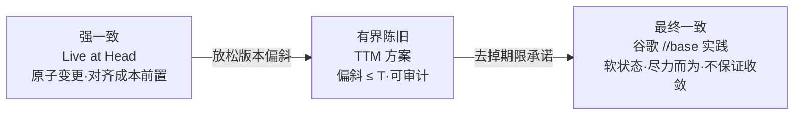
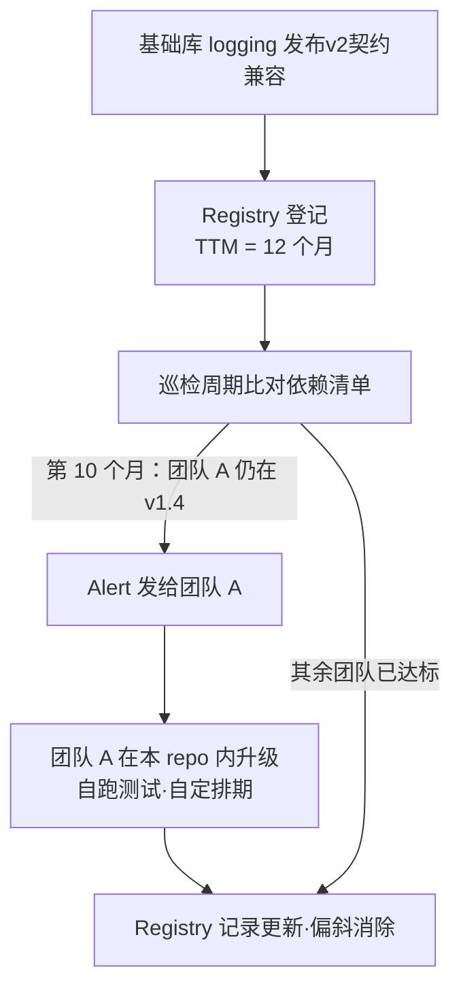
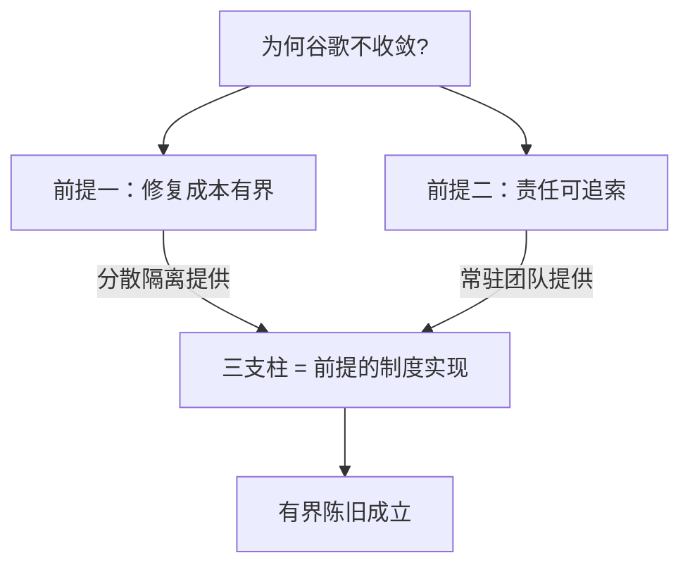

## 一、依赖治理是一致性问题

一个基础库发布新版本之后，数万人组织里的几百个调用方要不要立刻跟进、何时必须跟进——这个看似流程管理的问题，本质上是一致性问题：**系统是否允许各节点暂时处于不同版本（版本偏斜，version skew），以及偏斜被容忍多久。**

分布式系统的一致性光谱恰好提供了三个档位：

- **强一致（strong consistency）**：任何变更原子地传播到所有节点，不存在偏斜。代价是协调成本——每次写入都要等所有相关方确认。
- **最终一致（eventual consistency）**：允许偏斜，只承诺"没有新输入时终将收敛"，不承诺何时。收敛可能永远不发生。
- **有界陈旧（bounded staleness）**：允许偏斜，但偏斜有显式上界——最多落后 K 个版本或 T 时间。Azure Cosmos DB 把它做成了可选的一致性级别，位于强一致与最终一致之间。

用这个光谱定位现有的代码库治理模式，位置立刻清晰：

谷歌的 **Live at Head（源码级依赖）** 是强一致。在 One Repo（单一代码仓库）里改一个底层接口，所有下游调用点必须同步修改才能合入，代价是跨团队的政治对齐——审查委员会、合规围栏、无休止的宣讲会议（详见《[神话的黄昏](https://cj9208.github.io/blog/systems_and_governance/corporate/google-technical-bureaucracy/)》§一）。需要说明：强一致是 Live at Head 这一选择的性质，不是 One Repo 的必然属性——同一篇文章的附注一.4 记录了谷歌的实际演进：为了拆分底层库 //base，编译器专家用内联命名空间把版本号焊进符号名，让新老版本在同一个二进制里共存。这是软状态（soft state），是向最终一致方向的放松；但 //base 迁移历时数年至今没有迁完，古老的 `base::` 仍活在系统血脉里。**谷歌的实践落在最终一致档：允许偏斜，收敛无保证。**

本文提出的方案落在中间档：**TTM（Time to Maturity，成熟期限）依赖治理**。TTM 就是那个 T——基础包升级后，各业务方被允许落后的最长时间。它不是最终一致的修辞类比，而是把一致性级别做成了制度参数。

## 二、方案：TTM 异步分散治理

方案由三个部件构成：

- **分散**：一个业务一个 repo，repo 之间只有显式契约，禁止隐式源码引用；每个 repo 有常驻的负责团队，升级的爆炸半径被物理隔离锁在单个 repo 内。
- **TTM**：基础包发布新版本后，中央为这次升级设定收敛期限。期限按风险分级：常规升级一年，高危安全漏洞（CVE）七天。窗口期内各团队按自己的节奏升级，不要求立刻跟进。
- **Registry 与巡检**：中央 Registry 只记录元数据——哪个 repo、依赖哪个包、当前版本、期限何时到期。独立的巡检服务周期性比对依赖清单与 Registry 记录，发现超期或临近超期，向该 repo 的负责团队发 Alert。**中央全程不碰业务代码，不下达升级指令。**

用一个具体案例走完全流程：

团队 A 收到 Alert 后，升级工作完全在自己的边界内闭环：改自己 repo 的依赖声明，跑自己的测试，按自己的发布窗口上线。它不需要参加全局对齐会，不需要等中央排期，也不需要和其他三百个调用方协调。中央做的唯一一件事，是保证"落后超过一年"这个状态可见、且有人被通知。

治理与管理的边界由此划清：**中央只定义什么是健康的（规则），不指挥怎么变健康（操作）。** 团队收到 Alert 后按自己的优先级安排工作，全局基线安全与团队自治同时成立。

## 三、对比：好在哪

逐个对照现有模式的失效模式：

| 模式 | 版本偏斜 | 收敛承诺 | 账单收件人 | 典型失效 |
| --- | --- | --- | --- | --- |
| One Repo + Live at Head | 不允许 | 原子变更即一致 | 无账单（对齐税前置） | 对齐成本随规模发散 |
| 裸 polyrepo | 允许 | 无 | 无 | 永久漂移，安全债累积 |
| 谷歌补丁式放松 | 允许（例外通道） | 无 | 中央迁移团队 | 运动式迁移烂尾 |
| TTM 方案 | 允许，≤ T | 有界陈旧 | 依赖方团队 | 隔离不彻底时期限不可信 |

**对比 One Repo：免掉对齐税。** 强一致把协调成本前置到每一次变更——改一个接口要自证对几十个不相干团队无害。TTM 方案里不存在这个环节：契约兼容的升级由中央登记，各 repo 在窗口内自行消化，爆炸半径与协调半径都被锁在单 repo 内。One Repo 的完整批判见《[神话的黄昏](https://cj9208.github.io/blog/systems_and_governance/corporate/google-technical-bureaucracy/)》，此处不重复。

**对比裸 polyrepo：补上收敛力。** 去中心化自治最常见的死法是版本碎片化——各 repo 永远漂移，没人升级，安全债越积越厚，而且"谁该升级"这个问题没有答案。TTM 加巡检恰好补上这一环：漂移不再是无人知晓的默认态，而是有期限、有记录、有收件人的逾期状态。这是本方案与单纯拆仓库的本质区别。

**对比谷歌补丁式放松：账单开给依赖者。** 这是最锋利的一条差异。//base 迁移是运动式的：中央专项团队替全公司付账，推着几百个调用方迁移。《[神话的黄昏](https://cj9208.github.io/blog/systems_and_governance/corporate/google-technical-bureaucracy/)》附注一记录了它的终局——海勒姆定律（Hyrum's Law）咬人：广告计费系统依赖老库一个"非法输入返回空字符串"的 bug 做边界判断，清理老库等于炸掉现金流。调用方可以拒绝配合，因为代价在推动者头上；迁移团队只能妥协，数年迁不完。

TTM 把账单方向反过来：**窗口期内你不升级，到期 Alert 响的是你；如果你的代码依赖老版本的某个 bug，修复成本落在你自己头上——因为隐式依赖是你当年抄的近道。** 一年时间足够一个团队清理自己造的孽。谷歌迁不动，不是时间不够，是账单开错了人。

**契约同时约束上游：升级收益可验证、可拒收。** 反例仍是 //base：《[神话的黄昏](https://cj9208.github.io/blog/systems_and_governance/corporate/google-technical-bureaucracy/)》附注一.2 记录的环境寄生——那 5% 的服务器性能收益焊死在私有系统调用与硬编码路径上，收益与环境假设无法分离，下游连抱怨都无从提起：没有契约，"可靠"没有判据，抱怨没有对象。TTM 窗口给了下游一个验证期：拿 v2 对着契约跑，跑不过就是拒收的依据，抱怨是测试失败，不是对齐会议。这与"无豁免"方向相反——豁免是下游逃避义务，拒收是上游被问责；契约破裂的变更在入口已归入迁移类别，抱怨通道只处理契约内的质量回退。

由此还有一个自增强回路：抱怨需要判据，下游因此要求契约写明性能基准与验收标准；上游要让自己的升级免疫于抱怨，也主动把收益写进契约。**契约先行（Contract-First）从外部纪律变成双方的内生需求**——契约不再是合规文档，而是升级的结算凭证。这条回路同时让修复成本更有界：契约越丰富，隐式依赖越少，单团队能独立完成的清理越多，期限越可信。归属要说清：这是契约先行的红利，TTM 只提供让验证发生的窗口。

于是问题自然浮出：**谷歌也允许了版本偏斜，为什么它收敛不了，这个方案就能？**

## 四、收敛的两个前提

答案是两个前提。最终一致要真正收敛，必须满足：

1. **修复成本有界**：清理一处版本偏斜的工作，能在单个团队的边界内独立完成。
2. **责任可追索**：每处偏斜都有一个持续存在的、明确的负责者。

//base 标本同时死于这两种失效。其一是金额无界：《[神话的黄昏](https://cj9208.github.io/blog/systems_and_governance/corporate/google-technical-bureaucracy/)》附注一描述的"假底部"——日志模块隐式引用字符串切片，字符串切片绑定定制内存池，内存池报错又调回日志。你想清理一处依赖，拽出来的是几百万行底层代码的连环结，单个团队根本付不起。其二是收件人缺失：当年抄近道的极客早已离职，隐式依赖成了无主孤儿，追责找不到对象。**在蜘蛛网里，账单开给谁都一样，因为金额无界、收件人不存在。**

**公开先例站在前提这一边。** 窗口参数不是发明：[Windows Server 长期服务通道](https://learn.microsoft.com/en-us/windows-server/get-started/servicing-channels-comparison)按固定生命周期策略给 5 年主流支持加 5 年扩展支持，到期停安全更新；[Kubernetes 版本偏斜策略](https://kubernetes.io/releases/version-skew-policy/)允许 kubelet 最多落后 apiserver 3 个次版本，每个次版本约一年补丁支持。两者都是上游声明的有界陈旧，且都运转良好——因为两前提在客户侧天然成立：迁移成本锁在客户自己的系统边界内，客户就是唯一负责者。但它们的执行是退出式的：厂商停支持，客户自担风险。组织内部没有退出可用，执行必须换成问责式：偏斜可见、逾期有人被通知、账单付得清——这正是三支柱要补的那一环。

三支柱恰好是这两个前提的制度实现，它们是一条承重链，不是并列清单：

分散隔离让修复被锁在团队边界内（金额有界），常驻团队让 Alert 永远有收件人（责任可追索），TTM 让账单有到期日，巡检让账单可见。每一环都在修另一环的失效模式：没有分散，TTM 的期限不可信，Alert 沦为噪音；没有 TTM 与巡检，分散退化为裸 polyrepo 的永久漂移。**期限的慷慨程度，由隔离的彻底程度决定。**

到这里可以确认，这个方案与分布式系统的关系不是类比，是同构——每根支柱都有机制级对应物：

| 方案部件 | 分布式系统对应物 | 机制性质 |
| --- | --- | --- |
| 分散隔离 | 无共享（shared-nothing）分区 | 节点独占自身状态，跨节点只有显式契约 |
| 常驻团队 | 节点自治 | 状态修复在节点内部闭环 |
| Registry 元数据 | 状态声明 | 节点上报自身版本，系统只比对不指挥 |
| 巡检服务 | 反熵修复（anti-entropy） | 后台周期性比对修复分歧（Dynamo 用 Merkle tree），异步、不挡写入路径 |

"治理而非管理"不是管理风格偏好，是反熵机制的结构性质——它本来就在关键路径之外运行。同构的判据是失效模式与成立条件一起转移：反熵修复能工作，同样要求状态比对便宜（成本有界）、节点自治（责任可追索）。

两个推论随之成立：

**无需豁免阀。** //base 式的手术不需要在 TTM 制度内开例外——契约破裂的底层迁移与契约兼容的常规升级不是同一类治理对象，范畴边界在入口就分好了：重症走专项迁移，常规走 TTM。给常规制度装一个"重症豁免"阀，等于让每个团队都有机会声称自己是重症病人，豁免沦为古德哈特定律（Goodhart's Law）的逃逸口。窗口长度按风险分级（§二）是参数化，不是例外。

**组织版比机器版多一层。** 机器节点不会策略性违约，团队会。所以组织实现必须用成本归属与到期追索，替代"协议天然被遵守"这个机器假设——账单付得清、找得到人、逾期看得见，团队才有遵守协议的理由。这一层不是映射的破绽，而是方案里组织设计含量最高的部分。

## 五、市场收敛与规则收敛

《[生态式架构](https://cj9208.github.io/blog/ai_study/eco-architecture-ai-emd-evolution/)》提出的 EMD（Evolve Modular Design，演进式模块化设计）里，版本收敛由流量驱动：老版本调用率归零才自然死亡，是市场式收敛；TTM 的收敛由期限驱动，是规则式收敛。依赖升级域不能只靠前者——**安全漏洞不会等调用率归零。**

这条张力也标出了本篇在防御性进化系列中的位置：《[AI Coding 的防御性进化](https://cj9208.github.io/blog/ai_study/ai-coding-evolution/)》管空间隔离，《[文艺复兴](https://cj9208.github.io/blog/ai_study/linux-revival-ai-functions/)》管函数契约，《[生态式架构](https://cj9208.github.io/blog/ai_study/eco-architecture-ai-emd-evolution/)》管时间演进，本篇管治理节奏——控制面如何保证分散的系统仍然收敛。