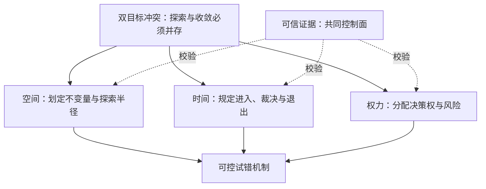
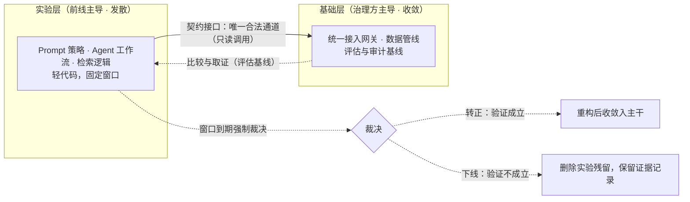
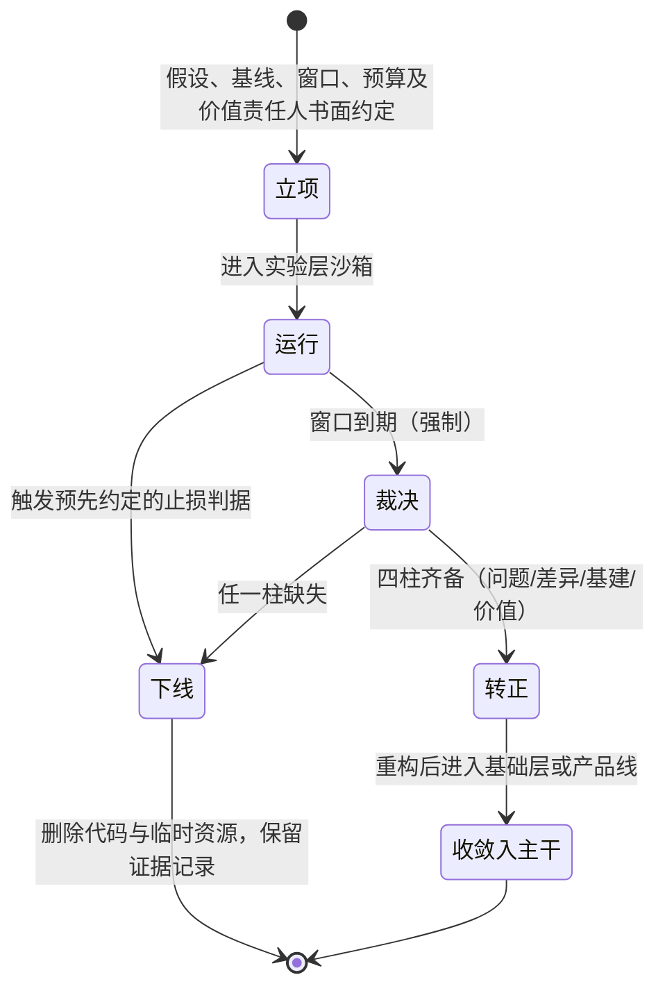

## 一、论点：确定性诉求与探索能力的结构性冲突

每当技术范式进入剧变期，组织内部都会浮现同一对矛盾：治理方要求先给出完备的架构蓝图，执行方要求先跑起来再说。移动互联网是这样，大数据平台是这样，如今的 AI 落地也是这样——AI 只是这一同型矛盾的最新标本，而非特例。

这对矛盾通常被叙述成"人"的问题：管理层不懂技术、保守、恋恋于 PPT；或者前线不计后果、乱堆技术债。本文的出发点是把这个叙述方式本身纠正过来：这是双目标冲突（dual-objective conflict）——治理方的目标函数是确定性、合规与长期维护成本的最小化，前线的目标函数是产品市场契合（PMF）验证速度与先机的最大化。两个目标函数在同一个代码库、同一份问责表上求最优解，冲突是结构性的，不是任何一方的认知缺陷。

命名的方式决定方案的空间。若矛盾是"人"的问题，解法只有说服与妥协，且每轮技术更替都要重新吵一遍；若矛盾是结构性的，解法就只剩下机制设计——了解约束、定义接口、建立反馈闭环。这是一个系统问题，就该用解系统题的方式解它。

解这道题只需要一个透镜：把双方看作同一个分布式系统里的两个进程。治理方进程维护不变量、收敛状态；前线进程生产候选信号、扩大探索。两个进程的冲突无法被消灭，但共存方式可以被设计——这正是后文全部机制的出发点。

## 二、矛盾的解剖：为什么两边都对

机制设计的第一步不是选边，而是分别把两边的诉求还原为其实际承担的职能。

管理层手里的"完备架构"未必是最优方案，却可承担风险定价与进度评估的共同坐标：预算可按架构模块配置，合规审计可按架构边界取证，事故责任可沿架构层次定位。这里的关键不是把蓝图当目的，而是让资源、风险和责任有可共同识别的边界；缺少这类边界时，这些职能会更难执行。反过来看，当架构入口无法收敛时，代价会落到日常运行中。[《实战诊断 —— 某企业 AI Platform 的正确蓝图与五重反模式解构》](https://cj9208.github.io/blog/ai_era_engineering_careers/ai-platform-blueprint-anti-patterns/)记录的便是这一类平台现象：Endpoint 分散后，成本分摊、权限与日志无法在同一入口收敛，每个团队被迫独立重解同一个问题，互耗工作量遂以 AIOps 的运营负担外化。它是共同边界失效的案例，而非管理层动机的证据。

前线所主张的"快速试错"，则承担发现机制与积累可选方案的功能。技术剧变期，预先蓝图对"什么方案真正有效"的预测能力会显著衰减，小成本实验因而成为获取信号的必要途径：下行可以被成本上限约束，而验证成立时的回报相对于单次试错成本可能显著更大。

项目尺度上，[《The State Machine of Technical Research: Balancing Exploration and Bounded Execution》](https://cj9208.github.io/blog/ai_era_engineering_careers/state-machine-technical-research/)刻画了两种单边失败：无限探索（高熵状态，永远在原型，永不交付）与过早优化（把完美执行的方案交付给一个并不成立的问题）。当求确定性与求发现的职能被塞进同一套日常规则，两类失败会在组织尺度彼此放大，并互相指责对方陷入对应的失败——这是双目标冲突在运行层面的具体形态。

因此，结论不是把组织硬切成互不往来的两半。两类职能不能共用同一套日常运行规则，却必须通过接口、迁移和裁决重新连接：操作上分离，机制上再耦合。要推导出的不是一句"隔离"，而是一套能同时保留探索与收敛的运行机制。

## 三、从双目标冲突到机制设计：四个不可省略的问题

把双方看作两个进程后，设计问题随之分解。两个目标函数不同的进程要安全共享同一个代码库、同一份问责表，不能靠折中口号，只能回答四个问题：允许什么变化，变化何时结束，谁有权作何种决定，以及凭什么相信这次决定。

| 必答问题 | 它排除的失败 | 对应的机制回答 |
| --- | --- | --- |
| 什么必须稳定，什么允许变化？ | 实验直接污染主干，或治理把一切冻结 | 空间边界：双域与契约接口 |
| 实验何时开始、结束和转正？ | 原型永久存活，或 demo 被误当资产 | 时间状态机：窗口、止损与状态迁移 |
| 谁能花钱、选择方法、承担不可逆承诺？ | 一方承担风险，另一方拥有全部控制 | 授权合约：决策权与风险的对应分配 |
| 什么观察可作为继续、下线或转正的依据？ | 事后争论、指标粉饰与裁决失信 | 审计日志：可复核的评估、成本与审计记录 |

前三项改变的是系统的权限、状态和权利；第四项不与它们并列替代，而是三者共同的控制面。没有边界，实验的风险无法封装；没有生命周期，边界内的试错无法退出；没有授权合约，机制得不到资源和执行权；没有共同证据，所有裁决终会退回权力争论。

这也解释了看似繁多的管理工具为何都只是局部答案。沙箱、统一 API 和特性开关主要回答空间；stage-gate 和项目排期主要回答时间；内部创新基金和预算上限主要回答风险分配；仪表盘只能提供证据。任一工具都不能替代其余三个问题的回答。

## 四、空间边界：以契约划定不变量与探索半径

四个问题从空间开始：什么必须稳定，什么允许变化。本文讨论的默认不是公司级分拆，而是同一组织内的系统级分域。只有当探索与交付在资金、资产和激励上也无法共用时，空间边界才可能推到公司级；那是极端形态，而不是普通组织应照抄的组织图。

在这个默认条件下，探索与交付必须共存于一家公司之内。可行的做法是把隔离从组织边界下沉为架构边界：在同一系统内切出两个运行域，各自使用不同的目标函数、评审标准与问责表。

| 维度 | 基础层（治理方主导） | 实验层（前线主导） |
| --- | --- | --- |
| 目标 | 确定性、合规、复用 | 验证速度、信息获取 |
| 内容 | 数据管线、统一接入网关、评估与审计基线 | Prompt 策略、Agent 工作流、特定检索逻辑 |
| 质量标准 | 高稳固、标准化、变更走评审 | 允许随用随抛的轻代码 |
| 生命周期 | 长期 | 固定窗口，到期强制裁决 |

这不是两个平行世界。演进式架构的要点不是预先完成一切实现，而是在最后责任时刻决定实现，同时及早固定最小的行走骨架与可演进接口。落到双域结构上，治理方只锁住不变量：身份与权限、数据出入口、成本归因、审计记录和契约版本；前线在接口之内决定假设、方法和实现。接口可以经版本化评审演进，但不应被每个实验随意改写。统一网关因此同时是治理方的成本与合规抓手，也是前线无需重复建设的依赖。这些不变量由市场、合同与监管先行给定——合规不是方案完成后再来验收的一项工作，而是提前排除不可接受选择的约束场；把它们编码进公共基础设施与接口契约，前线便能在不可协商的约束之内试错，而无须为每次探索重新发明合规。

隔离度的难点不在于把墙筑得越高越好，而在于界定可控的穿透路径。隔离过高，实验没有转正通道，双域退化为两个永久部门；隔离过低，实验代码与例外依赖不断进入主干，治理方最终只能收紧全部通道。实验层对基础层只读、只经契约接口调用，是合适的默认规则；一旦发现绕过契约，应先自动隔离影响面并留下审计记录，再判断是实验越界，还是基础层缺少必要能力。把每一次越界一律直接等同于项目整体下线，只会激励隐瞒，而不会提升边界质量。

## 五、时间状态机：让实验必然退出

双域隔离只解决空间问题，还欠一个时间问题：实验允许存在多久，结束后成果与残骸各去哪里。没有强制退出与沉淀路径的实验区，会逐步累积为第二个不敢删除的主干。

项目尺度上，[《The State Machine of Technical Research: Balancing Exploration and Bounded Execution》](https://cj9208.github.io/blog/ai_era_engineering_careers/state-machine-technical-research/)提供了探索与执行两阶段的状态机模板：探索期以脚本级原型充当传感器，待问题、差异与基建准备就绪后，才进入规格驱动的收敛执行。把这一模板制度化到组织尺度，就是让所有实验进入同一条生命周期；而既然讨论的是 AI 落地与 PMF，还必须加上第四根柱子——业务价值的验证及其承接责任。技术上更优的方案，并不自动等于值得进入产品主干的方案。

窗口期上限防止无限探索：到期必须裁决，而不是为项目发起人保留默认续期。预先约定的止损判据防止事后争论：成本越限、相对基线无改善、未能满足价值验证，或契约绕过未在限定时间内修复，都应触发下线评估。转正门槛则防止把跑通 demo 误当成可承重的资产：问题必须足够锐利，差异必须有相对基线的证据，数据与评估基建必须能接手，目标用户或业务责任人也必须确认其价值与后续承接。

门槛的松紧当然需要校准，但不能只看转正率或下线率。低转正率可能来自刻意押注高风险问题，低下线率也可能来自严苛的前置筛选。真正有意义的校准还要看裁决是否按期发生、单次实验是否守住成本上限、转正后是否兑现立项时宣称的差异，以及边界违规是否被及时暴露和修复。这些记录构成下一节所说的证据控制面。

## 六、授权合约：决策权与风险的对应分配

空间与时间说明了机制如何运行，仍没有说明谁有权让它运行。将这一层称为"向上叙事"会把问题缩小为说服技巧；它实质上是一份授权合约。治理方并非放弃控制，前线也并非获得一张不受约束的空白支票。双方交换的是不同类型的决定权。

| 决定 | 治理方 | 前线 | 业务／产品价值责任人 |
| --- | --- | --- | --- |
| 不变量与风险上限 | 定义权限、合规边界、预算和不可逆承诺 | 在边界内遵守 | 说明不可接受的业务风险 |
| 实验假设与方法 | 提供统一能力与审计条件 | 选择问题切片、方法和实现 | 确认目标用户、价值假设与观察窗口 |
| 继续、下线或转正 | 对超出风险上限或进入主干的承诺作裁决 | 提交可复核证据并执行结果 | 判断价值证据是否足以承接产品化 |
| 结果责任 | 对风险封装和基础能力负责 | 对实验纪律与技术事实负责 | 对采用、价值和后续运营负责 |

这张表的关键不在于新增一个委员会，而在于避免权责错位：治理方不应替前线决定每个实现细节，却必须拥有不可逆风险的裁决权；前线不应承担全部问责却没有窗口内的方法自主权；而若实验目标写作 PMF，业务价值也不能由技术指标单方面宣布成立。

此时，期权语言才有准确的位置。它是一个受边界约束的治理类比，而不是给项目估值的公式：可把每个实验视为一笔权利金明确的探索头寸，预算、算力、时间和可外部化的合规风险共同构成成本 K。只有边界确实有效，K 才能被封顶；成功后的价值 S 具有相对于单次权利金不对称且可能显著更大的上行。这个类比说明的是决策权为何必须与风险上限一并分配：治理方交出窗口内的微观控制，换回边界、预算、止损和主干准入的裁决权；前线交出可审计的证据与退出纪律，换回窗口内的执行自主权。

这里所称的路线图，也不应是一张假装预知未来的施工图。它给出当前认可的方向、骨架和复审节点，是双方都可据以行动、又可被每轮裁决更新的共同假设。所谓"完备"因此不再等于穷尽所有需求，而等于系统能以低成本吸收变化、删除失败并把成功纳入长期维护。

## 七、审计日志：可信证据作为共同控制面

边界、状态机和授权合约都不能只靠口头承诺。若实验发起人可以自行选择基线、解释结果并延后裁决，机制很快会退化为更精致的过程争论。可信证据的作用不是另造一套 KPI，而是让每一项权利、每一次状态迁移和每一笔风险都留下可复核的依据。

| 机制问题 | 最小证据 | 它服务的裁决 |
| --- | --- | --- |
| 边界是否被守住？ | 接口调用、权限、成本归因与审计记录 | 是否继续在实验层运行，或先隔离与修复 |
| 实验是否值得继续？ | 预先写明的假设、比较基线、窗口和实际成本 | 到期时继续、下线或调整问题 |
| 是否应转正？ | 相对基线的效果、稳定性与可复现性；基建接手能力；业务价值或采用证据 | 是否重构入主干并投入长期资源 |
| 授权是否被正确行使？ | 预算、例外、裁决人与理由的留痕 | 风险是否仍在已同意的范围内 |

证据必须在立项时就决定如何取得，而不是在结论出现后再挑选有利指标。它还必须足够轻量，使前线能真实记录，而不是再造一座以填表为目的的平台。最小可用的形式是一份实验记录：假设与基线、窗口与成本上限、允许的接口、价值责任人、最终裁决及其依据。失败实验删除代码和临时资源，但不删除这份记录；它是组织为下一轮试错留下的真实信息。

这样，校准机制才有可靠输入：裁决是否准时、成本是否受控、转正承诺是否在后来兑现、边界违规是否被发现与修复。若同一类实验反复越界，不应先归咎于执行者，而应检查接口是否过窄、预算是否失真、门槛是否把价值问题误判成技术问题。证据使机制能够修正自身，而不是在失效后重新回到"谁不理解谁"的叙事。

## 八、结语：组织与技术是同一道系统设计题

回到开头的命名问题，也回到那个透镜。管理层与前线不是两方需要被说服的敌人，而是同一个分布式系统的两个进程：一个维护不变量并收敛状态，一个生产候选信号并扩大探索。它们的冲突不会被消灭；真正可被设计的是冲突发生的边界、持续的时间、承担风险的权利，以及用来裁决的证据。

因此，本文保留的三件套不是任意挑出的好做法：空间上，双域与契约让变化不穿透不变量；时间上，生命周期让探索必然流向下线或收敛；权力上，授权合约让风险承担者与裁决者重新对应。可信证据横贯三者，使接口、窗口和裁决不只是被宣称存在，而是能够被检查、校准和更新。

这三层设计连同其证据控制面就位后，"完备架构还是快速试错"不再是每个技术周期都要重吵一次的路线之争。完备架构不再要求预知未来，快速试错也不再意味着逃避责任；两者被改造成一个已经划定边界、规定退出、分配权利并保留反馈的系统设计题。而系统设计题，才有可能被持续地解。

## 延伸阅读

**同一诊断的其它标本**

- [《约束、契约与博弈：从亚马逊、阿里到中国电网，看中台开发与业务定制的终极解耦》](https://cj9208.github.io/blog/systems_and_governance/corporate/constraints-contracts-game-theory/)：把中台与业务线的扯皮同样诊断为考核指标冲突而非立场冲突，解法同样落在契约与边界上；本文处理的是探索与交付这一对目标函数，并额外补上时间状态机与证据控制面。
- [《秩序与穿透：论治理体系中"合规"与"动员"的内在张力》](https://cj9208.github.io/blog/systems_and_governance/order-compliance-mobilization/)：治理域的同型冲突——追求结果正义的动员与追求程序正义的合规。它的破局路径"权责对称"对应本文第六节的授权合约，其"一放就乱、一收就死"的摆钟则对应第四节隔离过低与过高这两种退化。

**两边诉求的现实来源**

- [《重力回归：企业 ROI 约束与 AI '确定性账单'的控盘人》](https://cj9208.github.io/blog/ai_era_engineering_careers/gravity-roi-ai-deterministic-billing/)：解释治理方为何把确定性当成硬约束——Token 流式计费使预算沦为"账单盲盒"，签字权随之移交。本文第二节把"完备架构"还原为风险定价与进度评估的共同坐标，其财务机制在此。
- [《秩序之重：从系统演进看"变通"的代价》](https://cj9208.github.io/blog/ai_era_engineering_careers/order-and-system-evolution/)：解释前线的"变通一下"为何在规模下致命——误差级联放大、接口慢性腐烂、认知负荷破产。本文第四节"隔离过低"一支的技术机制在此。
- [《人治的重力场：企业同构、ACL 的破产与系统重构的死局》](https://cj9208.github.io/blog/systems_and_governance/corporate/rule-of-man-gravity-acl/)：提供探索价值的期权类比源头——持有廉价探索头寸的人，在范式相变时获得 V = max(S − K, 0) 的非对称收益。本文第二章只保留其结论（下行受成本上限约束、上行不对称），第六章把类比收敛为受边界约束的治理语言，用它解释权责交换，而非为项目估值。

**公司级组织分域**

- [《科学家退场与工程收权：Google 路线明朗化与 AI 产业的组织解耦》](https://cj9208.github.io/blog/systems_and_governance/corporate/google-scientist-exit-org-decoupling/)：讨论一种将探索与交付推至公司级分拆的极端个案；本文的默认解法仍是同一组织内以基础设施与契约划定运行边界。

**架构演进的对照**

- [《System Design Master Roadmap: Evolutionary Architecture & Complete Learning Blueprint》](https://cj9208.github.io/blog/ai_study/system_design/system-design-master-roadmap/)：从技术瓶颈解释架构如何逐级演进；本文关心的是在不确定性下，组织如何为这种演进配置探索窗口、风险边界与裁决机制。
- [《架构镜像：康威定律下的组织演化与系统设计》](https://cj9208.github.io/blog/systems_and_governance/conway-law-architecture-destiny/)：给出"系统架构投影组织沟通结构"的理论透镜——让探索与收敛两类进程共用一条沟通通道、一套评审标准和一份问责表，便会形成平台层被实验代码污染、实验层被架构评审扼杀的局面。这是本文第四节双域分域的组织学依据。
- [《The Trust Regime: Architecting Systems That Must Prove Themselves》](https://cj9208.github.io/blog/ai_study/system_design/trust-governance-regime/)：从 system design 视角论证合规是先行排除不可接受架构选择的约束场，而非事后验收；本文第四节把这一约束场落实到组织机制——将身份、数据边界、证据记录和控制点编码进公共基础设施与接口契约。
- [《The Coordination Regime: Conway's Law, Cognitive Load & the Platform》](https://cj9208.github.io/blog/ai_study/system_design/coordination-regime/)：把双域中的公共基础设施描述为平台队的产品，前线以 X-as-a-service 方式消费，协调开销付一次并摊销——解释双域为何能同时降低重复建设与认知负荷，但不构成边界真能生效的证明。
