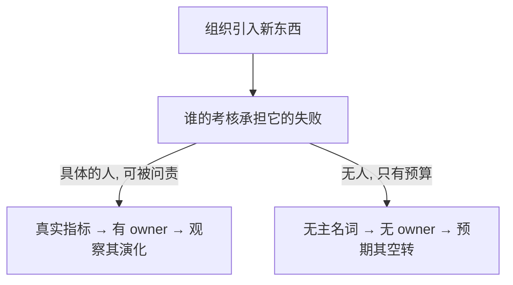
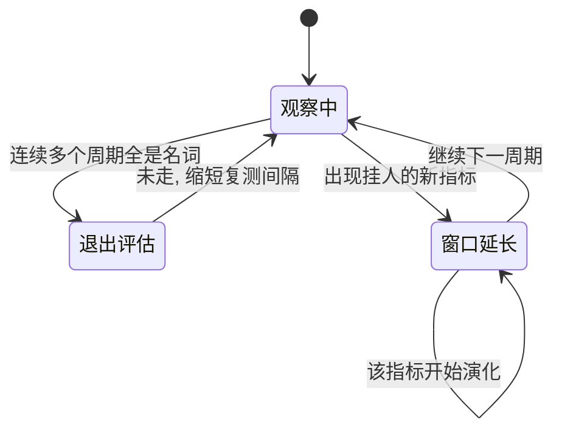

由理性的人组成的组织，为什么持续产出非理性的结果？多数回答停在"制度问题""人性问题"，太笼统。真正的缺口更具体：组织里的大多数"新东西"根本没有归属——有预算、有团队、有汇报，却没有一个人的得失押在它成不成上。本文把这个缺口做成一个能反复执行的判据。

## 一、判据：一件事有没有 owner

组织引入的任何新东西——系统、流程、平台、方法论、专项运动——在归属上只有两类：

**真实指标**：存在一个具体的人，他的考核承担这件事的结果，且他可以为失败被问责。这个人就是它的 owner。

**无主名词**：它有预算、有汇报、有专门团队，但没有人的得失与它的结果绑定。"能力建设""技术升级""数字化转型"是它的标准形态。

判据因此是一句话：**看这个新东西挂在谁的真实指标上，还是挂在名词上——换句话说，它有没有一个具体的 owner。** 归属决定存续：有 owner 的会演化，哪怕起步粗糙；无 owner 的会空转，哪怕起步精致。

它与古德哈特定律问的不是同一个问题。后者处理的是指标被选定之后如何被玩坏；判据前移一步，先问这个指标本身有没有一个 owner 把得失压在上面——没有 owner 的东西连被玩坏的资格都没有，它只是占据预算。

它当然有边界：只在预算与考核能同个人得失脱钩的规模上才成立——十人以内的小团队里谁扛什么一目了然，判据退化成常识，不必特地设立。

## 二、系统为什么只产生名词，不产生 owner

组织不是"没做好"owner 化这件事，而是**理性地不产生 owner**。根因只有一句：**真正的能力，收益无法被 owner 化。** 这里的能力，指那种要很久才见效、又很难算到某个人头上的东西——一套真正好用的系统、一支被练出来的队伍。它的收益长期不可测、归属也不确定：被培养的人会离开，出资方收割不到。而当它的 owner，却意味着把不可测的失败压进自己的考核，拿不到可测的好处。于是没有理性个体愿意去 own 它，组织在能力上的投入必然沉淀为只需按期花掉预算的名词。系统的目标函数从来不是"水平高"，而是稳定、可预测、可替换——那正是名词的属性，不是能力的属性。

一个"数字化转型办公室"最能说明这套机制：挂牌、配预算、配团队、配季度汇报，一切齐备。三年后问它做成了什么，答案是"推动了十余个试点""沉淀了一套方法论"——没有一条能追进某个人的考核。负责人换了两轮，办公室还在，因为它从不为失败付费，也就无从被裁撤。名词的典型生命周期正是如此：精致地开始，无人结束。

这一个根因向下生成所有熟悉的退化形态。烂系统没人 own 重构——每层只做局部最优、重构的失败无人敢认，于是它演化地烂下去而非被设计成烂。维持型、表演型、流程型工作没人 own 结果——它们的真实功能是维持秩序，是系统在生产自己的低效排泄物、再征用个体的健康去清理。AI 转型同样没人 own——AI 不修复激励错位、只会放大它，错位的考核一旦被自动化就空转得更快更贵。所谓"试点炼狱"，就是试点永远在跑却永远不收尾：没有任何人的得失要求它结束，于是一个个试点就这么堆着。而这里无人主观作恶：每个人都在做局部合理的选择，所有合理叠加成把人往下拽的结构。

收进物理语言：熵增指孤立系统自发走向无序，维持秩序必须持续注入能量。**无主名词正是熵增在组织里的日常形态——它有能量流入（预算），没有秩序流出（无人承担结果）。** 建一个好系统需要的能量必须由具体的人持续输入，而毁掉它只需要一句无人负责的话。owner 就是那个持续输入能量的人；系统不产生 owner，等于停止了负熵注入。这也是[《极简组织行为学与管理学概论：协议、博弈与系统的次优演化》](https://cj9208.github.io/blog/systems_and_governance/ob-management-overview/)那套系统诊断落到个体层面的一环。

## 三、你也成不了系统的 owner

顺理成章的下一步是：去当那个 owner。这条路在系统尺度上被堵死——堵死它的不是难度，是筛选。

成为一个 owner，需要四样东西同时在场：**站在真实问题上**（而非二手的、被转译的需求）、**有把它做对的判断力与专业路径**、**有让资源跟随判断的话语权**（它来自位置）、**扛得住失败反噬的政治生存**。最后一样其实是判据里 owner 的定义反过来读——owner 是"能为失败被问责的人"，所以能被问责而不被系统吐出，本身就是前提。前三样决定你做得对不对，第四样决定你还在不在场上。

缺任何一样，系统惯性都会把这个人拉回原位。而组织的筛选恰恰在这里做反选：位置（话语权）是它发给适应者的奖励，真会扛着反噬去动整个系统的人则被挤出局——适应者晋升，改变者出局。于是"系统无解"有了准确含义——**不是改变在技术上困难，而是筛选先于改变：能爬到位置的人被训练成不去动它，想动它的人又爬不到扛得住反噬的位置。** 四样联合出现、且指向系统级改动的概率极低。

理性策略因此必须降级：**从"选择或改变一个系统"，退为"检测并依附稀少的局部 owner"。** 这个降级不是妥协的修辞，而是稀少性的直接推论——既然这种局部 owner（负熵源）不可规划、不可招聘、不可制造，个体能管理的只有自己的暴露面：待在流动尚未冻结的位置，待在名词与真实指标的边界仍可辨的地方，待在失败代价仍有人在支付的小系统里。大结构不动，缝隙一直在动。

## 四、检测：个体唯一能重复的动作

降级之后剩下的动作是检测。[《存量陷阱与增量现实》](https://cj9208.github.io/blog/ai_era_engineering_careers/stagnation-vs-increment-career-choice/)给的职业筛选是一次性的——入职前判断岗位有没有核心业务域的定义权、扛不扛工业级高压流量；判据给的是进入系统之后、能按周期重复的那件事：

**本周期内，组织引入的每个新东西，最后挂在谁的真实指标上？**

两个灰区必须交代。其一，名词会伪装成指标：一个 KPI（关键绩效指标）写着负责人姓名，但要问"这件事失败了会发生什么"——若答案是削减明年预算而非问责任何人，姓名就只是署名，本质仍是名词；判据的实操变量不是名字，是**失败的代价由谁支付**。其二，混合态是常态：任何足够大的组织里名词与指标并存，检测器的输出不是"走或留"的一票，而是比例的趋势——名词占比持续上升，说明系统在存量方向上加速。

两点使用约束。它是低频工具：当成每日心态检查只会得到焦虑，按周期做结构观察才得到信号。它也只解决投向问题——判断投入该对齐哪里、撤离哪里；它不回答"知道该投向却做不成"的执行断层，那是另一个问题域。

## 五、依附：负熵源是稀少的局部 owner

检测要找的目标，是那份 owner 条件**恰好在一个人身上全部齐备**的罕见情形——**负熵源：站在真实问题上、有判断力、有话语权、且自己承担失败代价的人。** 他就是判据里那个"具体的人"的活体样本：他引入的任何新东西都挂在他自己的真实指标上，他自己就是 owner，所以每个动作天然带演化压力。

四样里，缺了政治生存的人早被筛选出局，你根本遇不到；所以在你能遇到的人里，前三样的组合决定他是不是负熵源——各缺一，就地降级为一种残留形态：有真实问题和判断力、无话语权，是**抱怨者**，说得对但没有支付结构让他做对；有话语权、无判断力，是**名词的生产者**，能量全部流入无主结构；有判断力和话语权、不碰真实问题，是**顾问**，正确但不落地。

识别是匿名的，不依赖名望与头衔。回到第二节那间数字化转型办公室：它之所以是名词，不缺预算、不缺团队，缺的是满屋子里一个把得失押上去的人。负熵源就是那个反例——别人都在讲"要建设什么能力"，他唯独问"这东西上线后谁的哪个数字会变"；试点拖到第三轮，是他拍板"停，这个不成"并为此担责。他谈新东西永远围绕"谁会用它、谁为结果得失"，而不是"这属于什么能力、什么升级"。

对待负熵源的正确动作是用足，因为他的窗口有限——话语权来自位置，位置来自更高层的耐心，窗口通常以他的离场告终。窗口内，个人投入应与他的真实指标对齐：借他负责的结构做端到端交付，在他支付失败代价的地方积累可迁移的能力。窗口关闭时，这部分资本随人走不了，但已长在个人身上。

负熵源也不是万能的，作用范围止于话语权所及：他不解决系统，只在自己那一块把退化顶回去；他离场后那块大概率回弹——局部改善无法温和地放大为整体改革。规模不大，方向是对的。也应诚实：这套方法不保证撞见任何东西，它的承诺是负面的——保证不再把个人资本持续投入已确认的空转结构。它是错误过滤器，不是成功引擎。

## 结语

你无法让系统产生 owner——筛选先于改变，把你我也挡在系统 owner 之外。剩下唯一能重复的动作因此不是控诉，也不是改造，而是检测：每一次新引入的东西，最后挂在谁的得失上。挂在名词上的，只会空转，避开；挂在某个具体的人的真实指标上的，是稀少的负熵源——撞见之后，先用足。

## 延伸阅读

**母框架**

- [《极简组织行为学与管理学概论：协议、博弈与系统的次优演化》](https://cj9208.github.io/blog/systems_and_governance/ob-management-overview/)：本文判据所属的系统诊断框架。

**相邻定律：判据与古德哈特的分工**

- [《终极的管理学悖论：当指标变成目标，便是灾难的开始》](https://cj9208.github.io/blog/systems_and_governance/goodhart-law-management/)：治指标被选定后如何被玩坏；判据前移一步，先问指标本身有没有 owner。
- [《指标的内爆与协议的重构》](https://cj9208.github.io/blog/systems_and_governance/goodharts-law-protocol-reconstruction/)：治已选的指标，给出成本硬编码等对抗设计；判据筛该不该有这个指标。

**系统退化链条的具体展开**

- [《组织如何筛选"高解题、零阻力"的人》](https://cj9208.github.io/blog/systems_and_governance/talent-screening-exam-culture/)：烂系统是演化而非设计——本文"局部最优叠加成全局次优"的筛选端。
- [《间断平衡：为什么庞大系统永远无法优雅地自我改良？》](https://cj9208.github.io/blog/systems_and_governance/chinese_government/punctuated-equilibrium-system-reform/)：庞大系统只能脆断式改革；支撑第三节"筛选先于改变"与第五节"局部改善无法放大"。
- [《为什么非科技巨头的 IT 注定搞不好？》](https://cj9208.github.io/blog/systems_and_governance/corporate/why-non-tech-giant-it-fails/)："自研屎山—外包危机—专家排异"五阶段摆钟，名词反复压垮指标的闭环标本。
- [《48 小时周均工时悖论》](https://cj9208.github.io/blog/systems_and_governance/48-hour-workweek-paradox/)：系统征用个体健康清理自身排泄物——"维持型工作是名词的投影"的度量端。

**AI 转型作为同一问题的新皮肤**

- [《实战诊断 —— 某企业 AI Platform 的正确蓝图与五重反模式解构》](https://cj9208.github.io/blog/ai_era_engineering_careers/ai-platform-blueprint-anti-patterns/)：某企业 AI 平台因构建路线错误退化成"工单接收器"——一个无人 own 结果的"转型"名词如何滑向低价值杂活的一线病例。
- [《重力回归：企业 ROI 约束与 AI '确定性账单'的控盘人》](https://cj9208.github.io/blog/ai_era_engineering_careers/gravity-roi-ai-deterministic-billing/)：只有确定性 ROI（投资回报率）被某人账本承接时才活得下来——"能力收益无法 owner 化"在 AI 预算上的样子。

**个体的选择压力**

- [《拒绝充当系统的缓冲垫：从"有意识伪盲"到"恶意合规"的组织博弈》](https://cj9208.github.io/blog/systems_and_governance/malicious-compliance-organization-game/)：适应者晋升、改变者出局，支撑第三节。
