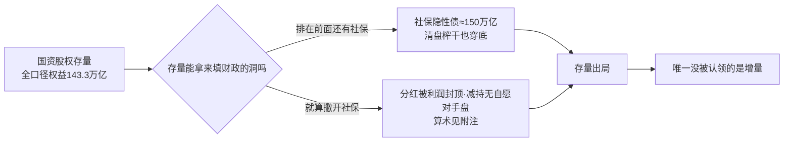
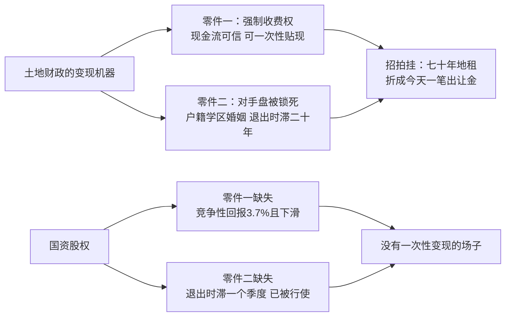
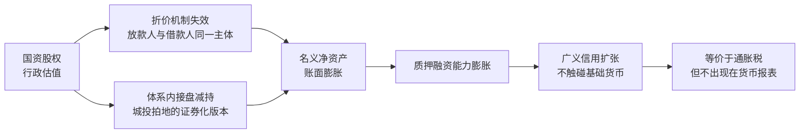

"股权财政接棒土地财政"这个提法近两年被反复提出。它的意思很具体：土地出让金坍塌之后，政府手里还有一笔庞大的国有资本股权——国资平台、政府引导基金直接或间接持有的企业股权——用它来填这个洞。说白了，就是从经营土地变成经营公司：过去卖地，现在当股东。

这个提法站不住。国资股权这条路其实是两问：手里那笔存量能不能拿来填，新的增量能不能造出来。存量先被一个排在财政前面的索取人——社保——认领出局；增量唯一拿得出手的成功案例是合肥，但合肥赚的不是股权差价，而且这套模式定义上不可复制。两问背后是同一个更深的缺口：土地财政之所以能"卖资产填当期财政"，靠的是一台把未来折成现值的变现机器——招拍挂把七十年地租一次性卖断；股权财政这台机器的零件都缺。

---

## 一、 土地财政的洞有多大

要判断股权财政接不接得了班，先得量清它要接的班到底有多大。国有土地使用权出让收入 2021 年达到 87,051 亿元的历史峰值，占地方政府性基金本级收入的 92.7%；此后连续四年下滑，2022 年 66,854 亿元、2023 年 57,996 亿元、2024 年 48,699 亿元、2025 年 41,518 亿元，2026 年 1 至 8 月为 13,753 亿元，同比再降 28.6%。**从峰值到 2025 年，一年蒸发的流量约 4.55 万亿元。**

这就是"股权财政"要接的班：一个每年约 4.55 万亿元、而且还在扩大的流量缺口——它曾占到地方政府性基金本级收入的九成以上。拿什么填？论者指向政府手里那笔庞大的国有资本股权。但在算它能不能填之前，得先盘清这笔资产究竟是什么。

---

## 二、 家底，以及排在财政前面的那只手

再看能填洞的资产有多大。按国务院向全国人大常委会提交的 2024 年度国有资产管理情况综合报告，截至 2024 年末，全口径国有资本权益是 143.3 万亿元——非金融国企 109.4 万亿（资产总额 401.7 万亿、负债 260.5 万亿、资产负债率 64.8%）加上国有金融企业 33.9 万亿。这是财政理论上能动用的存量上限。

| 项 | 规模 | 性质 |
| --- | --- | --- |
| 全口径国有资本权益（非金融 109.4 + 金融 33.9） | 143.3 万亿元 | 存量，财政能动用的理论上限 |
| 社保隐性债务（估算，见[《不清算的代价》](https://cj9208.github.io/blog/systems_and_governance/chinese_government/no-settlement-social-security/)） | 约 150 万亿元 | 排在财政前面的索取权 |

但家底雄厚是一回事，财政能不能动它是另一回事。得先问一句更根本的：**这笔存量，财政真的有权动用吗？** 排在它前面的还有一个更大的索取人——社保。[《不清算的代价：社保体制的系统工程博弈与反噬终局》](https://cj9208.github.io/blog/systems_and_governance/chinese_government/no-settlement-social-security/)结语算出的社保隐性债务（1997 版企业历史债放大到约 96 万亿，加 2014 版并轨债约 50 万亿）现值约 150 万亿元。两数对撞：**即便把全国的国企和国有银行全部原地清盘榨干，143.3 万亿的净资产也填不满 150 万亿的社保窟窿。** 国资这张底牌在撞上社保总账的那一刻就已经"穿底"——它是社保的储备，不是财政的活钱；财政排在这条队列后面，分红和减持变现还没轮到自己就已经被认领光了。

所以存量这条线可以就此打发：它要么被社保优先认领，要么——即便读者不认那笔 150 万亿的估算、假设存量可由财政自由支配——分红被利润总额封顶、减持变现找不到自愿对手盘，各自也都不够。这两笔的完整算术收在文末附注，作为一层不依赖任何社保数字的独立兜底。

---

## 三、 增量：合肥模式与它的两道坎

存量出局之后，"股权财政"论者手里还剩的只有增量这条线：用政府引导基金投出新的、值钱的股权，培育龙头、聚集产业链，再靠退出与税收获利。这是整个"股权财政接棒"叙事里唯一拿出过成功案例的部分，也是本节要集中拆解的对象。

招牌案例是合肥。媒体口径的三笔标志性投资（均为二手来源，只用于说明量级）：

| 项目 | 入局时点与背景 | 投入 | 退出与回报 | 留下的产业 |
| --- | --- | --- | --- | --- |
| 京东方 | 2008 年金融危机、京东方年亏 10 亿、无人敢投 | 联合社会资本 175 亿建 6 代线（当年合肥财政收入约 160 亿，暂停地铁项目），后续各代线累计投资超千亿 | 多次减持净收回超 140 亿元、回报率约 271%，至今仍持约 5.4% | 新型显示产值 1,467 亿元、190 余家上下游企业 |
| 蔚来 | 2020 年股价跌破 2 美元、现金流只够三周 | 70 亿战投换蔚来中国 24.1% 股权 + 总部落户，65 天签约；条款含优先购买权、反稀释权、赎回权（8.5% 复合年利率） | 三次回购累计套现约 105 亿、本金全回、净赚约 35 亿，仍持近 8% | 总部落户与全国第一的新能源汽车产量 |
| 长鑫 | 2016 年 DRAM 被海外垄断、国内产能近乎为零 | 一期 180 亿中合肥国资出 144 亿、占 80%；此后十年长鑫累计亏损 366 亿，合肥不撤资、持续加码 | 2026 年 7 月上市，市值 3.28 万亿元，合肥持股约 36.79%、账面浮盈超万亿——**锁定期内，尚未变现** | DRAM 国产产能 |

**先问最关键的问题：合肥赚的到底是什么钱？** 复盘三笔投资的公开记录，合肥模式赚的不是风投差价，而是产业集群的系统收益——资本退出的账面回报、产业链落地后的税收与就业、土地与配套资产的增值，三层叠加，单一项目的波动被系统对冲；用业内的话说，它不是赌企业，是买产业链。把这个透镜架上三笔投资：京东方留下的 1,467 亿产值与 190 余家配套企业、蔚来换来的总部落户与全国第一的新能源汽车产量——回报主体都是税基和产基，股权退出只是入场工具，落袋收益再循环进新基金。蔚来那笔干脆把债性写进了条款：8.5% 复合年息赎回权，名为股权，实为带对赌的债。而长鑫的万亿浮盈锁定期内不能卖——账面富贵没有变现出口，与附注里国资股权减持变现的困境同病。

所以合肥不是股权财政的反例，而是本文命题的又一次验证：**所有走得通的模式，回报主体都是税与产基；所有自称股权的模式，其股权部分要么锁定期内卖不掉，要么赚的是债的利息。** 这与 §四 将要给出的结论是同一个不变量：能定价的那部分之所以能定价，恰恰因为它不是股权而是税。

看清楚合肥赚的是什么钱之后，真正要回答的问题是：这个模式能不能被复制到全国，去填 4.55 万亿的洞。两道坎都过不去。

**第一道坎是期限错配：洞是当期的，回报是十年期的。** 长鑫一笔就足够说明问题——十年间标的累计亏损 366 亿，政府不撤资反而加码，靠的是用当期财政收入硬扛。京东方的版本同样如此：暂停地铁投面板，是把本应当期使用的财政资金锁进十年周期的产线。VC 的 J 曲线前段只有现金流出，而财政的洞逐年兑现——用短钱养长资产，这恰恰是城投刚刚死过一次的病，引导基金让它在财政层面复发。合肥扛得住十年 J 曲线，不是因为它比别的城市更会投，而是因为它是幂律分布里的幸运尾部：半导体、汽车、光伏上，大量城市下了同样的长注，绝大多数在十年周期里亏损、停滞或变僵尸，我们只看到合肥，是因为输家不出年报。可即便如此，把量级摆出来仍然刺眼：合肥最被称道的股权回报——蔚来十年净赚约 35 亿、京东方历次减持累计净收回超 140 亿——合起来不过百亿量级，这已经被当成全国典范写进了教科书；而缺口是 4.55 万亿/年，约合每天 125 亿，一个赌对三次、用了十年的标杆城市，股权端的全部落袋回报还填不上全国缺口的两天。要靠股权财政接班，得让大约 260 个合肥把各自十年豪赌的成果凑到一起，才够填一年——而下一道坎会说明，合肥模式定义上不可复制，根本凑不出 260 个。时间与规模两个维度同时不成立。

**第二道坎是囚徒困境：反共识的超额收益，被复制的那一刻就死了。** 合肥的回报来自市场无人敢接时的下注时点——2008 年的京东方、2020 年的蔚来——这是位置性的收益，它的存在以别人不这么做为前提，定义上不可复制。而当几乎所有工业城市都把新能源汽车当重点招商方向、以土地税收优惠加基金入股争夺同一批项目时，补贴就资本化成了全行业的过剩产能，价格战把利润率打穿：汽车行业利润率从 2021 年的 6.1% 降至 2025 年的 4.1%，为 2015 年以来最低，低于规模以上工业企业 5.31% 的平均水平，2025 年 12 月单月 1.8%、2026 年一季度 3.2%；汽车制造业产能利用率 2025 年约 73%、2026 年上半年降至 70.6%，跌破 75% 的健康线；新能源汽车规划产能超 3,000 万辆，实际需求不足 1,500 万辆。新势力最火的时候，全国有超过 50 家新势力车企，背后站着不同的地方。半导体正在重演同一剧本：国家集成电路产业投资基金三期规模 3,440 亿元创历史新高，各地半导体产业园与地方基金蜂拥而入——同一个机制在新能源汽车上已经跑完一遍，没有理由认为它在半导体上会失效。

这里还嵌着"退出权"这条主线（§四 展开）的又一次显形：**市场出清过剩产能靠破产，而政府扶持的项目不能破产。** 这本是 VC 的幂律天性——一篮子失败靠一个赢家的超额收益覆盖，而它能自我纠错，前提正是输家被允许死掉；政府引导基金拿到了 VC 的下行，却拿不到 VC 的出清。退出权缺失不仅杀死定价，还杀死了选择机制——过剩产能不出清、变僵尸，各地基金只能续命摊大饼。2026 年 1 月工信部、发改委、市场监管总局三部门联合召开新能源汽车企业座谈会、要求抵制无序价格战，行政干预从喊话升级到动手，恰恰说明出清已被行政持股锁死。合肥模式以别人不做为前提，而当所有城市都学会合肥，它的死法不是"学不会"，是"人人都学会"。

这层幸存者偏差不动摇上面的结论，反而与它同向：无论合肥是真本事还是窗口期的运气，它赚的都是税基与产基。而合肥的账本本身也不是干净的：2024 年末政府债务余额 2,749.8 亿元、窄口径债务率 176.1%，虽是安徽最低，"最低"不等于"没有"。模式成功与债务可控在合肥同时成立，恰恰说明它是一座城市在特定窗口期的集中豪赌，不是一台可以装进每个财政体的机器。

---

## 四、 股权财政缺了变现机器的两个零件

存量与增量两条路都走不通之后，"股权财政"这个提法还剩下什么？剩下的部分确实能变现，但看清它为什么能变现，恰好解释了国资股权为什么不能。

先复盘土地财政的机器。政府卖的不是土地，是未来七十年的强制收费权（地租），而招拍挂是一台把这笔未来一次性折成现值的机器。机器能转，靠两个零件同时存在：**零件一是现金流可信**——收费权是强制的，居民不买地也会租房、也会买东西、也会被征费，所以七十年的流量可以刚性预测、可以贴现；**零件二是对手盘被锁死**——户籍、学区、婚姻把整整一代人押在场内，退出时滞二十年，所以每一场招拍挂都拍得出去，而且拍得出高价。土地财政"撑了二十年"的全部秘密，就是这两个零件的乘积。

国资股权两个零件都缺。现金流端（零件一）：竞争性行业的经营回报，利润/权益比仅约 3.7% 且方向朝下，没有人敢按七十年贴现，所以"卖断未来"这个动作在资产端就不成立。对手盘端（零件二）：居民已经用存款流向、房贷余额和养老金仓位三次拒绝（见附注），而土地财政从来不必担心买家缺席。两个零件缺任何一个，变现机器都转不起来——而零件二为什么缺得这么彻底，要把"退出权"讲透。

赫希曼在《退出、呼吁与忠诚》中区分了 Exit 与 Voice，而[《禁止交易，怎会有准确定价？——从金融"价格发现"看微观博弈如何拯救社会规则》](https://cj9208.github.io/blog/systems_and_governance/chinese_government/no-trading-no-accurate-pricing/)正是用这个框架论证退出权如何倒逼规则纠偏——没有退出权的呼吁是苍白的，允许微观套利才能把坏资产打回原形。那篇文章的结论是应当赋予退出权。本文的结论方向相反，但用的是同一个概念：**正因为居民手里真的握着退出权，股权财政才做不成。** 关键在于退出权有强弱之分，判据是时滞与刚性，而非有无：

| 维度 | 土地财政 | 股权财政 |
| --- | --- | --- |
| 供给端 | 政府垄断土地一级市场 | 政府垄断国资股权 |
| 需求端绑定 | 户籍、学区、婚姻、生存必需 | 无绑定，完全可选 |
| 退出方式 | 不生育、躺平、断供 | 不买、持有存款、提前还贷 |
| 退出时滞 | 约二十年（跨代生物学） | 一个季度（当期金融） |
| 退出成本 | 极高（征信惩戒、烂尾楼绝不清算） | 近乎零（合同本身允许提前还贷） |

土地财政的需求端被锁死了整整一代人：一个人可以决定不买房、不生育、不参与，但这个决定要二十年后才在财政账本上显形，在此期间他仍要吃喝拉撒睡、仍要为孩子买学区房。系统因此能在一代人的时间内无视这张否决票——招拍挂每一场都拍得出去，因为买家被生存刚需押在场内。而这张慢票已经投完了：出生人口逐年下滑、总人口转为净减（逐年数见数据来源），[《弹性威权的套利终结》](https://cj9208.github.io/blog/systems_and_governance/chinese_government/elastic-authoritarianism-arbitrage/)§4.2 称之为"基因的拒绝生育"。

系统现在想在同一个居民部门身上启动第二个融资引擎。区别在于，第二个引擎面对的是一张快票：退出时滞一个季度，退出成本近乎为零，需求刚性为零——没有任何人必须买股票。**土地的招拍挂有对手盘，是因为对手盘被锁死；股权找不到对手盘，是因为没有人被锁死。**

何况第二个引擎是在第一个已经违约的前提下启动的。烂尾楼绝不清算、养老金个人账户空账、社保历史欠账被追溯性倒查，构成了一连串完整的违约演示；[《社会契约的异化》](https://cj9208.github.io/blog/systems_and_governance/social-contract-exploitation-path-dependence/)给出了机制——信任是未被计价的无形公地，透支远期信用换即时绩效缺乏内生约束，一旦远期回报率转负，个体就退场。所以在土地已经违约的前提下转向股权，第一步得先修复信任，否则没人参与；而信任宣布不出来，它取决于那笔违约有没有被实质清算。[《弹性威权的套利终结》](https://cj9208.github.io/blog/systems_and_governance/chinese_government/elastic-authoritarianism-arbitrage/)§4.2 的三大不对称罢工——资本拒绝投资、民众拒绝消费、基因拒绝生育——在此序列上补上第四条：**拒绝入股。**

剩下的例外恰好验证了这条规则。公募 REITs 是市场上唯一以真实现金流为定价基础的证券化通道（高速公路过路费、水电燃气费、产业园租金），它不必依赖散户情绪，**因为它携带了零件一：强制性收费权。** 能定价的那部分之所以能定价，恰恰因为它不是股权，是税——但截至 2026 年 9 月，全市场总市值仅约 2,322 亿元，相对 4.55 万亿的年缺口，量级上不构成替代。

"股权财政"这个提法的错误至此可以说清了：它把两类资产混为一类。一类有强制现金流因而可定价、可证券化，但规模有限——这是税的证券化，与土地财政同构；另一类规模巨大，但既没有可贴现的现金流、也没有被锁死的买家——这是股权的行政化。把两者打包在同一个词里，就产生了"股权财政可以接棒土地财政"的错觉。土地财政从来都是税的另一种形式（对土地使用权的强制征费），它与 REITs 同构，与国资股权不同构。连国资体系里最赚钱的烟草、石油，赚钱靠的也是垄断收费权而非经营能力——国资里能撑起财政的那一小块，本来就不是股权收益，是税。

---

## 五、 系统实际在走的那条路

如果股权财政从未真正在候选名单上，那系统实际在做什么？

**中央加杠杆置换地方债务。** 2024 年 11 月 8 日全国人大常委会批准增加 6 万亿元地方政府债务限额，2024 至 2026 年每年安排 2 万亿元置换隐性债务，另连续五年每年安排 8,000 亿元新增专项债用于化债；实际发行为 2024 年 2.00 万亿元、2025 年约 2.0 至 2.13 万亿元、2026 年 1 至 9 月 1.90 万亿元。超长期特别国债 2024 年 1 万亿元、2025 年 1.3 万亿元、2026 年 1.3 万亿元（已于 2026 年 10 月 16 日发行收官），另有 3,000 亿元特别国债用于补充大型商业银行资本。这条路的技术特征是：把地方隐性债务搬到中央资产负债表上，用中央信用替换地方信用，用长期限替换短期限。它不解决存量问题，只是把偿还时点后移。

**而它之所以能走通，是因为它根本不需要市场——它就是附注里那笔左手倒右手，只是从股权科目换到了债务科目。** 置换债的买家是国有银行体系：国家作为借款人发行债券，国家作为放款人（国有银行的最终所有者也是国家）承接债券，交易双方在终极资产负债表上是同一个主体。钱从体系的左口袋进了右口袋，账面上完成了"地方隐性债务的化解"，经济上没有一笔储蓄被自愿动员进来——这就是变相放水的债务版本。它与附注里抵押品虚增的区别只在记账科目：那边膨胀的是股权估值，这边膨胀的是中央信用。要说摩擦面，得先分清它长在哪一端。**承接端是锁死的**：国有银行不能拒绝，这一端的退出时滞是无限长——这是行政给定的条件，不是市场行为。**定价端不是没有摩擦**：置换债毕竟有票面利率和公开期限，利率信号可见，央行对收益率曲线的干预、汇率、外储对本币主权债务的约束，都是这个信号的实际承载面——比附注里那个连摩擦面都不存在的抵押品虚增多出一层。但只要承接端被行政锁死，这些信号就不承载出清压力，只决定显形的速度与形式，不改变方向：体系内债务不可能被体系外的现金偿还，终局仍是永续滚动、违约、或以通胀税结算三条路。

所以置换债不是对本文框架的反例，而是附注里那个判断的第二次验证：**体系内成交，科目随便换，经济实质不变——都是变相放水。** 反过来说，它也是财政在减持变现走不通之后实际走通的唯一一条路：不是把资产卖给自愿的人，而是把负债压给自己的另一只手。

至于面向居民的融资端，系统仍在做附注里描述的那件事：发行加速、出清停滞、进出比持续恶化，负反馈环每转一圈，自愿对手盘就再薄一层。

于是可以得到一个诚实的落点：**股权财政不是一个被否决的方案，是一个从未进入候选的方案。** 系统实际在做的是中央加杠杆置换地方债务，这恰好印证了[《社会契约的异化：过度开采与控制的路径依赖》](https://cj9208.github.io/blog/systems_and_governance/social-contract-exploitation-path-dependence/)§三的路径依赖判断——在重塑契约（路径 A）与加码控制（路径 B）之间，系统会稳定地选择即时阻力最小的那一条。阻力最小的定义在这里可以写得很具体：**不需要对手盘自愿的那一条。**

---

## 结语、 存量与增量，一个都走不通

回到开头。国资股权这条线是两问：存量能不能拿来填，增量能不能造出来。存量先被社保认领出局（143.3 万亿的权益填不满约 150 万亿的隐性债务，且即便撇开社保，分红与减持变现也各自不够）；增量不死在算术上，死在时间尺度与博弈结构上——远钱解不了近渴，而反共识的豪赌一旦被全员复制，就变成把全行业利润率打到十年新低的补贴竞赛。两条路都走不通，所以**股权财政不是一个被否决的方案，是一个从未进入候选的方案。** 系统实际在走的，是中央加杠杆置换地方债务：把地方隐性债务搬上中央资产负债表，用中央信用替换地方信用，把偿还时点后移——同一笔左手倒右手，只是从股权科目换到了债务科目，没有一笔储蓄被自愿动员，终局仍是滚动、违约或通胀税三选一。

土地财政撑了二十年，是因为它有一台变现机器：强制收费权让未来可信，被锁死的买家让贴现价成立，招拍挂把七十年折成一个下午。股权财政两个零件都缺，所以它撑不过一个季度——它的否决票当季就能投，而且已经在投。

这也是为什么"重塑信任才是关键"不能作为一个呼吁来结尾。在这个框架里，信任不是氛围或叙事，而是**退出权是否被行使的可观测状态**，只能通过改变它背后的底层条件来改变——实质清算、双向价格发现、国资收益的让渡，而这些都要既得利益让渡，即[《社会契约的异化》](https://cj9208.github.io/blog/systems_and_governance/social-contract-exploitation-path-dependence/)所说的路径 A。在那之前，系统会继续走它唯一走得通的路：把负债压给体系内的左手，把价格定给不存在市场的地方，把成本留给还没有读数的时间。

---

## 附注、 分红与减持变现：即使不考虑社保划转，存量也不够

正文用“社保的优先索取权”一句话就打发了存量这条线：全口径 143.3 万亿的国有资本权益，连[《不清算的代价》](https://cj9208.github.io/blog/systems_and_governance/chinese_government/no-settlement-social-security/)算出的约 150 万亿社保隐性债务都填不满，财政排在社保后面，根本轮不到它靠分红、靠减持变现来填洞。但那个 150 万亿是一笔杠杆化的估算，读者尽可以不认。所以本附注把分红与减持变现这两笔的算术原样保留在这里，作为一层不依赖任何社保数字的独立兜底：**即便完全撇开社保划转、假设其中非金融那 109.4 万亿可以由财政自由支配（金融的 33.9 万亿另被锁死，下面会讲），分红和减持变现也各自不够。** 分红被利润总额的流量上限锁死，减持变现被对手盘的缺席锁死——下面三节是完整推导。

### 分红：算术否决

国资收益进入财政只有一条路：**国有资本经营预算调入一般公共预算。** 这一点必须钉死，否则"用手里的国资填洞"会被误读成还存在另一条更大的通道——划转给社保基金的那部分股权，其分红进入社会保险基金预算，专款专用，不能调入一般公共预算。这恰好从收入端印证了正文 §二 的判断：社保是排在财政前面的索取人，连已划转那部分的分红都进不了财政，何况存量本身早被社保的窟窿认领。所以下面要算的分红天花板，已经是财政这条轴上的全部。

**先把对手最强的版本摆到桌面上。** 若不分口径、把全部国有资产（含金融）产生的名义利润总额都算作财政的潜在来源，账面上确实够到缺口的量级：非金融国企 2025 年利润总额 4.04 万亿元，仅六大行 2024 年归母净利润就有 1.4 万亿元，全口径金融国企的利润更大，两者相加明显超过 4.55 万亿元的缺口。单看这个静态总额，"股权分红填坑"似乎并非不可能。但这个"够"既是账面的、也是正在消失的，下面分三步拆掉它。

**第一步，它是一个缩着的天花板去追一个张着的洞。** 缺口那一端在快速扩大：土地出让金 2026 年 1—8 月同比再降 28.6%，流量缺口逐年张大。利润那一端在连续收缩：2025 年非金融国企利润总额同比 −6.3%，2026 年 1—2 月再降 2.0%，方向未改。两端相向而行，而且不对称——洞张大的速度远快于天花板收缩的速度，那个"账面够到"的交点只会更快消失。静态总额之所以还能超过缺口，靠的是拿某一年的利润去对某一年的缺口，而这个对比本身正在逐年恶化。

**第二步，这个账面总额落到财政手里，要先被砍掉金融那一整块。** 还有一本账必须在此钉死，否则会被一个流行的反问击中：**"银行那么赚钱，利润占上市公司近一半，为什么算不进来？"** 不是不想算，是抽不出来。这 1.4 万亿是归母口径，国资按持股比例实际可得要打六七折；更被资本充足率锁死——银行利润留存是为了支撑信贷扩张，抽走利润等于收缩信贷，而系统 2024 年反而安排 3,000 亿元特别国债给大行注资（见正文 §五），一边想抽、一边在注，说明这批利润早被预定为逆周期工具，不是自由现金流；再叠加央地归属的分割，金融国企对**一般公共预算**分红通道的贡献接近于零。于是出现一个精确的倒挂：**账面回报最高的部分，恰是被锁得最死的部分。** 第一步让步里那个"含金融的名义总额"，金融这一块落到财政手里时几乎是零，所以下面的算术只在非金融口径上做——这不是回避，而是那本账本来就独立成轴。

**第三步，就算撇开金融、只在非金融口径上把上缴比例拧满，也不够。** 先看现状：这条天花板其实已经顶到了头。2025 年全国国有资本经营预算收入 8,547 亿元，同比增长 25.8%，其中调入一般公共预算 5,741 亿元，调入比例 67.2%，两项均创历史新高。同期财政部已将中央非金融全资央企的税后利润上缴比例分档提高至 35%、30%、20% 与免收四档，烟草、石油等资源型企业适用 35% 顶格。以利润总额为分母，实际分配率约 14%（5,741 ÷ 40,380）。

现在做一道反事实算术：**把上缴比例从 14% 一路拧到 100%，会发生什么？** 全部非金融国企利润总额是 4.04 万亿元/年，缺口是 4.55 万亿元/年。也就是说，即便让全国所有非金融国企把每一分利润总额都上缴财政，仍然不够填。还要说明，这个 4.04 万亿已经是**上限的上限**：利润总额与财政真正能拿走的钱之间还隔着所得税、少数股东损益和法定公积金提取，能上缴的只是归属国家所有者的可分配利润，比利润总额更小；而且天花板本身是移动的——分红率拧向 100% 会抽干国企的再投资，压缩未来的利润基数。分红通道的失败不是"拧得不够紧"，是**按最宽松的口径拧断了也不够**——它被一个算术上限锁死，与政策力度无关。

为什么利润总量这么小？把国资当成一个投资组合来看：以 2024 年末国有资本权益 109.4 万亿元为分母、2025 年利润总额 40,380.5 亿元为分子，账面利润/权益比约 3.7%——分子用的是税前利润总额而非净资产收益率口径的净利润，真实的权益回报率比 3.7% 更低，这里同样只取量级。这个比值低于名义 GDP 增速，且方向朝下（第一步已给出 −6.3%、−2.0% 的连续降幅）。持有这批股权，等于持有一只**票息低于名义增长、还在降息的股权**。这里的 3.7% 是**全口径非金融国资**的平均，池子里既有上市国企，也有大量未上市的中小地方国企。上市国企是这个池子里质量最高的部分——而全口径平均仍只有 3.7%，也就是说，这个数字已经是把最好的部分掺进去之后的结果，"最好的一批"拉不动全池子的回报。

还有一个更微妙的结构问题：最赚钱的那部分国企——适用 35% 顶格上缴的烟草、石油等资源型企业——其利润来源不是经营能力，而是垄断收费权。这意味着国资体系里真正能产生"财政级"现金流的部分，性质上是税而不是股权收益。正文 §四 已把这一点与土地财政合并成同一个命题。

分红是唯一不依赖交易对手的出口，因此也是唯一不需要市场的出口。它能付息，不能还本。要突破算术上限，只剩减持变现这一条路，而它的每一种写法都需要一个对手盘。对手盘只有两种找法：自愿的，和体系内的。下面两节分别处理。

| 项 | 规模 | 时点 | 性质 |
| --- | --- | --- | --- |
| 国企利润总额（不含金融） | 40,380.5 亿元（−6.3%） | 2025 | 流量，分红的算术上限 |
| 六大行归母净利润 | 14,015 亿元（股东权益 15.57 万亿元，ROE 约 9%） | 2024 | 流量，账面最高但非财政可动用 |
| **账面利润/权益比（估算）** | **约 3.7%** | 2024 末权益 × 2025 利润总额 | 全口径非金融平均，分子为税前利润总额（非 ROE 口径），低于名义 GDP 增速 |
| 国有资本经营预算收入 | 8,547 亿元（+25.8%） | 2025 | 流量 |
| 其中调入一般公共预算 | 5,741 亿元（调入比例 67.2%） | 2025 | 流量，历史最高，实际分配率约 14% |

### 减持变现·对手盘之一：没人自愿接

第一种写法是减持给自愿的买家。"股权财政"论者通常先假设卖的约束不存在，转而引用中美居民资产结构的对照来论证空间：按《中国金融》2026 年第 8 期的口径，2025 年末中国居民金融资产中存款占 53%、股票占 12%、公募基金占 6.7%、理财与信托占 13%、保险占 10%；美联储 Z.1 数据显示 2024 年美国居民的现金存款占 11.2%、股票与基金占 55.3%、保险与养老金占 27.8%。中金公司测算，美国房产占居民总资产约 30%、权益类超过 53%，而中国房产占比已从 60% 以上降至约 52%—55%。以股票类占比计，潜在空间约 4.6 倍。

这个空间的隐含承诺是：它可以被"发展"出来，只要资本市场做对了什么，居民就会自愿把财富从不动产和存款切换到股权，承接国资的存量与增量。但空间存在与空间可达是两个命题——这个假设已经被数据否决，而且否决的方式比"不参与"更精确。

**否决分两层，一层比一层致命。先看资产层——问题在这批标的本身：这批股权撑不起"增值"叙事。** 居民的换仓决策是对回报率的定价，不是对政策的表态。本附注上一节已经算过，国资组合的利润/权益比仅约 3.7% 且方向朝下；一家利润在下滑、回报跑输名义增长的公司，其股权的"增值收益"没有基本面来源，只能来自下一个买家出更高的价——这是博傻结构，不是贴现结构。"居民财商不足"解释不了为什么他们能精确地把钱配置到固收端；"认知滞后"解释不了为什么在指数上涨 18% 的次年，增量资金依然绕开股权。**居民不是拒绝金融配置，是精确拒绝股权这一个资产类别。**

**再看市场层——这一层更致命，问题不在标的而在场子：就算换一块优质国资来卖，A 股作为一个融资市的定位本来就给不出正回报。** 融资市结构持续朝融资端倾斜：IPO 家数从 2021 年的 522 家降至 2024 年的 100 家（募资 647 亿元）后重新加速，2025 年为 116 家（募资 1,318 亿元，同比增长 95.6%），2026 年前三季度已达 123 家（募资 2,029 亿元，同比增长 173%）。同期退市并未同步放大：2024 年 52 家为历史峰值，2025 年回落至 29 家（Wind 口径，中上协与 iFinD 口径分别为 31 家与 32 家）。[《拆穿"父爱"：融资市的控制逻辑》](https://cj9208.github.io/blog/investment/financing-market-control-logic/)对这条"发行端—交易端—出清端"的控制链条已有完整拆解，本文只补一点：进出比的持续恶化意味着[《拆穿"父爱"：融资市的控制逻辑》](https://cj9208.github.io/blog/investment/financing-market-control-logic/)所说的长期复利前提进一步失效，而这正是负反馈环的入口。居民像对待房子一样对待股市——为了赚钱，而不是为了当股东；当一个市场长期证明它只为发行人服务时，"赚钱"这个参与理由也不成立了。

这个环没有出口。任何一次试图靠行政推动居民入市的努力，都会同时强化环上的两条边：它增加了供给端的融资量，也增加了居民对"这是一次抽水"的确认。

**数据已经三次给出同向回答。**

其一，存款增量塌缩，但搬出去的钱没有进股市。中国人民银行信贷收支表口径下，境内住户存款 2026 年 3 月末为 174.71 万亿元。2026 年前 9 个月住户存款增加 9.39 万亿元，同比少增 3.34 万亿元；其中 4 月减少 1.94 万亿元、5 月减少 0.11 万亿元，为近十年首次连续两月绝对下降（上一次出现在 2015 年 4 至 5 月），7 月再减 6,300 亿元。但 2026 年 5 月末，银行理财中现金管理类与固收类合计占比超过 96%，股票基金份额反而减少；2026 年一季度偏股型公募基金份额仅增长 2%。同期非银行业金融机构存款前 9 个月增加 4.41 万亿元，同比少增 0.4 万亿元，9 月单月减少 1.91 万亿元，为近年 9 月最低。散户入市确实发生了——2025 年新开户 2,743.69 万，2026 年前 9 月 2,712.59 万，同比增长 34.6%；两融余额从 2024 年末的 1.85 万亿元升至 2025 年末的 2.52 万亿元——但这些都是万亿元量级的边际现象，相对于 170 万亿元量级的住户存款，且随行情回落：2026 年三季度末两融余额 2.609 万亿元，环比下降 13.6%；上证指数从 2025 年末的 3,968.84 点（当年上涨 18.41%）回落至 2026 年 10 月 15 日的 3,707.48 点。

其二，退出权还在被反向行使。个人住房贷款余额 2025 年末为 37.01 万亿元，同比下降 1.8%，全年减少 6,768 亿元；2026 年二季度末降至 36.29 万亿元，同比下降 3.8%，上半年减少 7,163 亿元，已连续 13 个季度负增长。六大行的房贷余额在 2023、2024、2025 年分别净减 5,568 亿、6,210 亿、7,115 亿元，2026 年上半年再减 5,086 亿元。国家金融与发展实验室口径的居民部门杠杆率从 2023 年一季度的 63.3% 高点降至 2026 年二季度的 57.7%（中国人民银行《金融稳定报告》的宽口径 2024 年为 69.8%，两者相差约 8 个百分点，因是否计入公积金贷款而异）。2026 年上半年，居民贷款出现有统计以来首次净减少。提前还贷之所以是退出权最纯粹的形态，是因为它无法被惩罚——它写在合同里。系统对此的反应本身就是证据：2023 年初多家银行关闭线上预约、限制名额、收取违约金，经监管约谈后放松；至 2026 年 10 月，仍有预约排队一个月、还款不满一年收取违约金的报道。一个不需要论证其正当性的合同权利，被以行政手段设置摩擦，说明它被视为威胁。

其三，体制内的长钱做出了同向选择，这是最硬的一组数字。基本养老保险基金委托投资规模 2025 年末为 35,206.99 亿元，当年收益率 5.76%，十年年均 5.14%；按 2015 年《基本养老保险基金投资管理办法》，股票与股票基金等权益类资产合计上限为资产净值的 30%。而华创证券测算，2026 年一季度其实际重仓 A 股市值约 420 亿元，约为上限的四十分之一。这笔钱最了解底牌、最不受流动性约束、考核周期最长，它的仓位选择与居民部门同向。至于为什么体制内长钱会如此配置——养老金个人账户的空账运行与国家队目标函数的错配——[《绝非不懂长期主义：为什么我们的生态总是在玩"梭哈"与"消耗战"？》](https://cj9208.github.io/blog/systems_and_governance/chinese_government/all-in-war-of-attrition/)§三已有完整展开，本文不重复。

用一个比值收束这一节：以 Wind 全 A 口径计，2026 年 10 月 15 日 A 股总市值约 105 万亿元，与同期住户存款 174.71 万亿元之比约为 0.6。这个比值本身不说明问题，说明问题的是它的变动方向——在指数上涨 18% 的年份之后，居民资金依然选择固收。本节开头提出的 4.6 倍空间因此不可达：兑现它需要居民自愿换仓，而居民已经用存款流向、房贷余额和养老金实际仓位三次给出了同向回答。

### 减持变现·对手盘之二：体系内接盘等于变相放水

自愿对手盘缺席之后，减持变现并不会停下来——它会换一个对手盘继续成交。这正是这一节要处理的形态，也是三个出口里最危险的一个，因为它在账面上完全成功。

**当减持真的找不到外部买家时，接盘方只能是体系内主体**：地方 AMC、银行理财资金池、保险资金、其他国企。这类交易在会计上是真实的股权买卖，在经济上是自融自买，其"价格"只是记账数字。这不是新发明——2020 至 2022 年土地市场下行期，城投托底拍地是有大量公开记录的先例：地方政府把地卖给城投，城投的钱来自财政返款与银行开发贷，土地出让收入在账面上"实现"了，钱只是在体系内转了一圈。同样的操作换到国资股权上，就是本文讨论的减持与混装。[《威权治理系统总纲：从历史大分流到终局死锁》](https://cj9208.github.io/blog/systems_and_governance/chinese_government/authoritarian-governance-overview/)§三.3 描述的"大池子混装"与暗度陈仓的交叉补贴，在这里以证券化的形式复现：混装的好处是账面清爽，代价是没有任何一个价格承载真实信息。

**质押融资则是同一操作的加杠杆版本，而它的病灶比"估值虚高"更精确。** 金融市场里没有人对劣质抵押品按面值放款——质押率就是折价（haircut），折价率随抵押品质量浮动，这是常识。所以问题不是国资股权被高估，而是**折价机制本身失效了**：折价需要有人执行，而当借款人和放款人同属一个主体（国企向国有银行质押国资股权），执行者和被折价者是同一个人，没有人有动机把折价打下去。于是行政估值被计入名义净资产，评估报告按账面全额出具，名义净资产膨胀带来质押融资能力膨胀，融资能力膨胀带来广义信用扩张。整个过程不触碰基础货币，所有科目都干净，膨胀发生在抵押品的计价上。

**而质押严格说不是变现，是把未来的税收提前借出来。** 借钱总要还，还款来源只能是财政；当借款人本身就是国家时，这笔债的终局只有三种：永续滚动、违约、或以通胀税兑现。体系内按虚增估值互相质押，等于直接选了第三种。这在效果上等价于一次通胀税，但它不出现在任何货币统计里，因此也不会触发通常的财政纪律约束。

这正是[《范式的裂痕：周五暴跌背后的"财政主导"叙事与系统性脆弱》](https://cj9208.github.io/blog/investment/fiscal-dominance-crash/)所描述的财政主导（Fiscal Dominance）的资本市场形态。那篇文章讨论的是美国：国债供给压力如何反向侵蚀央行的独立性。

**先说本质，这里可以做一个直接类比：两者是同一件事——国家在为自己融资，而没有动员一笔自愿的私人储蓄。** 差别只在管道，而管道由一个结构变量决定：**政府是否拥有生产企业。** 美国政府不拥有企业，要为赤字融资就只能走"央行—国债"这条路，其形式是 QE（央行印钱从私营部门买入国债与 MBS）——这就是常说的"印钱放水"。中国政府拥有国企、也拥有国有银行，于是国家为自己融资不必绕道央行资产负债表，可以直接走"国企虚增抵押品—国有银行质押放款"这条路。同样是国家把自己的偿付能力变现，美国的形态是央行注资，中国的形态是国企与国有银行之间的自我质押——**都是放水，只是水从不同的管子出来。**

**但把类比停在"都是放水"会漏掉最关键的一点：两条管子的可观测性完全不同。** QE 扩的是**基础货币**，央行资产负债表公开、利率有市场承接，因此留下了价格信号这个可观测的摩擦面；抵押品虚增扩的是**广义信用**，不触碰基础货币，且根本没有市场参与，因此没有任何摩擦面。终局相似（都是财政主导、都是国家为自己融资），但美国那条管道天然留下可被市场约束的价格信号，中国这条天然不留。所以差别不在于美国有独立央行这个机构，而在于一条管子可观测、另一条不可观测。

这里出现了两种减持变现方式的第一处差异，也是本文最需要注意的一点：**体系内通道的失败是静默的。** 自愿通道失败会留下数据——居民不买，份额不增，增量塌缩，全都写在报表上。体系内通道失败不留数据：交易照常发生，科目全部干净，评估报告照常出具，只是那个价格不承载任何信息。它无法被市场纪律纠正，因为纠正机制所需的那个市场从未存在。

---

## 延伸阅读

**相关文章**

- [《禁止交易，怎会有准确定价？——从金融"价格发现"看微观博弈如何拯救社会规则》](https://cj9208.github.io/blog/systems_and_governance/chinese_government/no-trading-no-accurate-pricing/)：价格发现机制与退出权（Exit）概念的来源。本文与该文构成同一概念的两次反向应用——该文主张赋予退出权以纠偏规则，本文指出退出权的存在否决了股权财政。
- [《拆穿"父爱"：融资市的控制逻辑》](https://cj9208.github.io/blog/investment/financing-market-control-logic/)：发行端—交易端—出清端三条控制链条的完整拆解，本文附注（减持变现·自愿）负反馈环与市场层论据的来源。
- [《社会契约的异化：过度开采与控制的路径依赖》](https://cj9208.github.io/blog/systems_and_governance/social-contract-exploitation-path-dependence/)：信任公地的悲剧、路径 B/B' 与塔西佗陷阱的反向形态，本文 §四 的机制母体与 §五 的路径依赖落点。
- [《弹性威权的套利终结：从资源宽容到存量自噬的系统终局》](https://cj9208.github.io/blog/systems_and_governance/chinese_government/elastic-authoritarianism-arbitrage/)：三大不对称罢工，本文补第四条"拒绝入股"。
- [《绝非不懂长期主义：为什么我们的生态总是在玩"梭哈"与"消耗战"？》](https://cj9208.github.io/blog/systems_and_governance/chinese_government/all-in-war-of-attrition/)：养老金空账运行与国家队目标函数错配的完整展开，本文附注只引不写。
- [《范式的裂痕：周五暴跌背后的"财政主导"叙事与系统性脆弱》](https://cj9208.github.io/blog/investment/fiscal-dominance-crash/)：财政主导概念，本文附注将其移植到资本市场的抵押品虚增形态，并区分基础货币与广义信用两条通道。
- [《威权治理系统总纲：从历史大分流到终局死锁》](https://cj9208.github.io/blog/systems_and_governance/chinese_government/authoritarian-governance-overview/)：大池子混装与隐性交叉补贴，本文附注体系内自循环的来源。
- [《不清算的代价：社保体制的系统工程博弈与反噬终局》](https://cj9208.github.io/blog/systems_and_governance/chinese_government/no-settlement-social-security/)：本文引言与 §二"存量被社保优先认领"这一判断的算术来源——全口径国有资本权益 143.3 万亿（非金融 109.4 + 金融 33.9）对撞社保隐性债务约 150 万亿（1997 版企业历史债放大约 96 万亿 + 2014 版并轨债约 50 万亿），清盘榨干也"穿底"。**注意那 150 万亿是该文的杠杆化估算、非官方账面数**；正因它可争议，本文一边用它快速打发存量，一边用附注那套不依赖任何社保数字的流量算术兜底。
- [《大出清时代：为什么"债务爆破"才是中国经济破局的第一优先级》](https://cj9208.github.io/blog/systems_and_governance/chinese_government/debt-explosion-first-priority/)：与本文共享同一笔存量、结论却相反的一个方案，列在此处是为了对照。该文主张大规模划转国资股权、实现养老金的实际资产化，走社会保险基金预算这条线，解养老金的兑付问题；本文讨论财政的收入问题——土地出让金坍塌之后拿什么填——走国有资本经营预算这条线。两条预算线不同，但**争夺的是同一笔 143.3 万亿国资存量**：正因如此，[《不清算的代价》](https://cj9208.github.io/blog/systems_and_governance/chinese_government/no-settlement-social-security/)算出的社保优先索取权（143.3 < 150）直接决定了本文的落点——存量在被财政动用之前就已先被社保认领。区别只在约束：大出清要求打破体制内的刚兑神话（该文已判定阻力是政治经济学而非可行性），本文的减持变现要求居民自愿出价。

**数据来源**

- 土地出让收入：财政部《财政收支情况》历年月度与年度报告，2021—2026 年 8 月。
- 国资家底：国务院《关于 2024 年度国有资产管理情况的综合报告》（2025-10-26 提请全国人大常委会审议）——截至 2024 年末，全国非金融国有企业资产总额 401.7 万亿元、负债 260.5 万亿元、国有资本权益 109.4 万亿元、资产负债率 64.8%；国有金融企业资产总额 487.9 万亿元、负债 435.9 万亿元、国有金融资本权益 33.9 万亿元。
- 全口径权益 143.3 万亿与社保隐性债务约 150 万亿的对撞：见延伸阅读所引《不清算的代价》结语第 1—2 节（109.4 + 33.9 = 143.3 万亿；96 万亿 + 50 万亿 = 146 ≈ 150 万亿）。**该 150 万亿为杠杆化估算、非官方账面数**，本文只用它说明"存量被社保优先认领"的量级，不作为独立精确论据；对它的兜底是文末附注那套不依赖任何社保数字的流量算术。
- 六大行 2024 年报（媒体汇总口径）：归母净利润合计 14,015 亿元，股东权益合计 15.57 万亿元，资产总额 199.68 万亿元；账面 ROE 约 9% 为本文按两组数字相除的估算。"银行利润约占 A 股上市公司利润四成至一半"为媒体常用口径，**本文未逐项核实比例，仅用于呈现流行反问的量级，不作为论据**。国资可归属利润"打六七折"为按持股比例的粗略估算。
- **口径说明**：本文"国有资本权益 109.4 万亿元"为非金融口径；上市国企仅为其中一部分且多为绝对控股（可售的通常只有少数股权头寸）；账面利润/权益比约 3.7% 为全口径非金融平均（估算），不代表上市国企样本的回报水平。
- 国有企业经营数据与国有资本经营预算：财政部全国国有及国有控股企业月报（不含国有一级金融企业）、财政部国库司 2026-01-30 发布数据；2026 年 1—2 月利润总额同比 −2.0% 见财政部 2026-03-31 月报。央企税后利润上缴比例分档见财政部相关规定。
- **账面利润/权益比约 3.7% 为本文估算**：分子为 2025 年利润总额 40,380.5 亿元（财政部月报，税前口径，非净资产收益率的净利润口径），分母为 2024 年末国有资本权益 109.4 万亿元（综合报告），年份错配一年，仅用于说明量级，不作为精确测量。
- 公募 REITs：截至 2026-09-24 的合凡资产周报，**二手来源**；2026-06-18 上证报口径为 86 只、2,450 亿元。
- 城投托底拍地（2020—2022）：广泛记录于财经媒体报道与土地市场研究，**二手来源**，本文仅用作"体系内自融自买"的先例类比，不引用具体规模数字。
- 合肥三笔投资（京东方 175 亿投入与超 140 亿净收回、蔚来 70 亿战投与约 105 亿套现及 8.5% 复合年息赎回权、长鑫一期 180 亿中合肥国资 144 亿与十年累计亏损 366 亿、2026 年 7 月上市市值 3.28 万亿元与合肥持股约 36.79%）：均为财经媒体报道口径，**二手来源**；长鑫上市募资约 579 亿元见中信建投研报转引。合肥 2024 年末政府债务余额 2,749.8 亿元、窄口径债务率 176.1% 见媒体转引财政决算口径，**二手来源**。
- 汽车行业利润率与产能利用率：2025 年行业收入 11.18 万亿元、利润 4,610 亿元、利润率 4.1%（2015 年以来最低）、12 月单月 1.8%，见国家统计局数据之媒体转引；2026 年一季度利润率 3.2%、产能利用率 70.3%（二季度 70.8%），同为媒体转引口径。新能源汽车规划产能超 3,000 万辆、实际需求不足 1,500 万辆，行业估算，**二手来源**。50 余家新势力车企为媒体回顾口径。
- 国家集成电路产业投资基金三期注册资本 3,440 亿元（2024 年 5 月成立）：国家企业信用信息公示系统口径，媒体广泛报道。
- 住户存款、非银存款、个人住房贷款、居民杠杆率：中国人民银行金融统计数据报告与贷款投向统计报告；居民杠杆率另见国家金融与发展实验室《2026 年二季度宏观杠杆率报告》（2026-07-30）。**央行宽口径与 NIFD 口径相差约 8 个百分点，本文正文采用 NIFD 并注明。**
- 资金流向与理财结构：中金公司测算，转引自财经媒体报道，**二手来源**。
- 出生人口与总和生育率：国家统计局历年国民经济和社会发展统计公报；2025 年 TFR 官方未公布，0.97—1.09 为机构估算。
- A 股指数与总市值：中证指数有限公司官网（2026-10-15 收盘）；总市值采用 Wind 全 A 口径约 105 万亿元，**另有交易所汇总口径 121.85 万亿元，两者不一致，本文统一采用前者并注明**。巴菲特指标约 87.1%（2026-10-14）为非官方指标。
- IPO 与退市：Wind 口径为主，2025 年退市家数存在 29（Wind）、31（中上协，含北交所）、32（iFinD）三个版本，**无统一官方数**。投资者总数见中国结算《2025 年统计年鉴》（2026-06-12）；个人持股占流通市值约 30%、贡献成交量 60%—67% 为券商估算，交易所无年度官方拆分。
- 居民资产配置：中国口径引自《中国金融》2026 年第 8 期（口径 A，未穿透理财与基金）；另有 CNBS 法《中国居民财富报告 2026》口径 B（广义存款 43.7%、股票 9.9%、股权 13%），差异源于是否穿透，**本文统一采用口径 A**。美国口径引自美联储 *Financial Accounts of the United States*（Z.1，2024）；房产与权益类占比为中金公司转引。
- 基本养老保险基金委托投资：社保基金会受托运营报告（2026-08-01 发布）；权益类上限见 2015 年《基本养老保险基金投资管理办法》；实际重仓 A 股市值为华创证券 2026 年一季度测算，**券商估算而非官方披露**。此处仅用于说明体制内长钱的股权风险偏好，不作为财政收入论据。
- 化债与特别国债：2024-11-08 全国人大常委会决议；实际发行数据引自中金固收 2026-10-16 报告，**二手来源**；2026 年超长期特别国债发行收官见财政部 2026-10-16 公告。
- 提前还贷摩擦：2023 年初银行限制措施与监管约谈见当期公开报道；2026 年 10 月的预约排队与违约金情况见媒体报道，**二手来源**。

> 住户存款余额在不同统计口径下存在 165.89 / 167.04 / 172.7 / 174.71 万亿元等多个版本，本文统一采用中国人民银行信贷收支表口径的 174.71 万亿元（2026 年 3 月末）。凡标注为估算、测算或二手转引的数据，均不作为独立论据使用，仅用于说明量级。
