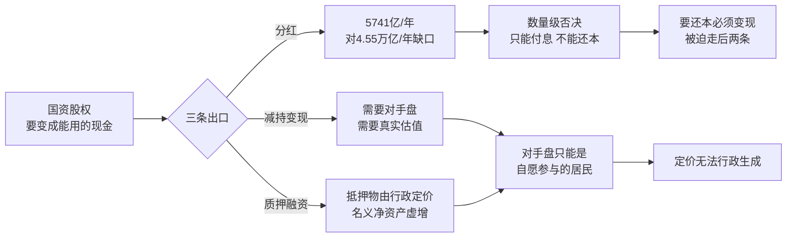

"股权财政接棒土地财政"这个提法近两年被反复提出。它的意思很具体：土地出让金坍塌之后，政府手里还有一笔庞大的国有资本股权，用它来填这个洞。

填洞只有两个通道。**通道一是变卖存量**——把国资股权卖出去，换成能用的现金。**通道二是融资增量**——把资本市场做成新的融资底座，让居民财富从不动产和存款切换到股权。两个通道共用同一个前提：**国资股权能够被定价**。变卖要有成交价，融资要有发行价，而这两个数字都无法由行政生成，只能由自愿承担风险的真实交易产生；一笔交易要有对手盘，对手方就必须拥有退出权，并且愿意不行使它。

于是问题变成一个可以被测量的比较：**行政定价在什么条件下可行？** 答案是需求端退出权的时滞与需求刚性。土地财政之所以能运行二十年，恰恰因为它的需求端退出权时滞长达一代人，且需求具有生存刚性；股权财政的需求端退出权时滞以季度计，需求刚性为零。同一种行政定价能力，在前者可行，在后者不可行。

---

## 一、 洞有多大，通道有几条

先看要填的洞。国有土地使用权出让收入 2021 年达到 87,051 亿元的历史峰值，占地方政府性基金本级收入的 92.7%；此后连续四年下滑，2022 年 66,854 亿元、2023 年 57,996 亿元、2024 年 48,699 亿元、2025 年 41,518 亿元，2026 年 1 至 8 月为 13,753 亿元，同比再降 28.6%。**从峰值到 2025 年，一年蒸发的流量约 4.55 万亿元。**

再看通道二号称的空间。论据通常是中美居民资产结构的对照：按《中国金融》2026 年第 8 期的口径，2025 年末中国居民金融资产中存款占 53%、股票占 12%、公募基金占 6.7%、理财与信托占 13%、保险占 10%；美联储 Z.1 数据显示 2024 年美国居民的现金存款占 11.2%、股票与基金占 55.3%、保险与养老金占 27.8%。中金公司测算，美国房产占居民总资产约 30%、权益类超过 53%，而中国房产占比已从 60% 以上降至约 52%—55%。以股票类占比计，潜在空间约 4.6 倍。

这个空间的隐含承诺是：它可以被"发展"出来，只要资本市场做对了什么。

通道一则连空间都不必假设——国资就在那里，卖掉就是现金。它的隐含承诺是：这批资产能够卖出一个足以填洞的价钱。

两个承诺都落在同一件事上：**这批股权能被定价。** 下面先追问这件事成立的条件，再看两个通道如何分别死在它上面。

---

## 二、 定价的条件：行政定价何时可行

行政定价并非总是失效。土地财政同样依赖行政定价——招拍挂的底价、供应节奏、规划条件都由政府决定——它却运行了二十年。所以问题不是"行政能否定价"，而是**行政定价在什么条件下可行**。

判据是两个变量：**退出权的时滞**（需求方从决定退出到退出生效需要多久）与**需求刚性**（不购买的代价有多大）。

| 维度 | 土地财政 | 股权财政 |
| --- | --- | --- |
| 供给端 | 政府垄断土地一级市场 | 政府垄断国资股权 |
| 需求端绑定 | 户籍、学区、婚姻、生存必需 | 无绑定，完全可选 |
| 退出方式 | 不生育、躺平、断供 | 不买、持有存款、提前还贷 |
| 退出时滞 | 约二十年（跨代生物学） | 一个季度（当期金融） |
| 退出成本 | 极高（征信惩戒、烂尾楼绝不清算） | 近乎零（合同本身允许提前还贷） |
| 定价可否行政化 | 可以 | 不可以 |

这里必须承认一件常被忽略的事：**土地财政也有退出权。** 赫希曼在《退出、呼吁与忠诚》中区分了 Exit 与 Voice，而[《禁止交易，怎会有准确定价？——从金融"价格发现"看微观博弈如何拯救社会规则》](https://cj9208.github.io/blog/systems_and_governance/chinese_government/no-trading-no-accurate-pricing/)正是用这个框架论证退出权如何倒逼规则纠偏——没有退出权的呼吁是苍白的，允许微观套利才能把坏资产打回原形。那篇文章的结论是应当赋予退出权。

本文的结论方向相反，但用的是同一个概念：**正因为居民手里真的握着退出权，股权财政才做不成。** 同一概念的两次反向应用，值得显式对照，而不是含糊带过。

关键在于退出权有强弱之分，判据是时滞与刚性，而非有无。土地财政的退出是跨代的、生物学的：一个人可以决定不买房、不生育、不参与，但这个决定要二十年后才在财政账本上显形，而在此期间他仍然要吃喝拉撒睡、仍然要为孩子买学区房。系统因此可以在整整一代人的时间内无视这张否决票。

而这张慢票已经投完了。国家统计局数据显示，出生人口 2022 年 956 万、2023 年 902 万、2024 年 954 万，2025 年降至 792 万，出生率 5.63‰，总人口 140,489 万人、净减 339 万人，自然增长率 −2.41‰。总和生育率 2022 年 1.05、2023 年 1.01、2024 年 1.14，2025 年官方未公布，机构估算区间为 0.97—1.09。[《弹性威权的套利终结：从资源宽容到存量自噬的系统终局》](https://cj9208.github.io/blog/systems_and_governance/chinese_government/elastic-authoritarianism-arbitrage/)§4.2 把这称为"基因的拒绝生育"，是对系统二十年后的劳动力红利与债务接盘基数的格式化。

系统现在想在同一个居民部门身上启动第二个融资引擎。区别在于，第二个引擎面对的是一张快票：退出时滞一个季度，退出成本近乎为零，需求刚性为零——没有任何人必须买股票。

下面两节分别看两个通道如何死在这张快票上。变卖通道先死于数量级，再死于对手盘的缺席；融资通道直接死于居民已经把快票投出来了。

---

## 三、 变卖通道：分红不够，所以必须变现

国资收益进入财政只有一条路：**国有资本经营预算调入一般公共预算。** 这一点必须钉死，否则"用手里的国资填洞"会被误读成还存在另一条更大的通道——划转给社保基金的那部分股权，其分红进入社会保险基金预算，专款专用，不能调入一般公共预算；它解的是养老金的兑付问题，不是财政的收入问题。所以下面要算的分红天花板，已经是这条轴上的全部。

而这条天花板已经顶到了头。2025 年全国国有资本经营预算收入 8,547 亿元，同比增长 25.8%，其中调入一般公共预算 5,741 亿元，调入比例 67.2%，两项均创历史新高。同期财政部已将中央非金融全资央企的税后利润上缴比例分档提高至 35%、30%、20% 与免收四档，烟草、石油等资源型企业适用 35% 顶格。也就是说，**这条通道已经被拧到了历史最紧的状态，年流量仍不足六千亿元，而它要填的洞一年蒸发 4.55 万亿元——八倍。**

分红是唯一不依赖二级市场的出口，因此也是唯一不需要定价的出口。它能付息，不能还本。要突破这个数量级，只剩两条路：减持变现，或者拿股权去质押借钱。这两条都需要一个估值，而估值的性质决定了这条通道的结局。

**减持变现需要对手盘。** §二 已经说明这个对手盘不能是国资体系自己（那是左手换右手），只能是自愿参与的居民——这把变卖通道直接推给了融资通道，而融资通道将在 §四 被否决。

**质押融资则是城投旧玩法的证券化版本。** 抵押物的估值由谁决定，决定了这条出口的性质。行政定价的国资股权被计入名义净资产，名义净资产膨胀带来质押融资能力膨胀，融资能力膨胀带来广义信用扩张。整个过程不触碰基础货币，所有科目都干净，膨胀发生在抵押品的计价上。这在效果上等价于一次通胀税，但它不出现在任何货币统计里，因此也不会触发通常的财政纪律约束。

这正是[《范式的裂痕：周五暴跌背后的"财政主导"叙事与系统性脆弱》](https://cj9208.github.io/blog/investment/fiscal-dominance-crash/)所描述的财政主导（Fiscal Dominance）的资本市场形态。那篇文章讨论的是美国：国债供给压力如何反向侵蚀央行的独立性。中国的形态不同——它不通过国债货币化，而通过股权定价的行政化来完成同一件事。差别在于，美国的财政主导有一个独立央行作为摩擦面，会产生可观测的利率与通胀信号；而抵押品虚增没有摩擦面，因为它根本没有市场参与。

**而当减持真的找不到外部买家时，它会退化成质押融资的另一种写法。** 接盘方只能是体系内主体：地方 AMC、银行理财资金池、保险资金、其他国企。这类交易在会计上是真实的股权买卖，在经济上是左手换右手，其"价格"只是记账数字。[《威权治理系统总纲：从历史大分流到终局死锁》](https://cj9208.github.io/blog/systems_and_governance/chinese_government/authoritarian-governance-overview/)§三.3 描述的"大池子混装"与暗度陈仓的交叉补贴，在这里以证券化的形式复现：混装的好处是账面清爽，代价是没有任何一个价格承载真实信息。

| 项 | 规模 | 时点 | 性质 |
| --- | --- | --- | --- |
| 土地出让金峰值 | 87,051 亿元 | 2021 | 流量，已坍塌 |
| 土地出让金 | 41,518 亿元 | 2025 | 流量 |
| **年化流量蒸发** | **约 4.55 万亿元/年** | 2021→2025 | 需要填补的洞 |
| 国有资本经营预算收入 | 8,547 亿元（+25.8%） | 2025 | 流量 |
| 其中调入一般公共预算 | 5,741 亿元（调入比例 67.2%） | 2025 | 流量，历史最高，唯一不需要定价的出口 |
| 全国国企利润总额（不含金融） | 40,380.5 亿元（−6.3%） | 2025 | 利润总额，非可分配现金 |
| 公募 REITs 全市场 | 89 只，2,322.4 亿元 | 2026-09-24 | 存量，唯一有真实现金流的证券化通道 |

这里出现了两个通道的第一处差异，也是本文最需要注意的一点：**变卖通道的失败是静默的。** 融资通道失败会留下数据——居民不买，份额不增，增量塌缩，全都写在报表上。变卖通道失败不留数据：交易照常发生，科目全部干净，评估报告照常出具，只是那个价格不承载任何信息。它无法被市场纪律纠正，因为纠正机制所需的那个市场从未存在。

---

## 四、 融资通道：第四罢工

变卖通道最终要落到融资通道上：减持要有接盘方，接盘方只能是自愿参与的居民。融资通道自己的假设则更直接——只要资本市场做对了什么，居民就会自愿把财富从不动产和存款切换到股权。

这个假设已经被数据否决，而且否决的方式比"不参与"更精确。

**存款增量塌缩。** 中国人民银行信贷收支表口径下，境内住户存款 2026 年 3 月末为 174.71 万亿元。2026 年前 9 个月住户存款增加 9.39 万亿元，同比少增 3.34 万亿元；其中 4 月减少 1.94 万亿元、5 月减少 0.11 万亿元，为近十年首次连续两月绝对下降（上一次出现在 2015 年 4 至 5 月），7 月再减 6,300 亿元。

**但搬出去的钱没有进股市。** 2026 年 5 月末，银行理财中现金管理类与固收类合计占比超过 96%，股票基金份额反而减少；2026 年一季度偏股型公募基金份额仅增长 2%。同期非银行业金融机构存款前 9 个月增加 4.41 万亿元，同比少增 0.4 万亿元，9 月单月减少 1.91 万亿元，为近年 9 月最低。散户入市确实发生了——2025 年新开户 2,743.69 万，2026 年前 9 月 2,712.59 万，同比增长 34.6%；两融余额从 2024 年末的 1.85 万亿元升至 2025 年末的 2.52 万亿元——但这些都是万亿元量级的边际现象，相对于 170 万亿元量级的住户存款，且随行情回落：2026 年三季度末两融余额 2.609 万亿元，环比下降 13.6%；上证指数从 2025 年末的 3,968.84 点（当年上涨 18.41%）回落至 2026 年 10 月 15 日的 3,707.48 点。

这个组合否定了两种流行解释。"居民财商不足"解释不了为什么他们能精确地把钱配置到固收端；"认知滞后"解释不了为什么在指数上涨 18% 的次年，增量资金依然绕开股权。**居民不是拒绝金融配置，是精确拒绝股权这一个资产类别。**

**退出权还在被反向行使。** 个人住房贷款余额 2025 年末为 37.01 万亿元，同比下降 1.8%，全年减少 6,768 亿元；2026 年二季度末降至 36.29 万亿元，同比下降 3.8%，上半年减少 7,163 亿元，已连续 13 个季度负增长。六大行的房贷余额在 2023、2024、2025 年分别净减 5,568 亿、6,210 亿、7,115 亿元，2026 年上半年再减 5,086 亿元。国家金融与发展实验室口径的居民部门杠杆率从 2023 年一季度的 63.3% 高点降至 2026 年二季度的 57.7%（中国人民银行《金融稳定报告》的宽口径 2024 年为 69.8%，两者相差约 8 个百分点，因是否计入公积金贷款而异）。2026 年上半年，居民贷款出现有统计以来首次净减少。

提前还贷之所以是退出权最纯粹的形态，是因为它无法被惩罚——它写在合同里。系统对此的反应本身就是证据：2023 年初多家银行关闭线上预约、限制名额、收取违约金，经监管约谈后放松；至 2026 年 10 月，仍有预约排队一个月、还款不满一年收取违约金的报道。一个不需要论证其正当性的合同权利，被以行政手段设置摩擦，说明它被视为威胁。这与[《弹性威权的套利终结：从资源宽容到存量自噬的系统终局》](https://cj9208.github.io/blog/systems_and_governance/chinese_government/elastic-authoritarianism-arbitrage/)§4.2 的三大不对称罢工——资本拒绝投资、民众拒绝消费、基因拒绝生育——构成同一条序列上的第四条：**拒绝入股。**

**体制内的长钱做出了同向选择，这是最硬的一组数字。** 基本养老保险基金委托投资规模 2025 年末为 35,206.99 亿元，当年收益率 5.76%，十年年均 5.14%；按 2015 年《基本养老保险基金投资管理办法》，股票与股票基金等权益类资产合计上限为资产净值的 30%。而华创证券测算，2026 年一季度其实际重仓 A 股市值约 420 亿元，约为上限的四十分之一。这笔钱最了解底牌、最不受流动性约束、考核周期最长，它的仓位选择与居民部门同向。至于为什么体制内长钱会如此配置——养老金个人账户的空账运行与国家队目标函数的错配——[《绝非不懂长期主义：为什么我们的生态总是在玩"梭哈"与"消耗战"？》](https://cj9208.github.io/blog/systems_and_governance/chinese_government/all-in-war-of-attrition/)§三已有完整展开，本文不重复。

居民为什么把退出权用在这个方向上，[《社会契约的异化：过度开采与控制的路径依赖》](https://cj9208.github.io/blog/systems_and_governance/social-contract-exploitation-path-dependence/)给出了机制：社会信任是未被计价的无形公地，当期会计成本为零，因此缺乏阻止过度开采的内生约束；代理人任期短于契约衰退周期，透支远期信用可换取即时绩效。一旦远期回报率转负，个体选择退场。近年的一连串事件构成了完整的违约演示——烂尾楼绝不清算、养老金个人账户空账、社保历史欠账被追溯性倒查——而[《社会契约的异化：过度开采与控制的路径依赖》](https://cj9208.github.io/blog/systems_and_governance/social-contract-exploitation-path-dependence/)§三.4 指出的路径 B'（伪改革）在此产生了它的可测量输出：当民众把每一项新政都预先解读为姿态而非实质，即便偶有真实让步，也难以换来预期的合作性响应。"存款搬家"的呼吁连续多年出现在政策话语与财经媒体中，而居民的实际配置行为给出了相反的回答。

用一个比值收束这一节：以 Wind 全 A 口径计，2026 年 10 月 15 日 A 股总市值约 105 万亿元，与同期住户存款 174.71 万亿元之比约为 0.6。这个比值本身不说明问题，说明问题的是它的变动方向——在指数上涨 18% 的年份之后，居民资金依然选择固收。

§一 提出的 4.6 倍空间因此不可达。空间存在与空间可达是两个命题，把它们混为一谈，就是"体量可以发展，参考美国"这一反驳的全部错误所在。

---

## 五、 剩下能定价的部分不是股权，是税

两个通道都走不通，那"股权财政"这个提法还剩下什么？

剩下的部分确实能定价，但规模与性质都不支持"接棒土地财政"这个提法。公募 REITs 是唯一以真实现金流为定价基础的证券化通道——高速公路过路费、水电燃气费、产业园租金——因此它的估值可以锚在现金流上，不必依赖散户情绪。但截至 2026 年 9 月 24 日，全市场已上市 89 只，总市值 2,322.4 亿元。这个数字相对于 4.55 万亿元的年流量缺口，量级上不构成替代方案。

更关键的是性质。这类资产的现金流来自强制性收费，其定价基础不是股东对企业剩余收益的索取权，而是对使用者的征费权。**能定价的那部分之所以能定价，恰恰因为它不是股权，是税。**

"股权财政"这个提法的错误在于把两类资产混为一类：一类有强制现金流因而可定价但规模有限，另一类规模巨大但定价只能行政生成。前者是税的证券化，后者是股权的行政化。把两者打包在同一个词里，就产生了"股权财政可以接棒土地财政"的错觉——土地财政从来都是税的另一种形式（对土地使用权的强制征费），它与 REITs 同构，与国资股权不同构。

这也顺带回答了 §三 留下的那个不对称：为什么变卖通道的失败可以是静默的，而土地财政的坍塌不是。土地的"价格"背后有一项强制性收费权，居民不买地也会租房、也会买东西、也会被征费，所以那张账单迟早会以别的形式送到；国资股权背后没有这项收费权，它只有对剩余收益的索取权，而这个索取权在没有人愿意出价时，就仅仅是一个账面数字。

---

## 六、 系统实际在走的那条路

如果股权财政从未真正在候选名单上，那系统实际在做什么？

**中央加杠杆置换地方债务。** 2024 年 11 月 8 日全国人大常委会批准增加 6 万亿元地方政府债务限额，2024 至 2026 年每年安排 2 万亿元置换隐性债务，另连续五年每年安排 8,000 亿元新增专项债用于化债；实际发行为 2024 年 2.00 万亿元、2025 年约 2.0 至 2.13 万亿元、2026 年 1 至 9 月 1.90 万亿元。超长期特别国债 2024 年 1 万亿元、2025 年 1.3 万亿元、2026 年 1.3 万亿元（已于 2026 年 10 月 16 日发行收官），另有 3,000 亿元特别国债用于补充大型商业银行资本。

这条路的技术特征是：把地方隐性债务搬到中央资产负债表上，用中央信用替换地方信用，用长期限替换短期限。它不解决存量问题，只是把偿还时点后移。

**而它之所以能走通，恰恰因为它绕开了 §二 的那个判据。** 置换债的对手盘是国有银行体系——用同一套变量看，这个需求方的退出权时滞是无限长（它不能拒绝承接），需求刚性由行政给定。所以行政定价在这条路上完全可行。这不是对判据的反例，而是判据的第二次验证：**同一套条件，换个对手盘，结论就翻过来。**

**融资市结构仍在朝融资端倾斜。** IPO 家数从 2021 年的 522 家降至 2024 年的 100 家（募资 647 亿元）后重新加速，2025 年为 116 家（募资 1,318 亿元，同比增长 95.6%），2026 年前三季度已达 123 家（募资 2,029 亿元，同比增长 173%）。同期退市并未同步放大：2024 年 52 家为历史峰值，2025 年回落至 29 家（Wind 口径，中上协与 iFinD 口径分别为 31 家与 32 家）。[《拆穿"父爱"：融资市的控制逻辑》](https://cj9208.github.io/blog/investment/financing-market-control-logic/)对这条"发行端—交易端—出清端"的控制链条已有完整拆解，本文只补一点：进出比的持续恶化意味着[《拆穿"父爱"：融资市的控制逻辑》](https://cj9208.github.io/blog/investment/financing-market-control-logic/)所说的长期复利前提进一步失效，而这正是负反馈环的入口。

这个环没有出口。任何一次试图靠行政推动居民入市的努力，都会同时强化环上的两条边：它增加了供给端的融资量，也增加了居民对"这是一次抽水"的确认。

于是可以得到一个诚实的落点：**股权财政不是一个被否决的方案，是一个从未进入候选的方案。** 系统实际在做的是中央加杠杆置换地方债务，这恰好印证了[《社会契约的异化：过度开采与控制的路径依赖》](https://cj9208.github.io/blog/systems_and_governance/social-contract-exploitation-path-dependence/)§三的路径依赖判断——在重塑契约（路径 A）与加码控制（路径 B）之间，系统会稳定地选择即时阻力最小的那一条。阻力最小的定义在这里可以写得很具体：**不需要对手盘自愿的那一条。**

---

## 结语、 定价无法行政生成

回到开头的那个前提。两个通道共用"国资股权能够被定价"这一假设，而这个假设的成立条件从来不在资产端。

资产端可以行政化：打包可以设立 AMC，证券化可以发行 REITs，估值可以由评估机构出具报告。负债端不能：定价只能由自愿承担风险的真实交易产生，而自愿的前提是交易对手认为远期承诺会被兑现。

两个通道因此死在不同的地方，而且死法不同。变卖通道死于对手盘的缺席——分红流量只有缺口的八分之一，要突破就必须变现，而变现在找不到外部买家时退化为体系内自循环，账面上看不出任何异常。融资通道死于参与约束——4.6 倍的空间确实存在，但兑现它需要居民自愿换仓，而居民已经用存款流向、房贷余额和养老金实际仓位三次给出了同向回答。

连接两者的是定价，而定价的连接方式是一条单向链：要突破数量级就必须变现，变现必须有对手盘，对手盘必须自愿，自愿必须信任。链条的最后一环无法由行政命令生成。

这也是为什么"重塑信任才是关键"不能作为一个呼吁来结尾。在这个框架里，信任不是一种氛围或一种叙事，而是**退出权是否被行使的可观测状态**：住户存款的增量、个人住房贷款的余额、偏股基金的份额、养老金的重仓市值，都是它的读数。这些读数无法通过宣布重塑而改变，只能通过改变它们所反映的底层条件而改变——高退市率的自然出清、多空双向的价格发现、国资收益的实质让渡。而这些条件本身要求既得利益让渡，即[《社会契约的异化：过度开采与控制的路径依赖》](https://cj9208.github.io/blog/systems_and_governance/social-contract-exploitation-path-dependence/)所说的路径 A。

土地财政能撑二十年，是因为它的否决票要二十年后才生效。股权财政撑不过一个季度，是因为它的否决票当季就能投，而且已经在投。

---

## 延伸阅读

**相关文章**

- [《禁止交易，怎会有准确定价？——从金融"价格发现"看微观博弈如何拯救社会规则》](https://cj9208.github.io/blog/systems_and_governance/chinese_government/no-trading-no-accurate-pricing/)：价格发现机制与退出权（Exit）概念的来源。本文与该文构成同一概念的两次反向应用——该文主张赋予退出权以纠偏规则，本文指出退出权的存在否决了股权财政。
- [《拆穿"父爱"：融资市的控制逻辑》](https://cj9208.github.io/blog/investment/financing-market-control-logic/)：发行端—交易端—出清端三条控制链条的完整拆解，本文负反馈环的供给侧来源。
- [《社会契约的异化：过度开采与控制的路径依赖》](https://cj9208.github.io/blog/systems_and_governance/social-contract-exploitation-path-dependence/)：信任公地的悲剧、路径 B/B' 与塔西佗陷阱的反向形态，本文 §四 的机制母体与 §六 的路径依赖落点。
- [《弹性威权的套利终结：从资源宽容到存量自噬的系统终局》](https://cj9208.github.io/blog/systems_and_governance/chinese_government/elastic-authoritarianism-arbitrage/)：三大不对称罢工，本文补第四条"拒绝入股"。
- [《绝非不懂长期主义：为什么我们的生态总是在玩"梭哈"与"消耗战"？》](https://cj9208.github.io/blog/systems_and_governance/chinese_government/all-in-war-of-attrition/)：养老金空账运行与国家队目标函数错配的完整展开，本文 §四 只引不写。
- [《范式的裂痕：周五暴跌背后的"财政主导"叙事与系统性脆弱》](https://cj9208.github.io/blog/investment/fiscal-dominance-crash/)：财政主导概念，本文将其移植到资本市场的抵押品虚增形态。
- [《威权治理系统总纲：从历史大分流到终局死锁》](https://cj9208.github.io/blog/systems_and_governance/chinese_government/authoritarian-governance-overview/)：大池子混装与隐性交叉补贴，本文 §三 体系内自循环的来源。
- [《大出清时代：为什么"债务爆破"才是中国经济破局的第一优先级》](https://cj9208.github.io/blog/systems_and_governance/chinese_government/debt-explosion-first-priority/)：**与本文不同轴，列在此处是为了防止混淆。** 该文主张大规模划转国资股权、实现养老金的实际资产化，走的是社会保险基金预算这条线，解的是养老金的兑付问题。本文讨论的是财政的收入问题——土地出让金坍塌之后拿什么填——走的是国有资本经营预算这条线。两者都涉及"国资股权"，但不是同一笔钱，也不面对同一个约束：前者要求打破体制内的刚兑神话（该文已判定阻力是政治经济学而非可行性），后者要求居民自愿出价。

**数据来源**

- 土地出让收入：财政部《财政收支情况》历年月度与年度报告，2021—2026 年 8 月。
- 国有企业经营数据与国有资本经营预算：财政部全国国有及国有控股企业月报（不含国有一级金融企业）、财政部国库司 2026-01-30 发布数据。央企税后利润上缴比例分档见财政部相关规定。
- 公募 REITs：截至 2026-09-24 的合凡资产周报，**二手来源**；2026-06-18 上证报口径为 86 只、2,450 亿元。
- 住户存款、非银存款、个人住房贷款、居民杠杆率：中国人民银行金融统计数据报告与贷款投向统计报告；居民杠杆率另见国家金融与发展实验室《2026 年二季度宏观杠杆率报告》（2026-07-30）。**央行宽口径与 NIFD 口径相差约 8 个百分点，本文正文采用 NIFD 并注明。**
- 资金流向与理财结构：中金公司测算，转引自财经媒体报道，**二手来源**。
- 出生人口与总和生育率：国家统计局历年国民经济和社会发展统计公报；2025 年 TFR 官方未公布，0.97—1.09 为机构估算。
- A 股指数与总市值：中证指数有限公司官网（2026-10-15 收盘）；总市值采用 Wind 全 A 口径约 105 万亿元，**另有交易所汇总口径 121.85 万亿元，两者不一致，本文统一采用前者并注明**。巴菲特指标约 87.1%（2026-10-14）为非官方指标。
- IPO 与退市：Wind 口径为主，2025 年退市家数存在 29（Wind）、31（中上协，含北交所）、32（iFinD）三个版本，**无统一官方数**。投资者总数见中国结算《2025 年统计年鉴》（2026-06-12）；个人持股占流通市值约 30%、贡献成交量 60%—67% 为券商估算，交易所无年度官方拆分。
- 居民资产配置：中国口径引自《中国金融》2026 年第 8 期（口径 A，未穿透理财与基金）；另有 CNBS 法《中国居民财富报告 2026》口径 B（广义存款 43.7%、股票 9.9%、股权 13%），差异源于是否穿透，**本文统一采用口径 A**。美国口径引自美联储 *Financial Accounts of the United States*（Z.1，2024）；房产与权益类占比为中金公司转引。
- 基本养老保险基金委托投资：社保基金会受托运营报告（2026-08-01 发布）；权益类上限见 2015 年《基本养老保险基金投资管理办法》；实际重仓 A 股市值为华创证券 2026 年一季度测算，**券商估算而非官方披露**。此处仅用于说明体制内长钱的股权风险偏好，不作为财政收入论据。
- 化债与特别国债：2024-11-08 全国人大常委会决议；实际发行数据引自中金固收 2026-10-16 报告，**二手来源**；2026 年超长期特别国债发行收官见财政部 2026-10-16 公告。
- 提前还贷摩擦：2023 年初银行限制措施与监管约谈见当期公开报道；2026 年 10 月的预约排队与违约金情况见媒体报道，**二手来源**。

> 住户存款余额在不同统计口径下存在 165.89 / 167.04 / 172.7 / 174.71 万亿元等多个版本，本文统一采用中国人民银行信贷收支表口径的 174.71 万亿元（2026 年 3 月末）。凡标注为估算、测算或二手转引的数据，均不作为独立论据使用，仅用于说明量级。
