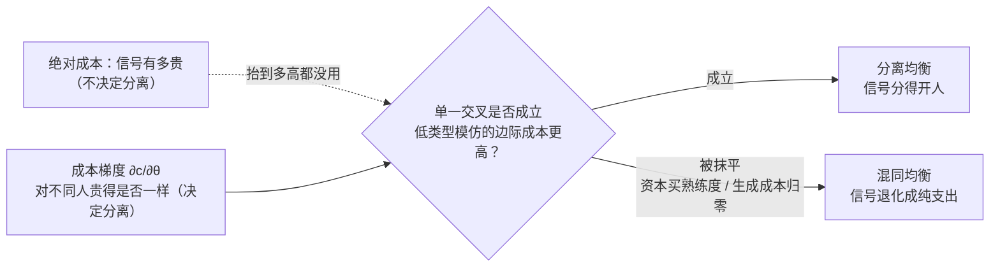

一个信号能不能把两种人分开，不看它有多贵，看它对不同人贵得是否一样。

学历、考分、题海里熬出来的熟练度，这些信号都很贵——贵到足以劝退一部分人。但"贵"本身不产生区分：如果一份成本对能力强的人和能力弱的人一样重，付得起的和付不起的各占一半，信号并没有把谁从谁里择出来。真正让信号能分开人的，是成本随能力**递减**——同一道门槛，没本事的人翻起来更费劲。这一条有精确的名字，叫单一交叉条件（single-crossing condition），它可以推导，也可以测量；而一旦它被抹平，再贵的信号也会退化成纯支出。

前两节推导，不带例子：先看柠檬市场为什么自己塌成混同，再看信号博弈里分离均衡的存在条件为什么写在成本的**梯度**上、而不是**绝对值**上。第三节两局实测：奥数的题海如何把梯度抹平，新加坡的双轨如何让同一套考分矩阵对权力和资本给出两个不同的读数。第四节换一个问题问——先动的不是发信号的人，而是设计菜单的人，筛选靠什么分开人。

---

## 一、柠檬市场：声明为什么不管用

阿克洛夫（Akerlof 1970）的二手车市场：卖方知道车的真实质量 $\theta$，买方不知道。买方唯一能做的，是按市场上的期望质量出价 $w=E[\theta]$。

于是好车主发现，自己那辆车被按平均价估值，亏了，退出；剩下的车平均质量更低，买方把出价再压一档；又一批相对好的车退出……这个螺旋的终点，不是"好车卖好价、烂车卖低价"的分开局面，而是整个市场塌到只剩烂车——所有人被按同一个低质估值对待。这个结局有个名字：混同均衡（pooling equilibrium）；与之相对、能把不同类型分开的，叫分离均衡（separating equilibrium）。

塌掉的原因不是买方蠢，是**类型是私人信息，而口头声明不花钱**。卖方当然可以说"我这车是好的"，可烂车的卖家说这句话一样不花钱、一样理直气壮。当一句话零成本、而且说的人和听的人利益不一致时，这句话不改变听者的判断——好车坏车都在喊"我是好车"，买方只能把它当噪音。这类零成本的信息传递在文献里叫廉价谈话（cheap talk）；Crawford 与 Sobel（1982）证明，偏好偏差足够大时，它唯一的稳健均衡是谁也不透露任何真实信息（babbling）。（这条的严格陈述与它的组织版本，留在文末附注。）

出路只有一条：让声明者付一个**有成本**、而且这个成本对不同人不一样重的动作。斯宾塞（Spence 1973）的就业市场信号博弈把它写成四件套：

- 类型 $\theta$（能力），私人信息；
- 信号 $y\ge0$（学历、考分），可观测；
- 成本 $c(y,\theta)$，发这个信号要付的代价；
- 出价 $w(y)=E[\theta\mid y]$，买方看到信号后按后验期望付费。

这里有一个和囚徒困境同源的要点：$w(y)$ 取决于买方的**信念**，而信念又取决于各类人实际怎么选 $y$——它是个自我印证的东西，是个不动点，不是哪一方单独能优化的量。分离均衡要成立的，正是"信念"与"选择"互相咬住的那个点。

**一张嘴说"我能力强"不值钱，因为骗子说这句话一样不花钱。**

---

## 二、单一交叉：分离写在梯度上

把类型简化成两种：低能力 $L$ 与高能力 $H$，$\theta_H>\theta_L$，买方对高能力愿意付 $\theta_H$、对低能力付 $\theta_L$。设分离均衡里低能力者不发信号（$y_L=0$，拿 $w=\theta_L$），高能力者发 $y^*>0$（拿 $w=\theta_H$）。

这个局面要稳住，得同时满足两条激励相容（incentive compatibility, IC）——谁都不想冒充对方。低能力者不去伪装成高能力（发 $y^*$ 划不来）：他发 $0$ 拿 $\theta_L$，冒充则拿 $\theta_H-c(y^*,L)$，于是

$$\theta_L\ \ge\ \theta_H-c(y^*,L)\quad\iff\quad c(y^*,L)\ \ge\ \theta_H-\theta_L$$

高能力者不退回冒充低能力（发 $y^*$ 比不发强）：他发 $y^*$ 拿 $\theta_H-c(y^*,H)$，退回则拿 $\theta_L$，于是

$$\theta_H-c(y^*,H)\ \ge\ \theta_L\quad\iff\quad c(y^*,H)\ \le\ \theta_H-\theta_L$$

两条合起来是一个夹逼：

$$\boxed{\ c(y^*,L)\ \ge\ \theta_H-\theta_L\ \ge\ c(y^*,H)\ }$$

它立刻给出一件事：$c(y^*,L)>c(y^*,H)$——**同一个信号 $y^*$，低能力者付的成本必须严格更高**。让这件事成立的条件，是边际成本随能力递减：

$$\frac{\partial^2 c}{\partial y\,\partial\theta}<0\qquad(\text{单一交叉条件})$$

**现在看靶心。** 假设这条不成立——发同样的信号，对高能力者和低能力者一样贵（$\partial c/\partial y$ 与 $\theta$ 无关）。那么 $c(y,L)=c(y,H)$，上面那个夹逼只能在 $c(y^*)=\theta_H-\theta_L$ 这一个刀口值上勉强取等，稍微一碰就散，一般**没有**分离均衡。换句话说，决定分离的是差价 $c(y^*,L)-c(y^*,H)>0$（梯度），不是绝对成本 $c$ 的高低。把信号对所有人都抬到极贵，仍然分不开人。**昂贵 ≠ 可分离**：昂贵是"绝对值高"，可分离是"梯度在"，这是两个正交的性质；一个信号可以又贵又分不开人（大家都付一样多的冤枉钱），也可以不那么贵却分得很开。

数值示意（下面所有数字都是**示意值**，有效信息只有排序）：取 $c(y,\theta)=\dfrac{y^2}{2\theta}$，它满足单一交叉（$\partial c/\partial y=y/\theta$ 随 $\theta$ 递减），再取 $\theta_L=1$、$\theta_H=3$。最小分离信号由低能力者那条取等定：$\dfrac{y^{*2}}{2}=3-1=2$，得 $y^*=2$。核对高能力者：$c(2,H)=\dfrac{4}{6}=0.67\le2$ ✓，他发 $y^*$ 净得 $3-0.67=2.33$，比冒充低能力的 $1$ 好，愿意发。低能力者在 $y^*=2$ 处恰好无差异（净得 $3-2=1=\theta_L$）——这就是"最小"分离信号的含义：再低一点，低能力者就会跳过来伪装。

而"跳过来伪装"正是信号失效的样子。把题海机构塞进来：它用套路和刷题，把低能力者发同一个 $y^*$ 的有效成本从 $2$ 压到接近高能力者的 $0.67$。于是低能力者净得 $3-0.67=2.33>1$，伪装从"无差异"变成"严格更优"，夹逼的左半边被顶穿，分离塌回混同。

| 资本把 $c(y^*,L)$ 从 2 压到 | 2（未抹平） | 1.5 | 1.0 | 0.67（压到高能力者水平） |
| --- | --- | --- | --- | --- |
| 低能力者伪装的净收益 | $1$（无差异） | $1.5$ | $2$ | $2.33$ |
| 分离是否成立 | 临界 | 已破 | 已破 | 完全混同 |

（示意值。阈值就是 $c(y^*,L)=\theta_H-\theta_L=2$：只要资本把它压到 2 以下，低能力者就开始伪装。）

这条梯度有两条被抹平的路径，都紧贴着上面那个夹逼。

**资本买熟练度。** 题海和机构套路压低的是 $c(y,L)$——让本来翻不过门槛的人用钱翻过去，梯度收敛，$\text{IC}_L$ 失效。这就是[《廉价文凭与昂贵青春》](https://cj9208.github.io/blog/systems_and_governance/diploma-opportunity-cost/)里"熟练度伪装成天赋"的形式：不是有人作弊，是成本的类型梯度被合法地套利掉了。

**生成成本归零。** 更彻底的抹平，是让所有人都能廉价发出"高"信号。[《信任的终结与重生》](https://cj9208.github.io/blog/ai_era_engineering_careers/proof-of-work-trust-recruitment-endgame/)算过这个极限：当 AI 让假简历的生成成本 $\to0$，筛选器放行假简历的概率 $\text{FPR}\to1$，后验

$$P(\text{真}\mid\text{合格})=\frac{p\cdot\text{TPR}}{p\cdot\text{TPR}+(1-p)\cdot\text{FPR}}$$

塌回先验 $p$——筛完的"合格池"和闭眼随机捞一个差不多。用本篇的语言说，$c(y,\theta)\to0$ 对所有 $\theta$，梯度直接归零。那篇的结论"信任的强度取决于伪造它的代价"因此可以再精确一句：起作用的不是伪造的**绝对**代价，是代价的**类型梯度**，$C_{\text{fake}}\gg C_{\text{real}}$ 只是"梯度足够陡"的一种说法。

两条路径同一个终点：**文凭通胀、信号军备竞赛是一个均衡，不是道德失败。** 没有人变坏，是夹逼的左半边被顶穿了。

**学历的价钱不是学费，是"没能力的人拿不到"；一旦这条梯度能用钱抹平，信号就退化成纯支出。**

---

## 三、案例：两局，逐条检验

上面那个夹逼有两个前提值得拿到真实的市场里对一对：一是梯度真的会被资本抹平吗，二是抹平梯度的手和伪造规则的手，是不是同一只。两局各测一个。

### 假设一：这个信号昂贵吗，梯度能被资本抹平吗

奥数这一局的入场，是它本来根本不贵、也不需要贵。[《廉价文凭与昂贵青春》](https://cj9208.github.io/blog/systems_and_governance/diploma-opportunity-cost/)记的初始状态是：奥数不挂钩生存资源，参与者绝大多数源于天然的数学直觉与兴趣，系统几乎不花组织成本就能筛出顶尖人才——用本篇的话说，此时 $c(y,\theta)$ 几乎全由 $\theta$ 决定，梯度极陡，信号纯度极高。

读数出现在它被挂钩"小升初保送""高考加分"之后。一旦这个信号能兑换阶层入场券，古德哈特定律（Goodhart's Law）生效：指标变成目标，就不再是好指标。产业化的机构用海量题海与套路总结，把资质普通的学生训练成高分刷题机器——这正是压低 $c(y,L)$ 的那只手。入场时那个"几乎不花钱就能筛出天赋"的陡梯度，被资本一点点套利成平的。

裁决：奥数没有变难也没有变简单，变的是它的成本**结构**——从"由天赋定价"变成"由天赋＋钱包共同定价"。当钱包能替天赋付掉大部分成本，夹逼的左半边就顶穿了，"熟练度伪装成天赋"不是修辞，是 $\text{IC}_L$ 失效的白话版。筛选失灵因此不是"机构缺德"，是新均衡。

### 假设二：抹平梯度的手和伪造规则的手，是不是同一只

新加坡这一局的入场，是一套刻意做成不可篡改的刚性考分矩阵。[《指标的内爆与协议的重构》](https://cj9208.github.io/blog/systems_and_governance/goodharts-law-protocol-reconstruction/)写的 PSLE 到分流体制，$\text{Success}=\text{Effort}\times\text{Intelligence}$，明码标价、对所有人透明，那句结论是它"最大限度地免疫了外部权力的随意捏造与寻租"。

这句话对一半，而错的那一半恰好是本篇要分辨的。先看它对的地方：本地轨执行冷酷的考分矩阵，大资本想通过捐款、递条子送孩子进顶尖公立学校的后门"被完全锁死"。用信号的语言说，权力想干的是**改规则**——直接篡改 $y$，或篡改 $y\to w$ 的映射（不走考分却拿到考分对应的资源）。一套明码标价、不可篡改、留痕可查的考分矩阵，挡的正是这一路。这是"免疫"成立的那个参数。

再看它没说的地方：大资本的子女根本不在这条轨道上卷。同一篇的双轨解耦写得很清楚——国际轨允许顶级国际学校集群（UWCSEA、SAS、Dulwich 等）独立运行，不走本土考制，考核标准"瞬间切换回大资本最熟悉的西式精英博弈：拼藤校率、马术、全球校友网络"。资本没有去攻破那个刚性考分，它**绕开**了它，换到一个信号完全不同的轨道；而在国际轨上，藤校率、马术、校友网络这些信号的梯度，恰恰是钱最能抹平的——它们几乎就是 $c(y,\theta)$ 里"钱包"那一项的纯函数。

裁决：同一套考分矩阵，对权力和资本给出两个读数，因为它们攻击的是**两个不同的参数**。权力改规则，被"明码标价＋不可篡改"挡住；资本不改规则，它买熟练度、或者直接退出到另一条规则里，抹的是梯度。刚性考分之所以看起来"免疫"，不是因为它战胜了资本，是因为资本被双轨解耦分流走了、根本没来攻这座城。所以那句"免疫"必须收窄：**对权力寻租免疫，对资本中性**——而"中性"的代价，是把资本的战场挪到了另一条轨道上，那里没有刚性考分来挡。

案例收束：**能挡住权力的，未必挡得住资本，因为它们攻击的是同一个机制的两个不同参数。** 这不是两句互相打架的话，是同一把单一交叉的刀，切在两个地方。

---

## 四、筛选：换个先动方，同一把刀

前面三节里，先动的都是**知道自己类型**的一方：工人选学历，学生刷题，资本挑轨道。信号（signaling）的定义就是知情方先动、用一个有成本的动作把自己的类型透露出去。

但很多筛选场景是反过来的：先动的是**不知道对方类型**的一方。雇主不知道求职者能力，保险公司不知道投保人风险。这时先动方不被动等信号，而是主动摆出一份**菜单**，让对方自己挑——这就是筛选（screening），罗斯柴尔德与斯蒂格利茨（Rothschild–Stiglitz 1976）在保险市场里给出的结构。

菜单是一组套餐 $\{(w_1,y_1),(w_2,y_2),\dots\}$：高工资配高要求，低工资配低要求。设计目标是让高能力者自愿挑走"高工资高要求"那项、低能力者自愿挑走"低工资低要求"那项——分离不靠雇主去甄别，靠对方**自选择**（self-selection）完成。而让自选择真的分得开的，还是同一把刀：低能力者模仿高能力套餐的边际成本必须更高（单一交叉），外加两条约束——每项都得让人愿意参与（参与约束，individual rationality, IR），且没人想冒充别人去挑另一项（激励相容，IC）。

**换个先动方，承重条件没变。** 信号是知情方用一个动作透露自己，筛选是不知情方用一份菜单逼对方暴露自己；两者靠的是同一个成本梯度，只是一个由发信号的人承担、一个被设计进菜单项里。

这一节能顺手修一个常见的概念误用。[《架构师的通信协议》](https://cj9208.github.io/blog/ai_era_engineering_careers/architect-communication-protocol/)里说，给客户"方案 A / 方案 B"的多选题不是最优解，"因为这无法达成纳什均衡"。这个诊断错了：**菜单本身就是一套筛选机制，不对称信息下它的均衡恒存在**（罗斯柴尔德–斯蒂格利茨那篇整篇就在算这个均衡）。多选题真正可能失败的地方不在"有没有均衡"，而在"这份菜单满不满足激励相容"——如果两个方案对客户里的不同类型没有区分度，对方会一律挑对自己最省事的那项，你想借菜单完成的分离就落空了。正确的说法是：菜单要设计到让对方自选择出你想要的信息，也就是满足 IC，而不是"给选择题达不成均衡"。

而招聘端整套题库、笔试、多轮面试，本质就是雇主先动的一份筛选菜单。[《组织如何筛选高解题零阻力的人》](https://cj9208.github.io/blog/systems_and_governance/talent-screening-exam-culture/)描述的正是这份菜单如何被设计、又如何被应试端反向套利——套利的，仍然是那条梯度。

**筛选的价格不在题目有多难，在"没本事的人自己选择不进来"；菜单设计得好，伪装者会自动挑走便宜那一项。**

---

## 结语：判据是两个问句

只有两个问句：

> **一、这个信号的成本，随能力上升还是下降？**
> **二、谁在破坏它——权力改规则，还是资本抹梯度？**

第一问问的是梯度。对所有人一样贵的信号，无论多贵，都是纯支出，分不开人（混同）；只有对没本事的人更贵，它才分得开（分离）。看到任何"高门槛＝高筛选力"的说法，先问这一句：门槛是均摊的，还是随能力递减的？

第二问问的是这条梯度会被谁、从哪个参数上破坏。刚性、明码标价、不可篡改，挡的是权力改规则；但它挡不住资本买熟练度，也挡不住资本直接退出到另一条规则里。所以"这个信号很硬、很贵、很公平"从来不等于"它分得开人"——要看它的成本结构，以及谁在套利那个结构。

回到开头那句话：一个信号能不能把两种人分开，不看它有多贵，看它对不同人贵得是否一样——以及这条"不一样"，能不能被钱买平。

---

## 附注：四处需要修正的旧判断

这四处都是本站旧文里的判断，方向没错，错在把"绝对成本"当成了"分离条件"，或把筛选、廉价谈话的均衡性质说反了。放在附注里，是因为它们是本文的自查，不是叙事的一部分。

**一、占优策略那句。** [《廉价文凭与昂贵青春》](https://cj9208.github.io/blog/systems_and_governance/diploma-opportunity-cost/)写"继续提升学历成为了个体在既定规则下的占优策略（Dominant Strategy）"，并把这一局面标注为"典型的囚徒困境"。两处都要改：

- **占优策略 → 分离均衡里的均衡策略。** 学历竞赛不是完全信息下的占优解，是不完全信息信号博弈里的一个均衡策略：它之所以看起来"占优"，是因为在单一交叉成立、分离均衡存在的前提下，高能力者发信号、低能力者跟进是被夹逼条件逼出来的，不是无条件最优。"在既定规则下"这个限定它已经写了，债比想象轻，缺的是把"占优策略"换成"分离均衡里的均衡策略"。
- **囚徒困境 → 排位博弈。** 这一局的收益结构不是 $T>R>P>S$ 的囚徒困境（完全信息、占优策略解），是排位博弈（rank-order tournament，Lazear–Rosen 1981）：名次而非绝对产出决定回报，解概念是贝叶斯纳什而不是占优策略。结构标签错了，开的药就会错——囚徒困境的药是改支付，排位博弈的药是改名次间距与筛选梯度。

**二、免疫那句。** [《指标的内爆与协议的重构》](https://cj9208.github.io/blog/systems_and_governance/goodharts-law-protocol-reconstruction/)写刚性考分矩阵"最大限度地免疫了外部权力的随意捏造与寻租"。方向对，缺的是限定：它免疫的是**权力寻租**（改规则、直接篡改 $y$ 或 $y\to w$ 的映射），被"明码标价＋不可篡改"挡住；它对**资本买熟练度、或资本退出到另一条轨道**（抹梯度）并不免疫——新加坡靠双轨解耦把资本分流，不是靠考分战胜资本。差别在**攻击的是哪个参数**上：规则完整性 vs 成本梯度。

**三、瞬间清零那句。** [《架构师的通信协议》](https://cj9208.github.io/blog/ai_era_engineering_careers/architect-communication-protocol/)写高频定频看板能让对方的"风险溢价（焦虑感）瞬间清零"。定频进度看板是一个**零成本信号**，也就是廉价谈话；Crawford 与 Sobel（1982）的结论是：当发送方与接收方的偏好有偏差时，零成本信息在均衡里能携带的信息量随偏差增大而趋于零（babbling）。所以定频看板清除不了道德风险，除非双方偏好真的对齐——它降低的是"对方不知道你死没死"这类**存活不确定性**（这一点它确实有效），不是"对方不知道你有没有偷懒"这类**行为不确定性**。"瞬间清零"应删，改成"当且仅当偏好足够对齐时降低风险溢价，否则它只是一份存活证明"。

**四、菜单那句。** 同一篇[《架构师的通信协议》](https://cj9208.github.io/blog/ai_era_engineering_careers/architect-communication-protocol/)写，给客户多选题"无法达成纳什均衡"。菜单本身就是筛选机制（Rothschild–Stiglitz 1976），不对称信息下均衡恒存在；"达不成纳什均衡"是概念误用。正确的要求是菜单满足**激励相容**——否则不同类型会一律挑走同一项，你想借菜单完成的分离落空。差别在**解概念**上：不是均衡不存在，是这份菜单没设计到让对方自选择出你要的信息。

四处的共同点是：前三处把"成本或信号的绝对性质"误当成了"分离或可信的充分条件"，第四处把"筛选均衡恒存在"误当成了"达不成均衡"。

---

## 事实与来源

本文的学术引注以下列为准（2026-10-29 逐条 web 核对卷期页码）：

- 柠檬市场与逆向选择：Akerlof (1970), "The Market for 'Lemons': Quality Uncertainty and the Market Mechanism", *Quarterly Journal of Economics* 84(3):488–500。
- 信号博弈与单一交叉：Spence (1973), "Job Market Signaling", *Quarterly Journal of Economics* 87(3):355–374（doi 10.2307/1882010）。**一处更正**：系列计划文档曾把此篇记作 *AER* 63，那其实是 Spence 同年另一篇 "Signal Purchase Functions and Investment in Information Channels"（*AER* 63(2):242–244），不是就业市场信号。
- 筛选与自选择菜单：Rothschild & Stiglitz (1976), "Equilibrium in Competitive Insurance Markets: An Essay on the Economics of Imperfect Information", *Quarterly Journal of Economics* 90(4):629–649。**一处更正**：计划文档曾记作 *AER* 66:189–211。
- 廉价谈话与 babbling：Crawford & Sobel (1982), "Strategic Information Transmission", *Econometrica* 50(6):1431–1451（该模型设信号成本为零）。
- 排位博弈：Lazear & Rosen (1981), "Rank-Order Tournaments as Optimum Labor Contracts", *Journal of Political Economy* 89(5):841–864。

其余事实与示意值说明：

- 第二节全部数字（$\theta_L=1$、$\theta_H=3$，$c=y^2/2\theta$，$y^*=2$，资本抹平表）都是**示意值**，不来自任何真实考分、薪资或培训数据；有效信息只有排序"梯度在则分离、梯度被抹平则混同"，以及阈值 $c(y^*,L)=\theta_H-\theta_L$。
- 第三节奥数一局的现象材料取自本站[《廉价文凭与昂贵青春》](https://cj9208.github.io/blog/systems_and_governance/diploma-opportunity-cost/)（信号纯度、题海军备竞赛、熟练度伪装成天赋）；新加坡一局的现象材料取自本站[《指标的内爆与协议的重构》](https://cj9208.github.io/blog/systems_and_governance/goodharts-law-protocol-reconstruction/)（PSLE 刚性考分矩阵、双轨解耦、国际学校集群）。**两局的结构诊断（梯度 vs 规则、两个参数）是本文的分析，不是那两篇的原文结论。** 国际轨三所学校（UWCSEA、SAS、Dulwich）为《指标的内爆》原文所列，是新加坡真实存在的国际学校。
- 第二节引用的"后验塌回先验"公式取自[《信任的终结与重生》](https://cj9208.github.io/blog/ai_era_engineering_careers/proof-of-work-trust-recruitment-endgame/)，本篇只做"梯度归零"的重新表述，未新增事实。

---

## 延伸阅读

- [《廉价文凭与昂贵青春》](https://cj9208.github.io/blog/systems_and_governance/diploma-opportunity-cost/)——"熟练度伪装成天赋"的现象出处：本篇给它补的形式是"资本把 $c(y,L)$ 压低、单一交叉被套利"。
- [《指标的内爆与协议的重构》](https://cj9208.github.io/blog/systems_and_governance/goodharts-law-protocol-reconstruction/)——"刚性考分免疫"的出处：本篇把"免疫"收窄为对权力寻租免疫、对资本中性。
- [《信任的终结与重生》](https://cj9208.github.io/blog/ai_era_engineering_careers/proof-of-work-trust-recruitment-endgame/)——"信任取决于伪造代价"的出处：本篇把它精确成"取决于代价的类型梯度"，$C_{\text{fake}}\to0$ 是梯度归零的特例。
- [《架构师的通信协议》](https://cj9208.github.io/blog/ai_era_engineering_careers/architect-communication-protocol/)——定频看板与多选题菜单两处的出处：本篇分别用廉价谈话与筛选均衡改判。
- [《组织如何筛选高解题零阻力的人》](https://cj9208.github.io/blog/systems_and_governance/talent-screening-exam-culture/)——招聘端筛选菜单的现象锚点：雇主先动的自选择结构。
- [《未来的影子：合作是 δ 的函数，不是道德的成果》](https://cj9208.github.io/blog/systems_and_governance/game_theory/discount-factor-retroactive-enforcement/)——同系列：那篇管"时间之手"（重复如何改变合作），本篇管"信息之手"（不对称信息下信号如何分开人）。
