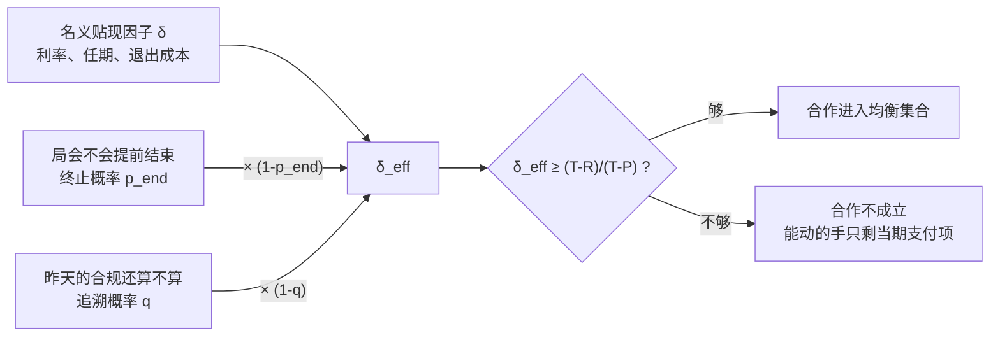

合作不是道德成果，是未来值钱时的副产品。而"未来值多少"是一个可以被制度改动的参数——这不是比喻，它可以推导，也可以测量。

---

## 一、收益表：为什么背叛是占优的

两个对手，各自有两个选择：合作，或者背叛。收益写出来是一张表。

|  | 对方合作 | 对方背叛 |
| --- | --- | --- |
| **我合作** | 3 , 3 | 0 , 5 |
| **我背叛** | 5 , 0 | 1 , 1 |

每格是（我的收益，对方的收益）。数字是示意的，重要的是它们的排序，习惯上写成四个字母：

- $T=5$（Temptation）：我背叛、对方合作，我拿到的诱惑值
- $R=3$（Reward）：双方都合作
- $P=1$（Punishment）：双方都背叛
- $S=0$（Sucker）：我合作、对方背叛，我当的冤大头

**囚徒困境的定义就是 $T>R>P>S$。** 这四个不等式一旦成立，三件事跟着成立。

**第一，背叛是占优策略。** 对方合作时，我背叛拿 5、合作拿 3；对方背叛时，我背叛拿 1、合作拿 0。两种情况下背叛都更好。占优策略的定义就是这个：无论对方怎么做，它都不比另一个差。

**第二，两个人各自理性，加总起来是最坏的结果。** 双方都选占优策略，落到 $(P,P)=(1,1)$；而双方都合作能拿到 $(R,R)=(3,3)$。$(1,1)$ 不是 Pareto 最优——存在一个让双方都更好的结果，却谁也走不过去。这是囚徒困境真正刺耳的地方：**它不是"有人做错了"，它是所有人都做对了之后得到的结果。**

**第三，$(1,1)$ 是纳什均衡，$(3,3)$ 不是。** 纳什均衡的定义是：给定对方的选择，没有人能靠单方面改变自己变得更好。在 $(1,1)$ 上，任何一方单独停手就掉到 0，所以没人想动。在 $(3,3)$ 上，任何一方单独背叛就跳到 5，所以它撑不住。

第三件事最容易被读错：均衡是一个**不动点**，不是一个最大值。当每个人的收益里都含有别人的行动时，"我的最优"依赖"你的最优"，能解出来的只有这种互相咬住的点。"稳定"和"好"因此是两个独立的性质，囚徒困境是它们分家的那个标准例子。

到这里结论是悲观的，而且和所有博弈论通俗读物的第一节一样：背叛占优，合作不可能。这张表内部无解——四个数字给定之后，能推出来的只有 $(P,P)$。唯一的出路是**从外部改变那四个数字**。

但"改数字"这条路有一个前提，而那张收益表没有把它写出来。

---

## 二、重复：δ 从哪里长出来

那张表假设**这局只玩一次**。

如果两个对手明天还要碰面，后天还要，明年还要——背叛还是占优策略吗？

不一定了。因为"今天背叛"的代价不再只是这一期的 $P$，它还包括对方从明天开始的报复。设博弈无限重复，每期的收益按 $\delta\in(0,1)$ 贴现——$\delta$ 就是**明天的收益在今天值多少**。

一直合作到永远，现值是

$$V_C=R+R\delta+R\delta^2+\cdots=\frac{R}{1-\delta}$$

今天背叛一次、拿完 $T$ 之后被对方永久报复，现值是

$$V_D=T+\frac{\delta P}{1-\delta}$$

$V_C\ge V_D$ 整理之后是

$$\boxed{\ \delta \;\ge\; \frac{T-R}{T-P}\ }$$

代入上面那组示意数字：$\delta\ge\frac{5-3}{5-1}=0.5$。**只要明天的收益在今天还值一半以上，合作就撑得住。** 这个门槛低得惊人——但它是一个真实的门槛，跌破它，合作立刻不成立，而且不是因为谁变坏了。

分子 $T-R$ 是背叛一次能多拿的；背叛之后每期少拿的是 $R-P$，两项相加正好等于 $T-P$，也就是分母。所以这个式子读作：**诱惑越大、惩罚越轻，需要的 δ 就越高；未来越值钱，能忍住的诱惑就越大。** $\delta$ 这个名字在文献里叫贴现因子，但它更直白的名字是"未来的影子"——它衡量的是明天在今天的投影有多长。

### 如果不是无限期

无限期是一个强假设。如果博弈有确定的最后一期，逆向归纳会从最后一期往前坍缩：最后一期背叛是占优的，于是倒数第二期合作也没有意义，一路推回第一期——这就是蜈蚣博弈（Rosenthal 1981）与连锁店悖论（Selten 1978）的内容。

但现实里的局很少有一个所有人都知道的最后一期。更常见的是**每期以概率 $p_{\text{end}}$ 意外终止**——不是"最后一期已知"，而是"每一期都可能是最后一期"，而逆向归纳因此无从启动。这时

$$\delta_{\text{eff}}=\delta\,(1-p_{\text{end}})$$

终止概率越高，未来的影子越短，上面那个阈值就越难达到。**$\delta$ 因此不是一个心理参数，它是一个可以被制度改动的量。** 改利率、改任期、改退出成本，都是在改它。

### 还有一个漏点：昨天的合规今天还算不算

推导 $V_C=\frac{R}{1-\delta}$ 时还藏着一个假设：**今天按规则做对了的事，明天仍然被算作做对了。** 上一节动的是"有没有明天"，这一条动的是"明天的账还算不算数"。追溯性执法破坏的正是它——而这个参数，标准重复博弈教材里没有给它名字。

设每期有概率 $q$，你此前积累的合规历史被按今天的标准重新定性，此后的续期价值被打到惩罚水平。把"账目还干净"时的现值记作 $V$，按第一期拆开：这一期拿 $R$；下一期以概率 $1-q$ 仍然干净，值 $\delta V$；以概率 $q$ 被重新定性，从此每期只有 $P$，值 $\delta\cdot\frac{P}{1-\delta}$。

$$V=R+\delta(1-q)\,V+\frac{\delta q P}{1-\delta}$$

含 $V$ 的项移到左边：

$$V\bigl[1-\delta(1-q)\bigr]=R+\frac{\delta q P}{1-\delta}\quad\Longrightarrow\quad V_C=\frac{R+\dfrac{\delta q P}{1-\delta}}{1-\delta(1-q)}$$

$q=0$ 时它退回 $\frac{R}{1-\delta}$，和前面一致。背叛那边不用改：一旦背叛，你已经在惩罚流里了，重新定性无从再降，所以 $V_D=T+\dfrac{\delta P}{1-\delta}$ 照旧。

$V_C\ge V_D$ 两边同乘正数 $(1-\delta)\bigl[1-\delta(1-q)\bigr]$：

$$R(1-\delta)+\delta qP\;\ge\;\bigl[T(1-\delta)+\delta P\bigr]\bigl[1-\delta(1-q)\bigr]$$

左边减右边可以因式分解成 $(1-\delta)\bigl[(R-T)+\delta(1-q)(T-P)\bigr]$。$1-\delta>0$，所以条件就是

$$(R-T)+\delta(1-q)(T-P)\;\ge\;0\qquad\Longleftrightarrow\qquad\boxed{\ \delta\;\ge\;\frac{T-R}{(1-q)\,(T-P)}\ }$$

$q=0$ 时退回原来那个阈值；$q>0$ 时分母缩小，阈值被抬高。同样一个人、同样一个未来、同样的耐心，在 $q$ 高的环境里就是撑不住合作。代入那组示意数字（$T{=}5,R{=}3,P{=}1$），阈值就是 $\frac{0.5}{1-q}$：它随 $q$ 单调上升，到 $q=0.5$ 时正好等于 1——而 $\delta<1$ 是定义域。**每期有一半概率被重新定性时，合作对任何有限耐心都不成立**，不需要谁变坏，也不需要 δ 特别小。

式子还可以读成另一种形状：$\delta(1-q)\ge\frac{T-R}{T-P}$。而上一节里终止概率给的是 $\delta(1-p_{\text{end}})\ge\frac{T-R}{T-P}$。**$q$ 和 $p_{\text{end}}$ 作用在同一个位置上。** 局被提前结束，和过去的合规被重新定性，对"未来值多少"的杀伤是同一笔——都从 δ 上切掉一块。下面那张图里两个漏点汇进同一个 $\delta_{\text{eff}}$，不是画得顺手，是因为它们本来就是同一个参数。

推到这里，能动手的地方就清楚了：**支付项** $T$、$R$、$P$、$S$ 的大小，从外部给背叛重新标价；以及 **δ 本身**，改局的结构。而 δ 只从两处漏——它会不会提前结束（$p_{\text{end}}$）、昨天的账今天还算不算数（$q$），这两条上面都推过了。

还有一层要说清：δ 够大只是把合作**放进均衡集合**，不保证它真的发生。那个集合还有多大、报复可不可信、行动会不会被看错，是三条更细的松动，主线用不到，收在文末附注一。

---

## 三、案例：两条路，各走到了哪里

2020 到 2026 年有两场局：一场是社区团购的补贴大战，一场是上市公司与国企的税务倒查。玩家不同、领域不同，结构却把两处杠杆、两个漏点都推到了台面上——而且第二场量到的那个漏点，第一场里根本测不出来。

### 支付项这条路：顶格罚款走到了尽头

2020 年下半年，社区团购在同一个城市里同时跑着好几家平台。每家每天要做一个决定：明天还补不补贴。

补贴能抢份额：对手不补而我补，用户当天就过来（$T$）；两家都补，钱烧掉了、份额没动，只剩损耗（$P$）；两家都不补，各自把毛利留下（$R$）；自己不补而对手补，被抢走的就是你（$S$）。$T>R>P>S$ 一字不改——第一节那张空表，填进一个真实的市场就是这个样子。于是补贴是占优策略，每家都在补，全行业一起落到 $(P,P)$。

第一个动手改这四个数字的不是局中人。2020 年 12 月 22 日，市场监管总局联合商务部召开行政指导会，对阿里、腾讯、京东、美团、拼多多、滴滴六家提出"九不得"。这是标准的"从外部改那四个数字"的动作，但"九不得"是会议要求，不是规章，没有法律文号，改不动任何一项支付。要真的压低 $T$，需要一张写着金额的罚单。

两个多月后，2021 年 3 月 3 日，市场监管总局对社区团购的低价倾销开出罚单：橙心优选、多多买菜、美团优选、十荟团各 150 万元，食享会 50 万元。150 万不是随手定的数，它是《价格违法行为行政处罚规定》第四条（低价倾销、无违法所得，上限 100 万）与第七条（价格欺诈、无违法所得，上限 50 万）的**合并顶格**，决定书原文就写"合并罚款 150 万元"；食享会只 50 万，因为它只中了后一条。

85 天后的 5 月 27 日，同一个总局对同一家十荟团再罚 150 万顶格，并第一次追加了非货币项——责令江苏区域停业整顿 3 日，答记者问里写的从重理由是"屡查屡犯"。

这两张罚单之间发生的事比金额重要：**第一次罚到了法律允许的极限，行为没有变。**

用第二节的语言说：罚款压低的是 $T$，而阈值 $\delta\ge\frac{T-R}{T-P}$ 的分子分母同时含 $T$。把 $T$ 从 5 压到 4，阈值就从 $0.5$ 降到 $\frac{1}{3}$——罚款确实是有效的，它让合作需要的耐心变少了。

问题是它能压多远。要真正消灭这个困境，得把 $T$ 压到 $R$ **以下**，那时"补贴"不再是占优策略，$T>R>P>S$ 的排序被打破，局本身就不再是囚徒困境。而 150 万相对于一个区域市场的补贴支出与份额收益，做不到这件事：罚到法定上限，$T$ 仍然大于 $R$，占优解还在原地。

所以顶格的含义不是"罚得不够重"，而是**支付项这条路在法律允许的范围内已经走到头了，而尽头没有解决这个问题**。第二次追加停业整顿，动的还是支付项——继续往下压 $T$，只是把成本从罚款换成了营业中断。这是同一维度上的加码，不是换维度。

### 第一个漏点：终止概率被玩家自己造成武器

要换维度，只能去动 δ。而这里其实叠着两个局，δ 在两边的漏法不一样。**横向那个**是平台与平台之间，每天在补贴上互相咬，结构就是第一节那张表；它的出路只有改支付项，而这条路刚刚被证明走到了头。**纵向那个**是监管者与企业之间，一年一年地重复——今年约谈，明年罚款，后年再查。

先看横向这一层。它的 $p_{\text{end}}$ 不是外生的，是玩家自己造出来的。

补贴的真实赌注不只是这一期的份额，而是**对方还能撑几期**。每家烧钱时算的都是同一件事：我的现金比你厚，先撑不住、先撤出这个城市的是你。用第二节的语言说，每一轮补贴都在抬高对手的 $p_{\text{end}}$；而 $\delta_{\text{eff}}=\delta(1-p_{\text{end}})$，$p_{\text{end}}$ 越高，未来的影子越短，"两家都不补"就越撑不住。

**所以补贴打得凶，不是谁算错了账，是这个局在自我强化：越想熬走对方，未来就越不值钱；未来越不值钱，就越只剩熬这一条路。** 第二节那条"终止概率高时合作不成立"的读数，在这里不是一个背景条件，而是被当成武器在用。

而且收益表还少写了一项。表里最大的数是 $T$，可它只覆盖"两家都还在场"的情形；如果对方真的退出，赢家拿到的不是 $T$，是整个市场。这一项没有写进 $T>R>P>S$，却是补贴战真正下注的东西——它让"加速结束这个局"从自杀变成了投资。代价是：在把对方熬走之前，这个局里已经不可能谈成"两家都不补"了。

纵向那个局不一样，$p_{\text{end}}$ 是外生的：业务线撤出、主体注销、负责人更替，都会让某一个具体的局提前结束。但重复本身是确定的——监管者与平台企业不是一次性交易，同一批主体每年都要碰面，所以 $\delta$ 不为零。

而这个局的主要漏点也不是 $p_{\text{end}}$，是第二节那个 $q$——它动的是同一个位置，量级却大得多。

### 第二个漏点：追溯概率写在补税公告里，而且对合作者更狠

$q$ 有多大，取决于到哪里去测。社区团购那一局里测不出来：价格规则被追溯重新解释的情况罕见，罚单上也从来不写这一项。换一个规则密集、账目留痕齐全的领域，$q$ 就直接写在公告里了。2025 到 2026 年的一串上市公司补税公告给出了它的实测值——义务主体换成了国企，但局的结构没换，动的还是同一个参数。

北大荒 2026 年 6 月 18 日收到《税务事项通知书》（哈税一通〔2026〕28 号），6 月 22 日公告：下属 16 家农业分公司从非职工家庭农场取得的土地承包费收入不应享受企业所得税优惠，需补缴 2021 至 2025 年企业所得税 10.24 亿元、滞纳金 3.86 亿元，合计 14.1 亿元，公告明确写了"本次补缴不涉及税务行政处罚"。广西柳工集团 2026 年 3 月 30 日公告，就 2020 年混合所有制改革中的少缴风险自查，补缴企业所得税 4.45 亿元、滞纳金 3.88 亿元，合计 8.33 亿元（柳市柳南税二分通〔2026〕105 号）。山东黄金的全资子公司莱州公司 2025 年 11 月 10 日公告，因两家已注销子公司 2021、2022 年的探矿权无偿划转，补缴企业所得税 5.08 亿元、滞纳金 2.30 亿元，合计 7.38 亿元。

三笔有一个共同结构：**没有一笔是在认定"当年做错了什么"，认定的都是"当年按当时有效的规则处理了，今天这个处理不成立"。** 北大荒的 16 家农业分公司连续五年按免税优惠申报；柳工的公告只说 2020 年混改"存在少缴企业所得税的风险"并要求自查，没有认定任何主观故意；山东黄金的两笔探矿权划转发生在 2021、2022 年，当时按不计入应税所得处理。北大荒那句"不涉及税务行政处罚"是决定性的——**不处罚意味着不认定当时存在应受处罚的违法行为**，剩下的只是重新定性。三笔公告里也都只有补缴税款与滞纳金两项，没有罚款。这是纯粹的 $q$ 事件，不是执法强度事件。

滞纳金本身就是 $q$ 的计价器。《税收征收管理法》第三十二条规定按日加收滞纳税款万分之五，年化 18.25%（单利）。柳工那笔 3.88 亿滞纳金除以 4.45 亿本金是 87%，按日万分之五反推约 **4.8 年**。这个数比金额更说明问题：一笔 4.8 年后才落地的追缴，它在 2020 年做混改决策那个时点的现值，完全由当时的 δ 决定；而 2020 年拍板的人，2026 年已经不在场。**追溯性执法的时间差，天然落在 $p_{\text{end}}$ 和 $\delta$ 这两个参数上，不落在支付项上。**

而且 $q$ 不是一个对所有人一样的数。**$q$ 随合规记录的可见度递增。** 账目越干净、资产越透明、决策链条越有完整凭证，能被拿来重新定性的抓手就越多，$q$ 也就越高；反过来，模糊、粗放、没有留下书面痕迹的操作，恰恰不容易成为倒查的靶子。上面三笔公告的义务主体分别是国有控股上市公司、大型国企集团和国有矿业子公司——它们是全系统里账目最规范的一批。

这意味着追溯性执法不是对所有人均匀地压低未来的现值，它**对合作者压得更狠**。用式子说就是 $q'(v)>0$，$v$ 是合规记录的可见度。于是"伪装平庸"不是一种心态，它是 $q'(v)>0$ 时的最优反应：既然把账做干净会抬高 $q$，那么把可见度主动压低就是理性的。

$q$ 的本质是信用——它量的不是执法严不严，而是主体还信不信第二节那个假设：今天按规则做对的事，明天仍然算数。这也是动 $q$ 真正的代价：罚单量得出补缴的税款，量不出整个系统对规则的信任被抽走了多少。而信用正是 δ 的地基——它一薄，$q$ 就抬高，第二节那个阈值就再也够不着；合作不是被罚垮的，是被不信任垮的。

案例的结论因此是：这一局确实重复，$\delta$ 也确实不为零，但真正在动的是 $q$。而 $q$ 不在任何一份处罚决定书里——罚款和停业整顿动的都是 $T$，只有"规则会不会被追溯重新解释"动 $q$，而它从来没有被当成一个政策变量对待过。

**这就是"追溯性执法收的不是税，是未来"这句话的准确含义。**

---

## 四、同一个 δ 的第二个读数：吹哨不等式

同一个参数还管着另一件事：合作怎么被打破。

设想一个被庇护的产业链条——地方监管者与被监管企业形成长期共谋，内部人轮流分租。要打破它，最常见的处方是设举报奖励。这个处方背后的直觉是：只要举报的收益大于共谋的收益，同盟就会瓦解。

把它写成正确的形式。设 $W$ 为法定奖励，$p$ 为查实概率，$c$ 为举报自身成本（取证、律师、职业中断），$B$ 为举报者每期从共谋中分得的租金，$L$ 为举报后每期承受的报复损失（饭碗霸凌、行业内封杀）。举报成立当且仅当

$$p\cdot W-c \;>\; \frac{\delta}{1-\delta}\,(B+L)$$

左边是当期的一次性净收益，右边是贴现后的**整条未来**：既包括放弃的共谋租金，也包括承受的报复。右边那个 $\frac{\delta}{1-\delta}$ 就是第二节里的几何级数，只是从明天开始算——同一个 δ。

这个式子的形状决定了处方。左边对 $W$ 是线性的，右边在 $\delta\to1$ 时**发散**。而编制内恰恰是 δ 最接近 1 的环境：长期重复、身份稳定、报复手段确定、退出成本极高。**在这种局里，奖励加到多大都补不上右边的发散项。** 加钱不是无效，是渐近无效——$W$ 要按 $\frac{1}{1-\delta}$ 的量级增长才能追上，没有财政这么出钱。

能真正移动这个不等式的只有三个参数：

- **提高 $p$**：让举报者不必独自承担举证风险——独立取证权、强制开示、法定公益诉讼主体资格。
- **压低 $L$**：把报复变得不可执行——技术线独立垂直隶属（地方主官无权开除不肯配合的监测站长）、污点证人豁免、职业黄金降落伞。
- **降低 $c$**：匿名通道、法律援助、举证责任部分转移。

同一个 δ，在第二节里是"合作为什么维持"，在这一节里是"共谋为什么打不破"。两件事是一件事：**δ 越大，明天越值钱，任何需要牺牲明天的动作都越贵。** 举报的价钱不写在奖励金额上，写在"举报之后你还要在这个系统里活多久"上。

---

## 结语：判据是两个问句

只有两个问句：

> **这个局明天还在吗？明天的收益还算数吗？**

第一问问 $p_{\text{end}}$：这是一次性交易还是长期关系，对手会不会离场，任期还剩多久。终止概率高时，未来的影子天然短，能动的手只剩下当期支付项——罚款、押金、违约金、即时结算。这里还要多问一句：$p_{\text{end}}$ 是环境给的，还是对手正在造的。当对方的策略就是把你熬走时，任何以"长期关系"为前提的方案都不成立——第三节那场补贴战就是这么打的。

第二问问 $q$：这条规则的将来值，会不会被昨天的解释推翻。$q$ 高时，动支付项没有用，因为你已经在动了却撑不住阈值；此时真正对症的动作是**降低重新定性的概率**，也就是把规则的将来值锁住。

但这两个问句问的是同一个 δ，而 δ 是一把双刃。第四节那条吹哨不等式是它的另一面：同一个"未来更值钱"，让合作撑得住，也让共谋打不破——δ 越大，任何要牺牲明天的动作（包括举报）都越贵。所以"把未来调贵"不是无条件的好：同样一个动作，在你想让守约者敢合作的局里是解药，在你想让分租者散伙的局里是毒药。先认清你要的是哪一个，再决定把 δ 往哪边推。

两个问句的分工因此是清楚的：第一个是结构问题，第二个是规则确定性问题。[《极简制度论》](https://cj9208.github.io/blog/systems_and_governance/minimal-institutionalism-certainty/)讲的确定性作用在第二个问句上——**它作用在 δ 上**。

回到开头那句话：合作不是道德成果，是未来值钱时的副产品。这两个问句合起来问的其实就是一件事——**在这个系统里，未来现在值多少。**

---

## 附注一：δ 阈值的三条松动

正文第二节把阈值 $\delta\ge\frac{T-R}{T-P}$ 算在最干净的形式上：报复用冷酷触发、惩罚一定落地、行动被完美观察。这三条都是假设，逐条松开得到三个更细的读数。它们不改主线——主线只用"δ 大 → 合作进均衡集合"这一步——但决定"合作会不会真发生"，也是附注二那三处修正的理论出处。放进来是因为它们有意思，不放正文是因为它们会把 $p_{\text{end}}$ 与 $q$ 那两个漏点的干净叙事冲散。

**报复不止一种：民间定理。** 正文那个阈值 $\delta\ge\frac{T-R}{T-P}$ 是在一种特定的报复方式下算出来的：**一旦背叛，对方从明天起永远背叛**。这个策略有个标准名字，叫冷酷触发（grim trigger）。它不是唯一的选择，而阈值的高低恰恰取决于选了哪一种。

换一个温和的：你背叛一次，我只回敬一期——这就是针锋相对（tit for tat，TFT）。报复不再是永久的，背叛的代价小得多，所以维持合作需要更高的耐心：

$$\delta\;\ge\;\frac{T-R}{R-S}$$

代入那组示意数字是 $\frac{5-3}{3-0}=\frac{2}{3}$，比冷酷触发的 $0.5$ 高出一大截。**报复越温和，能撑住的诱惑就越小。**

那么把报复方式全部枚举一遍，δ 够大时究竟能撑住哪些结果？这就是**民间定理**（Folk Theorem）回答的问题。严格陈述是：对任意一个落在阶段博弈支付凸包内、且严格优于对手能对你施加的最坏结果（minmax）的支付向量，只要 δ 足够大，就存在一个**子博弈完美**均衡支撑它（Fudenberg & Maskin 1986；该结论对**两人博弈**成立，玩家多起来之后"可行且优于 minmax"不再够用，要另加条件）。子博弈完美的意思是，这个均衡不只在开局成立，在博弈中途任何一个节点重新开始也成立——威胁是真会执行的，不是空话。

把量词去掉，它说的是两件事：

- **能撑住的结果不止一个。** 互相合作能撑住，一大批介于合作与互相报复之间的结果也能撑住；至于互相背叛，它根本不需要 δ 大——"双方永远背叛"在任何 δ 下都是均衡。
- **定理保证的是存在，不是唯一，也不排好坏。** 它有两个条件、一个存在量词，**没有一个"最"字**。

这条定理在本文里只干一件事：**让"合作是均衡之一"里的"之一"两个字有分量。** 后面凡是说某个局"能维持合作"，说的都是合作在均衡集合里，不是合作会发生。δ 够大只是把一大批结果同时摆上台面，最后落到哪一个，数学不回答——那是制度、历史与谁先动手的问题。附注二要修正的第一处旧判断，正是把这个集合当成了只有一个点。

**报复会不会执行：可验证性与声誉。** 冷酷触发那个阈值 $\delta\ge\frac{T-R}{T-P}$ 默认了一件事：背叛之后那个 $P$ 真的会落地。可报复本身往往要付成本，又没有第三方能核查它到底执行了没有——这时"你背叛我就报复"是一句廉价谈话，$V_D$ 里的 $P$ 根本不会出现，阈值算得再低也没用。这条直接接上[《摩擦的税》](https://cj9208.github.io/blog/systems_and_governance/unverifiable-labor-protection-trilateral-friction/)的判据：一项规则的执行成本取决于它的判定项是否可验证。**维持合作需要的不只是未来值钱，还需要未来的惩罚是可核实的。**

民间定理里"子博弈完美"那个条件说的正是这一点。而它有一个反方向的补救：惩罚核不实的时候，声誉可以顶上来。Kreps–Wilson（1982）、Milgrom–Roberts（1982）与 Fudenberg–Tirole（1983）证明，只要对手认为存在极小概率你是"疯掉的"类型（不按收益行事、就是会报复），那么即使在一个长但有限、逆向归纳本该把合作一路推倒的局里，威胁也重新可信。**所以"δ 小就必然不合作"是错的。**

但要看清声誉补的是哪一格。它改变的不是那个人的 δ，而是**对手对"$P$ 会不会落地"的推断**。一个组织里"这人不好惹"的名声，功能上等价于把他的报复从不可核实变成可信——它顶替的是可验证性，不是耐心。

**报复会不会打偏：噪声。** TFT 那个阈值还假设了另一件事：行动被完美观察。现实里存在误解、执行失误、归因错误——一次无意的失手被读成背叛，TFT 的无条件回敬引发对方回敬，两个"友善"的策略陷入永久互相惩罚。此时宽容度成为必需参数，而 TFT 恰恰没有。**噪声下的正确结论与无噪声时相反：观察干净时"报复越温和越撑不住"，可观察一旦出错，不肯原谅的那个才是脆弱的。** Nowak 与 Sigmund（1993）的"赢了坚持、输了改变"（win-stay, lose-shift）在有噪声环境下优于 TFT，正因为它能从双方的错误里恢复。组织里"每次都要讨个说法"的文化之所以耗散，就是因为它实现的是无噪声假设下的 TFT。

有一件事常被并进这一条，但不该并：Press 与 Dyson（2012）的零行列式（ZD）策略能成对压制 TFT，而那是在观察无误的前提下构造出来的。一旦双方会看错对方的行动，原来那组策略就锁不住它想锁的收益关系，得重新构造一批才行（Mamiya & Ichinose 2019、2020；Cheng 等 2022）。所以 ZD 不是噪声问题的答案，它自己先得被噪声改造一遍。

---

## 附注二：三处需要修正的旧判断

这三处都是本站旧文里的判断，方向没错，错在把条件句写成了无条件句。放在附注里，是因为它们是本文的自查，不是叙事的一部分。

**一、[《职场的"分布式共生"》](https://cj9208.github.io/blog/ai_era_engineering_careers/distributed-symbiosis-tit-for-tat/)：TFT 那句。** 原句写"在无限次重复博弈的复杂长周期系统中，TFT 被数学证明是让自身收益最大化的纳什均衡"，错了三层。

- **TFT 是策略，不是均衡。** 均衡是一个策略组合。(TFT, TFT) 是均衡，(冷酷触发, TFT) 也是均衡，(永远背叛, 永远背叛) 同样是均衡。
- **它不是"收益最大化"的那一个。** 附注一已经把民间定理的严格陈述放在那里了：两个条件、一个存在量词，**没有一个"最"字**。互相仇杀拿到的 $P$ 同样是均衡支付，定理不偏袒任何一方。
- **锦标赛测的不是这个。** 阿克塞尔罗德的两届计算机竞赛（1980 年 14 条策略、1984 年 62 条，各加一条随机策略）测的是**在一个特定策略池里的循环赛平均分最高**，不是逐对战胜。而"换个池子结论就变"这件事，阿克塞尔罗德自己演示过一遍：分析完第一届结果后他判断，宽容两次的 Tit for Two Tats 若参赛会夺冠，于是第二届亲自把它送进去——结果 TFT 又赢了。同一个策略，在两个池子里一次是冠军、一次不是。能成对压制 TFT 的策略后来也被明确构造出来，Press 与 Dyson（2012）的零行列式策略是一例；不过那是观察无误前提下的构造，与附注一那条噪声读数讲的不是同一件事。

正确的说法只有一句：**δ 足够大时，(TFT, TFT) 是重复囚徒困境的一个子博弈完美均衡。** 它既不唯一，也不最优，更不是道德的胜利。原句的差别落在**均衡集合的大小**上——它把一个集合当成只有一个点。

**二、[《零余量时代的微观窒息》](https://cj9208.github.io/blog/systems_and_governance/chinese_government/retroactive-audit-malicious-compliance/)：伪装平庸那句。** 原句写"当微观主体发现自己越努力、资产越透明，被抽血的比例就越高、被倒查的风险就越大时，理性的最优选择会迅速转向'伪装平庸'"，同一篇附注里写"资本极度短期化，所有人拒绝为未来买单"。这两句本来就对，缺的只是名字。模型给出的是 $q'(v)>0$：追溯概率随合规可见度递增，于是伪装平庸是最优反应而不是心态；"拒绝为未来买单"是 $\delta_{\text{eff}}$ 跌破阈值之后的同一个状态。差别在 **$q$ 这个参数上**：$q$ 的推导在第二节，$q'(v)>0$ 的论证在第三节。

**三、[《论中国微观治理中的官僚博弈与防御性共谋》](https://cj9208.github.io/blog/systems_and_governance/chinese_government/defensive-collusion-bureaucracy/)：吹哨那句。** 原句写"只要团队中有一个人当吹哨人的收益远大于参与共谋的收益，'跨部门生死同盟'的信任链条就会在瞬间土崩瓦解"，并把共谋者面临的局面标注为囚徒困境。标注不算全错——它确实需要一个支付结构调整。错的是把一个**序贯、有报复、无限重复**的博弈写成了一次性矩阵，于是"瞬间"这个副词站不住。模型给出的是第四节那条不等式：右边随 δ 发散，加钱是渐近无效的杠杆；那篇附注"信息结构重构"一节开的三项措施里，技术线垂直隶属动的是 $L$（对的）、污点证人豁免动的是 $L$、$c$ 与 $p$（对的）、"高额经济奖励"动的是 $W$（三项里唯一渐近无效的那一个）。差别在 **δ 的量级**上。

三处的共同点是：结论方向都没错，错的都是**把条件句写成了无条件句**。δ 足够大时合作可维持——这是条件句；TFT 是收益最大化的均衡——这是无条件句，而它不成立。

---

## 延伸阅读

- [《职场的"分布式共生"：从博弈论的 Tit-for-Tat 到技术团队的系统架构》](https://cj9208.github.io/blog/ai_era_engineering_careers/distributed-symbiosis-tit-for-tat/)——"TFT 被数学证明是收益最大化的纳什均衡"这句的出处：δ 足够大时它是**一个**均衡，不是唯一的、也不是最优的那个。
- [《零余量时代的微观窒息：从"强力倒查"到"恶意合规"的系统性异变》](https://cj9208.github.io/blog/systems_and_governance/chinese_government/retroactive-audit-malicious-compliance/)——"伪装平庸"与"拒绝为未来买单"的出处：直觉本来就对，缺的是 $q'(v)>0$ 这个形式。
- [《论中国微观治理中的官僚博弈与防御性共谋》](https://cj9208.github.io/blog/systems_and_governance/chinese_government/defensive-collusion-bureaucracy/)——"信任链瞬间土崩瓦解"那句的出处："信息结构重构"一节的三项措施里两项动对了参数，"高额经济奖励"动错了。
- [《摩擦的税：不可验证的劳动保护如何让三方同时全职化》](https://cj9208.github.io/blog/systems_and_governance/unverifiable-labor-protection-trilateral-friction/)——惩罚不可公开验证时，威胁是廉价谈话；那条反向读数的判据来自这里。
- [《极简制度论：确定性作为社会秩序的底层协议》](https://cj9208.github.io/blog/systems_and_governance/minimal-institutionalism-certainty/)——结语第二个问句（规则会不会被追溯重新解释）问的就是它讲的确定性，落点在 δ 上。

---

## 参考文献

本文的模型与两则附注依据下列文献：

- 民间定理：Fudenberg & Maskin (1986), "The Folk Theorem in Repeated Games with Discounting or with Incomplete Information", *Econometrica* 54(3):533–554（[JSTOR](https://www.jstor.org/stable/1911307)）；更早的版本见 Aumann–Maschler 1966 未刊讲稿与 Friedman 1971。严格陈述限于两人博弈，n 人情形需另加条件。
- 子博弈完美：Selten (1965)；连锁店悖论 Selten (1978), "The Chain Store Paradox", *Theory & Decision* 9:127–159（[Springer](https://link.springer.com/article/10.1007/BF00131770)）。
- 有限期内的声誉效应：Kreps & Wilson (1982), "Reputation and Imperfect Information", *JET* 27(2):253–279（[doi](https://doi.org/10.1016/0022-0531(82)90030-8)）；Milgrom & Roberts (1982), "Predation, Reputation, and Entry Deterrence", *JET* 27(2):280–312（[doi](https://doi.org/10.1016/0022-0531(82)90031-X)）；Fudenberg & Tirole (1983), "Sequential Bargaining with Incomplete Information", *REStud* 50(2):221–247。
- 蜈蚣博弈：Rosenthal (1981), "Games of Perfect Information, Predatory Pricing and the Chain-Store Paradox", *JET* 25(1):92–100（[RePEc](https://ideas.repec.org/a/eee/jetheo/v25y1981i1p92-100.html)）。
- 噪声与策略：Nowak & Sigmund (1993), "A Strategy of Win-Stay, Lose-Shift That Outperforms Tit-for-Tat in the Prisoner's Dilemma Game", *Nature* 364:56–58（[nature.com](https://www.nature.com/articles/364056a0)）；Press & Dyson (2012), "Iterated Prisoner's Dilemma Contains Strategies That Dominate Any Evolutionary Opponent", *PNAS* 109(26):10409–10413（[doi](https://doi.org/10.1073/pnas.1206569109)）。
- ZD 与观察误差：Mamiya & Ichinose (2019), "Strategies that enforce linear payoff relationships under observation errors in Repeated Prisoner’s Dilemma game", *J Theor Biol* 477:63–76（[doi](https://doi.org/10.1016/j.jtbi.2019.06.009)）；Mamiya & Ichinose (2020), "Zero-determinant strategies under observation errors in repeated games", *Phys Rev E* 102(3):032115（[doi](https://doi.org/10.1103/PhysRevE.102.032115)）；Cheng, Chen & Hong (2022), "Misperception influence on zero-determinant strategies in iterated prisoner’s dilemma", *Sci Rep* 12:5174（[doi](https://doi.org/10.1038/s41598-022-08750-8)）。

---

## 事实与来源

本文涉及的处罚、公告与法条以下列来源为准，数字为撰写时（2026 年 10 月）的公开信息：

- 第一节收益表里的 $5/3/1/0$ 是**示意值**，不来自任何真实财务数据；有效的信息只有排序 $T>R>P>S$。第三节把补贴大战映射到这张表上，映射本身也只是定性的——四格收益没有对应的实测数字。
- 2020 年 12 月 22 日"九不得"行政指导会由**市场监管总局联合商务部**召开，参加企业为阿里、腾讯、京东、美团、拼多多、滴滴**六家**。"九不得"是会议要求，不是规章，无法律文号。来源：[市场监管总局答记者问](https://www.samr.gov.cn/xw/zj/art/2023/art_49a989efcf5d4632a42c0289472a42a6.html)（总局官网，原文写明"2020年12月22日，市场监管总局联合商务部组织召开规范社区团购秩序行政指导会"并列出九个不得）；六家参会企业名单见[21世纪经济报道](https://news.sina.cn/j_uc.d.html?docid=iznezxs8375892)——总局那篇答记者问只写"五家社区团购企业"（受罚主体），不列参会的六家平台，两个数字指的是不同的名单。
- 2021 年 3 月 3 日处罚决定：橙心优选（北京）科技发展有限公司、上海禹璨信息技术有限公司（多多买菜）、深圳美团优选科技有限公司、北京十荟科技有限公司（十荟团）各 150 万元，武汉七种美味科技有限公司（食享会）50 万元，合计 650 万元；决定书 2021 年 3 月 11 日在市场监管总局官网公布。**150 万元是《价格违法行为行政处罚规定》（国务院令第 585 号）第四条上限 100 万与第七条上限 50 万的合并顶格，不是《价格法》设定的金额上限**——《价格法》第四十条不设金额上限。食享会只被认定价格欺诈一项，故为单条顶格 50 万。来源：[市场监管总局答记者问](https://www.samr.gov.cn/xw/zj/art/2023/art_49a989efcf5d4632a42c0289472a42a6.html)（含"共计处以罚款650万元"）；逐家金额见[财联社当日报道](https://m.cls.cn/detail/696038)；决定书 3 月 11 日官网公布见[媒体报道](https://news.sina.cn/j_uc.d.html?docid=kkntiak8216606)。法规原文：[《国务院关于修改〈价格违法行为行政处罚规定〉的决定》（国务院令第585号）](https://www.gov.cn/govweb/zhengce/2010-12/10/content_2602569.htm)——第四条"没有违法所得的，处10万元以上100万元以下的罚款"、第七条"没有违法所得的，处5万元以上50万元以下的罚款"，两个上限均以该页原文为准。
- 2021 年 5 月 27 日对十荟团再处 150 万元顶格罚款并责令江苏区域停业整顿 3 日，文号国市监处〔2021〕38 号，见新华社当日报道；总局答记者问以"屡查屡犯"等法定从重情形说明，并称这是总局成立以来首次开出比单纯罚款更高的"罚单"。来源：[市场监管总局官网专页](https://www.samr.gov.cn/xw/zj/art/2023/art_054aa1dab46d4cb8a760e2f46e290d5b.html)（附件即《国家市场监督管理总局行政处罚决定书 国市监处〔2021〕38号》，文号以该附件为准）；[新华社当日报道](http://www.xinhuanet.com//2021-05/27/c_1127499786.htm)（未载文号）。
- 滞纳金费率日万分之五（年化 18.25%，单利）出自《中华人民共和国税收征收管理法》**第三十二条**，见国家税务总局法规库。第三十二条规定费率，第五十二条规定追征期，两者不可混引。柳工那笔 3.88 亿滞纳金 ÷ 4.45 亿本金 = 87%，按日万分之五反推约 1,745 天 ≈ 4.8 年，与 2020 纳税年度、2026 年初缴纳的时间线一致。来源：[《中华人民共和国税收征收管理法》全文（国家税务总局法规库）](https://fgk.chinatax.gov.cn/zcfgk/c100009/c5195081/content.html)——第三十二条原文"从滞纳税款之日起，按日加收滞纳税款万分之五的滞纳金"。
- 北大荒《关于补缴税款相关事项的公告》2026 年 6 月 22 日，通知书哈税一通〔2026〕28 号（2026 年 6 月 18 日收到），补缴企业所得税 10.24 亿＋滞纳金 3.86 亿＝14.1 亿，公告原文写明"本次补缴不涉及税务行政处罚"，全额计入 2026 年当期损益，导致上半年归母净利润 −5.37 亿元。来源：[公告原文 PDF（巨潮资讯网）](http://static.cninfo.com.cn/finalpage/2026-06-23/1225380184.PDF)。**一处日期口径需要说明**：义务主体全称是黑龙江北大荒农业股份有限公司；公告落款为二〇二六年六月二十三日，巨潮披露页也归在 6 月 23 日，但证券时报、第一财经等多家媒体按"6 月 22 日（盘后）发布"报道，正文因此写 6 月 22 日——两个日期指同一份公告，差别在落款日与披露时点。金额、文号与"不涉及税务行政处罚"一句均以公告 PDF 原文为准。
- 广西柳工**集团有限公司**（债券发行人、上市公司柳工股份的控股股东，不是柳工股份本身）《关于涉税事项的公告》2026 年 3 月 30 日，通知书柳市柳南税二分通〔2026〕105 号，补缴企业所得税 444,989,646.40 元＋滞纳金 388,200,659.04 元＝833,190,305.44 元。公告未披露具体触发环节，市场上关于"12 个月锁定期"的解释属分析推断，不是公告文本。来源：[公告披露文件 PDF（上交所债券 244359.SH"25柳工K1"披露件）](https://pdf.dfcfw.com/pdf/H2_AN202603301820869739_1.pdf)；[新浪财经全文转载](https://finance.sina.com.cn/roll/2026-04-01/doc-inhsxvfk1977593.shtml)。金额、文号、2020 年混改三项均以披露件原文为准；披露主体为广西柳工**集团**有限公司本身，不是柳工股份。
- 山东黄金矿业股份有限公司公告临 2025-076，**2025 年 11 月 10 日**（不是 2026 年），义务主体为全资子公司山东黄金矿业（莱州）有限公司，补缴企业所得税 508,405,441.41 元＋滞纳金 229,934,918.44 元＝738,340,359.85 元。5.08 亿税款计入递延所得税资产、不冲击当期损益，只有 2.30 亿滞纳金进入 2025 年归母净利润。注意与山金国际（000975）2026 年 10 月 16 日另行公告的 2.87 亿补税事项区分，两者无关。来源：[山东黄金公告原文 PDF（巨潮资讯网，编号临2025-076）](http://static.cninfo.com.cn/finalpage/2025-11-11/1224795680.PDF)；[山金国际《关于子公司缴纳税款的公告》PDF](http://static.cninfo.com.cn/finalpage/2026-10-17/1225607958.PDF)（义务主体为吉林板庙子矿业有限公司，原因是部分业务不满足高新技术企业所得税优惠条件，补缴 2023 至 2025 年度税款及滞纳金 28,722.06 万元，同样写明不涉及行政处罚）——两笔的公司、成因、年度都不同，本文只用山东黄金那笔。
