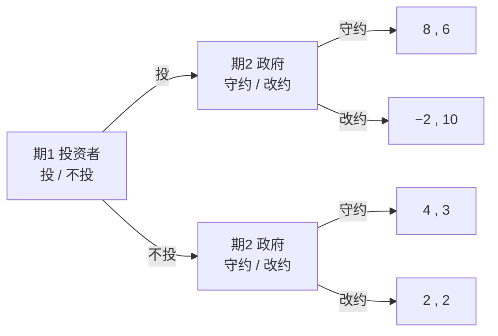

一句话值不值钱，不看它说得多重，看说话的人当场关掉了哪扇门、门把手交到了谁手里。

一个手里握着规则的人，说"我保证不改"没人信；要让这句话有人信，他必须付出什么。**可信是靠放弃选择权买来的，而它的价格就是事后最优与守约之间的那道落差，不随耐心走。**

---

## 一、两期之后，"改"才划算

玩家两个：一个要把资产放进来的人（建厂、把资金账户迁过来、签十年长约），一个定税率的人。定税率的人先宣布规则，放资产的人先动，然后规则可以再定一次。宣布不花钱，所以它在树上不占一层。

动作各取两个：投资者"投 / 不投"，政府"守约 / 改约"。改约的意思是：对已经落地的资产重定税率、重新解释口径。每格收益写成（投资者，政府）。

|  | 政府守约 | 政府改约 |
| --- | --- | --- |
| **投资者投** | 8 , 6 | −2 , 10 |
| **投资者不投** | 4 , 3 | 2 , 2 |

数字是示意的，重要的是它们之间的排序。这张表里有两条排序要紧。

**第一，改约只在对方已经投了之后才划算。** 对方投了，改约拿 10、守约拿 6；对方没投，改约拿 2、守约拿 3。**所以"改"不是占优策略**——占优要求在两种对手面前都不更差，而它在后一列反而更差。这正好是囚徒困境的反面：囚徒困境里背叛对两种对手都占优，谁先动都是这个结局；这张表里"改"的划算完全依赖一个条件，而这个条件是对方在上一步替你造成的。

**第二，最好那一格撑不住。** $(投,守)$ 给 $(8,6)$，可给定对方投了，政府单独换到"改约"就从 6 跳到 10。反过来 $(投,改)$ 也撑不住：投资者单独退到"不投"就从 $-2$ 回到 $2$。四个角逐个试一遍，**这张表在一次性博弈的写法下没有纯策略纳什均衡**——每一个角上都有人想动。

"没有均衡"不是这张表的缺陷，它在提醒一件事：这张表不能用收益表解，只能用时序解。倒着推。

**期 2：** 对方投了 → 改约（$10>6$）；对方没投 → 守约（$3>2$）。

**期 1：** 投资者知道这个答案。投，落到 $(投,改)$ 拿 $-2$；不投，落到 $(不投,守)$ 拿 $4$。→ 不投。

结局是 $(不投,守)$，收益 $(4,3)$。

**这个结局里没有人做错事。** 政府守了约，因为它没有可改的东西；投资者做了最优反应，他确实不该投。双方拿到的比 $(8,6)$ 那一格分别少 4 和 3，而没有任何一方违规、短视或心怀恶意。**坏均衡不是有人做错了，是对方不敢开始。** [《未来的影子》](https://cj9208.github.io/blog/systems_and_governance/game_theory/discount-factor-retroactive-enforcement/)说过囚徒困境刺耳的地方是"所有人都做对了之后得到的结果"；这句话在这里同样成立，但机制换了——那里是两个占优策略撞在一起，这里是逆向归纳往回退了一格。

---

## 二、加罚没有删掉那一行，只是把它往上挪了一层

"改"这一行看上去很好删：给违约挂一笔罚金 $F$ 就够了。把 $F$ 挂在政府的"改约"这个动作上（从政府的收益里扣，先不管它付给了谁），表变成：

|  | 政府守约 | 政府改约 |
| --- | --- | --- |
| **投资者投** | 8 , 6 | −2 , $10-F$ |
| **投资者不投** | 4 , 3 | 2 , $2-F$ |

还是倒着推，跟开头那张表同一个推法。

**期 2：** 对方投了，守约当且仅当 $6>10-F$，也就是 $F>4$；对方没投，守约当且仅当 $3>2-F$，只要 $F>0$ 就成立。**取严的那条是 $F>4$：到了它上面，"改约"在两列里都不划算，守约升级为占优。**

**期 1：** 投资者预期到守约，投（$8>4$）。

**结局：** $(投,守)$，收益 $(8,6)$，最好那一格保住了。

这就是所有"提高违规成本"式处方在纸面上都跑得通的原因：它只动支付，不动人心，而且动得很少——一个数字。

但有一步没写在这张表上：**罚金不会自己到账。**"改约"之后还有一次选择，由同一只手来做（下面只写政府一侧的收益）：

|  | 缴 | 豁免 |
| --- | --- | --- |
| **已经改约** | $10-F$ | $10$ |

豁免省下一整笔 $F$，而这张小表里没有给它记别的代价。于是豁免占优，**而且罚金定得越高，豁免越值得**——$F$ 这个数自己给自己造出了绕过它的动机。把这一步预见回去，期 1 的投资者看到的仍然是 $10$ 对 $6$：**上面那张表被这张表撤销了。** 要让罚金真的说话，就得给"豁免"也挂一笔罚金 $F_2$；而 $F_2$ 要不要缴，又是一次选择。

所以不必说"权力不受约束"这类大词，树自己就把结论给出来：**加罚没有删掉"改"那一行，只是把"改"往上挪了一层。** 每一层的处方都是"再挂一笔罚金"，每一层的执行都回到同一只手。递归要么在某一界真的删掉一行——在那里它不再是"我以后不改"，而是"我改不了"。

断掉的那一界就是承诺的定义：**承诺不是一次更强的意图表达，是一次选择集的收缩。** Schelling（1960）举的例子全是这一类：把船烧了、把钥匙扔进海里、把决定权交给一个不由自己任命的人。它们的共同点不是决心，是**动作变少了**。

### 删掉那一行，值 3，也要付 4

收缩选择集不是白做的。价和成本都写在同一张表上，两边都不用估。不绑的结局是 $(不投,守)$，政府拿 3；删掉"改约"这一行，投资者敢投，政府拿 6——**挣的就是这 3，两个数相减**，它的来源是别人敢把钱放进来。成本在期 2 那一步：对方投了之后，改约拿 $10$、守约拿 $6$，删掉这一行就等于把 $10$ 那一格划掉，**放弃的是 4**，记作 $\pi$。

$$\text{绑住值得做}\iff\underbrace{6-3}_{\text{有人敢投}}\ \ge\ \underbrace{\pi}_{\text{改不了，事后少收的}}$$

**这条式子在表里没有解，因为 $3<4$。** 把"改"整行删掉，等于连期 2 那条更划算的路一起封死，而封掉的那条路比换来的那点信任更贵。式子要成立只能改范围：整行删是放弃全部的事后最优，**按格删是只放弃其中最贵的那几格**，省下的和让出去的都按格计。所以这一节的话可以收成一句：**绑住划不划算，看事后最优与守约之间的落差有多大。**

$\pi$ 在表里就是 4。搬到现实里它有多大，看那一刻已经沉进来、等着被重定的资产有多少——这个数没有公开记录，本文只给式子的形状，不给读数。

---

## 三、把"我改不了"做成事实

第二节那笔账是政府自己算的，可它换来的东西在对方手里：只有投资者**看见**那一行确实被删掉了，他才敢投。"改不了"要成为事实，得同时满足三件事，三件都能当场核对。

（a）**不可逆**：撤销它要付一笔**已经发生**的成本——现在花钱、花权力、花脸面，而不是将来罚你。烧掉的船不能靠再说一次来重新烧。

（b）**可观察**：对方在决定投不投之前，就看得见 (a)。

（c）**验收不在自己手里**：确认与放行这道门由别人握着。

缺 (a) 就只是措辞；有 (a) 缺 (b)，钱付了没人收到；有 (a)(b) 缺 (c)，你承诺的是**一个数额**（税率、金额、期限）——只要对面有人已经把资产放进来，改一下就比守着多收，这个数额必弯；三条齐全，你承诺的才是**一个流程**，弯的时候留下代价和痕迹。**判据句：看一项承诺弯了之后还剩什么。** 还剩流程，说明原本绑的是流程；什么都不剩，说明原本只绑了一个数字。

这三条也解释了为什么现实的装置很少落在 0 与 1 这两端：法条留着修订程序，宪法留着紧急条款，独立机构的授权范围总得有人解释——"改不了"通常只能做成"改起来很贵"。于是真正要判断的从来不是"绑没绑"，而是**相机权被留在了哪一层、那一层给谁看**。摊开到可以核对的部分越确定，别人敢沉进去的投入越多；留下的相机权越窄，保费越低。

---

## 四、买不起保单的人买声誉

"看重长远的人才守规矩"这句常见说法只说对一半，说错的那半正好落在 $\delta$ 上。声誉不删任何一行，它靠的是"这期改了，下期的钱就不进来"。把第一节那张表重复着玩，每期有一批新的投资者进入：改约的当期好处是 $10-6=4$，代价是以后每期从 6 掉到 3。守约能靠声誉撑住的条件是

$$\frac{6}{1-\delta}\ \ge\ 10+\frac{3\delta}{1-\delta}\iff 6\ \ge\ 10(1-\delta)+3\delta=10-7\delta\iff \delta\ \ge\ \frac{4}{7}\approx0.571 .$$

**这条的形状与[《未来的影子》](https://cj9208.github.io/blog/systems_and_governance/game_theory/discount-factor-retroactive-enforcement/)那条阈值一样**：一边是守下去的现值，一边是背弃的当期所得加贴现后的惩罚，解出一个下限；差别只在惩罚从哪来——那里是对手的报复，这里是对手不再进来。

声誉与保单是同一件事的两种买法，谁便宜用谁。声誉的价格随耐心走：$\delta$ 掉到 $4/7$ 以下，以后每期的 3 贴现回来抵不过当期那 4，这条腿断了。保单的价格随事后落差走，第二节那笔账已经给出它的读数：$\pi=4$ 大于挣到的 3，**整行删是亏本的，买得起的只有按格删**。两笔账合起来给出本节真正的读数——**$\delta$ 小删掉的是声誉，删不掉规则**：一条写进成文法的税率、一道由别人握着的否决权，都不要求未来值钱。而耐心很足的时候声誉这条腿不用当期掏钱，保单反而涨价：敢做成不可逆的投入越多，能被动的那个基数就越大。

所以"早点把规则写死"之所以划算，理由很平——**那时候沉下去的资产还薄，要放弃的事后最优也薄。**

### 三笔钱落在三个时点

三笔钱的时点不一样。不可逆的成本在期 1 付；收益也在期 1 出现，形式是对方从"不投"换成"投"，于是政府往后每期拿 6 而不是 3；保费付在期 2 那一步——本来是"投已经进来了，改一下更划算"，绑住之后走不了这一步，少收的就是它。这个错位解释了承诺为什么总是被推迟：**在一个必须当期交账的系统里，成本记在自己的账上，而收益记在别人的账上。**

---

## 结语：判据是一句话，按顺序问

一句政策的话值多少钱，不看它的措辞有多重。看三件事，而且只有这个顺序：**它关掉了哪扇门；门把手在谁手里；开锁的代价由谁付、什么时候付。**

先问门，因为不关任何一门的承诺没有价格。再问把手，因为把手在自己手里的门，随时都在别人的行情里。最后问谁付钱——如果付钱的是"将来的某个时候"，那笔钱和没付一样；只有已经花掉的、别人看得见的、验收不在自己手里的，才是真付了。

---

## 附注一：可相信的三种机制，挂在三个不同的东西上

"他说的话能信吗"这一格，本站前两篇和本文各给了一个答案，它们不互相替代，挂在三个不同的参数上。

[《未来的影子》](https://cj9208.github.io/blog/systems_and_governance/game_theory/discount-factor-retroactive-enforcement/)的答案挂在 **δ**：未来足够值钱，合作才撑得住。它管的是重复如何改变动机，也管追溯性执法如何把这份价值抽走。

[《昂贵不等于可分离》](https://cj9208.github.io/blog/systems_and_governance/game_theory/costly-signals-are-not-separating/)的答案挂在**成本梯度**：一个声明可信，不是因为说的人花了大钱，是因为假话对他来说比真话更贵。它管的是不完全信息。

本文的答案挂在**选择集**：可相信不来自更强的意图表达，来自当场少掉一个动作。它管的是同一张收益表在有时间差之后会退到哪里。

三者互为替代，不是并列：δ 大到一定程度，声誉这条腿不用当期掏钱，保单就不必买；成本梯度足够陡，验货这道门就可以租出去，不必自己锁；而博弈会被终止、违约又没人看得见的时候，δ 买不到东西，只能靠写进成文法的那一格——那一格改起来最贵，改的时候也最显眼。

---

## 附注二：需要补充与改判的两处旧判断

两处都在 [《指标的内爆与协议的重构》](https://cj9208.github.io/blog/systems_and_governance/goodharts-law-protocol-reconstruction/)：一处补机制，一处改判。

**一、有名字，没有机制。** 该文写"需要系统交出自己的部分权力，形成可信承诺（Commitment Device）"。这句里"交出一部分权力"对应的是本文第二节那一步——**承诺＝把树上那一行删掉**；它缺的半句是删行凭什么被相信，那在第三节：当场可核对，而且验收不在自己手里。

**二、"绝不可能单方面撕毁"。** 该文这句把"承诺很硬"写成了"承诺不可撤销"。本文对应的点是第三节的 (c)：验收不在自己手里时，改得动的是数额，留下代价和痕迹的是流程。所以"单方面"三个字准，"绝不可能"不准。

---

## 延伸阅读

- [《未来的影子：合作是 δ 的函数，不是道德的成果》](https://cj9208.github.io/blog/systems_and_governance/game_theory/discount-factor-retroactive-enforcement/)——同系列第一篇：δ 与阈值那条式子的出处，本文第四节用的声誉阈值与它同形，差别只在惩罚从哪来。
- [《昂贵不等于可分离：信号与筛选》](https://cj9208.github.io/blog/systems_and_governance/game_theory/costly-signals-are-not-separating/)——"只有措辞"那一格的形式化：不可观察的信号等于廉价谈话，本文的 (b) 是它在时间轴上的样子。
- [《指标的内爆与协议的重构》](https://cj9208.github.io/blog/systems_and_governance/goodharts-law-protocol-reconstruction/)——本文两处修正的落点：那里给了承诺的名字，这里补上它凭什么有效、硬的又是哪一格。
- [《秩序与穿透：论治理体系中"合规"与"动员"的内在张力》](https://cj9208.github.io/blog/systems_and_governance/order-compliance-mobilization/)——把例外写成程序：第三节 (c) 那道"不在自己手里的门"在治理体系里的对应物，门没有被拆掉，只是把裁决挪到事前、交给另一只手。
- [《零余量时代的微观窒息》](https://cj9208.github.io/blog/systems_and_governance/chinese_government/retroactive-audit-malicious-compliance/)——相机权留在组织内部时的样子：中层握着"这次算不算违规"的裁量，于是所有人先为那道门付钱。

---

## 事实与来源

**模型与文献。**

- Kydland & Prescott (1977), "Rules Rather than Discretion: The Inconsistency of Optimal Plans", *Journal of Political Economy* 85(3):473–491——时间不一致的标准陈述。本文第一节的 $2\times2$ 是它的两期最小化示意，数字为示意值，重要的是排序。
- Schelling (1960), *The Strategy of Conflict*, Harvard University Press——承诺＝选择集的收缩；烧船、扔钥匙、把决定权交给别人这一类技术。
- Rogoff (1985), "Constraints on Governments as Commitment Strategies", *Quarterly Journal of Economics* 100(4):1169–1189——承诺是连续量、最优解常在一半的那一支结论；本文只取"程度可测"与第二节 $3<4$ 之后"只能按格删"这个方向，最优绑定范围不在本文里解。
- Barro & Gordon (1983), "Rules, Discretion and Measurement in a Positive Theory of Policy", *Journal of Monetary Economics* 12(1):101–121——相机行情的租金形式。
- Elster (1979), *Ulysses and the Sirens*, Cambridge University Press；(2000), *Ulysses Unbound*, Cambridge University Press——自我约束的两类有益限制这一主题，本文只取书名与主题。

**一处只有形式、没有读数的地方。** $\pi$ 的数值：表里它是示意的 $4$，搬到现实里要看那一刻已经沉进来、等着被重定的资产有多少；资本会在多长时间内撤出、撤多少没有公开记录，正文只给它与 $3$ 的比较关系。
