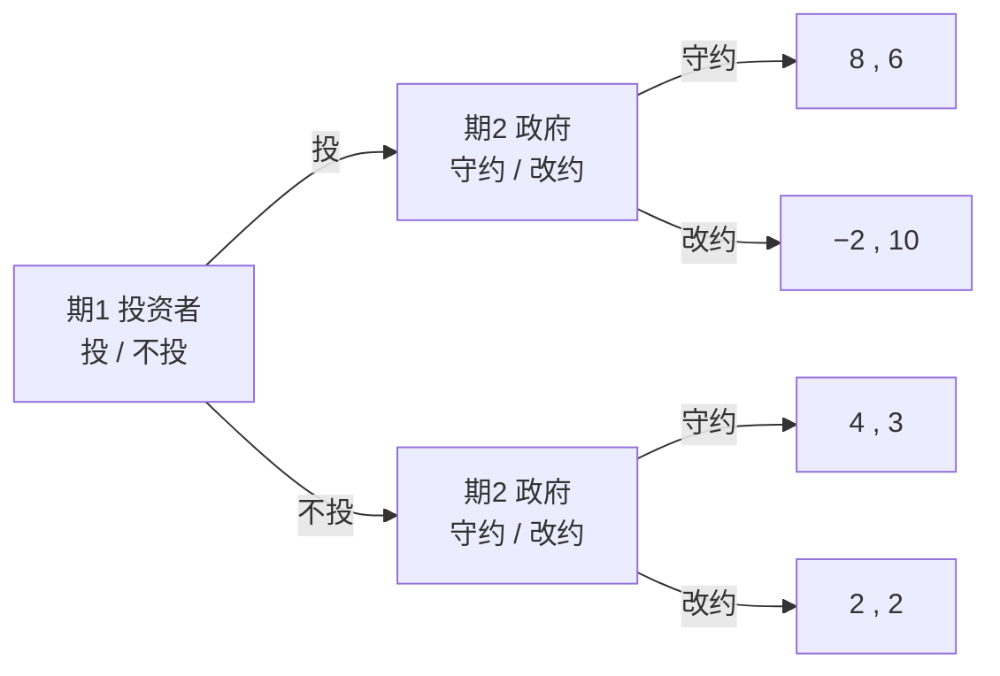

一句话值不值钱，不看它说得多重，看说话的人当场关掉了哪扇门、门把手交到了谁手里。

本文介绍博弈论里的承诺问题：一个手里握着规则的人，为什么说"我保证不改"没人信；以及要让这句话有人信，他必须付出什么。前半部分是标准内容：一个两期模型，规则与相机权各自给出什么均衡，承诺的价格怎么写成一条可以比的不等式，以及"我改不了"要成为事实需要哪三个条件。后半部分拿两块留了痕的制度做案例：一块是被国际协议改写的低税承诺，一块是写在宪法程序里的过去储备。两边各读一次数，看看这条不等式的左右分别长什么样。

结论可以先说一句：**可信是靠放弃选择权买来的，而它的价格就是事后最优与守约之间的那道落差，不随耐心走。**

---

## 一、两期之后，"改"才划算

玩家两个：一个要把资产放进来的人（建厂、把资金账户迁过来、签十年长约），一个定税率的人。定税率的人先宣布规则，放资产的人先动，然后规则可以再定一次。"宣布"这一层先按不承重处理——它承不承重正是本文要问的东西，一张不承重的宣布可以直接从树里删掉。

动作各取两个：投资者"投 / 不投"，政府"守约 / 改约"。改约的意思是：对已经落地的资产重定税率、重新解释口径。每格收益写成（投资者，政府）。

|  | 政府守约 | 政府改约 |
| --- | --- | --- |
| **投资者投** | 8 , 6 | −2 , 10 |
| **投资者不投** | 4 , 3 | 2 , 2 |

数字是示意的，重要的是它们之间的排序。这张表里有两条排序要紧。

**第一，改约只在对方已经投了之后才划算。** 对方投了，改约拿 10、守约拿 6；对方没投，改约拿 2、守约拿 3。**所以"改"不是占优策略**——占优要求在两种对手面前都不更差，而它在后一列反而更差。这正好是囚徒困境的反面：囚徒困境里背叛对两种对手都占优，谁先动都改不了结局；这张表里"改"的划算完全依赖一个条件，而这个条件是对方在上一步替你造成的。

**第二，最好那一格撑不住。** $(投,守)$ 给 $(8,6)$，可给定对方投了，政府单独换到"改约"就从 6 跳到 10。反过来 $(投,改)$ 也撑不住：投资者单独退到"不投"就从 $-2$ 回到 $2$。四个角逐个试一遍，**这张表在一次性博弈的写法下没有纯策略纳什均衡**——每一个角上都有人想动。

"没有均衡"不是这张表的缺陷，它在提醒一件事：这张表不能用收益表解，只能用时序解。倒着推。

**期 2：** 对方投了 → 改约（$10>6$）；对方没投 → 守约（$3>2$）。

**期 1：** 投资者知道这个答案。投，落到 $(投,改)$ 拿 $-2$；不投，落到 $(不投,守)$ 拿 $4$。→ 不投。

结局是 $(不投,守)$，收益 $(4,3)$。

**这个结局里没有人做错事。** 政府守了约，因为它没有可改的东西；投资者做了最优反应，他确实不该投。双方拿到的比 $(8,6)$ 那一格分别少 4 和 3，而没有任何一方违规、短视或心怀恶意。**坏均衡不是有人做错了，是对方不敢开始。** [《未来的影子》](https://cj9208.github.io/blog/systems_and_governance/game_theory/discount-factor-retroactive-enforcement/)说过囚徒困境刺耳的地方是"所有人都做对了之后得到的结果"；这句话在这里同样成立，但机制换了——那里是两个占优策略撞在一起，这里是逆向归纳往回退了一格。区别落在药上：占优解撞出来的局面，改表里的数字改不动（同一篇里顶格罚款做不到的那件事）；而这张表看上去一改就灵。

### 加罚没有删掉那一行，只是把它往上挪了一层

"改"这一行看上去很好删：给违约挂一笔罚金 $F$ 就够了。把 $F$ 挂在政府的"改约"这个动作上（从政府的收益里扣，先不管它付给了谁），表变成：

|  | 政府守约 | 政府改约 |
| --- | --- | --- |
| **投资者投** | 8 , 6 | −2 , $10-F$ |
| **投资者不投** | 4 , 3 | 2 , $2-F$ |

还是倒着推，跟开头那张表同一个推法。

**期 2：** 对方投了，守约当且仅当 $6>10-F$，也就是 $F>4$；对方没投，守约当且仅当 $3>2-F$，只要 $F>0$ 就成立。**取严的那条是 $F>4$：到了它上面，"改约"在两列里都不划算，守约升级为占优。**

**期 1：** 投资者预期到守约，投（$8>4$）。

**结局：** $(投,守)$，收益 $(8,6)$，最好那一格保住了。

这就是所有"提高违规成本"式处方在纸面上都跑得通的原因：它只动支付，不动人心，而且动得很少——一个数字。

但有一步没写在这张表上：**罚金不会自己到账。**"改约"之后还有一次选择，由同一只手来做（下面只写政府一侧的收益）：

|  | 缴 | 豁免 |
| --- | --- | --- |
| **已经改约** | $10-F$ | $10$ |

豁免省下一整笔 $F$，而这张小表里没有给它记别的代价。于是豁免占优，**而且罚金定得越高，豁免越值得**——$F$ 这个数自己给自己造出了绕过它的动机。把这一步预见回去，期 1 的投资者看到的仍然是 $10$ 对 $6$：**上面那张表被这张表撤销了。** 要让罚金真的说话，就得给"豁免"也挂一笔罚金 $F_2$；而 $F_2$ 要不要缴，又是一次选择。

所以不必说"权力不受约束"这类大词，树自己就把结论给出来：**加罚没有删掉"改"那一行，只是把"改"往上挪了一层。** 每一层的处方都是"再挂一笔罚金"，每一层的执行都回到同一只手。递归要么在某一界真的删掉一行——在那里它不再是"我以后不改"，而是"我改不了"。

断掉的那一界就是承诺的定义：**承诺不是一次更强的意图表达，是一次选择集的收缩。** Schelling（1960）举的例子全是这一类：把船烧了、把钥匙扔进海里、把决定权交给一个不由自己任命的人。它们的共同点不是决心，是**动作变少了**。

### 删掉那一行，值 3，也要付 4

收缩选择集不是白做的。价和成本都写在同一张表上，两边都不用估。不绑的结局是 $(不投,守)$，政府拿 3；删掉"改约"这一行，投资者敢投，政府拿 6——**挣的就是这 3，两个数相减**，它的来源是别人敢把钱放进来。成本在期 2 那一步：对方投了之后，改约拿 $10$、守约拿 $6$，删掉这一行就等于把 $10$ 那一格划掉，**放弃的是 4**，记作 $\pi$。

$$\text{绑住值得做}\iff\underbrace{6-3}_{\text{有人敢投}}\ \ge\ \underbrace{\pi}_{\text{改不了，事后少收的}}$$

**这条式子在表里没有解，因为 $3<4$。** 把"改"整行删掉，等于连期 2 那条更划算的路一起封死，而封掉的那条路比换来的那点信任更贵。式子要成立只能改范围：整行删是放弃全部的事后最优，**按格删是只放弃其中最贵的那几格**，省下的和让出去的都按格计。所以这一节的话可以收成一句：**绑住划不划算，看事后最优与守约之间的落差有多大。**

$\pi$ 在表里就是 4。搬到现实里它有多大，看那一刻已经沉进来、等着被重定的资产有多少——这一节给不出这个数，第三节去量。剩下的问题是这句"我改不了"怎么做成事实：删成什么样，别人才看得见。

---

## 二、把"我改不了"做成事实

### 付掉的必须是别人看得见的

第一节那笔账是政府自己算的，可它换来的东西在对方手里：只有投资者**看见**那一行确实被删掉了，他才敢投。"改不了"要成为事实，得同时满足三件事，三件都能当场核对。

（a）**不可逆**：撤销它要付一笔**已经发生**的成本——现在花钱、花权力、花脸面，而不是将来罚你。烧掉的船不能靠再说一次来重新烧。

（b）**可观察**：对方在决定投不投之前，就看得见 (a)。

（c）**验收不在自己手里**：确认与放行这道门由别人握着。

缺 (a) 就只是措辞；有 (a) 缺 (b)，钱付了没人收到；有 (a)(b) 缺 (c)，你承诺的是**一个数额**（税率、金额、期限）——只要对面有人已经把资产放进来，改一下就比守着多收，这个数额必弯；三条齐全，你承诺的才是**一个流程**，弯的时候留下代价和痕迹。**判据句：看一项承诺弯了之后还剩什么。** 还剩流程，说明原本绑的是流程；什么都不剩，说明原本只绑了一个数字。

这三条也解释了为什么现实的装置很少落在 0 与 1 这两端：法条留着修订程序，宪法留着紧急条款，独立机构的授权范围总得有人解释——"改不了"通常只能做成"改起来很贵"。于是真正要判断的从来不是"绑没绑"，而是**相机权被留在了哪一层、那一层给谁看**。这件事有一份现成的自述：新加坡金融管理局在货币政策框架问答里明写自己**不遵循刚性规则，因为应对意外事件需要一定程度的受限相机权**，同时不公开汇率篮子的币种与权重，也不公开政策区间的中心、宽度与斜率（MAS, *Frequently Asked Questions on Singapore's Monetary Policy Framework*，2025-05-23 修订版）。**锁住的是流程，保留的是幅度**：摊开到可以核对的部分越确定，别人敢沉进去的投入越多；留下的相机权越窄，保费越低。

### 买不起保单的人买声誉

"看重长远的人才守规矩"这句常见说法只说对一半，说错的那半正好落在 $\delta$ 上。声誉不删任何一行，它靠的是"这期改了，下期的钱就不进来"。把第一节那张表重复着玩，每期有一批新的投资者进入：改约的当期好处是 $10-6=4$，代价是以后每期从 6 掉到 3。守约能靠声誉撑住的条件是

$$\frac{6}{1-\delta}\ \ge\ 10+\frac{3\delta}{1-\delta}\iff 6\ \ge\ 10(1-\delta)+3\delta=10-7\delta\iff \delta\ \ge\ \frac{4}{7}\approx0.571 .$$

（中间那一步：两边同乘正数 $1-\delta$。）**这条的形状与[《未来的影子》](https://cj9208.github.io/blog/systems_and_governance/game_theory/discount-factor-retroactive-enforcement/)那条阈值一样**：一边是守下去的现值，一边是背弃的当期所得加贴现后的惩罚，解出一个下限；差别只在惩罚从哪来——那里是对手的报复，这里是对手不再进来。

声誉与保单是同一件事的两种买法，谁便宜用谁。声誉的价格随耐心走：$\delta$ 掉到 $4/7$ 以下，以后每期的 3 贴现回来抵不过当期那 4，这条腿断了。保单的价格随事后落差走，第一节那张表已经给出它的读数：$\pi=4$ 大于挣到的 3，**整行删是亏本的，买得起的只有按格删**。两笔账合起来给出本节真正的读数——**$\delta$ 小删掉的是声誉，删不掉规则**：一条写进成文法的税率、一道由别人握着的否决权，都不要求未来值钱。而耐心很足的时候声誉这条腿不用当期掏钱，保单反而涨价：敢做成不可逆的投入越多，能被动的那个基数就越大。

所以"早点把规则写死"之所以划算，理由很平——**那时候沉下去的资产还薄，要放弃的事后最优也薄。**

### 三笔钱落在三个时点

三笔钱的时点不一样。不可逆的成本在期 1 付；收益也在期 1 出现，形式是对方从"不投"换成"投"，于是政府往后每期拿 6 而不是 3；保费付在期 2 那一步——本来是"投已经进来了，改一下更划算"，绑住之后走不了这一步，少收的就是它。这个错位解释了承诺为什么总是被推迟：**在一个必须当期交账的系统里，成本记在自己的账上，而收益记在别人的账上。**

留给案例的判据是一句：**一条政策值多少钱，看它关掉了哪扇门、门把手在谁手里、开锁的代价由谁付。**

---

## 三、案例：不等式的两边各量一次

第一节那条不等式只写了两个数，没有说去哪里读。右边——明明能改而不能改、事后少收的那一笔——只有一处官方记录，在税收那一格：一块写进成文法的零税率，2021 到 2024 年被上一层的规则重新定了价，日期、税率、门槛全都留了痕。左边——承诺换来的那笔投入——公开材料里从来没有人报过数。所以第二场读另一件事：装置被压弯之后，哪一格还立着。那一格在 1991 年之后的过去储备上，弯过，也留过记录。

两场按同一个顺序读：先给场景，谁必须在那一刻决定什么；再摊开他手里的两条路，包括没走的那条要付多少钱；最后说这一场在哪一格上支持了前面那条不等式。

### 第一场：保费有官方句子的那一次

一家跨国集团要把区域资金账户、控股实体和一批处置收益放进岛上。它能读到的承诺是三句话：资本利得一般不予征税，公司所得税 17%，遗产税没有。三句话都不是自然事实。遗产税是被废掉的（Estate Duty (Abolition) Act 2008，2008 年第 13 号法律，视为自 2008-02-15 起施行，被废的主法是 1929 年的 Estate Duty Act）；"资本利得不征"这一格，两个活的例外已经把边啃掉了——第 10L 条对境外资产处置收益自 2024-01-01 起的处置课税，第 10G 条对出售持有本地不动产的未上市公司股份的短期收益课税。没有任何一张纸写着这三个数字不许改，二十多年里也没有一次验证。

政府手里有两条路。一条是把这三句做成收不回来的：写进宪法级的约束，或者交给一只不由自己任命的手，从此动税率要过第二道门。这条路的价格第一节算过，就是 $\pi$——对方把资产放进来之后，改一下能多收的那一笔。另一条是留着那只手，代价是这三句随时可以被动一格，于是肯把长期资产放进来的人得自己估这个风险。二十多年里它走的是第二条，一分钱保费也没付。

然后那扇门从外面装上了。2021-07-05 新加坡财政部对国会的书面答复（时任财政部长黄循财）写的是：

> Pillar 2 will therefore limit the effectiveness of tax incentives as a tool to encourage larger MNEs to invest in Singapore.

一句官方答复承认：吸引大型跨国集团投资的那件工具，效果要被限住了。同一份答复给了两个数与三条原则——在新加坡、合并收入超过 7.5 亿欧元这条线以上的跨国集团约 1,800 家；最低有效税率 15%；三条原则里第一条是"遵守国际公认标准"。三年后它落地成法条：Multinational Enterprise (Minimum Tax) Act 2024（2024 年第 36 号），2024-10-15 国会通过、2024-11-08 总统签署，设跨国企业补足税与国内补足税两种，适用于 2025-01-01 或其后开始的财年；门槛按最终母公司合并报表**前四个财年中至少两年**达到 7.5 亿欧元来判。

**这笔保费不是政府付出去的，是别人替它收走的。** 判定标准来自 OECD/G20 包容框架 2021-12-14 通过的 GloBE 示范规则：别人算，别人也能征——本地不补这一笔，母公司所在辖区按同一套口径补走。于是"把'改'往上挪一层"在这里不是比喻，是立法史：政府无权豁免一个由别人判定的数额，验收的门就不在它手里了。它在这笔买卖里保住的只有一件事：地板没有铺满整块地——绑住的不是整块税率，是 ≥7.5 亿欧元那一档、15% 那一格，其余企业、其余税种照旧。这正是第一节那条 $3<4$ 说的事：整行删买不起，买得起的只有按格删，**这里看到的就是按格删之后留下的形状**。至于把税率往下拉的动机会不会换个壳回来——同一部《所得税法 1947》在 2025 年 9 月新增第 93B 条，设立可退还投资抵免，机制自 2025-09-01 起运作；它和 15% 那条地板是什么关系，官方没有句子，本文不替它写。

**这一场测不出第二节的判据。** 那格零税率没有被谁撕毁，它是被上一层的规则重新定价的，所以"一项承诺弯了之后还剩什么"在这里没有观测对象。要测它，得换一个约束写在自家宪法里、拨多少批多少都进咨文和新闻稿的领域。

### 第二场：弯下去之后剩下流程

2020 年 3 月，政府要在几个月里花掉远超正常预算的钱，而钱在过去储备里。这一格和第一场不一样：约束写在自家宪法里，财政部自己的表述是 "The President can exercise veto powers over proposed transactions that draw on Past Reserves."；程序上还有一层，2020-03-26 时任总统哈莉玛致国会的咨文里写 "I reviewed the Government's proposal with my Council of Presidential Advisers (CPA)"、"The CPA unanimously recommended that I give my in-principle support"，并且 "I have the responsibility and discretion to withhold my assent"。也就是说，动这笔钱要过两道不在财政部手里的手。

它手里有两条路。一条是拆门：修宪、绕开总统与 CPA，从此动过去储备只要内阁决定——1991 年那套框架本来就是为堵住这条路设计的，走通它要付的不是钱，是"以后任何写进宪法的数字都不再被相信"。另一条是敲门：把提案交出去，等 CPA 审议、等总统裁量、把结果念给国会并留进新闻稿——慢、要解释，而且把例外交给一只不完全由自己任命的手。**它选了敲门，而且越敲越频繁。** 次数、数额、日期都有记录：

| 时间 | 那道门被推开的样子 | 记录里留下什么 |
| --- | --- | --- |
| 2008-10 | 纳丹同意以过去储备为全部银行存款提供 1,500 亿新元担保 | 担保从未被触发，门一次没开 |
| 2009-01 | 纳丹批准拨用 49 亿 | 1991 年框架建立以来第一次真拨 |
| 2011-02 | 政府决定归还已拨用的 40 亿 | 法律没有要求还 |
| 2020-03-26 | 哈莉玛批准拨用；咨文同时写"1991 年以来只拨过一次" | FY2020 至多 520 亿、FY2021 110 亿、FY2022 60 亿，都经总统批准 |
| 2025-09-22 | 财政部第二部长英达妮在国会书面答复里给出实拨数与态度 | "还"从规则内容里划掉 |

表里最后一行的原文是这样：

> Between FY2020 and FY2022, Singapore drew about \$40 billion from the Past Reserves to support COVID-19 measures... We do not expect to be able to put back the amount drawn from the Past Reserves during COVID-19.

三件事只有对照着读才看得见。其一，"还"从来不是义务，同一页财政部网页写得很清楚："There is no legal or constitutional obligation for the Government to return any amount drawn from the Past Reserves."——所以 2011 年那 40 亿还得回去是自愿，2025 年说还得回来不预期也是合法的。其二，写下"只拨过一次"的那一年，第二次就来了。其三，那笔自愿的归还本身是另一种买法：法律没有要求还，还它买的是"下一次总统还会点头"——不删任何一行，只让不守这一行的下期成本变高；而这条腿在危机里最先断，2020 年之后没有人归还任何东西。

**裁决：数额那一格弯了，流程那一格没断。** "绝不动用过去储备"没有兑现成数额上的守住，但每一次开门都有总统同意、CPA 建议、咨文与新闻稿，2020 到 2022 那三笔全部留痕可查，一笔都没有偷偷发生。**弯了之后还剩流程，说明原本绑的就是流程**；那句"绝不动用"从来不是一次不可逆的投入，它是一次意图的表达，真正不可逆的是那把钥匙在谁手里。同一道门，2009 年批 49 亿，2020 到 2022 批到 690 亿且明说不预期补回：要拨的钱和拨的次数一起变大，第一节那个 $\pi$ 就从一个符号变成可以比较的量——这一段把它抬到比任何一次声誉损失都贵。至于精确的数额，资本会在多长时间内撤出、撤多少，公开来源里没有，本文只给价格的形式，不给读数。

[《秩序与穿透》](https://cj9208.github.io/blog/systems_and_governance/order-compliance-mobilization/)写的"合规—动员"张力，在第二场里读得出一个具体解法：危机要把钱花出去，而钱被锁在第二把钥匙后面，政府既没有把门拆掉，也没有把钱锁死，而是**把"例外"预先写成一道程序**——请求、CPA 审议、总统裁量、公开记录。它没有取消那个张力，只是把它从"事后算不算违规"挪到了"事前找谁签字"。

两场加起来，那条不等式仍然没有被算出来。左边还是没有读数：没有人报得出"因为那三句话，多少资产留在了岛上"。右边有两次方向一致的观测——一次是官方句子承认相机权被上一层收走，同时留下一块只铺在 ≥7.5 亿欧元那一档的地板；一次是要拨的钱越拨越大、越拨越密，保费涨过任何一次声誉损失，而流程那一格还立着。所以这两场局能交付的不是一个数，是一句话里的两个部位：绑住的地方越细、越在别人手里，弯掉之后还立着的东西就越多。

---

## 结语：判据是一句话，按顺序问

一句政策的话值多少钱，不看它的措辞有多重。看三件事，而且只有这个顺序：**它关掉了哪扇门；门把手在谁手里；开锁的代价由谁付、什么时候付。**

先问门，因为不关任何一门的承诺没有价格。再问把手，因为把手在自己手里的门，随时都在别人的行情里。最后问谁付钱——如果付钱的是"将来的某个时候"，那笔钱和没付一样；只有已经花掉的、别人看得见的、验收不在自己手里的，才是真付了。

---

## 附注一：可相信的三种机制，挂在三个不同的东西上

"他说的话能信吗"这一格，本站前两篇和本文各给了一个答案，它们不互相替代，挂在三个不同的参数上。

[《未来的影子》](https://cj9208.github.io/blog/systems_and_governance/game_theory/discount-factor-retroactive-enforcement/)的答案挂在 **δ**：未来足够值钱，合作才撑得住。它管的是重复如何改变动机，也管追溯性执法如何把这份价值抽走。

[《昂贵不等于可分离》](https://cj9208.github.io/blog/systems_and_governance/game_theory/costly-signals-are-not-separating/)的答案挂在**成本梯度**：一个声明可信，不是因为说的人花了大钱，是因为假话对他来说比真话更贵。它管的是不完全信息。

本文的答案挂在**选择集**：可相信不来自更强的意图表达，来自当场少掉一个动作。它管的是同一张收益表在有时间差之后会退到哪里。

三者互为替代，不是并列：δ 大到一定程度，声誉这条腿不用当期掏钱，保单就不必买；成本梯度足够陡，验货这道门就可以租出去，不必自己锁；而博弈会被终止、违约又没人看得见的时候，δ 买不到东西，只能靠写进成文法的那一格——那一格改起来最贵，改的时候也最显眼。

## 附注二：三处需要修正的旧判断

三处都在 [《指标的内爆与协议的重构》](https://cj9208.github.io/blog/systems_and_governance/goodharts-law-protocol-reconstruction/)，前两处是事实口径，第三处是判断。

**一、有名字，没有机制。** 该文写"需要系统交出自己的部分权力，形成可信承诺（Commitment Device）"。名字是对的，缺的是它凭什么有效：按本文第一节，相机行事**不是占优策略**（对方没投的时候改约反而更差），所以它和囚徒困境不是一局；它的病出在逆向归纳，而**把选择集缩小确实能换到更好的均衡**——这是"交出部分权力"这句话里唯一有内容的部分。差别在结构标签上：占优解撞出来的局面改不动表，逐期最优反应叠出来的局面改得动，而改法是删行不是加罚。

**二、"0% 资本利得税、0% 遗产税"与"24 小时内毁灭性挤兑"。** 前者口径错：资本利得是**一般不予征税**（所得税法里另有两个活的例外，第 10L 条自 2024-01-01 起、第 10G 条对短期处置），遗产税不是零税率而是**被废掉的**（2008 年第 13 号法律）。后者无出处、无机制、无观察值，本文不沿用，旧文那边应降为明示示意。

**三、"绝不可能单方面撕毁"。** 见第三节第二场的裁决：改判为**它锁住的是流程，不是数额**。共同点是同一件事——该文把"承诺很硬"写成了"承诺不可撤销"，而本文三条件里的第三条（验收不在自己手里）说明：真正硬的从来不是那个数字，是数字外面那道不在自己手里的门。

---

## 延伸阅读

- [《未来的影子：合作是 δ 的函数，不是道德的成果》](https://cj9208.github.io/blog/systems_and_governance/game_theory/discount-factor-retroactive-enforcement/)——同系列第一篇：δ 与阈值那条式子的出处，本文第二节用的声誉阈值与它同形，差别只在惩罚从哪来。
- [《昂贵不等于可分离：信号与筛选》](https://cj9208.github.io/blog/systems_and_governance/game_theory/costly-signals-are-not-separating/)——"只有措辞"那一格的形式化：不可观察的信号等于廉价谈话，本文的 (b) 是它在时间轴上的样子。
- [《指标的内爆与协议的重构》](https://cj9208.github.io/blog/systems_and_governance/goodharts-law-protocol-reconstruction/)——本文三处修正的落点：那里给了承诺的名字，这里补上机制、日期与弯过的那两次。
- [《秩序与穿透：论治理体系中"合规"与"动员"的内在张力》](https://cj9208.github.io/blog/systems_and_governance/order-compliance-mobilization/)——把例外写成程序：本文第二场借的是它的问题域，那张表里"事后倒查"一格正是追溯定价的对象。
- [《零余量时代的微观窒息》](https://cj9208.github.io/blog/systems_and_governance/chinese_government/retroactive-audit-malicious-compliance/)——相机权留在组织内部时的样子：中层握着"这次算不算违规"的裁量，于是所有人先为那道门付钱。

---

## 事实与来源

**模型与文献。**

- Kydland & Prescott (1977), "Rules Rather than Discretion: The Inconsistency of Optimal Plans", *Journal of Political Economy* 85(3):473–491——时间不一致的标准陈述。本文第一节的 $2\times2$ 是它的两期最小化示意，数字为示意值，重要的是排序。
- Schelling (1960), *The Strategy of Conflict*, Harvard University Press——承诺＝选择集的收缩；烧船、扔钥匙、把决定权交给别人这一类技术。
- Rogoff (1985), "Constraints on Governments as Commitment Strategies", *Quarterly Journal of Economics* 100(4):1169–1189——承诺是连续量、最优解常在一半的那一支结论；本文只取"程度可测"与第一节 $3<4$ 之后"只能按格删"这个方向，最优绑定范围不在本文里解。
- Barro & Gordon (1983), "Rules, Discretion and Measurement in a Positive Theory of Policy", *Journal of Monetary Economics* 12(1):101–121——相机行情的租金形式。
- Elster (1979), *Ulysses and the Sirens*, Cambridge University Press；(2000), *Ulysses Unbound*, Cambridge University Press——自我约束的两类有益限制这一主题，本文只取书名与主题。

**第一场（低税承诺与 Pillar Two）。**

- Ministry of Finance, *Implications on Singapore from G7 Agreement on Global Minimum Corporate Tax Rate*，书面答复，财政部长黄循财，2021-07-05：原文 "Pillar 2 will therefore limit the effectiveness of tax incentives as a tool to encourage larger MNEs to invest in Singapore"；"about 1,800 such MNE groups in Singapore that would meet this criteria"；最低有效税率 at least 15%、合并收入 750 million euros；三条原则（abide by internationally agreed standards／safeguard our taxing rights／minimise the compliance burden）。mof.gov.sg
- *Multinational Enterprise (Minimum Tax) Act 2024*（No. 36 of 2024）：宪报首部载明"passed by Parliament on 15 October 2024 and assented to by the President on 8 November 2024"；设跨国企业补足税与国内补足税。sso.agc.gov.sg
- IRAS，*Global Anti-Base Erosion (GloBE) Rules and Domestic Top-up Tax (DTT)* 与 *Registration for MTT and DTT*：MTT／DTT 适用于 2025-01-01 或其后开始的财年；门槛为最终母公司合并报表前四个财年中至少两年 ≥ €750m；UTPR 另行考虑。iras.gov.sg
- IRAS，*Economic Substance Requirement*（第 10L 条相关页）：境外处置收益税制自 2024-01-01 起施行；资本利得一般不予征税。iras.gov.sg
- *Estate Duty (Abolition) Act 2008*（No. 13 of 2008）第 1 条："shall be deemed to have come into operation on 15th February 2008"；主法为 Estate Duty Act 1929。sso.agc.gov.sg
- *Income Tax Act 1947* 第 93B 条（Refundable Investment Credit），IRAS 页面记载机制自 2025-09-01 起运作。iras.gov.sg。**该抵免与第 15% 地板之间的因果关系未见官方表述，本文不作断言。**
- OECD/G20，*Statement on a Two-Pillar Solution to Address the Tax Challenges Arising from the Digitalisation of the Economy*，2021-10-08；GloBE Model Rules 由包容框架 2021-12-14 通过（Commentary 2022-03-14）。oecd.org

**第二场（过去储备与第二把钥匙）。**

- Ministry of Finance, *How are Past Reserves protected?*（最后更新 2026-07-02）：逐句为 "The President can exercise veto powers over proposed transactions that draw on Past Reserves"；"In October 2008, then-President S R Nathan gave his approval for a S$150 billion guarantee on all bank deposits in Singapore to be backed by Past Reserves"；"In January 2009, the Government obtained then-President S R Nathan's approval to draw S$4.9 billion from the Past Reserves"；"In February 2011, the Government decided to return the S$4.0 billion that it had drawn from the Past Reserves"；"There is no legal or constitutional obligation for the Government to return any amount drawn from the Past Reserves"；"The Constitution allows up to 50% of the expected long-term real rate of return (ELTRROR)…"；以及 FY2020／FY2021／FY2022 分别至多 520 亿、110 亿、60 亿新元经总统批准。mof.gov.sg
- President Halimah Yacob, *Message to the Parliament on the Government's Proposal to Fund Extraordinary Budgetary Measures from Past Reserves*，2020-03-26："Since we established the reserves protection framework in 1991…"；"Then-President S R Nathan approved a draw of \$4.9 billion"；"I reviewed the Government's proposal with my Council of Presidential Advisers (CPA)"；"The CPA unanimously recommended that I give my in-principle support"；"I have the responsibility and discretion to withhold my assent"。istana.gov.sg
- 国会书面答复，第二财政部长英达妮（Indranee Rajah），*Replenishing Reserves Drawn During COVID-19 Crisis and Impact on Taxes Imposed on Singaporeans*，2025-09-22："Between FY2020 and FY2022, Singapore drew about \$40 billion from the Past Reserves…"；"We do not expect to be able to put back the amount drawn from the Past Reserves during COVID-19."。mof.gov.sg
- 《宪法》第 144 条（总统同意权的范围）与第 148I 条（政府过去储备的拨用）。sso.agc.gov.sg

**货币政策那一段（第二节）。**

- MAS, *Frequently Asked Questions on Singapore's Monetary Policy Framework*（经济政策组，最后修订 2025-05-23）："MAS does not follow a rigid policy rule since a certain degree of (constrained) discretion is necessary to be able to deal with unexpected events"；不公开汇率篮子的币种与权重、也不公开政策区间的中心／宽度／斜率；政策声明每三个月一次（1／4／7／10 月 08:00），改为预先公布日程是 2023-10-13 宣布、自 2024 年 1 月起。mas.gov.sg

**两处只有形式、没有读数的地方。** 一是第一节 $\pi$ 的数值：表里它是示意的 $4$，搬到现实里要看已经沉进来、等着被重定的资产有多少，而资本会在多长时间内撤出、撤多少，公开来源取不到，正文只给它与 $3$ 的比较关系。二是第二场"弯了之后还剩什么"的企业内版本：一个组织里事前把审批绑死、事后必须靠动员松绑，这种频率与代价没有公开统计。
