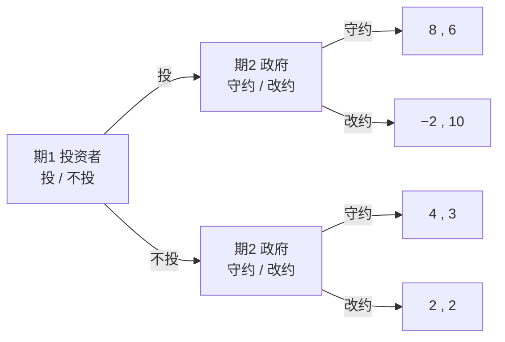
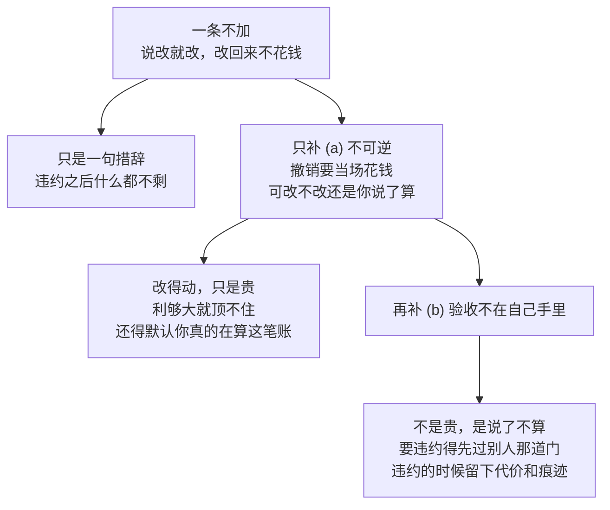

一句话值不值钱，不看它说得多重，看说话的人当场关掉了哪扇门、门把手交到了谁手里。

这话对手里握着规则的人格外刺耳。改与不改还是他说了算，那"我保证不改"就不可信——同一句再说三遍、说得更重，能改的余地一分没少。要让它可信，交出去的必须是"改不改"这个选择本身——**可信是靠放弃选择权买来的。**

买这份可信有两种付法：一种当场就把退路拆掉，另一种不收当场的钱，用以前攒下的表现顶住。

---

## 一、两期之后，"改"才划算

玩家两个：一个要把资产放进来的人（建厂、把资金账户迁过来、签十年长约），一个定税率的人。定税率的人先宣布规则，放资产的人先动，然后规则可以再定一次。宣布不花钱，所以它在树上不占一层。

动作各取两个：投资者"投 / 不投"，政府"守约 / 改约"。改约的意思是：对已经落地的资产重定税率、重新解释口径。每格收益写成（投资者，政府）。

|  | 政府守约 | 政府改约 |
| --- | --- | --- |
| **投资者投** | 8 , 6 | −2 , 10 |
| **投资者不投** | 4 , 3 | 2 , 2 |

数字是示意的，重要的是它们之间的排序。这张表里有两条排序要紧。

**第一，改约只在对方已经投了之后才划算。** 对方投了，改约拿 10、守约拿 6；对方没投，改约拿 2、守约拿 3。**所以"改"不是占优策略**——占优要求在两种对手面前都不更差，而它在后一列反而更差。这正好是囚徒困境的反面：囚徒困境里背叛对两种对手都占优，谁先动都是这个结局；这张表里"改"的划算完全依赖一个条件，而这个条件是对方在上一步替你造成的。

**第二，最好那一格撑不住。** $(投,守)$ 给 $(8,6)$，可给定对方投了，政府单独换到"改约"就从 6 跳到 10。反过来 $(投,改)$ 也撑不住：投资者单独退到"不投"就从 $-2$ 回到 $2$。四个角逐个试一遍，**这张表在一次性博弈的写法下没有纯策略纳什均衡**——每一个角上都有人想动。

"没有均衡"不是这张表的缺陷，它在提醒一件事：这张表不能用收益表解，只能用时序解。倒着推。

**期 2：** 对方投了 → 改约（$10>6$）；对方没投 → 守约（$3>2$）。

**期 1：** 投资者知道这个答案。投，落到 $(投,改)$ 拿 $-2$；不投，落到 $(不投,守)$ 拿 $4$。→ 不投。

结局是 $(不投,守)$，收益 $(4,3)$。

**这个结局里没有人做错事。** 政府守了约，因为它没有可改的东西；投资者做了最优反应，他确实不该投。双方拿到的比 $(8,6)$ 那一格分别少 4 和 3，而没有任何一方违规、短视或心怀恶意。**坏均衡不是有人做错了，是对方不敢开始。** [《未来的影子》](https://cj9208.github.io/blog/systems_and_governance/game_theory/discount-factor-retroactive-enforcement/)说过囚徒困境刺耳的地方是"所有人都做对了之后得到的结果"；这句话在这里同样成立，但机制换了——那里是两个占优策略撞在一起，这里是逆向归纳往回退了一格。

---

## 二、加罚没有删掉那一行，只是把它往上挪了一层

"改约"那一格在投资者眼里始终亮着，谁都不敢第一个把钱放进来。要让它熄灭，最省事的办法是[《未来的影子》](https://cj9208.github.io/blog/systems_and_governance/game_theory/discount-factor-retroactive-enforcement/)里那条最常见的处方：**给"改"重新标个价**——挂一笔罚金，让它不划算。

罚金 $F$ 挂在"改约"这一格上（从政府的收益里扣，先不管付给谁），表变成：

|  | 政府守约 | 政府改约 |
| --- | --- | --- |
| **投资者投** | 8 , 6 | −2 , $10-F$ |
| **投资者不投** | 4 , 3 | 2 , $2-F$ |

还是倒着推，跟开头那张表同一个推法。

**期 2：** 对方投了，守约当且仅当 $6>10-F$，也就是 $F>4$；对方没投，守约当且仅当 $3>2-F$，只要 $F>0$ 就成立。**取严的那条是 $F>4$：到了它上面，"改约"在两列里都不划算，守约升级为占优。**

**期 1：** 投资者预期到守约，投（$8>4$）。

**结局：** $(投,守)$，收益 $(8,6)$，最好那一格保住了。

这就是所有"提高违规成本"式处方在纸面上都跑得通的原因：它只动支付，不动人心，而且动得很少——一个数字。

但有一步没写在这张表上：**罚金不会自己到账。**"改约"之后还有一次选择，由同一只手来做（下面只写政府一侧的收益）：

|  | 缴 | 豁免 |
| --- | --- | --- |
| **已经改约** | $10-F$ | $10$ |

豁免省下一整笔 $F$，而这张小表里没有给它记别的代价，于是豁免占优。更麻烦的是**罚金定得越高，豁免越值得**——$F$ 这个数自己给自己造出了绕过它的动机。

投资者的算盘不会停在加罚那张表上。他决定投不投之前，要把"改约之后这笔罚金到底会不会真缴"一起算进去；算下来，加罚的表就退回没有加罚的表——他面对的仍然是改约拿 $10$、守约拿 $6$。罚金没有改动任何一格的排序，结局回到 $(不投,守)$。

那就在"豁免"这一行再挂一笔罚金 $F_2$。可 $F_2$ 要不要缴，仍然是这只手做的又一次选择，挂多少都一样。加罚删不掉"改"，只是把它往上挪了一层：选择从"要不要改约"变成"要不要缴上一轮的罚金"，做选择的那只手始终没换。往上套的每一层，开的处方都是"再挂一笔罚金"，长出来的都是同一只手又一次绕行。

套娃只有两种收场：一层一层加下去，等于什么都没绑；或者在某一层真的停住——那一层的处境不再是"我以后不改"，而是"我改不了"。

停住的那一层就是承诺的定义：**承诺不是一次更强的意图表达，是一次选择集的收缩。** Schelling（1960）举的例子全是这一类：把船烧了、把钥匙扔进海里、把决定权交给一个不由自己任命的人。它们的共同点不是决心，是**动作变少了**。

---

## 三、把"我改不了"做成事实

把选择集的收缩做成事实，需满足两件事，两件都能当场核对。要买的东西在对方手里：投资者得相信那一行回不来了，才敢把钱放进来。

（a）**不可逆**：撤销它要付一笔**已经发生**的成本——现在花钱、花权力、花脸面，而不是将来罚你。烧掉的船不能靠再说一次来重新烧。

（b）**验收不在自己手里**：确认与放行这道门由别人握着。

两条不是并列的清单，是一条一条往上加的；每少一条，承诺就往下退一格。

只补 (a) 的那一格最容易做到，也最容易被当成已经绑好了——花钱、烧船、发公告都是定规则的人自己就能做的动作，一道门也不用交出去。但它买到的只是**贵**，而贵有两道拦不住的关口。一道是利益够大；另一道是根本没人算：恐慌、面子、换届的压力，都能让那一刻不做这道题。两道关口说的是同一件事：这一格没有从树上删掉任何一行，它只是让"改"暂时没人走。补上 (b)，性质换了：不再是改一次要付多少钱，而是你一个人改不动——确认与放行在别人手里，要违约就得先让那个人点头，于是每一次违约都留下一笔代价和一个痕迹。第二节那棵套娃树也正是停在这里：罚金是一个数额，豁免额也是一个数额，每一层的贵都由同一个人估一遍。

这两条也解释了为什么现实的装置很少落在 0 与 1 这两端：法条留着修订程序，宪法留着紧急条款，独立机构的授权范围总得有人解释——"改不了"通常只能做成"改起来很贵"。这一切还有个大前提：对方在决定投不投之前，看得见你绑到了哪一层——看不见，绑得再足也只绑给自己。于是真正要判断的从来不是"绑没绑"，而是**相机权被留在了哪一层、那一层给谁看**。摊开到可以核对的部分越确定，别人敢沉进去的投入越多；留下的相机权越窄，买这份确定性要放弃的越少。

### 两边都在等，先动的只能是政府

政府这一侧的账是错位的：要付的东西当期就看得见——花的钱、让出去的权力、烧掉的那条退路；换来的那笔钱要等对方敢投才开始出现，而且先进的是对方的账。**在一个必须当期交账的系统里，成本记在自己的账上，收益记在别人的账上**，于是能拖一期是一期。

投资者那一侧看到的是另一件事：规则还没绑，"改"那一格就还亮着。表上只有投与不投，现实里还有投多少——没绑的时候，多沉一份资产就是多押一份在那一格下面，被改一次损失的也越多。于是他也拖：晚一点投、少投一点，或者干脆不投。

两边都在等，等出来的就是第一节那个没人投资的均衡。要打破它，先动的只能是政府：投资者先动，等于把自己送到"改"那一格下面。

### 声誉：省的是当场那一下，攒的是一段很长的历史

还有一种绑法不收当场的钱：一扇门也不用交出去，顶住它的是以前攒下的表现。

这份表现就是声誉：不违约的历史一期一期攒起来，对方进来之前看的就是这个。攒的是每一期都把"改"能多收的那笔放下不拿，攒够长对方才肯信；而且一次违约，这段历史就不作数，得从头再攒。新来的那只手没有历史可用——它要让人敢投，只能当场付。

## 结语：判据是一句话，按顺序问

一句政策的话值多少钱，不看它的措辞有多重。看两件事，而且只有这个顺序：**它关掉了哪扇门；门把手在谁手里。**

先问门，因为不关任何一门的承诺不值钱——那一行还在树上，对方算得出你会改，他就不投。再问把手，因为把手不离手的承诺也不值钱——开不开由你那一刻的账决定，对方算得出你会开，他就不投。

---

## 附注一：可相信的三种机制，挂在三个不同的东西上

"他说的话能信吗"这一格，本站前两篇和本文各给了一个答案，它们各管一格，挂在三个不同的参数上。

[《未来的影子》](https://cj9208.github.io/blog/systems_and_governance/game_theory/discount-factor-retroactive-enforcement/)的答案挂在 **δ**：未来足够值钱，合作才撑得住。它管的是重复如何改变动机，也管追溯性执法如何把这份价值抽走。

[《昂贵不等于可分离》](https://cj9208.github.io/blog/systems_and_governance/game_theory/costly-signals-are-not-separating/)的答案挂在**成本梯度**：一个声明可信，不是因为说的人花了大钱，是因为假话对他来说比真话更贵。它管的是不完全信息。

本文的答案挂在**选择集**：可相信不来自更强的意图表达，来自当场少掉一个动作。它管的是同一张收益表在有时间差之后会退到哪里。

三者互为替代，不是并列：δ 大到一定程度，违约的代价自己就够大，那份约束不必当场买；成本梯度足够陡，验货这道门就可以租出去，不必自己锁；而博弈会被终止、违约又没人看得见的时候，δ 买不到东西，只能靠写进成文法的那一格——那一格改起来最贵，改的时候也最显眼。

---

## 附注二：需要补充与改判的两处旧判断

两处都在 [《指标的内爆与协议的重构》](https://cj9208.github.io/blog/systems_and_governance/goodharts-law-protocol-reconstruction/)：一处补机制，一处改判。

**一、有名字，没有机制。** 该文写"需要系统交出自己的部分权力，形成可信承诺（Commitment Device）"。这句里"交出一部分权力"对应的是本文第二节那一步——**承诺＝把树上那一行删掉**；它缺的半句是删行凭什么被相信，那在第三节：当场可核对，而且验收不在自己手里。

**二、"绝不可能单方面撕毁"。** 该文这句把"承诺很硬"写成了"承诺不可撤销"。本文对应的点是第三节的 (b)：验收不在自己手里时，改得动的是数额，留下代价和痕迹的是那道门。所以"单方面"三个字准，"绝不可能"不准。

---

## 延伸阅读

- [《未来的影子：合作是 δ 的函数，不是道德的成果》](https://cj9208.github.io/blog/systems_and_governance/game_theory/discount-factor-retroactive-enforcement/)——同系列第一篇：δ 与阈值那条式子的出处。声誉在那里顶替的是可验证性，不是耐心；本文第三节用的是另一种声誉——一段很长的不违约历史。
- [《昂贵不等于可分离：信号与筛选》](https://cj9208.github.io/blog/systems_and_governance/game_theory/costly-signals-are-not-separating/)——"只有措辞"那一格的形式化：零成本的声明等于廉价谈话。
- [《指标的内爆与协议的重构》](https://cj9208.github.io/blog/systems_and_governance/goodharts-law-protocol-reconstruction/)——本文两处修正的落点：那里给了承诺的名字，这里补上它凭什么有效、硬的又是哪一格。
- [《秩序与穿透：论治理体系中"合规"与"动员"的内在张力》](https://cj9208.github.io/blog/systems_and_governance/order-compliance-mobilization/)——把例外写成程序：第三节 (b) 那道"不在自己手里的门"在治理体系里的对应物，门没有被拆掉，只是把裁决挪到事前、交给另一只手。
- [《零余量时代的微观窒息》](https://cj9208.github.io/blog/systems_and_governance/chinese_government/retroactive-audit-malicious-compliance/)——相机权留在执行者手里时的样子：执法与审计的人握着"这次算不算违规"的认定，企业中层与骨干先为那道门付钱。

---

## 事实与来源

**模型与文献。**

- Kydland & Prescott (1977), "Rules Rather than Discretion: The Inconsistency of Optimal Plans", *Journal of Political Economy* 85(3):473–491（[doi](https://doi.org/10.1086/260580)）——时间不一致的标准陈述。本文第一节的 $2\times2$ 是它的两期最小化示意，数字为示意值，重要的是排序。
- Schelling (1960), *The Strategy of Conflict*, Harvard University Press（[Harvard UP](https://www.hup.harvard.edu/books/9780674840317)）——承诺＝选择集的收缩；烧船、扔钥匙、把决定权交给别人这一类技术。
- Rogoff (1985), "The Optimal Degree of Commitment to an Intermediate Monetary Target", *Quarterly Journal of Economics* 100(4):1169–1189（[doi](https://doi.org/10.2307/1885679)）——承诺是连续量、最优解常在一半的那一支结论；本文只取"程度可测"这个方向，也就是第三节那句"现实的装置很少落在 0 与 1 这两端"，最优绑定范围不在本文里解。
- Barro & Gordon (1983), "Rules, Discretion and Reputation in a Model of Monetary Policy", *Journal of Monetary Economics* 12(1):101–121（[doi](https://doi.org/10.1016/0304-3932(83)90051-x)）——规则与相机权之争；本文只取"相机权被留在了哪一层"这个问题，租金形式不在本文里解。
