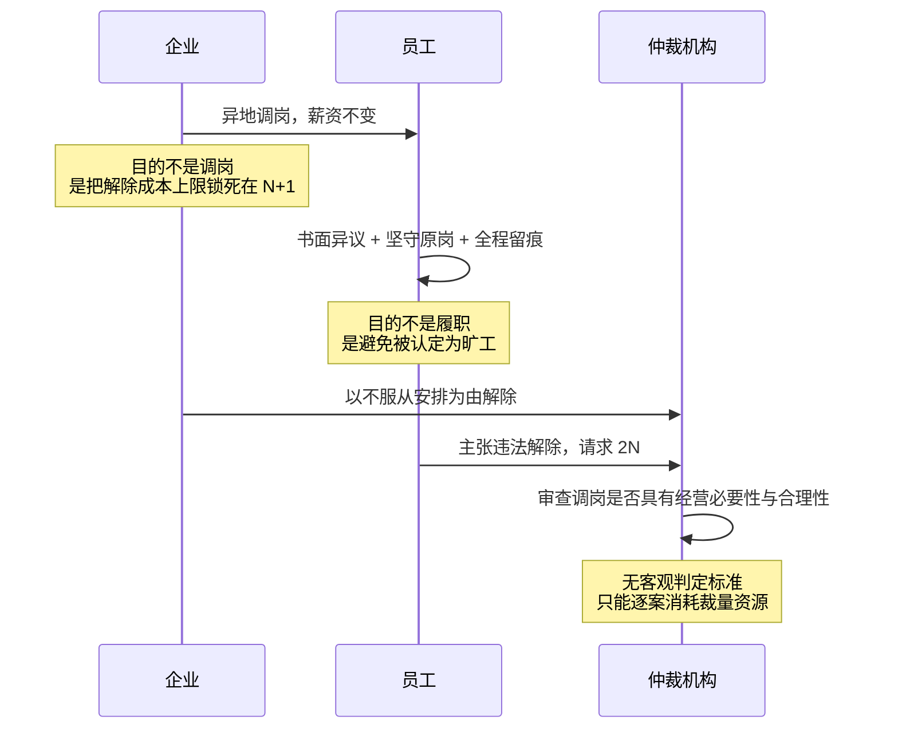
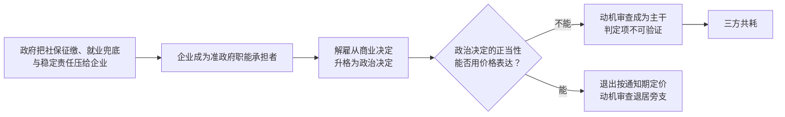

一条规则的执行成本，取决于它的判定项是否**可验证**（verifiable）：第三方能否用客观证据，在有限步骤内复核判定结果。打卡记录、工资到账、合同签署都是可验证项；“解除是否具有正当事由”、“调岗是否具有经营必要性”不是。

内地劳动保护的核心判定项恰恰落在后者。《劳动合同法》为解雇设置了很高的门槛，但门槛的高度不由客观事实决定，而由对企业动机与合理性的评价决定。评价无法被复核，于是保护并未消失，它只是换了存在形式：**从一条规则，变成三方各自承担的全职工作**。员工把一部分职业生涯转为取证，企业设立专门岗位设计规避路径，仲裁机构把人力投入动机审查。

这不是保护过度，也不是保护不足，而是保护的兑现方式要求所有人变成监视者。

## 三方共耗：一个没有赢家的均衡

以“异地调岗不降薪”为标本，可以看清整条链路。

企业的算盘是精算过的：直接协商解除要付 N+1，而以旷工解除是零成本。调岗不降薪把选择权抛给员工——员工若“主动不同意”并停止出勤，性质就从企业解除变为员工违约。员工的反制因此不是争取留在原岗，而是**制造证据**：书面表达异议、每天到原工位打卡、录音保留每一次谈话。仲裁机构接到的争议，判定项是“这次调岗有没有经营上的必要性”，而这个判定项没有任何客观证据可以复核。

| 参与方 | 实际投入 | 名义产出 | 净收益 |
| --- | --- | --- | --- |
| 员工 | 日常留痕、录音、书面异议 | 争议中多一分胜算 | $\leq 0$（时间成本自担） |
| 企业 | 规避方案设计、法务与HR编制 | 把解除成本压向 N+1 | $\approx 0$（省下的赔偿金差额，被常设的规避编制抵消） |
| 仲裁机构 | 逐案审查动机与合理性 | 一份难以自证的裁决 | $< 0$（纯公共损耗） |

三行里没有一行是正的。这一点与常见的模糊规则叙事不同：[《声明式与过程式》](https://cj9208.github.io/blog/systems_and_governance/declarative-imperative-governance/)描述的模糊，收益归掌握裁量权的一方——“刑不可知，则威不可测”；[《谁在用制度的“故意装糊涂”》](https://cj9208.github.io/blog/systems_and_governance/chinese_government/institutional-deliberate-ambiguity/)描述的模糊，收益归政府，代价由企业承担。那是零和，甚至是一方得利。

劳资场景里不是。裁量权在这里不是一项可以持有的资产，它必须在每一个个案中被消耗掉才能兑现。仲裁员无法把“审查动机的权力”攒起来变现，企业也不能。于是模糊不生产赢家，只生产摩擦——**这是一笔三方分摊、无人入账的税**。

## 不可验证性：模糊规则的执行成本

判据只有一条：存在客观证据，使第三方能在有限步骤内得出一致结论。两类判定项的差别因此不在重要性，而在成本形态。

| | 可验证判定项 | 不可验证判定项 |
| --- | --- | --- |
| 典型问题 | 是否打卡、是否到账、是否签署 | 是否具有经营必要性、是否属恶意规避 |
| 判定成本 | 一次性、可标准化 | 逐案、需裁量 |
| 前置投入 | 记录事实即可 | 必须预判对方动机并留痕 |
| 争议解决 | 短，证据决定结果 | 长，程序成为消耗手段 |
| 参与方 | 争议双方 | 双方 + 裁决者，且各自需专业代理 |

关键的转换发生在举证环节。信息天然掌握在企业一侧——考勤后台、调岗决策链、绩效评定过程都在企业系统里，员工无法取得。当法律要求员工证明企业的动机不正当，而员工又拿不到能证明动机的材料时，举证义务事实上就转化为**全员留痕义务**：既然事后取证不可能，就只能事前把每一天都当作证据来生产。

这就是“录音为王”的来源。它不是职场信任崩坏的道德症状，而是不可验证判定项的技术补偿——上一节那条“全员留痕义务”，落到日常就是它。

[《声明式与过程式》](https://cj9208.github.io/blog/systems_and_governance/declarative-imperative-governance/)在系统层面讲过同一机制——模糊规则等于抛弃类型检查，攻击面无限放大；裁决集中在单一节点，节点数一涨，治理成本就失控。那里的成本是一个总数，记在“系统”名下。拆到三方头上，它是三种不同的支出：员工付的是每天的注意力，把每一次谈话都当作将来可能的证据来经营；企业付的是一条常设编制，法务、HR 与规避方案设计；仲裁机构付的是不可复用的裁量劳动，每案重新审查一次动机，结论无法沉淀为可套用的标准。三笔支出相加，不产生任何新产出——这是它与投资性支出的区别，也是“税”这个说法的严格含义。

## 幻觉的再生产：少数兑现维持全局

内地的劳动保护常被形容为纸面的、虚假的。这个形容不准确，而准确的版本更麻烦。保护不是假的——确实有人死磕到底拿到了 2N。问题在于：**它的兑现依赖不可验证的主观判断，因此在统计上不可兑现，只在个案上偶尔兑现成功；而正是这些少数成功案例，维持了整个幻觉，也维持了仲裁案件量。**

机制是期望值层面的。当一个人通过长期对抗拿到违法解除赔偿金，所有观察到这件事的员工都会重算自己的最优策略：留痕的成本是确定的、每天几十分钟，而收益是一次性的、可能数倍于月薪。只要兑现概率不为零，留痕就是占优策略。于是单次成功不需要很多，它只需要存在。

“按闹分配”由此不再是道德缺陷，而是这个结构的必然输出。法律要求的是完美的合理性证明，而证明成本极高时，能承担时间成本与心理成本的人才兑现得了权利。老实人吃亏不是因为老实，而是因为他们的时间贴现率更高——他们等不起仲裁、一审、二审的完整链路。

这个均衡为什么不会自己崩塌？因为三方都没有单方面偏离的激励：政府从“调解为主”中获得稳定，企业从“2N 封顶”获得可精算的违法成本上限，劳动者从个案成功中获得希望。[《从“违法套利”到“制度威慑”》](https://cj9208.github.io/blog/systems_and_governance/chinese_government/labor-rights-deterrence/)的附注已经指出，这种限额赔偿构成一种默许企业精算违法的隐性社会契约。本文补充的是另一侧：它同时也构成一种默许劳动者全员留痕的隐性契约。

> 一处不确定性：“统计上不可兑现”是结构性推论加体感认知，不是实证结论。本文没有案件量与兑现率的公开数据来标定这个判断的强度。

## 因在政企：职能转嫁与动机审查

三方共耗是果，不是因。它的上游只有一条链。

商业决定的正当性由价格表达：企业愿意为解除付多少钱，员工愿意为离开收多少钱，两个数字相遇就完成了判定，不需要任何人评价动机。政治决定的正当性无法由价格表达——一次涉及数十人的裁撤是否“影响稳定”、是否属于“规避社会责任”，这些问题不能通过出价来回答，只能通过评价来回答。评价就是审查动机，审查动机就不可验证。反过来也成立：只要解雇仍被当作政治决定，判定项就无法被改写成可验证的形式。**规则清晰度是政企关系清晰度的因变量，不是可以单独立法获得的自变量。**

一个自然的替代解释是立法者认知不足，或者标准写得太粗糙。这个解释不成立。《劳动合同法》的立法标准参照的是成熟工业化国家，在解雇补偿、加班费、社保基数上的规定本身相当精确；不精确的不是条文，而是被设计为需要审查动机的判定项。而且这种设计有它的功能：**判定项越客观，裁量空间越小；裁量空间越小，选择性执法就越不可能。** 一个完全客观的解雇标准会让“调解为主、限额赔偿”这套实用主义妥协失去操作余地。

[《从维稳逻辑看政策扭曲》](https://cj9208.github.io/blog/systems_and_governance/chinese_government/zero-cost-stability-distortion/)已经论证了零成本维稳如何把风险转嫁给企业与个人。本文补一个方向：被转嫁的不只是风险，还有**判定成本**。风险转嫁后，企业至少知道自己在承担什么；判定成本转嫁后，三方都在为一个无法计量的项目全职工作，而没有人知道总账是多少。

## 港新的解法：主干是通知期，审查只是旁支

在这两地，绝大多数雇佣关系的结束不进入任何评价程序。通道只有一条：通知期。企业提前通知，或支付等额的代通知金（payment in lieu of notice），合约即告终止；员工主动离职同样需要提前通知。它是一个双向的、事前已知的标量，不需要任何人评价动机。

法定下限其实很短。新加坡分四档：服务不满 26 周为 1 天，26 周至 2 年为 1 周，2 至 5 年为 2 周，5 年以上为 4 周；裁员补偿也不是法定义务，只在合约或集体协议有约定时才具强制力，人力部的指引（服务满 2 年者每年 2 周至 1 个月薪资）属于建议。真正的保护力来自合约：市场上初级岗位约一个月，中高级岗位三到六个月（此为市场惯例示意，非法定标准）。

这个安排常被读作港新保护薄弱，但它其实是设计的核心——**把保护水平从立法者的统一标准，交给双方在签约时定价。** 由此得到三个只有价格通道才可能有的性质。

**通知期长短成为岗位重要性的可验证度量。** 头衔、薪酬与编制含金量都可以被通胀（虚高头衔、PPT 汇报线、名存实亡的岗位编），通知期不行，因为它直接是企业的现金义务：给一个岗位挂六个月的通知期，等于企业承认这个位置空缺会造成至少六个月的损失。

**清晰的价格才长得出精细的工具。** 花园假期（garden leave）——继续付薪但不要求到岗——是把通知期从“继续工作”改写为“切断信息接触”的产物；只有在通知期本身是可自由交易的标量时，这种改写才可能被设计出来。

**风险与对价在高管侧对称。** 他们不适用基层的法定保护，安全网完全来自合同里的高额通知期与遣散条款：保护越薄，对价越高，且对价在签约时就已明码标价。

主干之外还有一条兜底通道。港新同样设有违法解雇的判定——香港《雇佣条例》第 32K 条列出五项正当理由，新加坡《雇佣法令》第 14 条禁止“无正当因由或借口”的解雇（条文细节与赔偿数字见文末《制度事实与来源》）——但这条通道只在雇员主动申索时才被激活，附带年资与时限门槛，金钱赔偿有硬顶，程序简短。流传很广的“港新解雇不需要理由”把主次颠倒了：审查存在，只是不在主干上。

差别因此不在有无，而在位置与上限。内地的正当事由审查是每一次解除都必须穿过的主干，无论员工是否提起争议，企业在做决定的那一刻就要为将来可能发生的评价准备证据；金钱上限（2N）虽然确定，**程序成本却没有上限**，仲裁、一审、二审的完整链路可能持续一年以上，这段消耗无法在事前被任何一方定价。

> 一个容易混淆的对照：美国的随意雇佣（at-will employment）也是清晰的，但它是**单向清晰**——企业可以随时解雇且无须对价，劳动者没有对称的定价。本文主张的不是“解除越自由越好”，而是**对价必须明码标价、双向、且上限事前可知**。

| | 内地 | 港新 | 美国 |
| --- | --- | --- | --- |
| 默认解除通道 | 正当事由审查（主干） | 通知期履行（主干） | 无须任何通道 |
| 动机审查位置 | 每次解除均需通过 | 雇员申索时才激活 | 反歧视法与个案合同 |
| 审查门槛 | 无门槛 | 24 个月年资、严格申索时限；新加坡调解前置 | — |
| 金钱上限 | 2N，确定 | 硬顶：15 万港元 / 2–3 万新元 | 无 |
| 程序成本上限 | 无 | 有，审裁处程序简短、时限严格 | — |
| 对价方向 | 单向，仅企业支付 | 双向，双方均需履行通知期 | 单向，仅劳动者承担 |
| 保护力来源 | 法定统一标准 | 合约议价 | 市场自律 |

## 清晰的代价：门槛、硬顶与议价能力

通知期通道带来的那三个性质，都压在同一个前提上——签约时双方议价能力大致对等。前提不成立时，代价立刻显现：港新模式换来的低摩擦不是免费的，它有三笔明确对价。

**代价一：门槛以下没有保护。** 香港的 24 个月连续性合约要求，把短年资雇员整体排除在不合理解雇申索之外，他们能拿到的只有通知期或代通知金。在一个流动性高、短期合同普遍的市场里，这覆盖相当一部分劳动力。

**代价二：硬顶削弱威慑。** 15 万港元对一名月薪三万的雇员是五个月工资，对一家企业是一笔可精算的支出。当违法的价格低于违法的收益时，封顶就变成了许可。内地的 2N 同样不高，但它可以与“恢复劳动关系”这一非金钱救济并存；港新在金钱封顶之外，一般不合理解雇的复职需劳资双方同意，实际可得性很低——只有不合法解雇自 2018 年起例外。

**代价三：保护水平由议价能力决定。** 当法定通知期下限只有 1 天到 4 周、裁员补偿无法定时，一个人实际获得的保护完全取决于签约时的谈判地位。强者拿六个月，弱者拿一周，而法律对两者同样“清晰”。

这三条合起来指向同一个判断：**港新模式不是更好的保护，而是更便宜的确定性。** 清晰规则的分配后果是弱者承担清晰的成本，模糊规则的分配后果是弱者承担摩擦的成本，两者都不利于弱者；区别在于前者透明、可以事前议价，后者隐蔽、只能事后博弈。透明的不利至少能被计入报价，隐蔽的不利只能被承受。

反过来，内地的正当事由审查通道也不该被浪漫化。举报违规而被解雇的情形，在香港属于不合法解雇，可获补偿金并可能被强制复职；在新加坡可经 TADM 与 ECT 主张复职。内地在纸面上对同类情形的保护更强，问题在于兑现依赖不可验证的动机判断，而兑现率无法事前估计。一条在统计上不可兑现的救济通道，对当事人的期望值贡献接近于零，无论纸面强度多高。

此外，通知期作为一笔固定现金，其保护力会被再就业周期侵蚀：当再就业周期长于通知期时，超出部分的风险完全裸露。三个月的通知期在六个月的再就业周期面前只覆盖一半。港新的劳动力市场薄、外向程度高，这个缺口相对可控，但这属于制度外部环境，不属于制度本身的性质。

## 结语：把摩擦一次性结清，还是让三方分摊

两套系统生产的不是不同数量的保护，而是不同形态的成本。

内地这套的产出是一笔按时间摊开的摩擦。判定项不可验证，保护就没有消失，只是换了承担方式：员工把一部分职业生涯转为取证，企业设立常设编制设计规避路径，仲裁机构把人力投入逐案裁量。三笔支出相加不产生任何新产出，也没有任何一方能把它入账。保护的强度写在纸上很高，实际期望值却取决于谁耗得起仲裁、一审、二审的完整链路——而这条链路只对少数人兑现，少数兑现又足以让所有人继续留痕。

港新这套的产出是一次结清的对价。退出被定价为通知期，付满即终止，不需要第三方评价动机；动机审查退到旁支，被年资门槛与赔偿硬顶框住。摩擦因此不进入日常，只在极少数申索中被激活。代价写在同一张纸上：门槛以下没有保护，硬顶削弱威慑，实际保护水平由签约时的议价能力决定。

区别在成本形态。港新的成本是一笔签约时就能算出的对价，付完即止；内地的成本是一笔谁也不知道总额的税，从入职那天起按天征收，直到关系结束也没有结清的那一刻。

一条规则要求你证明别人的动机时，它真正在做的事，是让所有人全职监视所有人。

---

## 附录：内地为什么不能只改程序

既然港新能把动机审查放在旁支，内地为什么不能照做，只改写程序就把摩擦降下来？

港新的主干是通知期，动机审查之所以能退到旁支，是因为绝大多数解除根本不经过它——付满对价就结束。内地要复制这一点，前提是主干也换成价格；而主干一旦换成价格，一次涉及数百人的裁撤就可以用 N+1 合法结清，这在由企业吸收失业冲击的治理结构里是不可接受的。所以把审查移到旁支，要求先存在一个能承接主干的价格通道；而价格通道能否存在，取决于政府是否还需要企业替它兜底。改写程序解决不了这个问题，它只是把同一个判定项换个位置摆放。

同样的理由也解释了为什么加码威慑收效有限。[《从“违法套利”到“制度威慑”》](https://cj9208.github.io/blog/systems_and_governance/chinese_government/labor-rights-deterrence/)主张引入惩罚性赔偿、举证责任倒置、强制开示、实权工会与反报复机制。这套方案在逻辑上自洽，但它的隐含前提是判定项本身可以客观化——举证倒置与强制开示解决的正是信息不对称。问题是，当判定项是“动机是否正当”时，把全部企业内部数据交出来也无法回答它：数据可以证明调岗发生过，无法证明调岗是否出于经营必要。在职能转嫁未解除的前提下加码威慑，实际效果是提高企业的合规成本，从而提高规避设计的边际收益。调岗不降薪这类工具不会消失，只会更精细。

因此顺序不可颠倒。先把企业从准政府职能中卸出来——社保资产确权、福利与救济由财政而非企业承担——解雇才可能退回商业决定的性质，规则才可能被改写成客观判定项，摩擦才可能一次性结清而不是被三方分摊。这一点与[《极简制度论》](https://cj9208.github.io/blog/systems_and_governance/minimal-institutionalism-certainty/)关于确定性作为底层协议的论述一致，也解释了为什么制度移植在缺乏对应政企结构时反复失效。

---

## 制度事实与来源

本文涉及的法域规则以下列来源为准，数字为撰写时（2026 年 10 月）的公开信息：

- 香港《雇佣条例》（第 57 章）第 32K 条五项正当理由、24 个月连续性合约门槛、终止雇佣金与不合法解雇 15 万港元补偿金上限、2018 年 10 月 19 日起无须雇主同意的复职命令及不履行时的额外款项（平均月薪三倍、上限 72,500 港元）：[劳工处《雇佣条例》常见问题](https://www.labour.gov.hk/tc/faq/cap57k_whole.htm)、[社区法网·不合理解雇](https://www.clic.org.hk/cn/topics/employmentDisputes/mattersRelatedToEmploymentOrdinance/terminationOfEmploymentAndTheRelevantPayments/unreasonable_termination)、[Law.asia《内地与香港员工解雇比较分析》](https://law.asia/zh-hans/employment-law-differences/)。申索时限（被解雇后 3 个月内发出书面通知、9 个月内提交审裁处）取自实务整理，应以劳工处现行指引为准。
- 新加坡《雇佣法令》第 14 条“无正当因由或借口”解雇、TADM 调解转 ECT、复职或 2 万至 3 万新元赔偿上限、法定通知期四档下限、裁员补偿非法定而依人力部 TAMEM 指引：[SGECT 1 (2026) 对第 14 条立法史的梳理](https://www.elitigation.sg/gd/s/2026_SGECT_1)、[新加坡裁员与辞退补偿的法律要求](https://www.knitpeople.com.cn/blog/legal-requirements-for-retrenchment-and-dismissal-compensation-in-singapore)（二手整理，具体时限与上限应以 MOM 与 TADM 官网公告为准）。
- 内地 N+1、2N 上限、调解为主与选择性执法的分析，见[《从“违法套利”到“制度威慑”》](https://cj9208.github.io/blog/systems_and_governance/chinese_government/labor-rights-deterrence/)及其附注。
- 通知期的市场惯例数字（初级约 1 个月、中高级 3–6 个月）为示意，非法定标准。

---

## 延伸阅读

- [《从“违法套利”到“制度威慑”：解构劳动维权中的制度鸿沟与破局之路》](https://cj9208.github.io/blog/systems_and_governance/chinese_government/labor-rights-deterrence/)——本文的正面咬合对象：它主张加强威慑，本文主张把审查移到旁支并封顶。
- [《声明式与过程式：系统工程视角下“人治”与“法治”的四大差异》](https://cj9208.github.io/blog/systems_and_governance/declarative-imperative-governance/)——动态裁量与单体 CPU 瓶颈的一般性论述。
- [《谁在用制度的“故意装糊涂”，透支全社会的公平与信任？》](https://cj9208.github.io/blog/systems_and_governance/chinese_government/institutional-deliberate-ambiguity/)——模糊作为一方套利工具的零和版本。
- [《从维稳逻辑看政策扭曲：当行政规避成为社会内耗的推手》](https://cj9208.github.io/blog/systems_and_governance/chinese_government/zero-cost-stability-distortion/)——零成本维稳与风险转嫁。
- [《从“身份编”到“岗位编”：为什么我们缺乏真正的职业安全感？》](https://cj9208.github.io/blog/systems_and_governance/chinese_government/identity-post-career-security/)——用金钱买断风险替代身份保护的早期论述。
- [《极简制度论：确定性作为社会秩序的底层协议》](https://cj9208.github.io/blog/systems_and_governance/minimal-institutionalism-certainty/)——确定性作为不变量的总纲，也是本文“规则清晰度是政企关系清晰度的因变量”这一判断的上位命题。
- [《新加坡定居：是技术中产的天堂，还是极致精算的围城？》](https://cj9208.github.io/blog/systems_and_governance/singapore-tech-middle-class/)——新加坡侧的制度环境背景。
