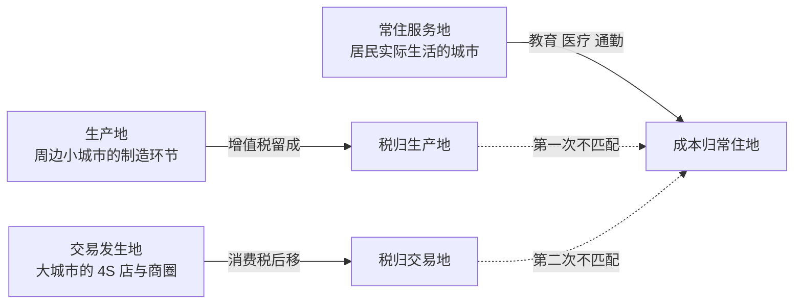
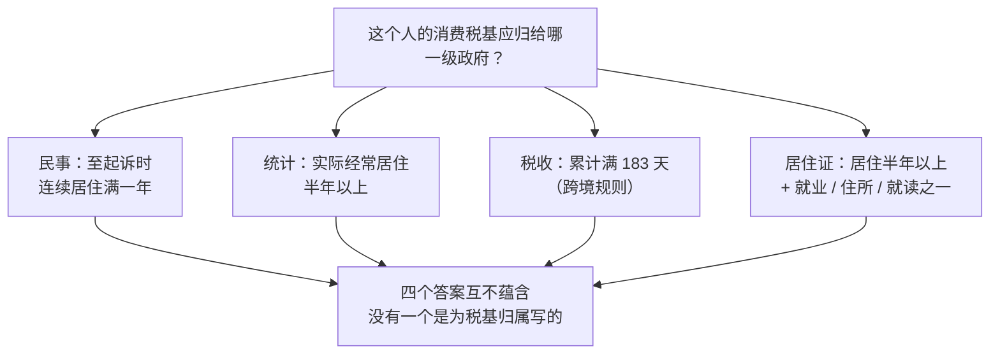

税收是一种契约：政府收走的钱，要和它为这笔钱办的事对得上。对不上的时候，财政学给过四种改法——上收、配套补助、重划辖区、向外部受益者收费——四种求的都是更合理的分配，但动的不是既有划分里的百分比，是这件事由谁办、钱由谁收，对齐收上来的钱和办的事。对不齐，激励就错位。

汽车是观察这套不匹配最省力的物件，因为它必须登记上牌才能合法上路，于是天然带着一个行政锚点。而一辆车在哪里买、在哪里上牌、在哪里跑、车主在哪里常住，这四个地点在今天的中国可以合法地互不相同。这不是漏洞，是常态。

核验能力这十年已经大幅补齐。补齐的是“能不能收”，没补齐的是“该归谁”。

## 一、第一次不匹配：指挥棒在生产环节，不在消费环节

地方从汽车产业拿到的主要收入是增值税，不是消费税。

增值税在生产出厂环节征收，2016 年营改增之后央地五五分成，是地方从制造业获取经常性财源的主渠道。国发〔2016〕26 号把这层关系写得很直白：中央分享增值税的 50%，地方“按税收缴纳地”分享另外 50%。企业所得税中央六成、地方四成。汽车消费税与车辆购置税则百分之百归中央。这三个事实叠在一起，决定了地方的行为方向：谁造得多、铺得广，谁就有税。哪怕车滞销在停车场，只要它在生产环节产生流转额，增值税就已经落袋。

于是地方有强激励保产能、保工厂。低效车企不容易出清，因为出清的账由地方承担，而维持运转的税由地方留下。生产端税制由此把地方政府异化成“超级工业投资公司”：僵尸工厂得到制度性保护，全社会资源向供给侧堆砌，而改善本地消费环境、提高居民购买力没有对应的财政回报，内需因此失去制度激励（见[《从技术乌托邦到制度次优解》](https://cj9208.github.io/blog/systems_and_governance/chinese_government/tech-utopia-second-best/)）。

消费税名义上对准消费，但地方拿不到分成，促消费的激励是断的。把消费税征收环节后移到零售端并下划地方，国发〔2019〕21 号已经写成正式安排，但加了个前提——“在征管可控的前提下”，先从高档手表、贵重首饰和珠宝玉石这类条件成熟的品目做起。方向是对的，落地很慢，卡在三处：烟酒油车的生产高度集中在特定省份，税源一夜切向消费地会造成生产大省财政休克；税控网点从几家巨型工厂扩散到千万级零售终端，征管成本裂变；消费税若变成地方现收现留的自留地，中央就失去了“先收上来、再转移支付发下去”的指挥棒。

到这一层为止，讨论都停在“改税种”上。改税种改的是指挥棒的指向，前提是这根指挥棒能被地方握住。下一节要问的是：握住之后，它指向哪里？

## 二、第二次不匹配：消费税后移没有指定“消费地”在哪里

后移的承诺是“消费在哪里，税收就留在哪里”，进而“谁承担服务人口的事权，谁就获得人口消费带来的税收”。[《从技术乌托邦到制度次优解：大国资源分发的隐性转轨》](https://cj9208.github.io/blog/systems_and_governance/chinese_government/tech-utopia-second-best/)把这叫作人税合一，认为它能让常住人口从地方财政的净负担变成核心现金流。

这个对齐有一个成立条件：消费发生的地方，就是服务被提供的地方。同一地消费时，条件满足，人税合一确实成立。跨城消费时，条件不成立。

小城市居民去大城市买车、购物、看展、就医，交易发生在大城市。后移之后，这笔税收归大城市。而这些人的子女教育、日常医疗、通勤道路、社区治安，成本留在小城市。第一次不匹配在旧体制下的形态是“事权在本地、财富在彼端”，第二次不匹配在改完之后仍然是“事权在本地、财富在彼端”，只是“彼端”从生产地换成了交易地。

后移修好了第一次不匹配，同时制造了第二次不匹配。

问题不在后移本身，而在于“消费在哪里”这个说法里藏着两个不同的地点：交易发生地和服务受益地。前者是一个收银台的位置，可以被数电票链条精确锁定；后者取决于一个人到底算哪里的居民，而这个“算”字，目前没有唯一答案。

## 三、不匹配卡在哪一点：车能定位，人定不了

车这一侧的工具已经够用。车船税随交强险由保险机构代收代缴，登记信息全国联网核验；ETC 记录了车辆在路网上的实际轨迹；电子车牌在若干城市试点，可以把通行数据与车辆身份绑定。“这辆车在哪里跑”是一个技术上可答的问题。

锚点也是现成的，而且钉得很稳。《车船税法》第七条规定，车船税的纳税地点为车船的登记地，或者扣缴义务人所在地。正因为稳，很少有人追问一句：登记地是不是受益地。

人这一侧也有锚点，而且钉得更硬：《民法典》第二十五条把住所落在户籍登记记载的居所上，与车的登记地在结构上完全同构。所以真正的对比不是“车有锚点、人没有”，而是车有一个明确且大体可用的锚点，人有四个互不蕴含的候选：

- 民事上，《民法典》第二十五条以户籍登记记载的居所为住所，经常居所与住所不一致的，经常居所视为住所。“经常居所”本身没有时长门槛，实务中常参照《民事诉讼法》司法解释第四条对“经常居住地”的界定——“离开住所地至起诉时已连续居住一年以上的地方”，起算点是一场诉讼的提起时刻；
- 统计上，国家统计口径把常住人口定义为实际经常居住在某地区半年以上的人口；
- 税收上，《个人所得税法》第一条以一个纳税年度内在境内居住累计满 183 天划分居民个人与非居民个人，《实施条例》第二条把“境内有住所”解释为因户籍、家庭、经济利益关系而在境内习惯性居住。这是一条跨境规则，回答的是归不归中国管，不是归哪个城市管；
- 行政上，《居住证暂行条例》第二条要求离开常住户口所在地、到其他城市居住半年以上，并具备合法稳定就业、合法稳定住所或连续就读条件之一。

四套标准各自成立，互不推出，而且没有一套是为税基归属写的：第一套解决诉讼管辖，第二套解决人口统计，第三套解决跨境纳税义务，第四套解决公共服务的申领资格。一个人可以满足其中两套而不满足另两套，且每一套都能拿出法定依据。远程办公是这种分离的边界案例，规模还小，但它说明了一件更要紧的事：分离可以完全合法地发生。社保缴纳地、工作地、居住地三者落在三个不同的城市，而且没有一条被违反。一个人在 A 城登记社保、受雇于 B 城的公司、大部分时间住在 C 城，每周去 B 城一次——这不是套利，是合规。

这里缺的不是数据，也不是执法力度。四套定义各自都有法定依据，也各自都能被完整核验，核验的结果是四个都成立的答案同时摆在那里：数据能告诉你一个人在几个城市各住了多少天、社保缴在哪里、车停在哪个小区，不能告诉你这些事实该按哪一套标准折算成归属。执法成本高，加强取证、细化程序可以缓解；定义缺失，再强的核验能力也补不上——它只能把一个法律上从未被做过的选择，呈现得比原来更清楚。

核验能力再强，也核验不出一个尚未被定义的归属。

## 四、美国把两次不匹配收成一条规则

美国各州税率各不相同，州与州之间却没有边境关卡。它跑得通，靠的不是更强的监控：处理“A 地买、B 地用”的方式不是拦截，是一套已经写明的规则。

美国的骨架是四件：注册地确定税权，车辆必须在使用所在州登记；使用税补差额，在低税州或无税州购车、在高税州长期使用，须按使用地税率补缴使用税；数据核验通过登记地址、保险地址与实际使用痕迹比对；罚则兜底，被查到要补税、加利息并罚款。

这四件里，第二件最像纸面条款：车和登记都在别人手里，凭什么让你补缴？检验它是否真在运转，要看套利收益最大的那个极端案例。蒙大拿州没有一般销售税，一辆在其他州要多缴一大笔销售税的车，挂到蒙大拿名下就一分不交。于是长期存在一种做法：在该州设立一家有限责任公司，用公司的名义登记豪车与飞机。它有个专有名词，叫“蒙大拿漏洞”。

各州的应对不是阻止登记，而是事后追缴：核查登记地址与实际使用地是否一致，认定不一致就追补。这份权力也不停在纸面上——田纳西州税务局设有针对外州有限责任公司登记方案的稽查与追缴程序；加利福尼亚州税务局与车管所 2026 年就这类登记发出专项稽查通告，媒体披露排查出的相关车辆以千计，同年 10 月州长又签署新法进一步扩大追缴能力。

这套机制不追求全数查获，它追求让套利的期望收益为负。设查获概率为 $p$、逃税额为 $G$、补税加罚款为 $F$，只要 $p \cdot F > G$，理性主体就不会去试。稽查程序、专项通告和新法抬的都是 $p$：它们要做的不是多抓几个人，是让这道不等式成立。

这套规则回答了第二节留下的问题：美国的答案是使用地。车在哪个州长期使用，税就归哪个州，而不是归收银台所在的那个州——那恰恰是征收最便利、最容易抓的锚点。“消费在哪里”在这里只指一个地点，不像后移的安排那样一次指两个。

开头那四个地点，在美国被一条规则收成了两个：登记必须落在使用所在州，“在哪里上牌”因此不再是一个可以独立选择的问题。锚点还是行政的，但它被钉在了成本发生的那一侧。为什么必须钉在那里，是下一节的事。

## 五、匹配的一般形式：收什么钱，办什么事

税收是一种契约。这不是比喻。Wicksell 给这条契约下的判据是：税收与支出必须作为同一个议案一起决定，否则无从判断这笔钱该不该收；Buchanan 把它叫财政交换。强制性不否定契约性，它就是契约的执行形式——正因为没有人可以退出，才更需要事先讲定收什么钱、办什么事。

上一节把锚点钉在使用地，理由只有一个：服务发生在那里。把它一般化，就是本文要说的那一条：政府收走的钱，要和它为这笔钱办的事对得上。为什么要对得上？因为税收落在谁的账上，激励就指向哪里；契约要的不是账算得平，是激励与成本钉在同一侧。这不要求“我交钱、你给我一对一服务”的市场交换，也不要求各地报出相同的税与服务组合——税率不同、服务组合不同，本来就是分权该有的样子。契约的判据只有一条：一个地方报出的那个组合得是它自己的账，收进来的钱和办出去的事记在同一本账上。

匹配的一半在税与经济活动之间。中国税制为此改过两轮税基，两轮做的是同一件事：缩小重复征税。营业税按全额、分环节征收：我从供应商买进，售价里必然含着他已经缴过的那一段，而我要就这个全额再交一次，链条每多一环就把上游多缴一次。分工越细税负越重，并上下游进一家企业、内部调拨不走市场反而省税——税制在替企业选组织形式，奖励“大而全”，惩罚专业化。增值税把税基从全额换成增值额、上一环已交的允许抵扣，重复征税从企业之间消失。增值税自己还有下一轮：它原本不允许抵扣固定资产进项，惩罚的是投资，2009 年从生产型转为消费型，重复征税从投资品上消失。两轮改的都是税基的定义——对什么征、征多少。

匹配的另一半在税与事权之间。征收环节从生产后移到零售、收入下划地方，动的不是税基，是这笔钱落在谁手里。第二次不匹配——交易在大城市，服务在小城市——就是受益范围跨出了收钱的那个辖区。这类不匹配，财政学给过四种改法：上收，把这件事连同它的收入一起交给能覆盖全部受益范围的那一级；配套补助，上级按地方支出的一定比例补贴，把外溢出去的那部分补回来；重划辖区，让管辖范围与受益范围重合；向外部受益者收费，谁受益谁付钱，哪怕他不住在这里。四种都是把付钱的人和受益的人重新对上：税种没变，变的是这件事划给谁。而划给谁没有唯一解——美国最高法院在 Container Corp. v. Franchise Tax Board（1983）里审查各州之间的利润分配公式，标准是“必须公平”，不是必须正确。所以归属只能挑一个代理指标写下来——增值额是一个，消费地是另一个——下一轮才有可援引的东西。

这条匹配要紧的是它的后果：激励钉在哪一侧，资源就往哪一侧流，钉错方向就是真实的浪费。生产端已经付过一次——增值税在出厂环节就落进地方的账，卖不卖得出去不影响这笔钱，于是保产能成了理性选择；第一节的产能过剩与僵尸工厂，不是地方的偏好出错，是激励被钉错了位置。消费端按现方案落地会再付一次：税收跟着收银台进了大城市，教育、医疗、通勤与治安仍记在小城市的账上——它既拿不到钱，也没有制度替它出钱。两侧是同一件事：钱归谁，决定的是谁有动力去办谁的事。

## 结语：技术划掉了“能不能收”，没划掉不匹配

金税四期与数电票确实解决了一件事。一笔交易的终端在哪里、货物流向哪里、资金如何勾稽，今天可以被实时穿透。制约消费税后移的那堵被[《从技术乌托邦到制度次优解》](https://cj9208.github.io/blog/systems_and_governance/chinese_government/tech-utopia-second-best/)称作“地狱级征管成本”的高墙，在技术层面上已经被铲平。

归属是另一件事。算力能锁定一笔交易在哪里发生，锁不出这笔钱该归谁——“该归谁”问的不是算力够不够，是钱和事匹不匹配。匹配也不是一条能测出来的自然事实：增值额是一个代理指标，消费地是另一个，两个都各有依据，挑哪一个就是决定把激励钉向哪一侧。它得被定下来，不是被算出来。

回到那辆车。它在哪里买、在哪里上牌、在哪里跑、车主在哪里常住，四个地点可以合法地互不相同。要把这四个地点收进同一条规则里，缺的不是更多的摄像头，是一条被定下来的归属规则：谁收这笔钱，谁就该拿它办哪件事，两处对不上就是不匹配。技术把“能不能收”划掉了，剩下“该归谁”，一个字都没多写。

---
## 延伸阅读

- [《从技术乌托邦到制度次优解：大国资源分发的隐性转轨》](https://cj9208.github.io/blog/systems_and_governance/chinese_government/tech-utopia-second-best/)——本文的上游对象，它问的是为什么要这样改：一笔税为什么要从生产端挪到消费端、地方财政靠什么撑起公共服务，大国资源分发这整套逻辑在它那里展开，范围比本文宽。本文只取它预设的那一条归属规则。它设想的终局是生产端保留物理预扣、用金税四期的数电票在零售端勾稽消费地、增量按比例自动划归实际消费地——技术上完全可行；但算得清在哪一侧，不等于不匹配就此消失。
- [《走出宏大叙事的幻觉：中西部大基建与转移支付的四大经济真相》](https://cj9208.github.io/blog/systems_and_governance/chinese_government/infrastructure-fiscal-transfer-economic-truth/)——同一个税收分离机制，但那篇跑的是东西部这条轴：增值税与企业所得税按生产地、注册地管辖申报，中西部承担了物流与基建的公共负债，税收却留在沿海总部，于是转移支付在法理上是税收返还而不是施舍。本文把轴换成大城市与小城市，两篇的分工在这里看得最清：那篇给的是不匹配落到地图上的真实后果——负债在内陆、税收在沿海总部，钱最后靠转移支付绕回来；本文给的是为什么要匹配的理由——后移治好了第一次不匹配，又生出第二次不匹配，两次踩的是同一条判据：收上来的钱和要办的事，得由同一个主体对上。
- [《定向补贴的微观死局与宏观政策的结构性反思》](https://cj9208.github.io/blog/systems_and_governance/chinese_government/targeted-subsidy-deadlock/)——它的第二节把生产型税制如何绑架地方的财政投资逻辑讲到了微观层面，与本文的第一次不匹配是同一个机制；它的第一节（累退效应、先消费后报销的门槛）则是这个机制落在分配上的结果。
---

## 制度事实与来源

本文涉及的规则与两条理论引证以下列来源为准，数字为撰写时（2026 年 11 月）的公开信息，均已比对官方或权威文本。仅个别征管技术细节仍标注“待核”。

- 央地收入划分：[《国务院关于印发全面推开营改增试点后调整中央与地方增值税收入划分过渡方案的通知》（国发〔2016〕26 号）](https://zh.wikisource.org/zh-hans/%E5%9B%BD%E5%8A%A1%E9%99%A2%E5%85%B3%E4%BA%8E%E5%8D%B0%E5%8F%91%E5%85%A8%E9%9D%A2%E6%8E%A8%E5%BC%80%E8%90%A5%E6%94%B9%E5%A2%9E%E8%AF%95%E7%82%B9%E5%90%8E%E8%B0%83%E6%95%B4%E4%B8%AD%E5%A4%AE%E4%B8%8E%E5%9C%B0%E6%96%B9%E5%A2%9E%E5%80%BC%E7%A8%8E%E6%94%B6%E5%85%A5%E5%88%92%E5%88%86%E8%BF%87%E6%B8%A1%E6%96%B9%E6%A1%88%E7%9A%84%E9%80%9A%E7%9F%A5)规定所有行业企业缴纳的增值税均纳入中央和地方共享范围，中央分享 50%，地方“按税收缴纳地”分享 50%，自 2016 年 5 月 1 日起执行，过渡期暂定二至三年；[《国务院关于印发实施更大规模减税降费后调整中央与地方收入划分改革推进方案的通知》（国发〔2019〕21 号）](https://guangdong.chinatax.gov.cn/gdsw/gzswzcwj/2019-10/12/content_18b14cd01e714630bb8297fe7c8c68af.shtml)在过渡期到期后确认“保持增值税收入划分‘五五分享’比例不变”，并要求“在征管可控的前提下”先对高档手表、贵重首饰和珠宝玉石等条件成熟的品目实施消费税征收环节后移、稳步下划地方。企业所得税与个人所得税分享比例依国发〔2001〕37 号自 2002 年起实行（当年中央与地方各 50%），2003 年调整为中央六成、地方四成，其后经国发〔2003〕26 号确认延续。消费税与车辆购置税依 1994 年[《国务院关于实行分税制财政管理体制的决定》](https://www.sz.gov.cn/zfgb/1994/gb49/content/post_10090769.html)属中央固定收入。
- 车端征管工具：[《车船税法》](https://www.12371.cn/2020-06/07/ARTI1591545204767982.shtml)第六条以从事机动车第三者责任强制保险业务的保险机构为车船税扣缴义务人，第七条规定纳税地点为车船的登记地或扣缴义务人所在地。待核：车辆登记信息全国联网核验的制度依据、ETC 通行数据的税务使用范围与电子车牌试点城市名单，尚无统一公开出处。
- 居住认定的四套口径：[《民法典》第二十五条](https://www.moj.gov.cn/pub/sfbgw/zwgkztzl/2025nianzhuanti/2025mfdxcy/2025mfdxcy_mfdql/202505/t20250507_518708.html)（自然人以户籍登记或其他有效身份登记记载的居所为住所；经常居所与住所不一致的，经常居所视为住所）；[《最高人民法院关于适用〈中华人民共和国民事诉讼法〉的解释》第四条](https://gongbao.court.gov.cn/Details/63ff48da6a9792f8ad1cb65a8b99d1.html)（经常居住地指“公民离开住所地至起诉时已连续居住一年以上的地方，但公民住院就医的地方除外”）；[国家统计局口径](https://www.stats.gov.cn/zs/tjws/tjbz/202301/t20230101_1903796.html)（常住人口指实际经常居住在某地区半年以上的人口）；[《个人所得税法》第一条](https://fgk.chinatax.gov.cn/zcfgk/c100009/c5193028/content.html)与《实施条例》第二条（一个纳税年度内在境内居住累计满 183 天为居民个人；“在境内有住所”指因户籍、家庭、经济利益关系而在境内习惯性居住——该条解决的是居民与非居民之分，属跨境规则）；[《居住证暂行条例》（国务院令第 663 号）第二条](https://www.mps.gov.cn/n6557558/c5121279/content.html)（公民离开常住户口所在地，到其他城市居住半年以上，符合有合法稳定就业、合法稳定住所、连续就读条件之一的，可以申领居住证）。
- 税收契约性的判据：Wicksell 要求税收与支出作为同一个议案一起决定，见 Knut Wicksell, "A New Principle of Just Taxation"（1896 年德文原文 "Zur Steuertheorie"，英译载 Musgrave & Peacock 编，Classics in the Theory of Public Finance, pp. 72–118；[RePEc 书目记录](https://ideas.repec.org/h/pal/intecp/978-1-349-23426-4_6.html)，链接于 2026-11-05 探测返回 200）。"财政交换"（fiscal exchange）的表述见 James M. Buchanan, "Taxation in Fiscal Exchange", Journal of Public Economics 6 (1976), pp. 17–29，及其与 Geoffrey Brennan 合著 The Power to Tax: Analytical Foundations of a Fiscal Constitution（Cambridge University Press, 1980）；出版商页面需订阅，故本条不附正文链接，书目信息据多家独立引证核对。本文只取两条判据的表述来定义契约，不引入两人的完整理论框架。
- 税基的两轮调整：营业税改增值税自 2016 年 5 月 1 日起全面推开，第一节所引国发〔2016〕26 号即其央地收入划分安排；增值税由生产型转为消费型依[《财政部 国家税务总局关于全国实施增值税转型改革若干问题的通知》（财税〔2008〕170 号，成文日期 2008 年 12 月 19 日）](https://fgk.chinatax.gov.cn/zcfgk/c102416/c5203418/content.html)，自 2009 年 1 月 1 日起允许一般纳税人抵扣新购进固定资产的进项税额，[财政部、国家税务总局负责人就此答记者问（2008 年 11 月 11 日）](http://www.mof.gov.cn/zhengwuxinxi/caizhengxinwen/200811/t20081111_89433.htm)称转型“将消除我国当前生产型增值税制产生的重复征税因素”。营业税按全额分环节征收、增值税按增值额征收并允许上一环抵扣，是税制通说；本文只据其逻辑推演对分工与企业组织形式的影响，未另行引证。
- 不匹配的四种改法：上收给能覆盖全部受益范围的那一级、上级配套补助、重划辖区使管辖范围与受益范围重合、向外部受益者收费，是财政学处理受益外溢的通行清单；本文只列其逻辑与共同点（都在改这件事划给谁，让付钱的人与受益的人重新对上），未另行引证。
- 归属公式的司法审查：Container Corp. v. Franchise Tax Board, 463 U.S. 159 (1983)，美国最高法院审查加州对跨国企业集团采用的三因素分配公式，认定公式不必精确、但必须公平，见 [Cornell LII 判例全文](https://www.law.cornell.edu/supremecourt/text/463/159)。
- 美国跨州车辆课税：各州普遍设使用税（use tax），对在本州使用而在外州购买的货物按使用地税率补征。蒙大拿州不设一般销售税，通过在该州设立有限责任公司登记豪车、房车与飞机的做法长期存在，通称“Montana loophole”；[田纳西州税务局](https://www.tn.gov/revenue/tax-fraud/out-of-state-llc-registration-scheme.html)设有针对外州有限责任公司登记方案的稽查与追缴程序；加利福尼亚州税务局与车管所 [2026 年 3 月发布专项稽查通告](https://cdtfa.ca.gov/news/26-02.htm)，彭博税务新闻（Bloomberg Tax）2025 年 7 月报道该州排查出约 1500 辆与蒙大拿税收安排相关的车辆，[2026 年 10 月州长签署新法](https://www.latimes.com/california/story/2026-10-05/luxury-car-buyers-who-use-montana-loophole-to-dodge-california-taxes-are-target-of-new-law)进一步扩大对这类安排的追缴能力。
