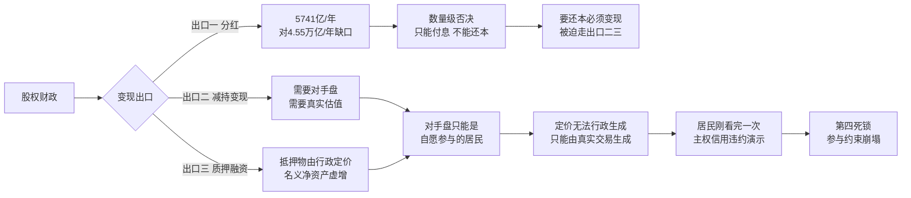

# 《股权财政的不可能》大纲与数据门禁

**状态：初稿已写完，`draft: true`，`hugo --buildDrafts` 通过（3 张 Mermaid 均以 `<pre class="mermaid">` 输出、7 个 H2、19 行表格、23 处站内链接指向 9 篇目标文章）。正文 11,113 字符，延伸阅读+数据来源 3,260 字符，合计 14,373。文件名 `content/blog/systems_and_governance/Chinese_government/退出权的两种时滞-土地财政与股权财政的定价条件差异.md`（无特殊 Unicode）。**

**互引 URL 已按索引核对，大纲 §4 中两处 slug 猜错，正确值为：**

- 《从技术乌托邦到制度次优解》→ `chinese_government/tech-utopia-second-best/`
- 《大出清时代》→ `chinese_government/debt-explosion-first-priority/`

**核心发现：原经验锚"存款不断新高"在 2026 年 10 月已不成立，但真实数据让论点更强——钱确实在搬，只是 96% 搬向固收，偏股公募份额仅增 2%。居民不是拒绝金融配置，是精确拒绝股权这一个资产类别。**

**2026-10-25 裁决（第二稿 v2，覆盖 2026-10-22 的结构裁决）：**

用户判定"版本一（国资划转社保）"是范畴错置：划转股权的分红进入**社会保险基金预算**、专款专用，不能调入一般公共预算，因此它解的是养老金兑付问题，不是财政的收入问题，不构成"接棒土地财政"的候选方案。

两条支撑证据：

1. 国资收益进入财政只有一条通道——国有资本经营预算调入一般公共预算（2025 年 5,741 亿）。划转给社保基金的那 10% 股权，其分红从这条通道里被挪走，方向上是**竞争**而非互补。（制度设计上的推论，未核到明文，标注为推理。）
2. 站内另两篇都把"划转国资"归到养老金轴：《不清算的代价》结语 §2 算的是 143.3 万亿国有净资产对 150 万亿 IPD 的穿底；《大出清时代》§63/§110/§151 主张的是"养老金实际资产化""打破刚兑神话"。本文初稿是唯一把它当"接棒土地财政"的地方，等于自造了一个站内无人支持的接口。

**处理方式：本 outline §1 的原始承重结构（(a) 国资自己变现 / (b) 居民换仓，"一条链，不是两条路"）本来就是对的，是初稿起稿时把它改写成了"版本一/版本二"并挂上了社保。v2 恢复 §1 的原始脊柱，不新造结构。**

对"仅保留一条思路"的一处修正（已在对话中提出）：用户原话是"如果高估，融资逻辑，就是民众拒绝参与"，但"民众拒绝参与"只覆盖 (b)。(a) 的失败形态是**没有对手盘 → 体系内自循环 → 伪装成成交**，是静默的、不留数据的；(b) 的失败是可观测的（存款流向、偏股份额、两融）。核心论点收成一个（定价不可行政生成），但保留它在两条通道上的不同失败形态——这不是两个论点，是同一不变量的两个投影。

v2 落地清单：

- **删**：版本一全部（2017 方案、1.68 万亿、93 家、2.26 万亿）；养老金精算两版并列段（社科院 2019 版/2025 版）；IPD 区间；§六 消费税后移卡壳段；数量级表中三行社保/养老金存量项；数据来源中"国有股权划转社保""全国社保基金""养老金精算预测""消费税后移进展"四条。
- **保留**：§二 全部（判据 + 退出权对比表 + 与《禁止交易》的反向应用 + 慢票已投完）；§四 全部（第四罢工是参与约束的实测，与社保无关）；§五 全部（能定价的是税不是股权，是核心论点的适用域）；体制内长钱 420 亿段（作参与约束的最硬证据，非财政论据，数据来源已加注）；三张 Mermaid。
- **新增**：§三 开头钉死预算口径（承担"为什么划转社保不算第二条通道"的 fencing）；§三 末"变卖通道的失败是静默的"段；§五 末"为什么土地财政的坍塌不静默"段；§六"判据的第二次验证"段（置换债对手盘是国有银行，退出权时滞无限长 → 行政定价可行，反证判据）；延伸阅读《大出清时代》加"与本文不同轴"注解。
- **链接处置**：《从技术乌托邦》随消费税段一起移除（延伸阅读由 9 条收为 8 条）；《大出清时代》保留但只出现在延伸阅读，注解写明两轴之别。
- **文件**：`退出权的两种时滞-土地财政与股权财政的定价条件差异.md`，`draft: false`，slug `exit-rights-lag-equity-finance-impossibility`。正文 10,936 字符（初稿 11,827），延伸阅读+数据来源 3,111。
- **2026-10-25 已合并发布**：v2 副本已删除，内容覆盖回正式文件；slug 去掉 `-v2` 后缀；`draft` 改为 `false`；审阅用的版本说明 blockquote 已删除；`date` 保留起稿时刻 2026-10-22T09:45，`lastmod` 更新为发布时刻。已加入 `Chinese_government/_index.md` 的"宏观约束与出清逻辑"板块末位（该栏目页 52 篇文章中此前唯一未被列出的就是本文，属发布必做项，非可选反链），并同步该页 `lastmod`。已重跑 `build-index.py`：233 条，index.json 中本文条目摘要已刷新（不再含社保表述），diff 仍只涉及本文与《未来的影子》两条新增。`hugo --gc` 生产构建通过（无 relref 报错），页面 3 张 Mermaid、2 张表、8 个 H2、8 个唯一站内目标 0 断链。
- **未做（需单独授权）**：大纲 §4 计划的两处反向链接——《弹性威权》§4.2 补第四罢工的指向、《社会契约的异化》§三.4 补 B' 的可测量输出。两篇均为已发布文章，改动需同步 `lastmod`，本轮未动。

---

**2026-10-22 裁决：**

1. 标题定为 **A《退出权的两种时滞：土地财政撑了二十年，股权财政撑不过一个季度》**。
2. **原 §五（连体制内的长钱都不肯进）不独立成节**，压进 §四 做一个反证段，以缩小与《绝非不懂长期主义》§三的重叠面。正文由六节收为五节。
3. 养老金预测**两版并列**（2019 版 2035 耗尽 + 2025 版推迟至 2044），并标注各自假设与来源级别。
4. 数据口径统一：住户存款用**央行信贷收支表 174.71 万亿（2026-03）**、A 股总市值用 **Wind 全 A 105 万亿（2026-10-15）**、居民配置用**《中国金融》2026 年第 8 期口径 A**，全部注明来源与口径。
5. **回改《拆穿"父爱"：融资市的控制逻辑》的退市率引用**（见 §5），已授权，同步 `lastmod` 并重跑 `build-index.py`。

---

## 0. 基本参数

| 项 | 值 |
|---|---|
| **标题（已定）** | **《退出权的两种时滞：土地财政撑了二十年，股权财政撑不过一个季度》** |
| 落选候选 | B《没有对手盘的价格：股权财政与定价的行政不可生成性》／C《第四死锁：股权财政为什么接不了土地财政的班》／D《自愿的税：股权财政如何退化成一次好看的放水》 |
| slug | `exit-rights-lag-equity-finance-impossibility` |
| 栏目 | `content/blog/systems_and_governance/Chinese_government/` |
| 体量 | 9,000–11,000 字符，对齐《弹性威权的套利终结》 |
| 起稿状态 | `draft: true`，`date`/`lastmod` 用实际时刻，不得晚于系统时钟 |
| 图表 | 2 张 Mermaid（变现出口的 LR 决策流；负反馈环）+ 退出权对比表 + 数量级对比表 |
| tags | `Fiscal System`、`Macro Transition`、`Price Discovery`、`Exit Rights`、`Social Contract`、`Trust Collapse`、`Market Structure`、`Balance-Sheet Recession` |
| category | `Systems and Governance` |

---

## 1. 承重结构：一条链，不是两条路

对话中途我提出 (a) 国资自己变现 / (b) 居民换仓 的二分，用户反驳"（a）也需要民众参与，资本市场的核心是定价"。**反驳成立一半，而成立的那一半恰好是把两者连起来的链条。**

- (a) 有一个出口不需要定价：**分红**。分红不依赖二级市场，但天花板是 5,741 亿/年（2025 年国有资本经营预算调入一般公共预算），而土地财政一年蒸发 4.55 万亿流量 → **数量级否决**。
- (a) 要突破数量级天花板，唯一的路是**变现**。变现需要估值，估值需要对手盘，对手盘只能是自愿参与的居民 → **回到 (b)**。
- (b) 是唯一有足够空间的路径（美国居民权益类占金融资产 55.3%，中国股票类仅 12%，潜在空间 4.6 倍），但它死于信任。

所以 (a) 死于数量级，(b) 死于信任，而**定价是把两者焊在一起的那根链**。全文的脊柱就是这条链。

---

## 2. 数据门禁（写不出数字的论点不进正文）

### 2.1 核心算术：流量引擎 vs 存量池子

| 项 | 数值 | 时点 | 来源级别 |
|---|---|---|---|
| 土地出让金峰值 | 87,051 亿（占地方政府性基金本级收入 92.7%） | 2021 | 财政部，一手 |
| 土地出让金 | 41,518 亿（−14.7%） | 2025 | 财政部，一手 |
| 土地出让金 | 13,753 亿（−28.6%） | 2026 年 1–8 月 | 财政部，一手 |
| **年化流量蒸发** | **约 4.55 万亿/年** | 2021→2025 | 推算 |
| 国有资本经营预算调入一般公共预算 | 5,741 亿（调入比例 67.2%，创新高） | 2025 | 财政部国库司，一手 |
| 全国国企利润总额（不含金融） | 40,380.5 亿（−6.3%），2023 为 46,332.8 亿、2024 为 43,504.6 亿 | 2025 | 财政部月报，一手 |
| 中央层面已划转社保的国有资本及现金收益 | 2.26 万亿（2020 年末"全面完成"时为 1.68 万亿、93 家） | 截至 2025-09 | 证券时报专访，二手 |
| 全国社保基金资产总额 | 38,083.73 亿（2025 年收益率 13.22%） | 2025 年末 | 理事会年报，一手 |
| 公募 REITs 全市场 | 89 只，总市值 2,322.4 亿 | 2026-09-24 | 合凡资产周报，二手 |
| **股权变现路径存量天花板合计** | **约 6.3 万亿（且有重叠：划转部分已在社保基金资产内）** | 2025 | 推算 |

**读数：一年蒸发的流量（4.55 万亿）是全部合规分红流量（0.57 万亿）的 8 倍；全部可证券化国资存量（6.3 万亿）不到峰值年流量（8.7 万亿）的四分之三。土地财政是流量引擎，股权财政是存量池子——数量级上不成立，与信任无关。**

### 2.2 养老金存量缺口（全部为精算预测，必须标注假设）

| 项 | 数值 | 性质 |
|---|---|---|
| 社科院《中国养老金精算报告 2019–2050》 | 累计结余 2027 年见顶 6.99 万亿、2028 年当期收不抵支、2035 年耗尽 | **预测**，前提"现行政策不变"，2019 年发布 |
| 社科院《中国养老金精算报告 2025–2060》 | 收不抵支推迟至 2036、耗尽推迟至 2044（纳入延迟退休与全国统筹） | **预测**，仅见媒体转述，未获报告全文官方链接，**慎用** |
| 养老金隐性债务（IPD） | GDP 的 80%–160%+ | 第三方估算，各版定义不同**不可直接比较** |

> 写作约束：引用"2035 年耗尽"必须同时标注静态假设与 2025 版已推迟至 2044；IPD 只给区间不给单点数，并注明口径互异。

### 2.3 第四罢工：居民精确拒绝股权（经验锚，2026-10 已更新）

| 项 | 数值 | 时点 | 来源级别 |
|---|---|---|---|
| 住户存款余额 | 121.21 万亿 → 137.88 万亿 → 152.25 万亿 | 2022/2023/2024 年末 | 国家统计局公报，一手 |
| 住户存款余额 | 167.04 万亿（本外币，+14.64 万亿，+9.71%）；人民币口径 165.89 万亿 | 2025 年末 | 央行《金融统计数据报告》，二手转引 |
| 住户存款（信贷收支表口径） | 174.71 万亿 | 2026 年 3 月末 | 财联社转引，二手 |
| **2026 年增量塌缩** | 前 9 月 +9.39 万亿，**同比少增 3.34 万亿**；4 月 −1.94 万亿、5 月 −0.11 万亿（近十年首次连续两月绝对下降，上一次为 2015 年 4–5 月）；7 月 −6,300 亿 | 2026 | 央行，二手转引 |
| **搬去的不是股市** | 银行理财中现金管理+固收类占比**超 96%**；股票基金份额反而减少 | 2026 年 5 月末 | 中金，二手 |
| 偏股公募份额 | 2026Q1 仅增 **2%** | 2026Q1 | 中金林英奇，二手 |
| 非银存款 | 前 9 月 +4.41 万亿（同比少增 0.4 万亿），9 月单月 −1.91 万亿（近年 9 月最低） | 2026 | 央行，二手转引 |
| 两融余额 | 1.85 万亿 → 2.52 万亿（+36%）→ 2.609 万亿（环比 −13.6%） | 2024末/2025末/2026Q3末 | 中证数据，二手 |
| 上证指数 | 3,968.84（+18.41%）→ 3,842.19（前三季 −3.19%）→ 3,707.48 | 2025末/2026-09-30/2026-10-15 | 中证指数官网，一手 |
| A 股总市值 / 住户存款 | 约 105 万亿 / 约 172 万亿 ≈ **0.6** | 2026-10-15 | Wind 全A口径 |

> **口径冲突未消解**：住户存款余额存在 165.89 / 167.04 / 172.7 / 174.71 万亿多个版本；A 股总市值存在 105 万亿（Wind 全A）与 121.85 万亿（交易所汇总）两口径。**写作时统一采用一组并注明口径，不得混用。**

### 2.4 退出权的反向行使：去房贷杠杆

| 项 | 数值 | 时点 |
|---|---|---|
| 个人住房贷款余额 | 37.01 万亿（−1.8%，全年 −6,768 亿） | 2025 年末 |
| 个人住房贷款余额 | 36.72 万亿（−3.1%）→ 36.29 万亿（−3.8%，上半年 −7,163 亿，**连续 13 个季度负增长**） | 2026Q1 / 2026Q2 |
| 六大行房贷余额净减 | −5,568 亿 / −6,210 亿 / −7,115 亿 / −5,086 亿 | 2023 / 2024 / 2025 / 2026H1 |
| 居民杠杆率（NIFD） | 63.3%（高点）→ 61.4% → 59.4% → 59.0% → **57.7%** | 2023Q1 / 2024末 / 2025末 / 2026Q1 / 2026Q2 |
| 居民贷款 | 2026 上半年**有统计以来首次净减少** | 2026H1 |
| 提前还贷摩擦 | 2023 年初银行关闭线上预约、限名额、收违约金，监管约谈后放松；2026-10 仍有预约排队 1 个月、不满 1 年还款收违约金的报道 | 2023 / 2026 |

> **口径冲突**：央行《金融稳定报告》宽口径（含公积金贷款）2024 年为 69.8%，与 NIFD 差约 8 个百分点。

### 2.5 慢退出权已执行完毕

| 项 | 数值 | 时点 |
|---|---|---|
| 出生人口 | 956 万 → 902 万 → 954 万 → **792 万** | 2022 / 2023 / 2024 / 2025 |
| 出生率 / 自然增长率 | 5.63‰ / −2.41‰；总人口 140,489 万（−339 万） | 2025 |
| TFR | 1.05 → 1.01 → 1.14；2025 年官方未公布，机构估算 0.97–1.09 | 2022–2025 |

### 2.6 潜在空间与配置结构对比（"体量可以发展"这一反驳的实证）

| 项 | 中国 | 美国 | 来源 |
|---|---|---|---|
| 存款占居民金融资产 | 53%（口径A）／43.7% 广义（口径B） | 11.2% | 《中国金融》2026 年第 8 期／CNBS 法；美联储 Z.1（2024） |
| 股票类 | 12%（口径A）／9.9%（口径B） | 股票+基金 **55.3%** | 同上 |
| 房产占总资产 | 约 52–55%（曾 60%+） | 约 30% | 中金转引 |

> **两口径差异源于是否穿透理财/基金，写作时必须选定一组并注明。这一组数据是对话对手"参考美国，体量可以发展"的正面回应：空间确实有 4.6 倍，但兑现它要求居民自愿换仓，而这正是死锁所在。**

### 2.7 市场结构与发行端节奏

| 项 | 数值 | 时点 |
|---|---|---|
| A 股 IPO | 522 家 → 100 家（募资 647 亿）→ 116 家（1,318 亿，+95.6%）→ 前三季 123 家（2,029 亿，**+173%**） | 2021 / 2024 / 2025 / 2026 |
| A 股退市 | 52 家（历史峰值）→ **29（Wind）/31（中上协）/32（iFinD）**，为回落而非增加 | 2024 / 2025 |
| 美股退市 | 551 家，退市率约 10% | 2024 |
| 投资者总数 | 25,067.29 万（+5.86%），自然人占 99.76% | 2025 年末 |
| 个人持股 / 成交贡献 | 约占流通市值 30%、贡献成交量 60–67%（**券商估算，交易所无年度官方拆分**） | 2026 |
| 巴菲特指标 | 约 87.1%（总市值 122.1 万亿 / 2025 GDP 140.19 万亿），历史分位 83.6% | 2026-10-14 |

### 2.8 体制内长钱也不肯进（杀死"制度设计好就行"这一反驳）

| 项 | 数值 | 时点 |
|---|---|---|
| 基本养老保险基金委托投资规模 | 35,206.99 亿（收益率 5.76%，十年年均 5.14%） | 2025 年末 |
| 权益类政策上限 | 股票+股票基金等合计不得高于资产净值 **30%** | 2015《基本养老保险基金投资管理办法》，现行有效 |
| **实际重仓 A 股市值** | **约 420 亿**（华创证券测算，远低于上限） | 2026Q1 |
| 全国社保基金境内外配置 | 境内 84.77% / 境外 15.23%；官方口径"股债大体四六开" | 2025 年末 |

> **这是全文最锋利的一组数字：手握 3.5 万亿、政策允许 30% 入市的体制内长钱，实际只放了约 420 亿进 A 股。如果连最了解底牌、最不受流动性约束、考核周期最长的钱都不肯承担股权风险，"居民财商不足/认知滞后"的解释就被内部证伪了。**

### 2.9 现实选了哪条路（对照组）

| 项 | 数值 | 时点 |
|---|---|---|
| 消费税征收环节后移并下划地方 | **未立法、未落地**。国务院预算执行报告表述仍为"研究制定消费税改革方案"；财政部长重申"推进" | 截至 2026-10 |
| 化债"6+4+2" | 2024-11-08 批准增加 6 万亿限额；2024–2026 每年 2 万亿置换隐债；另连续 5 年每年 8,000 亿新增专项债化债 | 2024–2026 |
| 置换隐债专项债实际发行 | 2.00 万亿 / 约 2.0–2.13 万亿 / 1.90 万亿（1–9 月，进度约 95–98%） | 2024 / 2025 / 2026 |
| 超长期特别国债 | 1 万亿 / 1.3 万亿 / 1.3 万亿（2026-10-16 发行收官），另 3,000 亿补充大行资本 | 2024 / 2025 / 2026 |

> **对照结论：站内《从技术乌托邦到制度次优解》附注2 判定"消费税后移是唯一解"，而三年过去它仍在"研究制定"。现实中系统实际选择的是第四条路——中央加杠杆置换地方债务。这既印证了《社会契约的异化》§三的路径依赖（选阻力最小的 B，不选 A），也给本文提供了一个诚实的落点：股权财政不是被否决的方案，是从未进入候选的方案。**

---

## 3. 正文大纲

## 一、一笔会计分录

- **Core Thesis:** 国资股权划转不产生任何新的购买力，它只是把股权从一个国家账户移到另一个国家账户；要变成能发养老金的钱，必须经过三个变现出口，而其中两个是货币创造的会计伪装。
- **Sub-components:**
  * 左手换右手 — 划转的会计实质与购买力零增量
  * 出口一分红 — 唯一不依赖二级市场的路径
  * 出口二减持 — 需要对手盘与真实估值
  * 出口三质押 — 抵押物行政定价与信用扩张
  * 数量级算术 — 5,741 亿对 4.55 万亿
- **Key Trade-off/Constraint:** 分红只能付息不能还本；要还本就必须变现，而变现立刻把问题推到定价上。

## 二、放水的"好看形式"

- **Core Thesis:** 股权财政的货币化不发生在基础货币报表上，而发生在抵押品的计价上——名义净资产虚增带来抵押融资能力膨胀，等价于一次不出现在任何货币科目里的通胀税。
- **Sub-components:**
  * 抵押品虚增机制 — 行政定价如何生成信用
  * 报表洁净性 — 为什么所有科目都合规
  * 体系内自循环 — AMC与理财资金池互相接盘
  * 与直接印钞的区别 — 财政主导的资本市场形态
- **Key Trade-off/Constraint:** 这条路径的隐蔽性是它的优点也是它的死穴——它无法被市场纪律纠正，因为根本没有市场参与。

## 三、行政定价的适用域

- **Core Thesis:** 行政定价能否成立，取决于需求端退出权的时滞与需求刚性；土地财政两项全占，所以能撑二十年，股权财政两项全失，所以撑不过一个季度。
- **Sub-components:**
  * 土地财政的定价条件 — 供给垄断叠加需求绑定
  * 退出权时滞 — 跨代生物学退出对当期金融退出
  * 需求刚性 — 生存必需对完全可选
  * 慢票已投完 — 2025年出生人口792万
  * 快票正在投 — 存款与房贷的行为证据
- **Key Trade-off/Constraint:** 这一节必须承认土地财政也有退出权，否则会被"不买房地的人"这一反例打穿；退出权有强弱之分，判据是时滞与刚性而非有无。

| 维度 | 土地财政 | 股权财政 |
|---|---|---|
| 供给端 | 政府垄断土地 | 政府垄断国资股权 |
| 需求端绑定 | 户籍、学区、生存必需 | 无绑定，完全可选 |
| 退出方式 | 不生育、躺平、断供 | 不买、持有存款、提前还贷 |
| 退出时滞 | 约二十年（跨代生物学） | 一个季度（当期金融） |
| 退出成本 | 极高（征信惩戒、烂尾楼绝不清算） | 近乎零（合同本身允许提前还贷） |
| 定价可否行政化 | 可以（招拍挂底价） | 不可以 |

## 四、第四罢工

- **Core Thesis:** 居民部门在拒绝投资、拒绝消费、拒绝生育之后，正在执行第四条罢工——拒绝入股；2026 年的资金流向数据显示这不是消极的不参与，而是精确到资产类别的主动否决，而体制内长钱做出了同向选择。
- **Sub-components:**
  * 增量塌缩 — 2026年前9月同比少增3.34万亿
  * 方向性证据 — 96%流向固收，偏股份额仅增2%
  * 反向行使 — 个人住房贷款连续13个季度负增长
  * 合同里的退出权 — 提前还贷为何无法被惩罚
  * **体制内反证（一段，不独立成节）** — 养老金委托3.52万亿、权益上限30%、实际重仓A股约420亿，从系统内部证伪"财商不足"
  * 违约演示的记忆 — 烂尾楼、空账、倒查
- **Key Trade-off/Constraint:** 必须放弃"存款不断新高"这个表述——存量仍在高位但增量已塌缩，且部分资金确实在搬；论点要从"居民不动"升级为"居民动了，但精确绕开了股权"。体制内长钱只作一段反证，**不展开国家队目标函数错配与空账运行**（那是《绝非不懂长期主义》§三的地盘），只引不写。

## 五、唯一能运作的那部分不是股权，是税

- **Core Thesis:** 股权财政中真正能定价的资产（REITs、收费权）规模上限仅约 2,300 亿，且其现金流来自强制性收费，本质退化为使用费；而系统现实中选择的替代财源是中央加杠杆，股权财政从未进入候选。
- **Sub-components:**
  * REITs 的规模天花板 — 89只2322亿的实证
  * 真现金流资产的税属性 — 强制收费与股权的混淆
  * 消费税后移的三年原地 — 唯一解仍在研究制定
  * 现实选择 — 6+4+2化债与特别国债
  * 提法自身的错误 — 能定价的与被行政定价的混为一类
- **Key Trade-off/Constraint:** 这一节要同时反驳两个对手——"体量可以发展"（发展空间确实有 4.6 倍，但兑现要求自愿换仓）与"制度设计好就行"（体制内长钱的行为已经回答）。

## 结语、定价是资本市场唯一不可替代的功能

- **Core Thesis:** 股权财政的不可能性不是一个发展阶段问题，而是一个结构问题——资产端可以行政化，负债端不能，而两者之间的桥叫定价，定价只能由自愿承担风险的真实交易生成。
- **Sub-components:**
  * 资产端与负债端的不对称 — 全文承重墙复述
  * 信任的可观测定义 — 退出权是否被行使
  * 与路径依赖的收敛 — 系统只会选B与B'
- **Key Trade-off/Constraint:** 结语不能落在"应该重塑信任"这类呼吁上；信任在这里不是氛围，而是退出权行使状态的可观测量，因此无法单方面宣布重塑。

---

## 4. 互引计划

**新文章需引用的站内文章**（正文用公开链接，每次提到都加链接）：

| 目标文章 | 引用位置 | 引用什么 |
|---|---|---|
| [《禁止交易，怎会有准确定价？》](https://cj9208.github.io/blog/systems_and_governance/chinese_government/no-trading-no-accurate-pricing/) | §二、§三、结语 | 价格发现只能来自微观真实博弈；退出权（Hirschman）概念 |
| [《拆穿"父爱"：融资市的控制逻辑》](https://cj9208.github.io/blog/investment/financing-market-control-logic/) | §二、§五 | 发行端壳溢价、做空缺失、退市不足 1% 的三链条 |
| [《社会契约的异化》](https://cj9208.github.io/blog/systems_and_governance/social-contract-exploitation-path-dependence/) | §四、结语 | 信任公地悲剧、路径 B/B'、塔西佗反向形态；附录的中美契约锚点对比 |
| [《弹性威权的套利终结》](https://cj9208.github.io/blog/systems_and_governance/chinese_government/elastic-authoritarianism-arbitrage/) | §四 | 三大不对称罢工，本文补第四条 |
| [《绝非不懂长期主义》](https://cj9208.github.io/blog/systems_and_governance/chinese_government/all-in-war-of-attrition/) | §四（反证段） | 养老金空账、国家队目标函数错配、极限流动性偏好——**只引不写**，避免与该文 §三重叠 |
| [《从技术乌托邦到制度次优解》](https://cj9208.github.io/blog/systems_and_governance/chinese_government/resource-distribution-hidden-transition/) | §一、§三、§五 | 附注2 三大死锁与美式个人/资产本位系统；消费税后移 |
| [《大出清时代》](https://cj9208.github.io/blog/systems_and_governance/chinese_government/great-liquidation-era-debt-priority/) | §一 | 国资股权划转与养老金实际资产化的规范方案 |
| [《范式的裂痕》](https://cj9208.github.io/blog/investment/fiscal-dominance-crash/) | §二 | 财政主导概念，本文将其移植到中国资本市场形态 |
| [《威权治理系统总纲》](https://cj9208.github.io/blog/systems_and_governance/chinese_government/authoritarian-governance-overview/) | §二 | 大池子混装与隐性交叉补贴 |

**反向链接**（需单独授权，改一篇同步一次 `lastmod`）：建议只动两处——《弹性威权》§4.2 补第四罢工的指向，《社会契约的异化》§三.4 补 B' 的可测量输出。其余不动。

**productive tension 要点明**：《禁止交易》主张"应该给退出权，退出权拯救社会规则"；本文主张"正因为给了退出权，股权财政做不成"。同一概念的两次反向应用，值得在 §三 显式对照，而不是含糊带过。

---

## 5. 数据健康警告（对已发表文章）

**《拆穿"父爱"：融资市的控制逻辑》有一处引用需要加限定。** 该文写"美股 2010 年以来的平均退市率约 9.3%"。核查发现中国证券报口径下 2014–2018 年均退市率仅 4–5%（纽交 4.14%、纳指 5.5%），且**主动退市（并购、私有化）占 90% 以上，强制退市仅约 5%**。

- 影响：如果新文章复用这个数字做中美对比，懂行的读者会指出美股高退市率主要来自并购而非出清，与"缺乏分解者"的论点方向相反。
- 处理建议：新文章**改用强制退市口径**，或直接改用"A 股 2024 年退市 52 家、退市率不足 1%（Wind）"配"IPO 2026 年前三季 123 家、募资 +173%"，用**进出比**代替退市率，更稳。
- 另需修正：该文"A 股 2024 年退市 52 家、创历史新高"仍准确，但 2025 年已回落至 29–32 家，**不能说退市在加速**。
- **回改已授权（2026-10-22），执行记录见 §6。** 改动同步 `lastmod` 并重跑 `build-index.py`。

---

## 6. 裁决记录与下一步

五项裁决已于 2026-10-22 全部落地，正文由六节收为五节（原 §五 压入 §四 作反证段）。裁决内容见文首。

**已执行的仓库改动：**

1. `content/blog/investment/拆穿父爱-融资市的控制逻辑.md` §四——给美股退市率加主动退市/强制退市限定，并在"数据来源"补口径说明与"未核对报纸原文"标注；`lastmod` 同步为改动时刻。
2. 重跑 `build-index.py`。

**下一步：** 依 `generate-article` 技能起稿，`draft: true`，落 `content/blog/systems_and_governance/Chinese_government/`，文件名避开特殊 Unicode（建议 `退出权的两种时滞-土地财政与股权财政的定价条件差异.md`）。起稿时须遵守：

- 正文引用站内文章一律用公开链接，每次提到都加链接。
- 数据口径按 §0 与 §2 的选定值，不得混用；每个关键数字保留时间与来源。
- 养老金预测两版并列，标注 2019 版为静态假设、2025 版仅媒体转述。
- IPD 只给区间不给单点数，注明各版定义不同不可直接比较。
- 体制内长钱只写一段，展开部分交给《绝非不懂长期主义》的链接。
- §三 须显式点明与《禁止交易，怎会有准确定价？》的反向应用关系。

