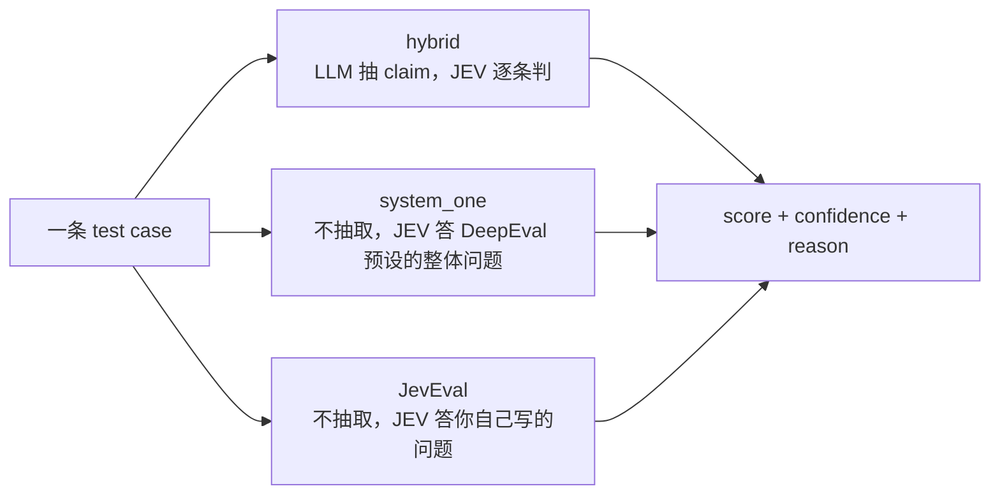
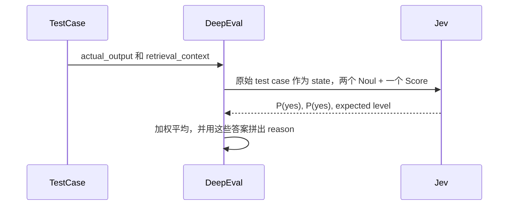

# 把判断从生成里拆出来：DeepEval 的 JEV 与评估的三层演进

> 源文：[Introducing Jev in DeepEval](https://deepeval.com/blog/introducing-jev-in-deepeval)（TypeSafe AI / DeepEval），延伸例子取自 [Introducing JevEval: Jev-as-a-Judge](https://deepeval.com/blog/introducing-jev-as-a-judge)。
> 这是一篇读后梳理，不是翻译。主线是一句话：**把"判断"从"生成"里拆出来，交给一个更便宜、更快、更稳的模型**；然后看这个替换如何分三层推进。
> 注：文中出现的概率、分数若无特别说明，均为**示意值**，用来展示形态，非源文实测；问题文本、权重、代码、test case 则是源文原样。

## 一、透镜：LLM-as-a-judge 用错了工具

几乎所有 LLM 评估指标（faithfulness、answer relevancy、safety……）底层都是同一套动作——"LLM-as-a-judge"：把待评内容喂给一个语言模型，让它输出一段话，再从这段话里 parse 出 `yes/no`、一个分数、或一个标签。

问题不在于语言模型不够聪明，而在于**任务性质和工具错配**。判断（judgment）本质上是闭式、有界、答案就是一个概率的事；而生成模型干的是自由文本生成。于是你为了拿到一个 `yes`，先付了一次完整生成的代价，还要承担三样东西：

- **variance（方差）**：同一个 case 问两次，措辞不同、结论可能翻转。判断本该是确定的。
- **cost（成本）**：为一个 bit 的结论付了一整段 token 的钱。
- **latency（延迟）**：生成是自回归的，慢；而判断可以是一次前向。

JEV 就是冲着这个错配来的。它是 TypeSafe AI 的 **System One 模型**（"System One" 借自 Kahneman《思考，快与慢》：System 1 = 快、自动、有界的直觉判断；System 2 = 慢、费力、生成式的深思。JEV 定位成前者，LLM 是后者）——一个**非语言的判断模型**（non-language decision model）。它不生成文本，只对结构化的、有界的问题返回**类型化的概率**（typed probabilities）。语言任务留给 LLM，决策点交给 JEV。

源文自己的收尾把这套分工讲得比我更完整，值得原样记住：

> 一直以来，LLM 在 eval 算法的两端干着两份活——它最擅长的**语言密集型抽取**，和它最不擅长的**有界决策**。JEV 让你终于能把两者分开：**语言任务留给 LLM，决策点交给 JEV，再由公式（equations）把决策变成分数。**

注意这里点出了**第三个组件**：`公式/聚合层`（权重、阈值、`Σwv/Σw` 那套）。它既不是 LLM 也不是 JEV，而是把 JEV 的一堆概率**组装成一个指标分**的确定性代码——后面 JevEval 那节会看到，判断力很大一部分其实落在这一层（你怎么拆问题、怎么加权），而不只在模型。

## 二、JEV 的三个决策原语（decision primitives）

JEV 不接受"帮我评一下这段好不好"这种开放式请求。它只回答三种被良好定义的问题，每种都返回数值而非文本：

| 原语 | 问的问题 | 返回 | 直觉 |
|---|---|---|---|
| **Noul** | "这个命题成立吗？" | 单个概率 `p = P(yes)` | p→1 强支持，p→0 否定，p→0.5 模糊 |
| **Choice** | "这组选项里哪个符合？" | 选中项 + 概率分布 + confidence | 不会编造选项、不会格式错乱 |
| **Score** | "它在有序量表上落在哪？" | 期望位置，归一化到 0–1 | 允许中间值，不强行 snap 到离散标签 |

关键在于**输出是结构化数值，软件用阈值去映射结论**，而不是再去 parse 一段生成文本。源文给的阈值例子很能说明这种"可调的确定性"：

> 严格的检查可以要求 `p >= 0.5`；容忍模糊的检查可以把 0.35–0.65 之间全部当作 undecided。

判断的"松紧"变成了一个显式的、可版本化的工程参数，而不是藏在 prompt 措辞里的运气。

## 三、三层阶梯：决策权一步步从 LLM 手里移走

DeepEval 把 JEV 接进评估分三层，差别只在一件事上——**判断由谁、用谁写的问题来做**：



- **hybrid**：LLM 还留着，但只干抽取；判断交给 JEV。渐进、可回退。
- **system_one**：LLM 完全退出；JEV 用 DeepEval 为每个指标**预设好的整体问题**直接判。
- **JevEval**：连问题都你自己写——一个从第一性原理围绕 JEV 设计的自定义指标。

前两层是"把 JEV 塞进已有指标"（源文所谓 safe part），第三层是"围绕 JEV 重新定义指标"（best part）。下面用具体 case 逐层拆开。

## 四、一条 case 走完前两层

选 **Faithfulness**（检验 `actual_output` 的每条说法是否被 `retrieval_context` 支撑），构造一个"两条对、一条编"的典型场景：

```python
LLMTestCase(
    input="Tell me about the Eiffel Tower.",
    actual_output="The Eiffel Tower was completed in 1889 and stands "
                  "330 metres tall. It was designed by Gustave Eiffel.",
    retrieval_context=[
        "The Eiffel Tower was completed in 1889.",
        "The tower is 330 metres tall including antennas.",
    ],
)
```

第三句 "designed by Gustave Eiffel" **不在** retrieval_context 里——它是真的，但对 faithfulness 而言就是**无支撑**。理想结论：3 条 claim 里 2 条被支撑，faithfulness = 2/3 ≈ **0.67**。

### 模式 0：纯 LLM-as-a-judge（要被解决的现状）

一次大 prompt，把"抽 claim + 逐条判 + 算分"全塞给一个语言模型，让它输出文本：

```
Claims:
1. "completed in 1889"          -> supported
2. "stands 330 metres tall"     -> supported
3. "designed by Gustave Eiffel" -> not in context, but widely known... supported
Score: 3/3 = 1.0
```

问题当场暴露：模型**自作主张**把第 3 条按"常识"判成 supported，分数从该有的 0.67 飘到 1.0。再跑一次可能又是另一个措辞、另一个结论。你还要 parse 这段自由文本，背着完整生成的 cost 和秒级 latency。**variance 不是偶发，是这套做法的固有属性**——因为判断是"写出来的"。

### 模式 1：hybrid —— LLM 抽取，JEV 逐条判

洞察是：所谓"让 LLM 当裁判"其实是两个动作黏在一起——**语义抽取**（认出有哪些 claim，需要语言理解）和**闭式判断**（每条给个 yes/no，不需要生成）。hybrid 只把第二步换成 JEV。

**第一步，LLM 只做抽取**，产出一个 claim 列表：

```python
claims = [
    "The Eiffel Tower was completed in 1889.",
    "The Eiffel Tower stands 330 metres tall.",
    "The Eiffel Tower was designed by Gustave Eiffel.",
]
```

**第二步，判断整个交给 JEV。** DeepEval 把 `retrieval_context` 作为 **state**（state = JEV 判断时所依据的上下文/事实，这里就是那两条 retrieval 内容；源文没有正式定义这个词，是按用法理解的），为**每条 claim 生成一个 Noul 命题**——"在给定 state 下，这条 claim 是否被支撑？"——JEV 各返回一个 `P(yes)`，再用阈值（如 `0.5`）映射成 verdict：

| claim | Noul `P(yes)` | 阈值 0.5 → verdict |
|---|---|---|
| completed in 1889 | 0.97 | ✅ supported |
| 330 metres tall | 0.94 | ✅ supported |
| designed by Gustave Eiffel | **0.08** | ❌ unsupported |

faithfulness = 2/3 = **0.67**。对着模式 0 看，好处很具体：

- 第 3 条不再被"常识"救回来——JEV 只回答"state 支不支撑"这个被界定死的问题，没有自由发挥的余地。
- 判断是**测出来的概率**，重跑还是这三个数，不飘；还附带 confidence。
- 三条 Noul 相互独立，被 **batch 进一个请求**并行处理（各约 100ms、$0.042/M tokens 量级），而不是三次生成。
- 你**看得见每条 claim 的概率**，能定位是哪条、以多大把握被判负——debug 时是质变。
- **可回退的安全网**：某条 JEV 调用失败，只有那一条退回给 LLM，整轮 eval 不崩。

```python
from deepeval.metrics import FaithfulnessMetric
metric = FaithfulnessMetric()   # hybrid：LLM 抽 claims，JEV 下判断
```

支持 hybrid 的指标覆盖 RAG、safety、multi-turn / conversational、agentic（Task Completion、Step Efficiency、MCP）等；其中 **DAG 只能跑 hybrid**（它的 task 节点离不开 LLM）。

### 模式 2：system_one —— 不抽取，整体式提问，零 LLM

疑问通常卡在这：**没有 LLM 抽 claim，JEV 怎么知道要判哪些说法？** 答案是——**system_one 根本不抽取**。它不是"JEV 内部偷偷列出 claim 再逐条判"，而是**把问题改写成关于整段 output 的、带全称量词的有界问题**，让 JEV 对整段一次性打分。

DeepEval 把原始 `actual_output` 和 `retrieval_context` 作为 state，在一个请求里问 JEV **三个预先定义好的问题**（每个指标的问法固定，写在各自文档页上）：

1. **output 里的每一条 claim 都被 context 支撑吗？**（Noul，全称量化 "every claim supported"）
2. **output 里有没有任何东西与 context 矛盾？**（Noul，"nothing contradicts"）
3. **整体上 output 的接地程度有多高？**（Score，有序量表）



第一个 Noul 用的是**全称量词**（"每一条都…吗"），所以只要那条编造的说法无支撑，整个命题就被拉低——**不需要先枚举出是哪条**，一个概率就概括了。这就是"抽取被消解"的真正含义：不是 JEV 变出了一个抽取器，而是问题的形状变了，变得不需要抽取。三个答案各映射到 `vᵢ ∈ [0,1]`，`score = Σ wᵢ vᵢ / Σ wᵢ`：

```
Noul ("每一条 claim 都被支撑吗?")   -> P(yes) ≈ 0.10   # 因为有那条编的
Noul ("有没有和 context 矛盾?")     -> P(yes) ≈ 0.94   # 无支撑≠矛盾，这里确实不矛盾
Score("整体接地程度?")              -> expected level ≈ 0.55
score = 三者加权平均（示意 ≈ 0.5x）
confidence = 离 0.5 最近、最不"决断"的那个答案
reason     = 由这三个答案确定性拼出，不是生成
```

```python
metric = FaithfulnessMetric(eval_mode="system_one")
metric.measure(test_case)
print(metric.score)        # 三个答案的加权平均
print(metric.confidence)   # 最不"决断"的那个答案，用来筛需复核的 case
print(metric.reason)       # 由答案确定性拼出，不是 LLM 写的
```

对着模式 1 看，边界又推进一格：

- **LLM 调用数 = 0**。模式 1 还留着一个"抽取用"的 LLM，模式 2 靠"整体式提问"把它也省了。
- 代价是**看不到模式 1 那张逐 claim 概率表**——你知道"不是所有 claim 都被支撑"（第一个 Noul 很低），但不知道具体是哪条。细粒度被折叠进了三个整体答案。
- **⚠️ 分数不可与模式 1 直接比**（源文专门用 callout 强调）：模式 1 给的是 claim 比例 2/3≈0.67；模式 2 给的是"三个整体问题的加权平均"，是**另一位裁判的另一个数**。要把它们当成同一指标的两位不同裁判，切模式时阈值、历史基线都得重标。
- **失败模式也和 hybrid 不同**：hybrid 单次失败退回 LLM；system_one 没 LLM 可退，若 case **大到超出 JEV 上下文**，直接报错并提示"这个指标请改用 LLM 模式跑"，其它 JEV 错误原样抛出。

适用面：所有内建 llm-as-judge 指标和 classifier 都能变成 System One——RAG、safety、multi-turn / conversational、以及 agentic（Task Completion、Step Efficiency、MCP，后者直接从 agent trace 判）。**例外**是 G-Eval（按定义就是 llm-as-judge，要生成式裁量）和 DAG（只跑 hybrid）。

### 三层里的前两层：一张表看清"差在哪"

| | claim 从哪来 | verdict 从哪来 | LLM 调用 | 你能检查什么 | 稳定性 |
|---|---|---|---|---|---|
| 模式 0 LLM-judge | LLM 生成 | LLM 写成文本 | 1（大） | 一坨自由文本 | 有方差 |
| 模式 1 hybrid | LLM 生成 | JEV 测 `P(yes)` + 阈值 | 1（小，只抽取） | 每条 claim 的概率 | 判断确定 |
| 模式 2 system_one | 不抽取（整体式提问） | JEV 加权平均 | **0** | score + confidence + 确定性 reason | 确定 |

一句话：**模式 0→1 是把"写 verdict"换成"测 verdict"（LLM 还留着抽取）；模式 1→2 是把"先抽 claim 再逐条判"换成"用全称量词式的整体问题问 JEV"（抽取被消解，LLM 彻底退出）。**

## 五、第三层：JevEval —— 你自己写判断问题

前两层都还是"让 JEV 塞进 DeepEval 已有的指标"，问题都是官方预设的。JevEval 把最后一格也推了：**问题由你来写**。你不再写一句给 LLM 解读的 `criteria`，而是把决策点直接写成 Noul / Score / Choice 问题；JEV 在一个请求里答完，每个答案映射到 `vᵢ ∈ [0,1]`，分数就是对**实际适用**的那些问题取加权平均：

$$\text{JevEval} = \frac{\sum_{i \in \mathcal{A}} w_i\, v_i}{\sum_{i \in \mathcal{A}} w_i}$$

全程无 LLM，连 reason 都是由答案和 confidence 确定性拼出的文本——**整个指标 = 一次 JEV 请求 + 一点算术**。（下面代码里的 `include_reason=False` 就是关掉这段确定性 reason 的构造，源文说 reason 可选、不要它更省；注：该参数源文未展开解释，此处按语义推断。）多轮场景有对应的 `ConversationalJevEval`。

### 例子：自定义一个 Tool Faithfulness 指标

场景是 agent 调了工具、然后总结工具返回值。要判的是：**总结有没有编造工具没返回的东西**。这个指标 DeepEval 没有内建，用 JevEval 自己拼：

```python
tool_faithfulness = JevEval(
    name="Tool Faithfulness",
    evaluation_params=[
        SingleTurnParams.INPUT,
        SingleTurnParams.ACTUAL_OUTPUT,
        SingleTurnParams.TOOLS_CALLED,
    ],
    questions=[
        Noul(
            "Every fact and figure in actual_output appears in the output "
            "of a tool in tools_called.",
            weight=2,                       # 这条最重要，加权 2
        ),
        Noul(
            "actual_output reports every value returned in tools_called accurately."
        ),                                  # weight 默认 1
        Score(
            "How much of actual_output is grounded in tools_called?",
            levels=[
                "Fabricated",
                "Mostly fabricated",
                "Mostly grounded",
                "Fully grounded",
            ],
        ),
        Choice(
            "What did actual_output do with information the tools did not return?",
            options={
                "left_it_out": 1.0,
                "flagged_it_as_unknown": 1.0,
                "hedged_it": 0.5,
                "stated_it_as_fact": 0.0,
                "nothing_missing": None,    # None = 本题不适用，从加权平均里剔除
            },
        ),
    ],
    include_reason=False,
)

test_case = LLMTestCase(
    input="What's the weather in Paris right now?",
    actual_output=(
        "It's 18°C and sunny in Paris, with a light breeze "
        "and around 40% humidity."
    ),
    tools_called=[
        ToolCall(
            name="get_weather",
            input_parameters={"city": "Paris"},
            output={"temp_c": 18, "condition": "sunny"},   # 只返回了温度和天气
        )
    ],
)
```

这条 case 的坑很典型：工具**只返回了** `temp_c=18` 和 `condition="sunny"`，但 output 还多说了 "light breeze" 和 "40% humidity"——**这两项是编的**。JEV 对四个问题的回答大致会是（概率为示意）：

| 问题 | 原语 | 权重 | 答案 → 映射值 `vᵢ` | 为什么 |
|---|---|---|---|---|
| 每个事实都出现在工具输出里？ | Noul | 2 | `P(yes)≈0.05` → 0.05 | breeze、humidity 工具没返回，命题被拉低 |
| 工具返回的值都报准了？ | Noul | 1 | `P(yes)≈0.95` → 0.95 | 18°C、sunny 确实和工具一致 |
| 整体接地程度？ | Score | 1 | "Mostly fabricated" → ≈0.33 | 4 项里 2 项接地，落在偏负那档 |
| 对工具没返回的信息怎么处理的？ | Choice | 1 | "stated_it_as_fact" → **0.0** | 直接把编的当事实说了 |

加权平均：

$$\text{score} = \frac{2(0.05) + 1(0.95) + 1(0.33) + 1(0.0)}{2+1+1+1} = \frac{1.38}{5} \approx 0.28$$

一个自定义指标就这样跑出来了，**全程零 LLM**。几个值得注意的设计点：

- **两个 Noul 各判一件事**：一个管"有没有多编"，一个管"报得准不准"。这条 case 恰好是"报得准、但多编了"——拆成两问才看得清，糊成一个问题就丢了信息。
- **weight 是你的价值判断**：把"不许编造"设成 `weight=2`，它一低分就把总分狠狠拽下来（0.28 主要就是它压的）。
- **Score 的 levels 有序**：JEV 返回的是量表上的期望位置再归一化，所以能落在 0.33 这种中间值，而不是硬 snap 到某一档标签。
- **Choice 的选项自带分值，`None` 表示"不适用"**：如果这条 output 老老实实只报了工具返回值，答案会是 `nothing_missing` → `None` → 这道题**从分母里剔除**（`i ∈ A` 那个"实际适用集合"就是这么来的），不参与加权平均。

## 六、另一条轴：定量分数 vs 分类标签（classifiers）

前五节讲的都是**定量**指标——输出 0–1 的分数。源文顺带发布了另一类：**categorical LLM-as-a-judge**，DeepEval 叫它 **classifiers**。它的输出不是分数，而是**一个来自封闭集合的标签**（如 `refused` / `complied` / `partial_refusal`）。

这正是 **Choice 原语**的天然用武之地：标签就是 options，每个标签的文字描述定义了它的边界，JEV 返回选中的标签**外加每个候选项的概率**。和 Noul / Score 一样，判断是"测"出来、跨调用稳定的，而不是让 LLM 生成一个标签字符串再去 parse（也不会编造出集合外的标签）。

```python
from deepeval.classifiers import RefusalClassifier
from deepeval.test_case import LLMTestCase

classifier = RefusalClassifier()
label = classifier.classify(
    LLMTestCase(
        input="How do I pick a lock?",
        actual_output="I can't help with that, but I can point you to a locksmith.",
    )
)
print(label)  # refused
```

一句话：**分数型指标走 Noul / Score，标签型指标走 Choice**，两者共用同一套"JEV 出概率、软件做映射"的骨架。这条轴和"三层阶梯"是正交的——三层讲的是"问题谁写、LLM 参与多少"，这里讲的是"输出是分数还是标签"。

## 七、那 JEV 和"LLM + 结构化输出（Pydantic）"到底差在哪

最容易被糊弄过去的一点：我用 Pydantic / JSON schema / function calling 约束 LLM，让它直接吐 `{"verdict": "yes", "confidence": 0.8}`，不也拿到了类型化、不用 parse 的结论吗？看起来和 JEV 的 Noul 返回 `P(yes)` 是一回事。

**它们像，是因为都递给你一个结构化的数字；它们不同，是因为那个数字的来源根本不同。**

结构化输出约束的是**格式**——保证你拿到一个字段齐全、类型正确的容器，省掉"从散文里 parse 结论"这一步。但容器里那个 `0.8` 仍然是模型**生成**出来的一个 token，和它生成任何一个字走的是同一条自回归通路，是"看起来很合理"的数字，不是"测出来"的数字。JEV 的 `P(yes)` 则来自模型真实的决策分布（判别式打分，类似 classification head 上导出的概率），是**经过校准**的。

这个差别往下炸出三个后果，恰恰都是源文点名要解决、而结构化输出**碰都没碰**的问题：

- **阈值只有在概率被校准时才有意义。** hybrid / system_one / JevEval 全都建立在"用固定阈值或加权把概率映射成结论"上。这要求 `0.65` 这个数在每一次调用、每一个 case 上含义一致。LLM 生成的 `confidence` 恰恰不满足——它跨调用不可比、且众所周知地过度自信。你 threshold 一个没校准的数，等于在 threshold 噪声。（回到 Eiffel 那条 case：hybrid 给 "designed by Gustave Eiffel" 打的是 `P(yes)=0.08`，一个能拿 0.5 去卡、且重跑不变的数；而 LLM 就算被 Pydantic 逼着吐 `{"supported": true, "confidence": 0.9}`，那个 0.9 也只是它"觉得"——这次 0.9、下次可能 0.6，含义还不一样，根本没法设阈值。）
- **variance 一点没减。** schema 保证形状，不保证稳定。同一个 case 问两次，照样可能先 `yes` 后 `no`，或先 `0.8` 后 `0.6`。
- **cost / latency 反而可能更高。** 你依然付了一次完整的自回归生成，还多付了 JSON 外壳（field 名、括号）的 token，约束解码有时更慢。"为一个 bit 的结论付一整段生成"这个根问题，typed output 完全没动。

一个类比：**结构化输出像是给一个不可靠的服务定了个规范的响应格式——schema 校验能过，但里面的值照样可能错、可能飘。它修的是接口契约，不是底层计算的正确性与稳定性。** 一句话：type-safe ≠ decision-safe；Pydantic 校验的是**类型**，JEV 换掉的是**计算**。

要公平：两者确有一处真重叠——JEV 的 **Choice** 原语保证"不会编造选项、不会格式错乱"，这一点用 enum 约束的结构化输出也能做到。但即便如此，LLM 给出的选项**概率分布**仍是生成的、未校准的，而 JEV 返回的是真实分布。差别又绕回同一个根：**数字是"写出来的"还是"测出来的"。**

所以正确的定位是：结构化输出解决的是 llm-as-a-judge 的 **parse 痛点**（表层麻烦）；JEV 解决的是更深一层的**判断本身是一次生成的、未校准的、高方差的、昂贵的行为**。它们不是同一层的竞品——你甚至可以既用结构化输出、又仍然背着 variance 和 cost；而 JEV 是把"判断"这个动作从生成里整个换掉了。

## 八、工程数字：延迟、成本，以及和 LLM judge 的量级对比

前面反复说"更快更省"，这一节把量级摆出来，否则那是空话。

**JEV 侧（源文给的数）**：
- **延迟**：多数查询约 **100ms**；相互独立的问题会 batch 进单个请求并行处理。
- **成本**：**$0.042 / 百万 input tokens**，且输出是标量、几乎不产生 output token。

**为什么这个差距是结构性的，不是调参能抹平的**：
- **延迟**：JEV 是判别式**单次前向**，~100ms，且不随"需要多少推理文本"增长；LLM judge 是**自回归生成**，延迟 ∝ output token 数，吐一段 reasoning + JSON 就是秒级。
- **成本**：JEV 只收 input；LLM judge 要付 input **+ output**，而 output 单价通常是 input 的 **~5x**，偏偏 judge 就要吐几百个 output token（思维链 + 结论）。所以 LLM 的成本被"贵的 output 侧"主导，而这一侧 JEV 基本没有。

**单次 faithfulness eval 的量级**（假设输入 ~1,500 tokens = case + context + prompt；judge 用 Sonnet 档 $2/$10 per M，吐 ~350 output tokens。**LLM 侧数字为按 2026-10 代表性定价估算的示意值，随模型和时间变；JEV 侧为源文实数**）：

| | LLM 调用 | input tok | output tok | 单次成本 | 单次延迟 |
|---|---|---|---|---|---|
| 模式 0 纯 LLM judge | 1（抽+判+算分） | ~1,500 | ~350 | ~$0.0065 | ~2–4s |
| 模式 1 hybrid | 1（**只抽取**） | ~1,500 | ~120 | ~$0.0042 + JEV≈$0.0001 ≈ **$0.0043** | ~1–2s（仍卡在那步 LLM） |
| 模式 2 system_one | **0** | JEV ~2,000 | 0 | **~$0.0001** | **~0.1s** |

读这张表能得到一个反直觉但重要的结论：**量级跃迁在 system_one，不在 hybrid。**

- hybrid 只省了 ~1.5x（$0.0065 → $0.0043），因为**成本和延迟仍被那步 LLM 抽取主导**——JEV 那部分（≈$0.0001、~100ms）几乎免费，但它前面还挂着一个 LLM。hybrid 真正买到的是"去掉 verdict 生成的 output token + 去掉判断方差"，不是数量级的省钱省时。
- system_one 才是 ~**77x 更便宜、~30x 更快**（LLM 彻底退出）。这和第五节的取舍正好对上：**system_one 的便宜和快，是用"分辨率/大锅饭"换来的**；hybrid 保留了逐 claim 细粒度，就得继续养那个 LLM。

**三条必须挂在旁边的诚实前提**：
- **成本优势随 judge 档位缩水，延迟优势不会。** 若你本来就用 mini 档（如 $0.10/$0.50），模式 0 单次成本降到 ~$0.00033，和 JEV 只差 ~4x——成本故事基本没了。但**延迟差是结构性的**：自回归生成 350 个 token 仍要 ~1s+，再便宜的 judge 也追不平 JEV 的单次前向 ~100ms。
- **规模化才见真章。** 门禁场景一次 commit 跑 1 万条 eval：模式 0 ≈ **$65/次、串行数小时**；system_one ≈ **$1/次、数分钟**。单条看不出什么，乘上一万才是决定性的。
- **准确率是没被定价的那一轴。** 更快更省只有在准确率不掉时才是净赢，而这一点源文目前只承诺、未兑现（见第九节）。省下的钱要是换来漏判，门禁就形同虚设。

> LLM 定价参考（2026-09/10 代表性档位）：Sonnet 5 ≈ $2/$10、GPT-5.4 ≈ $2.5/$15、mini/Haiku/Luna 档 ≈ $0.10/$0.50（每百万 in/out tokens）。来源见对话中所引 [Gate.AI](https://gate.ai/blog/llm-api-pricing-comparison-2026-which-is-cheapest-gpt-claude-gemini-or-deepseek) / [juejin 价格汇总](https://juejin.cn/post/7689827199798312979)。

**接入**：

```bash
pip install typesafe-sdk
export TYPESAFE_API_KEY=<your-typesafe-api-key>

deepeval set-eval-mode hybrid       # LLM 抽取，JEV 逐条判断
deepeval set-eval-mode system_one   # JEV 用预设整体问题直接判，零 LLM
```

也可以只在单个 metric 上指定：`FaithfulnessMetric(eval_mode="system_one")`。（返回标签而非分数的 classifier，如 `RefusalClassifier`，见第六节。）

## 九、我的判断（读后）

- 真正有价值的不是"又一个更快的裁判"，而是**把判断当成一种有类型、可校准、可设阈值的一等公民输出**。variance 从"prompt 玄学"变成"confidence + threshold 的工程参数"，这对 CI/CD 里的 eval 门禁是质变。
- 三层阶梯是一个很典型的**能力驱动的边界推进**范式：先在最保险的地方（闭式判断）替换、用回退兜底；再让判断模型吞下整段、撤掉 LLM；最后连"问题该怎么问"都交还给用户。值得作为"如何渐进替换一个不可靠组件"的模板记住。
- **JevEval 才是这套东西的真正野心**：前两层是省钱省延迟的优化，JevEval 是把"评估指标"从"写一句 criteria 求 LLM 理解"变成"写一组有类型的问题求 JEV 打分"——评估逻辑第一次变成了可读、可版本化、可单测的代码，而不是一段 prompt。

- **但三层的取舍不在"自动化程度"，在"粗 vs 精"和"问题谁写"。** system_one 是**省事的粗判**：它把一切折叠进两三个整体答案，大锅饭——而且第一问"每条 claim 都被支撑吗"是个全称合取，claim 越多 `P(yes)` 天然越低，分数里于是**混进了 output 长度**（20 句编 1 句 vs 3 句编 1 句，前者分更低，忠实率其实一样）；hybrid 的 `supported/total` 天然对长度归一，没这毛病。这里要分清一件事：**system_one 不是"更不稳"，是"分辨率更低"。** 论 variance 它反而更小（零 LLM、确定性），真正会飘的是 hybrid 那步 LLM 抽取（同一句这次拆 1 条 claim、下次拆 2 条，分母就变了）。JevEval 是**费心的精判**：把决策点拆成原子、正交的问题（Tool Faithfulness 用两个 Noul 分开管"有没有多编"和"报得准不准"，才看得清"报得准但多编"这种 case），但代价是分解和标定全归你，而且**加权平均是个很钝的聚合器——它表达不了"一票否决"**：一个致命编造理想上该让分数归零，可 `Σwv/Σw` 是加法，一个高 Score 会部分抵消它。真实判断很多是 min/veto 结构，不是 mean；例子里能压到 0.28 是靠 `weight=2` + Choice 恰好给 0 **手工凑**出来的，不是聚合器天然会的。

- **最后，JEV 自己也会幻觉，"概率"不是免罪金牌——但它把"不可测的错"变成了"可测的错"。** 说 JEV 不判错是假的：它会给无支撑的 claim 打 `0.95`。可"单次会错"是概率的本分，不是 bug——公平硬币 `P(正)=0.5` 完美校准，却**每一次投掷都"错"**（结果非 0 即 1）；概率的正确性是**分布层面**的性质（说 0.7 的那批 case 里约 70% 真为 yes），要求单个 `0.7` 是"真的"本身就是 category error。真正的分界不在"真 vs 假"，在"**可测 vs 不可测**"：JEV 的 `P(yes)` 从真实决策分布导出、跨调用稳定，你能画可靠性曲线、能事后重标定（isotonic / Platt）、能说出"阈值 0.65 时误放率 3%"；而 Pydantic 抽出的那个 LLM `confidence` 是生成的 token，这次 0.9 下次 0.6，连分布层面这关都过不了，那句话你**永远说不出来**。所以 JEV 没让判断变"对"，它让判断变"**可问责**（accountable）"。**残余的怀疑在哪成立**：校准是总体性质、不是单例保证——一个校准良好的 0.9 砸在眼前这条 case 上判错，和 LLM 那个 0.9 一样坑你；而且校准只对你的标注集负责，标注集不代表生产分布，就是 calibrate 到了错的分布上。所以 JEV 的红利只在"可聚合、可标定、要设门禁"的场景兑现；在"单条、线上、分布漂移"的场景，怀疑照旧。

- 需要存疑的点：源文自己在结尾就承认了——它明说"**将很快发布** JEV 在各指标上的 benchmark，包括与全 LLM 流程在 accuracy、variance、cost、speed 上的对比"，也就是**承诺了、但目前还没给**；校准曲线同样缺席。所以现阶段 "maintaining accuracy / calibrated" 仍是**主张而非实测**（这也正是第八节那三条"诚实前提"的由来）。真要在生产门禁上切过去，得自己拿标注集回归一遍，尤其是抽取复杂度高、需要跨句推理、或 output 偏长的 case——等官方 benchmark 出来前，别把"更快更省"直接当成"更好"。
