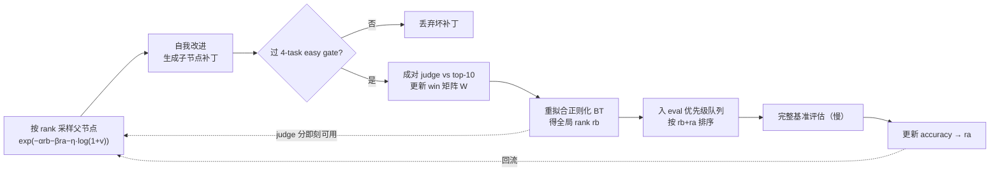

# 先排序、再验证：SIFT 的困难↔方案咬合，与"机器全是通用件、判断力才是壁垒"

> 源文：《Self Improvement via Fast Tree-search》（SIFT = Recursive Self-Improvement via Fast Tree-search），arXiv:2609.19526v1 [cs.AI]，2026-09-17，Preprint。作者 Xinghong Fu（MIT，通讯 fxh@mit.edu，MIT UROP grant，部分工作在 Sakana AI 实习期间完成）、Aravinth Kulanthaivelu（Sakana AI）、Yutaro Yamada（Sakana AI）。原文 <https://arxiv.org/abs/2609.19526>。本地 PDF：`C:\Users\cjdyx\我的云端硬盘\DS_ML\skills+harness\2609-Self Improvement via Fast Tree-search.pdf`（24 页）。
> 这是一篇读后梳理，不是翻译。主线一句话：**递归自我改进的成本瓶颈不在"生成候选补丁"，而在"判断哪个候选值得花钱做完整验证"；SIFT 的全部设计＝在生成与昂贵验证之间插入一层便宜的相对排序信号（成对 LLM 评判 + Bradley-Terry 聚合），并且只用它的排序、不拿它当准确率替身，来驱动一棵与慢评估解耦并行的搜索树。**
> 标注约定：§三–§六 的机制、公式、prompt 条款、全部实验数字与表格均为**源文原样**（个别源文正文与表格数字互相打架处已就地并列标注、未替源文调和）。§二（域背景：为什么 RSI 的评估这么贵、"多保真度偏好-surrogate 搜索"与"bloom filter / 级联漏斗"这两个命名、以及它们各自的边界）、§一中"用搜索的语言讲"那段纠偏、§六收束里跨 JEV/Dream-RSI 的综合，均为**我的分析，非源文**，已就地标注，不要当源文事实引用。

## 一、透镜：先把不变量钉精确

核心不变量只有一句：**自我改进里稀缺的不是"更好的补丁"，而是"哪个补丁值得继续投钱"的判断——而这个判断，源文用的词是 poor signal-to-cost trade-off。** 完整跑基准能给出可靠信号，但极贵；只跑一小撮任务便宜，但信号噪声大到不可用。SIFT 主张：这条两难可以靠插入"中间态的便宜信号"来破——一个独立的 LLM judge，专门给自我改进提案的质量排序。

这个不变量投影成三件事，正好是后面咬合表的三层：

- **信号形态**：把"绝对打分 / 重跑基准"换成"成对比较 → 聚合成全局排序"，并且**只消费排序**（rank），不消费分数。
- **资源分配**：昂贵的完整评估是稀缺资源，只投给"初步准确率高 + judge 看好"的少数节点；一条保真度阶梯（4-task gate → Polyglot-50 → 225 held-out）逐级加码。
- **调度**：expansion（生成+评判）与 evaluation（跑基准）完全解耦、并行；judge 分让 expansion 在评估还没跑完时就能投机展开（speculative expansion）。

**用搜索的语言讲（我的分析，非源文）**：这确实是一棵 agent-设计树上的 heuristic search——judge+BT 就是这棵树的 heuristic evaluation function，rank-based parent sampling `exp(−(α·rb+β·ra+η·log(1+v)))` 就是带访问惩罚的 soft-best-first（UCT 味道）。但"heuristic search"这个名字**对的是脚手架、会归错功的是贡献**。经典 heuristic search 里 `h(n)` 是**算起来便宜**的，研究问题是它准不准；SIFT 这里反过来——evaluation function（跑一遍基准）本身**就是主要成本**（Polyglot-50 一次 $6.0 / 2.6 CPU-h，judge 一次成对调用 $0.044）。所以它的贡献不在搜索算法（那部分基本是借来的），而在**评估层**：把一个"昂贵、绝对、逐节点"的 evaluation，换成"便宜、相对、只用 rank"的 surrogate，再让搜索与慢评估解耦。把功劳记在"搜索"上会看漏这篇论文真正动了什么。

## 二、域背景：为什么 RSI 的评估天然贵（我的分析，非源文）

源文给了瓶颈陈述，但没展开它为什么在物理上这么硬。这一节是我的领域推理，用来交代后面困难集从哪来。

**它搜索的对象是"程序自己"，不是"某个任务的解"。** 普通 MCTS/A\* 在任务状态空间里搜，评估一个节点＝读一个状态、算一个 `h(n)`，便宜。RSI 搜的是 agent harness 的设计空间——每个节点是一份会去调度 coding model 的**源码**；评估一个节点＝把改过的 agent 拿去**跑一整套基准**。于是"评估函数"从一次前向变成一次完整的 agent×benchmark 运行，成本抬了几个数量级。源文引的数字很直白：前人在 SWE-Bench 上一次进化可达 $22,000、数千 CPU 小时。

**而且它是递归的，账会利滚利。** 每个补丁重塑的正是"调度 coding model 的那段代码"，所以改进会 compound；反过来，评估成本也 compound——树每长一层，要评估的候选就多一批，而每个候选的评估都是一次完整基准跑。这就是为什么"生成"从来不是瓶颈：LLM 写补丁又快又便宜，贵的是"写完之后怎么知道它到底好不好"。

**更准的命名：多保真度 + 偏好型 surrogate 的搜索。** 一旦看清"评估函数就是主要成本"，SIFT 的形状就完全可以倒推出来——它是一条**保真度阶梯**：最便宜的一档是 judge（成对比较，只看代码，不跑任务），中间档是 4-task easy gate 和 Polyglot-50 子集，最贵的一档是 225-task 完整基准（只留作 held-out 终评）。昂贵评估只留给低保真度档位排序靠前的节点。关键细节：最低那一档（judge）**故意做成"排序 oracle"而不是"准确率预测器"**——源文原话是 judge "most useful when it comes to providing a ranking signal rather than as a surrogate for benchmark accuracy"。这解释了为什么它只用 rank、为什么 judge 不必校准、为什么一个更弱的 judge 仍能引导搜索却在"前沿终选"上掉链子。这条"多保真度 + 偏好 surrogate"的命名是我的概括，源文只描述了机制、没这么归类。

**同一招的系统设计名字：bloom filter / 级联漏斗（我的分析）。** 换成系统设计的语言，"拿代价小的初筛挡住注定失败的昂贵操作"就是 bloom filter 的老把戏——LSM-tree / RocksDB 用它避免为不在 SSTable 里的 key 付一次磁盘读，缓存层用它避免 miss 打到 DB。SIFT 里那个 **4-task easy gate 就是标准的 bloom-filter 式廉价拒绝**：跑都跑不起来的补丁当场丢掉，不浪费后面的 judge / eval。但要划清边界——bloom filter 只精确对应 easy gate，**judge+BT 不是 bloom filter**，差在三条轴上：① bloom 是二元成员测试（in / out），judge 是**带噪声的全局排序**，用途是给 eval 队列定优先级、给 parent 采样定向（prioritize），而不是"丢掉"（drop）；② bloom 的误差按构造是单边的（有 false positive、无 false negative），judge 的误差是**双边且带噪**的——这恰恰是要 BT + 正则 + 只用 rank、且终选前仍跑权威评估的原因；③ bloom 建好后静态、逐查询无状态，judge 的结果会**累积进持久状态**（win 矩阵 W + BT 分）并 compound，也就是 §六 说的那道壁垒。更准的说法是：**bloom filter 是这套机制的 1-bit 退化情形，SIFT 把"廉价初筛"从"二元拒绝"推广成了"分级排序"。** 那条保真度阶梯（4-gate → Polyglot-50 → 225）本质是个**级联漏斗**——recsys 的 retrieve → rank → re-rank、FrugalGPT 的 cheap → expensive 模型级联都是同一族，judge 是最便宜的那一级；经济动机相同（别对每个候选都付昂贵操作），只是分辨率更高。

## 三、困难↔方案咬合

三层按系统自身的结构分：A 评判信号层、B 搜索/资源分配层、C 调度层。表中"困难/方案/为什么这么解"均为源文原样（含源文自述的设计理由）；个别我补的推论已就地标"（我的分析）"。

### A 层 · 评判信号：把"绝对打分 / 重跑基准"换成"成对比较 → 全局排序"

| 困难 | 方案 | 为什么这么解 |
| --- | --- | --- |
| 完整评估可靠但极贵，小子集便宜但噪声大——signal-to-cost 两难（Table 1：Polyglot-50 一次 $6.0 / 2.6 CPU-h；judge 一次成对 $0.044 / 0.0042 CPU-h） | 引入独立 LLM-as-a-judge，对候选补丁做**成对比较**，作为下游评估之外的中间信号 | 一次成对调用比一次完整评估便宜一个数量级；K=10 时单节点约 10 次成对调用、每次几美分。成对比较 calibration-free、比绝对 rubric 分更可靠（源文引 Zheng 2023 / Jiang 2025 的 LLM-as-a-judge 文献） |
| judge 绝对打分不可靠、跨节点分数不可比 | 不用绝对分，把成对胜负累积成 win-count 矩阵 W（Wij＝i 被偏好过 j 的次数），每轮评判后重拟合**正则化 Bradley-Terry** | BT 假设每节点有 latent θi>0、P(i≻j)=θi/(θi+θj)，把稀疏且可能互相矛盾的成对结果用**一组** latent strength 联合解释成全局序 |
| 新节点只比了几场、甚至还没输过 → BT 分数会退化/无界 | 加正则项 λ 当 symmetric pseudo-count（给每个有序对都加 λ 场虚拟胜负） | 防退化，让比较次数不同的节点分数可比。源文 Theorem 1：任意 λ>0 时正则化 BT 对数似然在归一化子空间 H 上有唯一极大值（严格凹 + 上水平集有界） |
| BT 分数的绝对尺度会随比较次数/拓扑漂移 | **只用 BT 诱导出的 rank** rb(i)，不用原始分数；每轮归一化 Σθi=n | rank-based 让搜索对分数绝对尺度不敏感；也因此 judge 不必校准，只需给出有用的**排序**（源文 B.4 明确这是 intentional 设计） |
| 树长大后每个新节点跟全档案比 → judge 成本爆炸 | comparison-target selection：只跟 archive 里 **top-10** 强节点比（用 judge rank + accuracy rank 选目标） | 把 judge 算力集中在与前沿相关的比较上，不浪费在弱/已被支配的节点；K=10 让单节点 judge 成本有界 |
| judge 到底该看什么输入，直接影响排序质量 | 消融四种输入表示（Table 6，Qwen3-Coder-480B，50 个非根节点，BT 分 vs 实测 Polyglot 准确率的相关性） | 见下；结论是**给完整文件、不做 swap-order** |

judge 输入消融（Table 6，源文原样；Spearman 是主指标，因为 SIFT 用 rank-based 采样）：

| judge 输入变体 | Pearson r | Spearman ρ | 每次比较成本 (USD) |
| --- | --- | --- | --- |
| Diffs（根 agent 实现 + 通往各 agent 的 diff 链） | +0.14 | +0.40 | 0.0076 |
| Diffs + swap-order（同一对正反两序各判一次，消位置偏差） | +0.11 | +0.43 | 0.014 |
| **Full files（两个候选的完整源文件）** | **+0.45** | **+0.68** | **0.011** |
| Full files + swap-order | +0.37 | +0.67 | 0.021 |

源文的解读：full-file 让 judge 直接推理 agent 的**最终行为**，而不必从补丁链里重建行为，所以 Spearman 从 0.40 跳到 0.68，成本仍远低于一次基准评估。swap-order 对 full files 几乎不涨（0.68→0.67），说明增益来自更丰富的程序上下文，而非消除呈现顺序偏差。故默认 full-file 不 swap——"每美元能买到的最强 rank 信号"。

A 层原则一句话：**评判的全部价值在于"排序"，不在"打分"；一旦接受这点，成对比较 + BT 聚合 + 只用 rank 就是自然选择，而 judge 输入要喂到"能直接看出最终行为"为止。**

### B 层 · 搜索 / 资源分配：昂贵验证是稀缺资源，按 rank 投给最有希望的

| 困难 | 方案 | 为什么这么解 |
| --- | --- | --- |
| 该展开哪个父节点？只看准确率会 exploit 当前最好、错过"准确率低但有前途"的分支 | rank-based parent sampling：`P(i) ∝ exp(−(α·rb(i) + β·ra(i) + η·log(1+v_i)))`，混合 BT rank、accuracy rank、visit-count 惩罚 | 前两项偏向 judge 和基准都看好的节点；visit-count 项降低已被反复展开的 lineage 权重，鼓励继续分叉而非死磕一条线。源文 Proposition 1：指数 rank 采样把 top-M 的概率质量抬到 (1−e^{−αM})/(1−e^{−αn})，远高于均匀的 M/n |
| 探索项到底有没有用 | α=β=η=1（所有 run 通用，源文 B.1） | η=0 时 Polyglot 只有 **30.1%**，η=1 时 **35.1%**（o3-mini base）——探索惩罚是实打实的增益，不是摆设 |
| 未评估完的节点没有 accuracy，无法参与采样 | 等待评估的节点**临时继承父节点的 accuracy**；新节点先过一个 **4-task easy gate** 立刻滤掉坏补丁 | 让新节点能马上参与采样、不必等 eval；easy gate 用最小代价挡住灾难性补丁，避免把 judge/eval 浪费在跑都跑不起来的补丁上 |
| 昂贵的完整评估该给谁 | eval **优先级队列**，按 rb(i)+ra(i) 排序；完整评估只留给最有希望的节点（过了 easy gate 的节点从父节点继承 ai） | 把稀缺评估算力投给 judge+accuracy 都看好的候选，而不是均匀撒 |

B 层原则一句话：**搜索压力（往哪展开）和评估压力（先评谁）都由同一个 rank 混合量驱动；accuracy 只是其中一票，且允许"暂时借用父节点的"，好让搜索永不被评估阻塞。**

### C 层 · 调度：别让慢评估阻塞搜索

| 困难 | 方案 | 为什么这么解 |
| --- | --- | --- |
| 每个补丁必须先跑完基准才能进入下一轮 → benchmark 主导 wall-clock，串行阻塞 | **完全解耦的非阻塞主循环**（Algorithm 1）：expansion 与 evaluation 并行；orchestrator 取回完成的 expansion 节点、插入 eval 队列、同时启动下一轮 expansion | 不再被慢评估卡住；judge 分提供中间信号，让 expansion 在 eval 完成前就能投机展开。源文 Fig 6（5 run 平均）：异步流水线贡献了**大部分**加速，投机展开在其上再叠一层 |
| HGM 那种"随机采任务做评估"→ 拿到简单任务的节点纯靠运气得高分；且单任务信号噪声大、仍慢 | 用**固定子集**（Polyglot-50）比准确率，保证节点间可比；同时靠 judge 信号在 eval 完成前引导 expansion | 固定子集＝公平可比，judge＝快，解耦＝不阻塞——三者同时拿到 high signal 与 fast search。源文点名 HGM（Wang et al. 2025，用 Thompson sampling 解耦）的随机采任务会导致 final accuracy 估计失真 |

C 层原则一句话：**把"生成/评判"这条快环和"跑基准"这条慢环物理解耦，用 judge 分当作快环的燃料——搜索的速度从此由快环决定，而不是被慢环拖着走。**

解耦主循环的形状（我的示意流程图，节点/边均对应源文 Algorithm 1 与 Fig 2）：

快环（采样→改进→gate→judge→BT→回到采样）不等慢环（队列→完整评估→更新准确率）。那条虚线"judge 分即刻可用"就是 speculative expansion 的论点：一个还没跑完基准的节点，凭 judge 排序就能马上被当父节点展开。

### 还没解掉 / 正在探索的瓶颈（源文 Limitations & Future work，原样）

- **仍依赖下游基准做最终验证**；而且最强 run 里的 judge（gpt-5.4-high / Qwen3-480B）比 coding backbone 更强，所以"实用但不是纯粹的自我评判"。未来试更小/开源 judge，或让 coding model 自己当 judge。
- **BT 把每个节点压成一个标量 strength，会掩盖 task-specific 的取舍**：一个补丁可能改善长程调试却拖累简单语法修复，单标量排序表达不了这种多维profile。未来方向：多套 skill-specific 排序、把标量 strength 扩成向量、按失败类别 condition judge 比较。
- **安全 / 评估完整性**：候选补丁可能学会钻 harness 空子、放松约束、或优化评估过程的 artifact 而非真实编码能力。源文在 Polyglot-50 run 里确实观察到 diagnosis agent 偶尔提议"放宽 eval harness"（延长 timeout、加大 retry 次数）的补丁；靠 sandbox、限制可写文件、拒绝触碰 benchmark/harness 代码的补丁来挡（最终实验里没有这类补丁进入）。
- 明确的未来件：把 BT strength 当**显式 eval gate**（动态阈值，过线才给完整评估）；archive 剪枝（judge rank 与 accuracy 双被支配的节点淘汰）；**agentic judge**（不只看代码，还跑轻量探针、查 trace、合成小对抗任务再给成对偏好）；用 Item Response Theory 给**下游任务**也排难度（p_{j,i}=σ(θ_j−β_i)），按 Fisher information 采任务。

## 四、标杆案例：走一遍全流程，每步对应哪个能力

### 主案例 · Polyglot 的 node 2→17→25（源文 Fig 7，逐字数字）

这是源文用来演示"judge 提供中间引导信号、去探索低准确率但更有前途的节点"的具体实例。按 SIFT 一轮 expansion 走：

1. **采样到 node 17 当父节点**——node 17 的 accuracy 排名**低于**档案里其它节点，但它的 **BT judge 分最高（2.81）**。→ 用到能力：A 层成对 judge + BT 聚合给出 rb，B 层 rank-based sampling 里 rb 项压过 ra 项，于是它被优先展开。**这一步就是"只用排序、且 judge 排序能推翻 accuracy 排序"的字面体现。**
2. **投机展开 node 17**——注意此时 node 17 自己的完整评估**尚未跑完**，它只是 judge 看好就被当父节点用了。→ 用到能力：C 层解耦流水线 + speculative expansion（快环不等慢环）。
3. **node 17 生出子节点 node 25，node 25 最终拿到最高准确率 42%**。→ 结果：一个"当下 accuracy 不起眼"的分支，靠 judge 的中间信号被坚持展开，最后长出了全场最好的节点。
4. **到 expansion 满 30 节点时回看整条 lineage 2→17→25，BT judge 分 = 1.484 / 1.93 / 1.93（排名 2 / 1 / 1）**。→ 用到能力：judge 不是偶然蒙对一次，而是**持续**把这条 lineage 排在前面，于是递归自我改进能沿着一个有前途的方向一路 compound。

一句话：这个 case 把"judge 分 ≠ accuracy，但 judge 排序能把搜索引向 accuracy 到不了的地方"演示得很干净——如果只按 accuracy 贪心，node 17 早就被丢弃了。

### 副案例一 · TerminalBench：judge 抓到"下游分数根本看不见"的失败模式（源文，逐字引语）

源文发现：full-eval 下最好的节点，和搜索期 accuracy 最高的节点，**不是同一个**。搜索期 accuracy 最高的那个节点，主要新增是一个 instruction-derived 的 local verifier（带 multi-attempt refinement），但——

- 这个 verifier 被一个**默认关闭的 env flag** 挡着；
- 它重写的 bash 工具**每次调用都起一个全新的交互式 shell，却声称状态是持久的**。

judge **只从代码**就把这两条都点了出来，原话：verifier "likely does nothing on default runs"，shell 重写 "a major runtime risk on the actual execution path"。反观 full-eval 最好的那个节点，做的是"带显式 timeout、process-group 清理、输出截断的持久 shell + 有界的 prompt 改动（最多鼓励两次 validation pass）"。

要点（源文）：judge 抓到的这个失败模式**对任何下游评估分数都是不可见的**，所以"按最高 accuracy 选"在这里根本不可靠。这是"judge 提供的是 accuracy 给不了的信息"的最强证据。

### 副案例二 · SIFT 到底发现了什么改动：node 9 > node 24（源文 B.5，逐字数字）

从 o3-mini 初始 coding agent 出发：

| Node | Parent | subset accuracy | BT score | 相对 baseline 的累积改动 | full Polyglot |
| --- | --- | --- | --- | --- | --- |
| 9 | root(0) | 0.44 | 2.370 | +1 行 instruction、+1 个新工具（test_runner） | **35.6%** |
| 24 | 9 | 0.44 | 1.903 | node 9 的改动 + agent 改写 + 再加 1 个工具（test_analyzer） | 33.8% |

node 9 的改动极小：在 `forward()` 的 task instruction 后追加一句"改完代码就跑 `test_runner` 工具执行测试套件、拿结构化失败信息、据此做小而准的修改并迭代重跑直到通过或到安全迭代上限"，外加一个能自动识别 pytest/cargo/go test/npm/Gradle/Maven 并返回结构化 pass/fail 的 test_runner 工具。node 24 继承它、又加了个大得多的 test_analyzer（从测试文件推断公共 API、可选生成 scaffold 补丁），**但 subset accuracy 停在 0.44、BT 分反而更低、full Polyglot 从 35.6% 掉到 33.8%**。

源文的结论：最有用的发现不是大改写，而是一个**小的、在运行路径上的（active-path）改动**，让 agent 更 test-driven；子节点加了更多自动化和更多表面积，却没提升实测准确率。这与 judge 的角色一致——**优先那些真正改善 solve 行为的改动，惩罚那些引入 runtime/regression 风险的额外复杂度**。（这条与我仓里 Instagram Direct 那篇"正确代码应是最省力的那种、错误代码难以表达"同源：agent harness 的质量在于减少运行路径上的阻力/风险，而非堆机器。此句是我的关联，非源文。）

## 五、效果（源文逐字数字）

### Polyglot-225（Table 2，held-out 终评）

| Method | Coding model | Judge model | Polyglot Accuracy (%) |
| --- | --- | --- | --- |
| Base Agent | Qwen3-Coder-30B | None | 20.0 |
| SICA | Qwen3-Coder-30B | None | 25.1 |
| DGM | Qwen3-Coder-30B | None | 27.1 |
| HGM | Qwen3-Coder-30B | None | 30.5 |
| **SIFT** | Qwen3-Coder-30B | Qwen3-Coder-480B | **31.1** |
| **SIFT** | Qwen3-Coder-30B | gpt-5.4 | **32.0** |
| Base Agent | o3-mini | None | 14.2 |
| DGM | o3-mini | None | 30.7 |
| SIFT | o3-mini | None（no-judge 消融） | 29.8 |
| **SIFT** | o3-mini | gpt-5.4 | **35.1** |
| SIFT | o3-mini | gpt-5-mini | 31.6 |

### 运行级资源（Table 3，每行一次搜索 run；judge 成本已含在 API 总成本里）

| 配置 | expansion 步数 | API 成本 | 其中 judge | CPU-h | wall-clock |
| --- | --- | --- | --- | --- | --- |
| Qwen3-30B / Qwen3-480B judge | 30 | $34.3 | $4.1 | 224 | 6.7 h |
| Qwen3-30B / gpt-5.4 judge | 30 | $33.7 | $9.7 | 188 | 6.8 h |
| o3-mini / gpt-5.4 judge | 20 | $86.8 | $15.7 | 59 | 2.1 h |

源文正文的几个 headline（原样）：Qwen3-30B 进化 30 步，Polyglot-50 从 **16% → 38%**，archive 平均准确率随迭代稳步上升，最好后代 final Polyglot **31.1%**，总花费 **$34.3 API / 6.71h wall / 224 CPU-h——是 DGM baseline 的十分之一**；同一预算下比 HGM 的异步树搜索（30.5% / 347 CPU-h）又准又省。o3-mini 侧：30 步内到 **35.1%**，超过 DGM 跑 80 节点的 30.7%；重复 3 次落在 **[32.0%, 35.6%]**，一致优于 DGM 且更省资源。

> ⚠️ 源文内部数字打架（我如实并列、未替源文调和）：o3-mini 这条 run，正文（p6）写的是"30 步、<5h wall、42 CPU-h、$150 API"，而 Table 3 对应行写的是"20 步、2.1h wall、59 CPU-h、$86.8 API"。两处对不上，引用时以你要用的那张表/那段话为准，别混。

跨模型迁移（Fig 4，源文）：把 SIFT 用 o3-mini 和 Qwen3-30B 发现的 harness，换 gpt-5-mini / gpt-5.4-mini 当 coding model 重评，Polyglot 一致提升——说明 SIFT 发现的是**鲁棒、可迁移的 harness**，不是只对搜索期那个 coding model 过拟合。

### TerminalBench 2.1（Table 4 / Table 5 / Fig 5）

Table 4（"Search eval" 是 50-task 搜索子集上的分；"Repeated mean" 是对每个选中 agent 独立跑三次完整评估的均值，满分 89）：

| Setting | Agent | Search eval | Repeated mean |
| --- | --- | --- | --- |
| Initial agent | 起点 | 14/50 | 26.0/89 (29.2%) |
| SIFT with judge | Judge rank 1 | 18/50 | **32.7/89 (36.7%)** |
| SIFT with judge | Accuracy rank 1 | 19/50 | 25.0/89 (28.1%) |
| No-judge ablation | Accuracy rank 1 | 19/50 | 26.0/89 (29.2%) |

要点（源文）：judge 选中的节点在**搜索期分数略低**，但在完整基准 + 重复评估下**超过另外两个**。这直接支撑"judge 给的是排序信号、不是 accuracy 替身"。

Table 5（judge 模型强弱对比，每条件一次 run；Gain 是相对起点 29.2% 的百分点提升；ρ 是 BT rank 与 full-benchmark 分的 Spearman，over 20 个完整评估过的候选；Pairwise(top-5) 是 BT top-5 内与真值排序的一致率）：

| Judge | Best agent found | Gain | Recall@5 | ρ | Pairwise (top-5) |
| --- | --- | --- | --- | --- | --- |
| gpt-5.4-high | 36.7% | +7.5 | 4/5 | +0.72 | 1.00 |
| gpt-5（更弱） | 34.5% | +5.3 | 3/5 | +0.71 | 0.50 |
| None（no-judge） | 29.2% | +0.0 | — | — | — |

源文解读：弱 judge 仍保留了大部分**全局排序**信号（ρ=0.71 ≈ gpt-5.4-high），搜索照样产出 34.5% 的 agent、远高于 no-judge；但两者在**排序顶端**分道扬镳——BT top-5 内 gpt-5 的成对一致率只有 0.50（gpt-5.4-high 是 1.00），且 gpt-5 排第一的候选并不是它这轮搜出来的最好 agent。结论：**弱 judge 能把搜索引向强候选，但在"从前沿里终选那一个"上不可靠**——这提示一个分层配置：便宜 judge 做绝大多数比较，强 judge 只给前沿排序。

### SWE-60（Appendix A，Fig 8 / Table 7，gpt-5-mini coding / gpt-5 诊断+自改 / gpt-5.4-high judge，起点 40.0%，预算 800 次评估）

聚合重复评估：SIFT with judge **52.1%** vs no-judge ablation **47.5%**（起点 40.0%）。Table 7 里 judge 选出的 node 12（search 55.0%）重复均值 53.8%、node 16（search 53.3%）重复均值 50.4%，均领先 no-judge 选出的 node 11（51.7%→44.6%）——源文称之为 judge 的 "sharpening effect"。

## 六、收束：commoditized 通用件 vs 不可复制的壁垒

### 机器全是借来的（commoditized）

源文自己就写了 "We import this machinery into self-improvement"。逐个拆：

- **Bradley-Terry 模型**——1952 年的经典 noisy-pairwise-ranking 工具，top-K 恢复的理论也是现成的（源文 Theorem 2 直接引 Chen & Suh 2015、Chen et al. 2019）。
- **pairwise LLM-as-a-judge**——LLM-judge 流水线里的通用做法（Zheng 2023、Jiang 2025），成对 calibration-free 比绝对 rubric 可靠是共识。
- **解耦 / 异步流水线**——HGM（Wang et al. 2025）已有，只是它用 Thompson sampling 决定展开/评估谁。
- **rank-based tree search + visit-count 惩罚**——MCTS/UCT 味道的标准件；AFlow 早就用 MCTS 搜 code workflow。
- **整条 RSI 血统**——Gödel machine → Gödel Agent → SICA → STOP → DGM（archive 保多样性）→ HGM（Clade Meta Productivity）→ Group-Evolving / Red Queen。**SIFT 直接建在 DGM 的 harness 上**，沿用 DGM 的评估协议（只把 gate 从 10-task 缩到 4-task）。

也就是说，SIFT **没有造任何一个新零件**。这恰恰是它"simple framework"的自我定位。

### 壁垒在哪（收在这）

- **判断力，而非机器。** 真正难复制的是那几条 context-earned 的判断：① 认出瓶颈是评估的 signal-to-cost、不是生成；② 认识到 judge 只需给**排序**、不需校准、不能当 accuracy 替身（这是"只用 rank"和"弱 judge 仍能引导搜索"的根）；③ full-file ≫ diff-chain 这个经验发现（Spearman 0.68 vs 0.40，是消融测出来的、不是推出来的）；④ judge 在"引导探索"上有用、在"前沿终选"上需要强 judge（gpt-5 top-5 一致率 0.50 vs gpt-5.4-high 1.00）——这条直接指向"分层 judge"的配置。这些判断换一个域就得重新测，机器却可以原样搬走。
- **不可复制的"状态"是那张不断累积的 win 矩阵 + 拟合出的 BT 序。** 有意思的是：SIFT 真正沉淀下来、别人拿不走的，不是算法，而是**那批已经付过钱的成对比较记录**（W）和它们聚合出的全局排序。这与 Dream-RSI"可复制的是编排层、不可复制的是被冻结的执行现场"是同构的——算法是通用件，**已付费的证据**才是壁垒。（这句同构是我的分析，非源文。）
- **一个足够强、且被喂了正确表示的 judge。** 壁垒部分落在"有没有 gpt-5.4-high / Qwen3-480B 这种比 coding backbone 更强的 judge，并且知道要喂完整文件而非 diff"。源文自己把这列为 limitation：最强 run 的 judge 比 coding model 强，所以不是纯粹的自我评判。

### 迁移到其他域的通用启示（我的分析）

**judgment-vs-verification split 的又一实例**：当"验证"主导成本、而你只需要**排序**不需要校准分数时，在生成与验证之间插一层便宜的相对排序信号（成对比较 + 聚合成全局序），并把昂贵验证只留给排序靠前的少数候选。它与 JEV 是同一招的两个变体——**JEV 换模型**（把判断交给非语言的、有界的 System-One 决策模型 + 公式聚合层），**SIFT 换问题形态**（judge 仍是 LLM，但从"绝对打分"改成"成对比较"，再用 BT 当聚合层、且只消费 rank）。两者都在攻击同一件事：LLM-as-a-judge 用错了工具 / 太贵。

与 Dream-RSI 咬合成一对**正交解耦**：同一个瓶颈诊断（评估/反馈成本，而非生成），Dream-RSI **向后看**——把已付过钱的在线探索冻结成回放模拟器，让策略改进从 online trial-and-error 变成零执行成本的 offline replay；SIFT **向前看**——用便宜 judge 预测评估结果 + expansion/eval 并行，在评估跑完前就投机展开。一个靠 memoize 过去，一个靠 predict 未来。把这两条放一起，就是"RSI 里如何绕开昂贵评估"的两种基本姿势。

## 延伸阅读

以下均已读目标文件确认相关（不凭标题猜）：

- `notes/reading/dream-rsi-replay-simulator-notes.md` — **孪生 RSI 论文**（《Dream-RSI》，arXiv:2609.14858，2026-09-14，比 SIFT 早 3 天）。同一瓶颈诊断（RSI 的瓶颈已从"生成更好的解"上移到"改进那个决定去哪生成解的策略"，而 meta 层反馈延迟且昂贵），正交解耦机制（冻结历史成回放模拟器 vs 便宜 judge 预测 + 并行）。其收束"可复制的是编排层、不可复制的是被冻结的执行现场"与本篇 §六"win 矩阵才是壁垒"同构。
- `notes/reading/rrsi-regularized-harness-self-improvement-notes.md` — 同期同族的 RSI 论文（Google，arXiv:2609.24972；本篇 arXiv:2609.19526 略早），攻的是本篇刻意绕开的另一半。本篇解决"评估太贵→用便宜 rank surrogate + 保真度阶梯决定验证谁"；RRSI 解决"在有限 evolve tasks 上做 adaptive search 必然 overfit→regularize 搜索本身"（Proposal 端控每轮变更的复杂度/归因，Selection 端 benchmark-specific 提前筛掉 + noise-adjusted floor + cost gate + pruning）。两者在同一处相撞：**本篇那个只跑 4 个 task / Polyglot-50 的便宜 judge，正是 RRSI 警告会 overfit 的 limited eval set**；本篇源文自认补丁会"钻 harness 空子、优化评估过程的 artifact"，就是 RRSI §一 的 benchmark-specific fitting + evaluation noise chasing，而 node 24 那种堆更大机器的补丁就是 complexity accumulation。一句话：SIFT 造了个便宜的 selection，RRSI 告诉你它不加正则会退化。RRSI §四.2 已把 dream-rsi 认作同构的 meta-optimization，本篇是这一族第三个节点。（这层对照是我的分析）
- `notes/reading/jev-deepeval-judgment-model-notes.md` — judgment-vs-generation split。JEV 的"公式/聚合层把决策变成分数" ≈ SIFT 的"BT 把成对偏好聚合成全局排序"；两者都判定"LLM-as-a-judge 用错工具/太贵"，JEV 的解法是换模型（非语言 System-One），SIFT 的解法是换问题形态（成对而非绝对）+ 只用 rank。本篇 §六迁移启示即由此对照而来。
- `notes/reading/airbnb-eval-driven-development-notes.md` — 评估簇的第三个变体，与上面 jev 那条互补成三分。三篇都处理"LLM-as-a-judge 又贵又不可靠"，答案不同：**Airbnb 校准 VJ**（golden set 把 VJ 对齐 human、到高80s-90s%，要可信的**绝对分**），**JEV 换掉判断模型**（非语言 System-One 返回 typed probabilities），**SIFT 换问题形态**（judge 仍是 LLM，但绝对打分→成对比较，且只消费 rank、明确放弃绝对分）。那篇 airbnb→本篇已点出这个对立（"Airbnb 要 VJ 绝对分可信，SIFT 干脆放弃绝对分只用 rank"），这里反向补全：本篇的便宜 judge 敢只要 rank，正因为 §一 那个"瓶颈在决定验证谁、不在生成"的诊断——排序够用就不必付校准绝对分的代价。（三分是我的分析）
- `notes/reading/kuaishou-conan-stability-agent-notes.md` — "方法即通用件、Context 才是壁垒"这个收束框架的出处。其"harness 配方是 commodity、真正拉开距离的是又脏又重别人搬不走的活"与本篇"machinery 全是借来的、判断力与已付费证据才是壁垒"是同一把尺子用在不同域。
- `notes/reading/instagram-direct-compose-ai-native-notes.md` — 较弱的一条关联：本篇 §四副案例二（node 9 的一行 active-path 改动胜过 node 24 堆的更大机器）与该篇"正确代码应是最省力的那种、错误代码难以表达"同源，都在说 agent harness 的质量在于减少运行路径上的阻力/风险而非堆功能。
- `notes/reading/auto-recsys-playbook-sharing-notes.md` — 较弱但结构精确的一条。那篇 §8.10 明说它的"组合层是空的"：没有预算约束、没有 early stopping、`idea_backlog` 排序"发生在入队时、之后不随实验结果更新"。本篇恰好是一台**随结果动态重排、按 rank 投放昂贵验证预算**的机器（BT strength 随成对比较持续更新，rank 靠前的 node 才被采为 parent、才配跑 full eval）。所以本篇可当那篇所缺"随结果动态择优投放"selection 层的一个具体实现——差别只在分配对象（本篇 eval 预算 vs 那篇 GPU 预算/分支砍除）。**注意别被标题里的"RecSys"误导**：那篇讲的是造推荐模型的**研究 agent**，不是推荐系统的召回→排序→重排级联，所以本篇 §二 那个 bloom filter / 级联漏斗类比与那篇无关，真正的接口是组合层的选择机制。（这层对应是我的分析）

本仓已发布文章（公开链接，均已读目标确认相关）：

- 《[The Comparator Trap: Why High-Stakes AI Fails](https://cj9208.github.io/blog/ai_study/harness-engineering/the-comparator-trap-why-high-stakes-ai-fails/)》—— 那篇的核心论点是：coding agent 之所以先颠覆市场，是因为软件环境自带一个 inherent、low-cost、absolute 的二元 comparator（编译 / 测试），能算出 action 与 setpoint 之间的 error delta；高风险域（金融/法律/医学）缺的正是这个客观自动的 Comparator。SIFT 恰好是**放松"comparator 便宜"这条假设的情形**：在 harness 层，评估一个 agent 的 comparator（跑完整基准）虽然可靠，却**不 low-cost**——它本身就是瓶颈。于是 SIFT 造了一个**便宜的 surrogate comparator**（成对 LLM judge）来替它排序。可当作"当 comparator 存在、却贵到不能对每个候选都跑时怎么办"的一个答案。（这层对应关系是我的分析）
- 《[The Search Pathology: Why Scaling Test-Time Compute Can Degrade Code Agent Quality](https://cj9208.github.io/blog/ai_study/search-pathology-test-time-compute/)》—— 那篇主张：在 imperfect surrogate（单测、PRM）上 scale 搜索会触发 Goodhart / reward hacking，长出 bloat 与 over-engineering，解法是**加固评估地形**（multi-dimensional proxy ensembles、adversarial PRM、property-based test）而非约束搜索算法。SIFT 正面撞在这个风险上：judge 和 Polyglot-50 都是 imperfect proxy，源文自己承认补丁会"钻 harness 空子、放松约束、优化评估过程的 artifact"（＝reward hacking），靠 sandbox + 拒绝改 harness 代码来挡；而它把单一 BT 标量扩成多维 strength / 多套 skill-specific 排序的 future work，正是那篇说的"multi-dimensional proxy ensembles / 加固评估地形"。§四副案例二（node 9 > node 24，judge 惩罚增加 runtime/regression 风险的额外机器）也是那篇"反 over-engineering"的一个实例。
