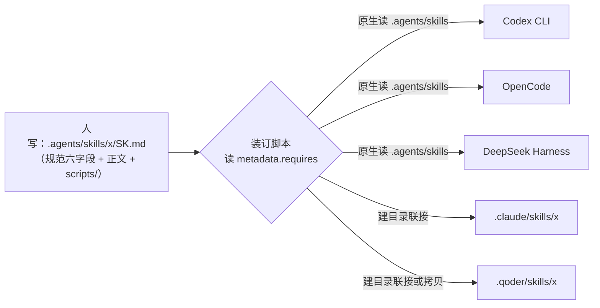

# 中间表示与后端：让一份 Skill 在五个 harness 里跑起来

> 设计文档 · 2026-10-26 · 状态：装订层已实施（见 §九）
> 目标 harness 范围：Qoder、OpenCode、Codex CLI、Claude Code、DeepSeek Harness (dsh)
> **本文重点已被作者否决**：格式与装订不是主要问题，它降级为一次性实现；真正要解的是 skill 本身的设计，判据与逐条债务见 [01-技能债务清单.md](./01-技能债务清单.md)。
> 实施之后**留下的决策**（选了哪条路、否决了哪些备选、代价是什么）已提炼到 [docs/decisions/0001-agent-skill-canonical-directory.md](../../docs/decisions/0001-agent-skill-canonical-directory.md)。本文是过程记录，那份是决策记录——以后要改 `.agents/skills/` 的约定，以那份为准。

## 一、结论先行

Skill 生态在 2025-12 已经统一到同一个物理形态：一个目录 + 一份带 YAML frontmatter 的 `SKILL.md`，规范托管在 [agentskills.io](https://agentskills.io/specification)。所以"格式"这一层其实不需要设计了。

真正没统一的是三件事，而它们性质完全不同：**在哪被发现**（装订）、**用什么预算被触发**（触发）、**能不能真跑起来**（能力）。手工维护多份拷贝的方案之所以必然漂移，是因为它把这四层当成一层在抄。~~你仓库里已经出现了：`.qoder/skills/` 与 `.opencode/skills/` 的 14 个 skill 里，`capstone-thinking-partner` 两份内容已经不同。~~ **【2026-10-26 更正：此断言为假。`.qoder/skills` 自 2026-09-24 起就是指向前者的符号链接，一直是同一棵树；那条 DIFF 是我的目录级比对方法的假阳性。详见 01 §一 更正一。原理仍成立——多份可独立编辑的拷贝必然漂移——只是本仓库此前并没有踩这个坑。】**

设计思路借编译器的形状：**写一次中间表示（IR），为每个目标生成一份后端（装订层）**，而不是给每个 target 手写一遍源码。可移植性的判据是一条下限，不是平均值——

> 一个 skill 的可移植性 = 它四个层里**最不可移植那一层**的可移植性。

四层分别落在：

| 层 | 内容 | 可移植性 | 应对方式 |
|---|---|---|---|
| 装订层 | 目录位置、发现顺序、命名冲突规则 | 无（每个 harness 自己的路径约定） | **生成**，绝不手写、绝不进 git |
| 触发层 | `name` + `description`，以及它们被注入的 token 预算 | 有最严公共分母 | 按公共分母**约束写法** |
| 指令层 | `SKILL.md` 正文 Markdown | 完全可移植 | 唯一真正的资产，人写 |
| 能力层 | `scripts/` 执行、工具名、权限模型 | 半可移植（能跑 ≠ 认得同名工具） | **能力称谓 + 显式声明**，装订层校验 |



一个关键事实让这个方案很轻：**五个里有三个原生读 `.agents/skills/`**（Codex、OpenCode、dsh）。只有 Claude Code 和 Qoder 需要一个链接动作。所以"通用版"的实际工作量是：**一个 canonical 目录 + 两条链接规则 + 一份作者规范**。

## 二、现状矩阵（仅列范围内五个，字段以官方文档为准）

| | Qoder | OpenCode | Codex CLI | Claude Code | DeepSeek Harness |
|---|---|---|---|---|---|
| 项目级路径 | `.qoder/skills/` | `.opencode/skills/`（复数）**且** `.agents/skills/`、`.claude/skills/` | `.agents/skills/`（从 cwd 向上扫到仓库根） | `.claude/skills/`（支持父目录/嵌套子目录） | `.agents/skills/`、`.dsh/` 下 |
| 用户级路径 | `~/.qoder-cn/skills/`（CN 版） | `~/.config/opencode/skills/`，也读 `~/.claude/skills/`、`~/.agents/skills/` | `~/.agents/skills/`、`~/.codex/skills` | `~/.claude/skills/` | UNVERIFIED |
| 读 `.agents/skills/` | **不读**（文档只见 `.qoder/skills`） | 读 | 读（这是它的主路径） | UNVERIFIED（文档只写 `.claude/skills`） | 读 |
| 解析的 frontmatter | `name`/`description`，其余 UNVERIFIED | 规范六字段，未知字段忽略 | **仅** `name`/`description`/`metadata.short-description`；`license`/`compatibility`/`allowed-tools` 不解析 | 一长串私有字段：`when_to_use`、`paths`、`allowed-tools`、`disallowed-tools`、`disable-model-invocation`、`user-invocable`、`model`、`effort`、`context`、`agent`、`hooks`、`shell`、`argument-hint` | 至少 `name`/`description` |
| 执行 `scripts/` | 支持 | 只读，由 agent 自己用 shell 跑 | 执行 | 执行（`` !`cmd` `` 内联也会执行，可关） | UNVERIFIED |
| 调用方式 | 自动 + `/name` | 模型经 `skill` 工具选中，**无斜杠接线** | 自动 + `$name` + `/skills` 选择器 | 自动 + `/name` | 自动 + 斜杠 |
| 截断/预算 | `description` ≤ 1024 | `description` 1–1024 | 技能目录预算 = **上下文窗口的 2%** | `description` + `when_to_use` 拼接后截断于 **1536 字符** | 采用渐进披露，预算数字 UNVERIFIED |
| 重名行为 | — | 跨根目录名必须唯一（**会直接报错**） | 两个都进选择器，**不合并** | 前缀区分；`synced`/`anthropic-skills` 是保留名 | — |
| 优先级 | 项目 > 用户（推测） | 多根，名唯一 | 仓库 > 用户 > 系统 | 企业 > 个人 > 项目 > 内置 | — |

来源：[agentskills.io 规范](https://agentskills.io/specification)、[Qoder Skills 文档](https://docs.qoder.com/zh/cli/Skills)、[OpenCode skills](https://opencode.ai/docs/skills)、[Codex Agent Skills](https://test.runoob.com/codex/codex-agent-skills.html)（二手，字段解析结论与 [Codex 源码解析器](https://github.com/openai/codex/blob/main/codex-rs/skills/src/parser.rs) 一致，标记为待一手复核）、[Claude Code Skills](https://code.claude.com/docs/en/skills)、[DeepSeek Harness 用户指南](https://dsh.hicyou.com/zh/docs/user-guide)。

两个额外发现值得记：

1. **OpenCode 项目级同时扫三个根，已一手核实**（[官方文档](https://opencode.ai/docs/skills)原文列出 `.opencode/skills/`、`.claude/skills/`、`.agents/skills/` 三个项目级位置及各自的全局等价物，且"walks up from your current working directory until it reaches the git worktree"）。跨根重名的后果我先前写成"会报错"，此处降级为 **UNVERIFIED**（文档只说冲突，具体行为需读源码或实测），但结论不变：**只能有一个根真的装着内容**。这条直接推翻了本文 §四 原计划里"给 Claude Code 也建联接"那一步——见 01 §三 P0-1。
2. **dsh 的发布日期两个来源不一致**（官网写 2026-08-13 发布，中文对比文写 2026-08-27 开发者预览）。它的项目级技能走 `.agents/`，这点各方一致；要打包成分发的插件时走 `dsh.bundle` / Cordis 市场，那是另一条路，本设计不覆盖。

## 三、通用格式的硬约束（IR 契约）

这七条是"写一次到处跑"的全部代价。违反其中任一条，就会退化成 N 份拷贝。

**R1 唯一真源。** 真实文件只存在于 `.agents/skills/<name>/`。其余 harness 目录一律是链接或生成物，且**加进 `.gitignore` 不提交**。理由不是洁癖，是 R1 的可检验形式：任何一份能被独立编辑的拷贝，半年后必然和正本不同。

**R2 frontmatter 只用规范六字段。** 顶层只允许 `name`、`description`、`license`、`compatibility`、`metadata`、`allowed-tools`。harness 私有字段（如 Claude 的 `paths`、`disable-model-invocation`）一律挂在 `metadata:` 下面。两个原因：Codex 根本不解析规范外顶层键（写了等于没写）；而把 skill 打包上 claude.ai 或走 Skills API 时，规范外的顶层键是**硬报错**，本地却能跑——这是最坏的一类不一致：只在分发那天炸。

**R3 触发句前置，正文不复述触发条件。** `description` 的模板固定为：

```
<一句话说明做什么>. 触发：<用户会说的动词/短语，3-6 个>. 不用于：<最容易误选的那个相邻场景> → <相邻 skill 名>.
```

控制在 **500 字符内**，最长不超 1024。因为 Codex 按上下文 2% 截目录、Claude 在 1536 字符截 `description + when_to_use`，两者都是从尾部截——把触发关键词放尾部等于没有。同时"何时不用"必须进 `description` 而不是只写在正文：OpenCode 之类的 harness 只把 name+description 注入目录，正文要等被选中后才加载，那时误选已经发生。你现有的 `digest-article` 就是这个形状（描述里带了"触发：总结/读一下/消化…"），把它定为规范即可。

**R4 工具用能力称谓，绑定关系显式声明。** 正文里写"抓取正文：优先直接取网页内容；取不到时用可用的浏览器渲染能力"，不要写 `browser-use` 的 `take_snapshot` 这种具名调用。需要硬绑某个工具或某个 harness 独占能力时，声明出来，让装订层能拒绝或降级，而不是让读者在换一个 harness 时靠猜发现 skill 哑了：

```yaml
metadata:
  requires: [web-fetch, web-browser, python]
```

反向也成立：**具名文件路径可以写**（`notes/reading/`、`content/blog/`），那是仓库约定，跨 harness 稳定。

**R5 引用只走一层，路径相对 skill 根目录。** 规范明确要求相对路径 + 避免深链条跳转；OpenCode 和 Codex 的实际加载行为也是这样。一个 skill 里的 `references/*.md` 只由 `SKILL.md` 直接引用，不要 references 之间互相引用。附带一个真实教训：`addyosmani/agent-skills` 的 README 自己就警告——**只装单个 skill 会缺共享的 `references/`**。跨 skill 共享资料是这套格式最容易埋的坑，正确做法是把共享部分复制进各自目录，或在 `metadata` 里声明依赖让装订层成组装。

**R6 脚本窄入口、宽出口、无状态假设。** `scripts/` 里只依赖标准库或 `metadata.requires` 已声明的依赖；入口是显式 `python scripts/x.py --in ... --out ...`，**不要用 Claude 的 `` !`cmd` `` 内联语法**（只有 Claude Code 会执行内联）。输出走 stdout 的结构化文本，别让脚本猜路径。这条在你仓库里还叠了一个红线：脚本读写中文一律 Python `encoding='utf-8'` 或显式 `-Encoding UTF8`，禁用 PowerShell 默认编码。

**R7 每个 skill 自带 Verification 段。** 结尾写"什么算成功"——可观测、harness 无关的结果（文件落在哪、条数对得上、构建通过）。这条是社区共识里最有价值的一句：真正管用的团队 skill，往往不是知识最多的那个，而是能让 agent 在关键节点**停下来、验证、留下证据**的那个。

**边界：哪些内容不该做成 skill。** skill 适合固化"动作明确、结果可验证"的部分——构建/测试命令、修改范围、命名规范、review 维度、发布前检查。业务取舍、风险例外、不可逆决策不该塞进去。另外，长期生效的项目规则（如 `AGENTS.md` 里那些链接规则）属于 always-on 层，不属于按需加载的 skill 层；两个机制混用会导致"有时候记得有时候不记得"。

## 四、装订层设计

把差异全部压到这一层，机械生成，人不参与。

| 目标 | 动作 | 依据 |
|---|---|---|
| Codex CLI | 无需动作，`.agents/skills/` 原生 | 文档主路径 |
| OpenCode | 无需动作，原生；~~删掉 `.opencode/skills/` 现有拷贝~~ **已执行**：`git mv .opencode/skills .agents/skills`，历史保留 | 原生 + 只能有一个内容根 |
| DeepSeek Harness | 无需动作（`.agents/`），待一手复核脚本执行行为 | 一致来源均指 `.agents/` |
| Claude Code | ~~`.claude/skills/<name>` → 逐个建目录链接~~ **暂缓**：`.claude/skills` 会被 OpenCode 当第三个内容根扫到，与 `.agents/skills` 重名冲突。三条待选见 01 §三 P0-1 | Claude Code 文档确认 follow symlinks，但代价转嫁给了 OpenCode |
| Qoder | **已执行**：整个 `.qoder/skills` 一个目录联接指向 `.agents/skills`（不是逐个 skill） | 实证：原设置本就是 `Qoder → .opencode/skills` 的符号链接且一直在用，故 Qoder 跟随重解析点 |

Windows 上的实现选择，是三条路线的分水岭：真正的符号链接需要开发者模式或管理员权限，**目录联接（junction，`mklink /J`）不需要**，而且对只有目录的 skill 完全够用。这条事实决定了自建路线在你机器上是零摩擦的。**已实测**：本机 `python os.symlink()` 建目录链接返回 WinError 1314（客户端没有所需特权），脚本自动降级为 junction 成功；Node `lstat` 对 junction 的返回值与旧符号链接一致（`isSymbolicLink=true`），故对 harness 的扫描器而言二者不可区分。

三条路线的取舍：

| | 自建薄脚本 | `npx skills`（Vercel Labs） | rulesync |
|---|---|---|---|
| 机制 | 读 `.agents/skills/`，对声明需要的 target 建 junction | 75+ agent 预设（含 `qoder`/`qoder-cn`/`opencode`），**默认 symlink**，`--copy` 可选，写 `skills-lock.json` | `.rulesync/` 为正本，**materialize 拷贝** 到 70+ target，做真格式转换 |
| 是否转换 frontmatter | 会（我们自己写降级规则） | **不转**，共享同一份 `SKILL.md`，私有字段按 harness 自行忽略 | 转的是 rules/mcp/hooks，**skill 本体不转** |
| Windows | junction 无权限摩擦 | symlink 默认，需开发者模式；失败需 `--copy` | 拷贝，无摩擦 |
| git | 链接不进 git，脚本进；一行 `bind` 命令重建 | lock 文件可提交，可复现 | 拷贝可提交，但 14 个 skill × N 个 target 的文件进 git，diff 噪音大 |
| 成本与风险 | 一个脚本 + 自己维护它对路径的假设 | 依赖外部项目节奏；不解决 R2/R4 的作者约束 | 最重，且引入构建步骤混进 Hugo 流程 |

推荐**自建薄脚本**，理由是它只解决你实际的问题（五个 harness、一个仓库、junction 够用），而 `npx skills` 的价值在"从 GitHub 装别人的 skill"——那是另一个需求，等你真要拉外部技能包时再引入也不冲突：它的 lock 与我们的 canonical 目录可以并存。

脚本职责就三件，按 R 编号校验、 loud 失败：

1. 扫 `.agents/skills/*/SKILL.md`，校验顶层键 ⊆ 规范六字段（违反 R2 → 报错退出，不静默忽略）、`name` 与目录名一致、`description` 长度与触发句位置（R3）。
2. 按 `metadata.requires` 对照当前 target 的能力表；不满足就打印哪个 skill 会哑，而不是生成后让你踩。
3. 建/删链接，幂等；`.claude/skills/`、`.qoder/skills/` 只由它写，人不碰。

## 五、不适用 SKILL.md 的 harness：留一个降级后端

Aider（`CONVENTIONS.md`，靠 `--read` 注入）、Continue（`rules/` + `.prompt.md`）这类不认 skill 目录的工具，不在当前范围，但 IR 让它们的成本是**一个输出格式**而不是重写：把 `description` + 正文内联成一段扁平 rule 文本，丢掉 `scripts/` 并在头部注明"脚本部分需手动执行"。设计上只要保证 R3（触发句进 description）不破坏，这个后端就是纯机械的。这一节现在不实现，只作为约束存在的理由。

## 六、迁移清单（2026-10-26 拆成两阶段）

作者拍定路线：**先可用，再优化**。因此本文 §三 的 R2/R3/R4 改写全部推到第二阶段，本轮只做装订。技能总数也不是 14 而是 **19 份 SKILL.md**（14 个顶层目录，其中 `capstone-thinking-partner/` 内嵌 6 个）。

第一阶段（已完成，见 §九）：

1. ~~把 14 个 skill 从 `.qoder/skills/` 移入 `.agents/skills/`~~ **实际执行方向相反且更简单**：真实内容一直在 `.opencode/skills/`（git 跟踪，46 个文件），`.qoder/skills` 只是链接。故 `git mv .opencode/skills .agents/skills`，历史保留为 48 个 rename。
2. ~~逐个补 R2~~ **本轮免做**：校验脚本实测 19 份文件**没有一个规范外顶层键**，R2 已经是既成事实。
3. ~~处理 R5：确认无跨 skill 引用；清 `__pycache__`~~ 脚本随目录整体搬迁完成；`__pycache__` 由 bind 的 copy 兜底路径忽略。
4. ~~冲突验证：确认 OpenCode 从 `.agents/skills/` 列出全部技能~~ 改为**读官方文档原文核实**（三根扫描已确认），实测留待下次在 OpenCode 里跑一次。
5. 写 `scripts/bind_skills.py`：`bind` / `check` / `unbind`，校验分致命与警告两级（致命才拒绝装订，避免"一个非致命问题导致整机没技能"）。~~产出 `.claude/skills/`~~ **取消**，理由见 §四 与 01 §三 P0-1。
6. 更新 `AGENTS.md`（新增"Skill 的唯一真源"一节 + 把 `.agents/skills/`、`scripts/` 写进授权例外）。`.gitignore` 无需改动——`.qoder/skills` 早在忽略列表里。

第二阶段（未开始，条目与优先级在 [01-技能债务清单.md](./01-技能债务清单.md)）：R3 重写描述、补 11 个缺失的"何时不用"、禁令改正面配方、结构补齐、最后才建判据回路。

## 七、验收：每个 harness 三个观测点

不能只看"文件在不在"。每个 harness 逐个确认，并把结果记回本文：

| 观测点 | 怎么看 | 已知风险 |
|---|---|---|
| 出现 | `/skills` 列表（Claude/Codex/Qwen）或 `@`/`/` 面板；OpenCode 直接问"你有哪些 skill 可用" | ~~Qoder 可能不跟随链接~~ 已验证跟随（探针双向）。**这一栏的观测方法就是那个探针**：临时建一个 `junction-probe/` 技能，看它是否出现在清单里，验完删掉 |
| 触发 | 只说 3 个触发关键词，不提 skill 名，看是否自动选中 | description 尾部被截（R3）；正文写了"何时用"但没进 description |
| 执行 | 跑一个带脚本的（`rename-blog-filenames`），确认脚本被真执行且中文文件未被破坏 | OpenCode 只读不执行（agent 用 shell 跑）；dsh 未知（R6）；PowerShell 编码红线 |

## 八、未决与风险

需要一手复核的三处，都不影响架构、只影响装订细节：~~Qoder 是否跟随符号链接~~ **已实证：跟随**（原设置就是链接，一直可用；联接侧也在 2026-10-26 用一次性探针技能做了双向验证——放入 `junction-probe` 后下一轮出现在可用技能清单里，删除后下一轮消失，顺带证明 Qoder 每轮重扫、新技能无需重启）；以及它除 `name`/`description` 外还解析什么；Claude Code 是否读 `.agents/skills/`（官方文档未提，若读则可省掉一条链接规则——这条现在升级为 P0-1 的决策前提）；Codex 只解析三字段的结论目前来自二手文档 + 源码路径推断；dsh 是否执行 `scripts/`。

两个真实风险：**渐进披露不是免费的**——Claude Code 一旦选中 skill，正文会留在上下文里，多个 skill 叠加后长正文比长描述更贵，所以正文要短、细节放 `references/`；**跨 skill 共享资料是反模式**，别为了 DRY 做 `references/common.md` 被多个 skill 引用，R5 会静默失效。

最后一条是判断而不是事实：这套东西的收益不在"省切换麻烦"，而在**它让 skill 变成可版本化的资产**。你写的第一版 `digest-article` 里那套"困难↔方案咬合"的读法，本来只活在你的肌肉记忆里；固化成一份符合规范、五个 harness 都能加载、且能被脚本校验的目录之后，它才第一次成为可审计、可回滚、可迁移的东西。这是"AI 领域的 Dockerfile"这个说法的实际含义。

## 九、实施记录（2026-10-26）

第一阶段的实际改动，以及和本文原设计的差异。

| 动作 | 结果 |
|---|---|
| `git mv .opencode/skills .agents/skills` | 19 份 `SKILL.md` + 各自 `scripts/` 进入 git 跟踪的正本，历史保留 |
| `python scripts/bind_skills.py bind` | `symlink` 尝试失败（WinError 1314，非提权）→ 自动降级 `junction`；`.qoder/skills -> .agents/skills` |
| `python scripts/bind_skills.py check` | `canonical OK: 19 skill(s)` + `binding OK: link -> .agents/skills`，退出码 0 |
| 往返测试 | `unbind` → `bind` → `check` 全绿；`bind` 重复执行输出 `already bound`，幂等 |
| 探针验证（P0-2） | 新建 `.agents/skills/junction-probe/` → 下一轮出现在可用技能清单；删除 → 下一轮消失。**双向都观测到**，联接可读，且 harness 每轮重扫 |
| `AGENTS.md` | 新增"Skill 的唯一真源：`.agents/skills/`"一节，含禁止手建 `.claude/skills` 与 `rm -rf` 穿越联接的删除警告；授权例外补进 Site structure |
| `.opencode/` 整个目录 | 已删除（61MB `@opencode-ai/plugin` bootstrap 产物，git 从未跟踪）。唯一被跟踪的 `.opencode/README.md` 先 `git mv` 到 `.agents/skills/README.md` 再改写为 harness 中立的技能索引 |
| `.gitignore` | ~~未改动~~ 删掉了第 1 行 `.opencode/node_modules`（目录已不存在，且第 7 行 `node_modules/` 本就覆盖它），给 `.qoder/skills` 加了"生成物，不是内容"的注释 |

git 侧最终计数：46 个 rename（技能树）+ 1 个 rename-and-modify（README）+ `AGENTS.md`/`.gitignore` 修改 + 新增未跟踪的 `scripts/` 与 `notes/skills-portability/`。

与原设计不同的两处，都是被事实推着改的：**正本从 `.agents/` 接收的对象是 `.opencode/` 而不是 `.qoder/`**（因为前者才是 git 里的那一份）；**Claude Code 的链接动作取消**（因为 OpenCode 扫三根，多一个内容根就是重名源）。

顺带产生的一个副产品判断：`bind` 之前必须先 `validate`，而且校验要分致命与警告。原因是装订动作会先删除旧绑定再建新绑定——如果校验里有假阳性（本轮我确实差点写进一个：`metadata:` 空值会误清 description 累加器），拒绝装订的结果是"技能直接不可用"，比任何格式瑕疵都严重。所以 `bind` 现在只对重名、`name` 与目录不符、无 frontmatter 这类真正会让 harness 挑不出唯一答案的问题硬失败，其余降级为打印警告。

未验证项（诚实记录）：Qoder 侧的发现能力已经观测到（上面那行探针），但**没有任何一个 harness 真跑过一次"只说触发词、不提技能名"的自动触发**，带脚本的技能也没在新路径下执行过一次。OpenCode / Codex / dsh 三侧连"能不能列出 19 条"都还是读文档得出的结论，没有实测。所以本文的实施状态准确说法是：**装订层已完成并在 Qoder 上验证，其余 harness 与全部触发行为未观测**——后者属于 01 清单里的判据回路，不在第一阶段。
